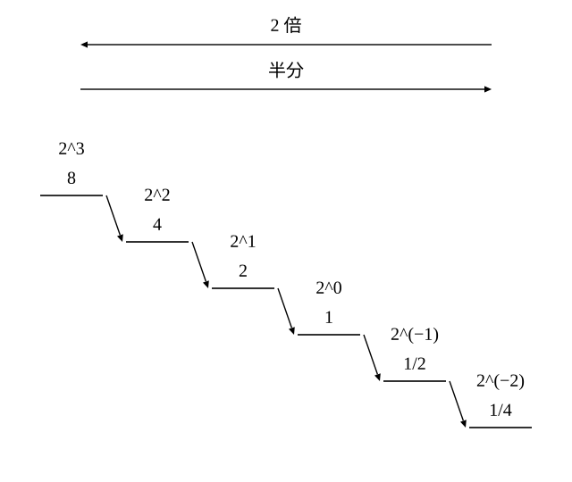

# L01 指数を 0 と負の整数へ広げる——法則が成り立つように決める

- unit_id: hs-math-ii-exponential-logarithm
- 位置づけ: 単元第1レッスン（1.5時間）。数学Ⅱ「指数関数・対数関数」の入口。この単元では、指数の意味を整数・有理数・実数へ広げて指数関数を作り、その上で対数と対数関数を学ぶ。最初の一歩として、中学で使ってきた正の整数の指数の計算の決まりを「指数法則」として一般の形に書き、その法則がそのまま成り立つように 0 と負の整数の指数の意味を決める。この「法則が成り立つように決める」考え方は、L02 で分数の指数へ広げるときにそのまま使う。
- distribution_status: published_draft
- license: CC-BY-4.0
- verify_required: 例題数値・記述は監修者検証必須。
- 主概念: ①前提診断（中1 累乗・中2 単項式の乗除）と語（累乗・指数・底）の再掲、正の整数の指数法則を一般形で確かめる ②「半分にしていく」論法で a^0=1・a^(−n)=1/a^n を決め、整数の指数で法則が成り立つことを確かめて計算する

---

## 0. 本編の前に——2つの前提を確かめる

このレッスンは、中1「正の数と負の数」で学んだ累乗の読み方と、中2「式の計算」で学んだ同じ文字の累乗どうしのかけ算・わり算の上に立つ。先に2問だけ確かめておこう（この節だけは、中学の教科書と同じように指数を右肩に小さく書く）。

**確認A** 次の値を求めよ。
(1) (−2)⁴  (2) −2⁴

**確認B** 次の計算をせよ。
(1) x³×x⁴  (2) x⁶÷x²（x≠0）

（ここから下は答え。先に自分の答えを紙に書いてから読もう。）

確認A: (1) は −2 を 4 個かけ合わせた数で、(−2)×(−2)×(−2)×(−2)=**16**。(2) は 2⁴ に負の符号を付けた数で、−(2×2×2×2)=**−16**。
確認B: (1) x を 3 個かけた物と 4 個かけた物をかけるから、x は全部で 7 個で x³×x⁴=**x⁷**。(2) x を 6 個かけた物を x を 2 個かけた物で割ると、約分で 2 個が消えて 4 個残り、x⁶÷x²=**x⁴**。

:::guide
**指数はすぐ左だけに働く——中1の約束の再掲と、手が止まったときに戻る場所**

確認Aで (−2)⁴ と −2⁴ を同じ値だと考えたなら、中1で学んだ「累乗の底にあたる部分を丸で囲んでから計算する」手順を思い出そう。指数は、そのすぐ左にある物だけに働く。(−2)⁴ では括弧で囲まれた −2 全体が底で、−2⁴ では 2 だけが底であり、負の符号は累乗の外にある。この読み分けは、このレッスンで指数が負の数になっても変わらない。確認Aで手が止まったなら中1「正の数と負の数」の累乗のレッスンへ、確認Bで指数どうしをかけてしまったなら中2「式の計算」の単項式の乗法と除法のレッスンへ戻る。確認Bの「個数を数える」考え方は、次の節でそのまま指数法則になる。
:::

## 1. 記法の約束と指数法則——かけ合わせた個数を数える

このレッスンの終わりに、次の3つができるようになることを目指す。

1. 0 と負の整数の指数を「正の整数のときの指数法則がそのまま成り立つように決めた」と、2 の累乗の表を使って説明できる。
2. 整数の指数について、積・商・累乗の指数法則で計算できる。
3. (−a)^n と −a^n・a^0・a^(−n) の意味を言い分けられる。

教科書やノートでは指数を右肩に小さく書く。この教材では、2 の 3 乗を 2^3 のように、a の n 乗を **a^n** と書く。指数が負の数や式のときは括弧で囲み、2 の −3 乗は 2^(−3)、a の m＋n 乗は a^(m＋n) と書く。括弧の位置がそのまま「どこまでが指数か」を表す。

語を確かめておく。a を n 個かけ合わせた数 a×a×…×a（n 個）を a の n 乗といい、a^n と書く。a の 2 乗、3 乗、…をまとめて a の**累乗**といい、右肩の n を**指数**という（累乗・指数は中1の語である）。かけ合わせる数 a を、この単元では a^n の**底**（てい）と呼ぶ。たとえば 2^3=2×2×2=8 で、底は 2、指数は 3 である。

中学では、指数は 1 以上の整数（正の整数）だった。このとき、次の3つの計算の決まりが成り立つ。m、n は正の整数で、a はどんな数でもよい（ただし商では 0 で割ることになるので a≠0）。

- 積: a^m×a^n=a^(m＋n)
- 商: a^m÷a^n=a^(m−n)（m>n のとき、a≠0）
- 累乗の累乗: (a^m)^n=a^(mn)

理由はどれも「かけ合わせた個数を数える」ことで分かる。a^m×a^n は a を m 個かけた物と n 個かけた物をかけるから、a を全部で m＋n 個かけた物である。a^m÷a^n は、m>n なら約分で a が n 個消えて m−n 個残る。(a^m)^n は a^m（a が m 個）を n 個かけるから、a は mn 個である。この3つを**指数法則**という。数で確かめると、2^3×2^2=8×4=32=2^5、2^5÷2^2=32÷4=8=2^3、(2^2)^3=4^3=64=2^6 である。

同じ数え方で、(ab)^n=a^n b^n も分かる（ab を n 個かけると、a も b も n 個ずつ現れる。(2×3)^2=36=2^2×3^2 である）。この教材では、指数法則は上の3本を指し、(ab)^n はこの数え方で済ませる。

確認Aで見た読み分けを、この教材の書き方で書き直しておく。まとめると **指数はすぐ左だけに働く** という1行になる。(−2)^4 は底が −2 で (−2)^4=16、−2^4 は底が 2 で −2^4=−(2^4)=−16 である。

商の法則に「m>n のとき」と条件が付いていることに注意しよう。m=n なら指数は 0、m<n なら指数は負の数になり、正の整数の指数しか知らない今は、その意味がまだ無い。次の節で、この意味を決める。

## 2. 0 と負の整数の指数を決める——2 の累乗の階段

2 の累乗を、指数の大きい方から並べてみる。2^3=8、2^2=4、2^1=2。指数が 1 減るごとに、値は半分になる（8÷2=4、4÷2=2）。これは商の法則 2^n÷2^1=2^(n−1) そのものである。

この「指数が 1 減ると半分」が、指数 0 や負の整数でもそのまま続くように値を決めてみる。2^0 は 2^1 の半分で 2÷2=1。2^(−1) は 2^0 の半分で 1÷2=1/2。2^(−2) は 2^(−1) の半分で (1/2)÷2=1/4。表にすると次のようになる。

| 指数 n | 3 | 2 | 1 | 0 | −1 | −2 |
|---|---|---|---|---|---|---|
| 2^n の値 | 8 | 4 | 2 | 1 | 1/2 | 1/4 |

左へ 1 つ進むと 2 倍、右へ 1 つ進むと半分。この階段を右へ下りていくと、2^0=1 と 2^(−1)=1/2 に「着地する」。2^0 や 2^(−1) の値は、何かから計算して求めた物ではなく、法則がここで止まらないように決めた物である（この階段の考え方は、高等学校学習指導要領解説 数学編（平成30年告示）の総説にある例による）。

決めた値が本当に法則と合っているか、2つの問いで確かめよう。

2^0 を 0 と決めると、何が困るか。積の法則が指数 0 でも成り立つなら、2^0×2^3=2^(0＋3)=2^3=8 のはずである。ところが 2^0=0 なら左辺は 0×8=0 となり、8 にならない。法則が指数 0 で壊れてしまう。2^0=1 なら 1×8=8 で、法則はそのまま続く。

2^(−1) はなぜ −2 ではなく 1/2 なのか。積の法則が指数 −1 でも成り立つなら、2^(−1)×2^1=2^(−1＋1)=2^0=1 である。つまり 2^(−1) は「2 をかけると 1 になる数」で、これは 1/2 しかない。−2 では (−2)×2=−4 となり、1 にならない。負の指数は、値が負になることを表すのではなく、2 で「割る回数」を表している。

底が 2 でなくても同じことができる。a を 0 でない数、n を正の整数として、次のように決める。

- **a^0=1**（a≠0）
- **a^(−n)=1/a^n**（a≠0）

a≠0 という条件が付くのは、a^(−n)=1/a^n の右辺で a^n で割るからである。0 で割ることはできないので、0^(−1) のような値は定めない。0^0 も、この教材では定めない。「0 乗は 1」と無条件に言わず「0 でない数の 0 乗は 1」と言う。

:::guide
**なぜ a^0=1 と決めるのか——決めないと法則がそこで止まる**

a^0=1 は「a を 0 個かける」という言い方では説明できない。0 個かけ合わせる、という操作が無いからである。そこで考え方を変える。正の整数の指数で成り立っていた指数法則が、指数 0 でもそのまま使えるようにしたい。積の法則 a^0×a^n=a^(0＋n)=a^n が成り立つには、a^0 は a^n にかけても a^n を変えない数、つまり 1 でなければならない。「0 乗は 0」とすると 0×a^n=0 となって法則が壊れる。a^0=1 は、法則がそこで止まらないように選ばれた値である。この「法則が成り立つように決める」考え方は、次のレッスンで分数の指数を決めるときにも同じ形で使う。
:::

:::guide
**負の指数は『割る回数』を表す**

2^(−1)=1/2、2^(−2)=1/4 はどちらも正の数である。指数が負になっても、値が負になるわけではない。正の指数 n が「2 を n 回かける」ことを表すなら、負の指数 −n は「2 で n 回割る」ことを表す。1 を 2 で 1 回割ると 1/2、2 回割ると 1/4 になる。階段の表で右へ 1 つ進むたびに半分になったのは、この「割る」が 1 回ずつ増えていたからである。a^(−n)=1/a^n という式は、この「a で n 回割る」を 1 つの分数で書いた物にすぎない。負の指数を見たら、符号を付けるのではなく分母へ回す。
:::

## 3. 整数の指数で法則を確かめる——計算の型

決めた値を使うと、指数法則は整数の指数の全体で成り立つ。m、n を整数（0 や負の整数でもよい）、a≠0 として、

- a^m×a^n=a^(m＋n)
- a^m÷a^n=a^(m−n)
- (a^m)^n=a^(mn)

正の整数の指数では、積と累乗の法則で a はどんな数でもよかったが（商は 0 で割れないので a≠0 だった）、整数の指数では3本とも a≠0 の条件が付く（0 と負の指数で a^n で割るからである）。数値で確かめよう。2^3×2^(−5)=2^(3−5)=2^(−2)=1/4 である。左辺を直接計算すると 8×(1/32)=8/32=1/4 で、確かに一致する。

商の法則から「m>n のとき」の条件が消えたことに注目しよう。2^4÷2^6 は、正の整数の指数しか無かったときは法則の外だった。今は 2^4÷2^6=2^(4−6)=2^(−2)=1/4 と計算でき、直接計算の 16÷64=1/4 と一致する。

a^m÷a^n=a^(m−n) が m<n でも使えるようになったのはなぜか。負の指数の意味を a^(−n)=1/a^n と決めたからである。2^4÷2^6 を約分すると分母に 2 が 2 個残って 1/2^2 になるが、これはちょうど 2^(−2) の意味そのものである。指数の大小を気にせず「指数を引く」だけでよくなった。

**例題1** 3^(−2) の値を求めよ。

3^(−2)=1/3^2=**1/9**

検算: 決めた値を法則へ戻す。3^(−2)×3^2=(1/9)×9=1 で、a^(−n)×a^n=a^0=1 が成り立っている。

**例題2** (−2)^(−3) の値を求めよ。

底は括弧で囲まれた −2 全体である。(−2)^(−3)=1/(−2)^3=1/(−8)=**−1/8**

検算: (−2)^(−3)×(−2)^3=(−1/8)×(−8)=1 で、法則へ戻せている。なお −2^(−2) のように括弧が無ければ底は 2 で、−2^(−2)=−(1/2^2)=−1/4 である。(−2)^(−2)=1/(−2)^2=1/4 と比べて、符号だけが違う。

**例題3** 2^0×2^5 の値を求めよ。

2^0×2^5=2^(0＋5)=2^5=**32**

検算: 2^0=1 だから、直接計算しても 1×32=32 で一致する。

**例題4** (2^3)^(−2) の値を求めよ。

(2^3)^(−2)=2^(3×(−2))=2^(−6)=1/2^6=**1/64**

検算: 2^3=8 だから、直接計算すると 8^(−2)=1/8^2=1/64 で一致する。

答えを出したら、次の2つで自分の答えを確かめる。このレッスンの自己検査の型である。

1. 負の指数の答えは、決めた値を法則へ戻す。a^(−n) の値に a^n をかけて 1 になるか。
2. 階段の表を作ったときは、隣どうしが 2 倍（底が a なら a 倍）の関係になっているか。

:::guide
**ここで決めたことの格——証明した物ではなく、決めた物である**

このレッスンで新しく覚える式は a^0=1 と a^(−n)=1/a^n の2つだが、この2つは何かから証明した物ではない。0 や負の整数や分数の指数は、正の整数のときの指数法則がそのまま成り立つように決めたものである。言い換えると「指数法則の方が先にあり、それを守るように値を選んだ」のであって「値が先にあり、法則はその結果」ではない。だから、決めた値が正しいかどうかは、法則へ戻して確かめる（例題1の検算）ことで分かる。分数の指数については、次のレッスンで同じ考え方を使って決める。高等学校学習指導要領解説 数学編（平成30年告示）も、拡張した指数の定義を形式的に説明するのではなく、指数法則が同様に成り立つように定義されることを調べる活動を通して理解することを求めている。
:::

## 4. 練習

**問1** 次の値を求めよ。
(1) 5^(−2)  (2) (−3)^(−3)  (3) 7^0  (4) (−3)^(−2)  (5) −3^(−2)

**問2** 指数法則を使って計算せよ。a は 0 でない数とする。
(1) 3^4×3^(−6)  (2) 5^2÷5^5  (3) (3^(−2))^2  (4) a^3÷a^(−2)  (5) a^5×a^(−5)

**問3** 次の問いに答えよ。
(1) 10^(−3) を小数で表せ。
(2) 0.01 を 10 の累乗の形で表せ。

**問4** a を 0 でない数とする。a^0 の値を 1 と決めるのはなぜか。「指数法則」の語を使って2文で説明せよ。

**問5** a を 0 でない数、n を正の整数とする。積の法則 a^m×a^n=a^(m＋n) が m=−n のときにも成り立つとすると、a^(−n)×a^n=a^0=1 である。このことから a^(−n)=1/a^n を導け。

:::stretch
**S1** 中学では、大きな数を 1 以上 10 未満の数と 10 の累乗の積で表した（たとえば 3500=3.5×10^3）。負の指数を使うと、小さな数も同じ形で表せる。
(1) 0.00035 を a×10^n（1≦a<10、n は整数）の形で表せ。
(2) (1) で表した数に 2×10^6 をかけた値を、指数法則を使って求めよ。
:::

対応解答: answer_key_L01.md

<!-- gen_nav:nav:start（自動生成・手編集しない） -->

---

[単元の目次](README.md)｜[解答](answer_key_L01.md)｜[次のレッスン →](lesson_02.md)

<!-- gen_nav:nav:end -->
