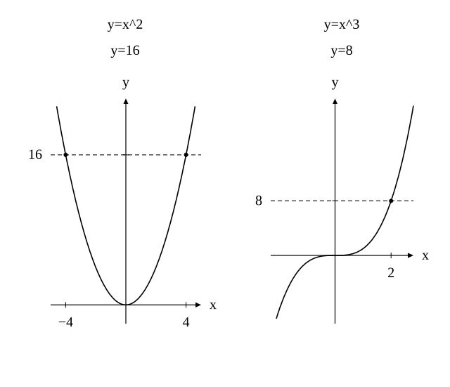
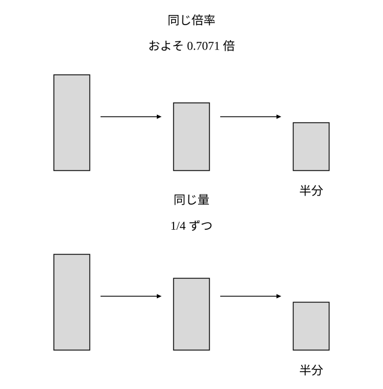

# L02 累乗根と有理数の指数——1 回分の倍率を表す

- unit_id: hs-math-ii-exponential-logarithm
- 位置づけ: 単元第2レッスン（2時間）。L01 で整数まで広げた指数を、分数（有理数）まで広げる。先に「n 乗すると a になる数」として累乗根を置き、次に「2 回かけて a 倍になる 1 回分の倍率」から分数の指数の意味を決める。決め方は L01 と同じで、指数法則がそのまま成り立つように決める。ここで身に付ける「n 回で p 倍なら 1 回あたり p^(1/n) 倍」という読み方は、L03 の指数関数と L10 の活用で再び使う。
- distribution_status: published_draft
- license: CC-BY-4.0
- verify_required: 例題数値・記述は監修者検証必須。
- 主概念: ①前提診断（中3 平方根・数Ⅰ 根号の計算）→n 乗根の定義と正の数 a の n 乗根 ⁿ√a・値を挟んで見積もる ②「2回かけて a 倍になる1回分の倍率」から a^(1/n)=ⁿ√a・a^(m/n) を法則が成り立つように決める（a>0）・有理数の指数の計算

---

## 0. 本編の前に——2つの前提を確かめる

このレッスンは、中3「平方根」で学んだ平方根の意味と、数学Ⅰ「数と式」で学んだ根号の計算の上に立つ。先に2問だけ確かめておこう。

**確認A** 次の問いに答えよ。
(1) 9 の平方根を求めよ。  (2) √9 の値を求めよ。

**確認B** √2×√8 を計算せよ。

（ここから下は答え。先に自分の答えを紙に書いてから読もう。）

確認A: (1) 2 乗すると 9 になる数は 3 と −3 の 2 つあるから、9 の平方根は **3 と −3**（±3 と書く）。(2) 記号 √9 は、9 の平方根のうち正の方を表すから √9=**3**。「9 の平方根」と「√9」は同じではない。
確認B: 根号の中どうしをかけて √2×√8=√(2×8)=√16=**4**。4^2=16 だから、確かに 2 乗して 16 になる正の数である。

:::guide
**累乗根は √ の仲間——n 乗して確かめる・手が止まったときに戻る場所**

確認Aで「9 の平方根は 3」と答えたなら、中3で学んだ約束を思い出そう。2 乗すると 9 になる数は 3 と −3 の 2 つあり、記号 √ はそのうち正の方を表す。このレッスンで学ぶ n 乗根も、同じ型で理解できる。「2 乗すると a になる数」の 2 を n に変えて「n 乗すると a になる数」と言い直し、記号 ⁿ√a はやはり正の方を表す。値が正しいかどうかは、いつでも「正の数で、n 乗して a に戻るか」で確かめられる。確認Aで手が止まったなら中3「平方根」の平方根の意味を扱うレッスンへ、確認Bで根号の中をかけられなかったなら数学Ⅰ「数と式」の根号の計算のレッスンへ戻る。
:::

## 1. n 乗根——n 乗すると a になる数

このレッスンの終わりに、次の3つができるようになることを目指す。

1. 正の数 a の n 乗根を「n 乗すると a になる数」として定義を述べ、ⁿ√a の値を 2 つの数の間に挟んで見積もれる。
2. a^(1/n)=ⁿ√a・a^(m/n)=ⁿ√(a^m) を「法則が成り立つように決めた」と、倍率の例で説明できる。
3. 累乗根を有理数の指数に直して指数法則で計算し「n 回で p 倍」を 1 回分の倍率に翻訳できる。

中3の平方根は「2 乗すると a になる数」だった。この 2 を一般の n に変える。n を 2 以上の整数とするとき、n 乗すると a になる数を a の **n 乗根**という。2 乗根は平方根のことである。平方根、3 乗根、4 乗根、…をまとめて a の**累乗根**という。

数で見てみよう。3 乗すると 8 になる数は 2 である（2^3=8）。負の数を 3 乗すると負の数になるから、3 乗して 8 になる数は 2 だけである。4 乗すると 16 になる数は 2 と −2 の 2 つある（2^4=16 で (−2)^4=16）。平方根のときと同じように、偶数乗のときは正と負の 2 つが現れる。

正の数 a について、正の n 乗根はただ 1 つに決まる。その正の n 乗根を **ⁿ√a** と書く。³√8=2 であり、⁴√16=2 である。(−2)^4=16 でもあるが、記号 ⁴√16 は正の方の 2 だけを表す。n が偶数のときは −ⁿ√a も a の n 乗根であるが、この教材では記号 ⁿ√a が表す正の方だけを扱い、負の数の n 乗根は扱わない。また √a は ²√a のことで、2 は書かない。

この単元で累乗根を考える a は、正の数に限る。平方根に戻って見ると、2 乗して 16 になる数は 4 と −4 の 2 つで、√16 は正の方の 4 である。グラフで見ると、y=x^2 のグラフと直線 y=16 は 2 点で交わり、y=x^3 のグラフと直線 y=8 は 1 点で交わる。交点の x 座標が n 乗根である。

ⁿ√a の値が正しいかどうかは、正の数であることと、n 乗して a に戻ることの 2 つで確かめる（偶数乗では、符号を誤った −2 も 4 乗すると 16 に戻ってしまう）。この「n 乗して確かめる」から、a>0、b>0 のとき次の 2 つが分かる。

- (ⁿ√a)^n=a（ⁿ√a は n 乗すると a になる数だから）
- ⁿ√a×ⁿ√b=ⁿ√(ab)（左辺を n 乗すると (ⁿ√a)^n×(ⁿ√b)^n=ab になる。n 乗して ab になる正の数は ⁿ√(ab) ただ 1 つだから）

³√8 や ⁴√16 のように、きれいな値になるとは限らない。³√10 は 3 乗して 10 になる数だが、整数ではない。そのときは、中3で √2 を 1.4 と 1.5 の間に挟んだのと同じように、値を 2 つの数の間に挟んで見積もる。2^3=8<10<27=3^3 だから、³√10 は 2 と 3 の間にある（2<³√10<3）。さらに細かく、2.1^3=9.261<10<10.648=2.2^3 だから 2.1<³√10<2.2 である。小数の 3 乗は電卓で計算してよい。電卓やグラフ描画ツールで確かめてもよい。

## 2. 1 回分の倍率——a^(1/n) を決める

ある量が、同じ倍率で 2 回変化して 9 倍になった。1 回あたり何倍か。2 回かけて 9 倍になるのだから、1 回分の倍率は 2 乗すると 9 になる正の数、つまり √9=3 倍である。この「1 回分の倍率」を指数で書いてみる。1 回分の倍率を r とすると r×r=9、すなわち r^2=9 である。L01 で決めた考え方を使うと、r を 9 の「何乗か」で書けるはずである。(9^p)^2=9^(2p) という累乗の法則が成り立つように p を選ぶなら、2p=1、つまり p=1/2 である。1 回分の倍率は 9^(1/2) と書け、その値は √9=3 である。

一般に、a>0 として a^(1/2) の意味を決める。正の整数の指数で成り立っていた累乗の法則 (a^m)^n=a^(mn) が、指数 1/2 でもそのまま成り立つようにしたい。すると (a^(1/2))^2=a^((1/2)×2)=a^1=a でなければならない。つまり a^(1/2) は「2 乗すると a になる正の数」で、これは √a である。L01 で a^0=1 を決めたときと同じ論法である。

- **a^(1/2)=√a**（a>0）

a^(1/2) を a の半分と決めたら、何が壊れるか。16^(1/2)=8 と決めてみる。累乗の法則が成り立つなら (16^(1/2))^2=16^1=16 のはずだが、8^2=64 で 16 にならない。法則が指数 1/2 で壊れてしまう。16^(1/2)=√16=4 なら 4^2=16 で、法則はそのまま続く。1/2 のような指数 1/n は「何分の一にする」ことではなく「何回かけると元の数に戻るか」を表している（一般の m/n のときの戻し先は、§3 の自己検査の型で見る）。

減る場合も同じである。ある量が同じ倍率で 2 回変化して半分になった。1 回分の倍率 r は r^2=1/2 を満たすから、r=(1/2)^(1/2)=√(1/2)=1/√2 で、小数で書くとおよそ 0.7071 倍である。検算すると (0.7071)^2≒0.5000 で、確かに 2 回で半分に戻る。

ここで「2 回で半分になるなら、1 回で 1/4 ずつ減る」と考えたくなる。1 回で 1/4 ずつ減るとは、最初の量の 1/4 という同じ量を毎回引くことである。1→3/4→1/2 と進んで確かに 2 回で半分になるが、倍率は 1 回目が 3/4 倍、2 回目が (1/2)÷(3/4)=2/3 倍で、毎回変わってしまう。毎回その時点の量の 1/4 を減らす（毎回 3/4 倍）と考えても、(3/4)^2=9/16 で 1/2 にならない。「同じ倍率で変わる」と「同じ量ずつ変わる」は別の変化であり、このレッスンで扱うのは同じ倍率で変わる方である。

:::guide
**a^(1/2) は a の半分ではない**

16^(1/2) を見て 8 と答えたくなるのは、分数の指数を「かけ算の回数が半分」と読んでいるからである。しかし指数は「何回かけるか」を表す数であり、1/2 回かけるという操作は無い。L01 の負の指数と同じように、考え方を変える。a^(1/2) は、2 回かけると a になる倍率である。16 に戻るには 4 を 2 回かければよく、8 を 2 回かけると 64 になってしまう。だから 16^(1/2)=4 である。「a の半分」ではなく「2 回かけると a になる数」と、口に出して言い直す。同じく a^(1/3) は a の 3 分の 1 ではなく「3 回かけると a になる数」ⁿ√a の n=3 の場合である。
:::

指数が 1/n や m/n のときも同じように決める。a>0、m を整数、n を 2 以上の整数として、

- **a^(1/n)=ⁿ√a**
- **a^(m/n)=ⁿ√(a^m)=(ⁿ√a)^m**
- a^(−m/n)=1/a^(m/n)

a^(1/n) は (a^(1/n))^n=a^(n/n)=a^1=a が成り立つように決めた値で、n 乗すると a になる正の数 ⁿ√a である。a^(m/n) は、a^(m/n)=(a^m)^(1/n)=ⁿ√(a^m) とも a^(m/n)=(a^(1/n))^m=(ⁿ√a)^m とも読める。どちらで計算しても値は同じである。理由は、u=ⁿ√a とおくと u>0、u^n=a で、整数の指数の累乗の法則から (u^m)^n=(u^n)^m=a^m となり、u^m は n 乗すると a^m になる正の数、つまり ⁿ√(a^m) に等しいからである。8^(2/3) で確かめると、(³√8)^2=2^2=4 であり、³√(8^2)=³√64=4 である。「n 乗根をとってから m 乗」でも「m 乗してから n 乗根」でも 4 になる。負の分数の指数は、L01 の負の指数と同じく分母へ回す。

:::guide
**なぜ底を正の数に限るのか——一言だけ**

L01 では底が 0 でなければ負の数でもよかったが、分数の指数からは底を正の数に限る。理由は、底が負だと同じ指数に対して値が 1 つに決まらなくなるからである。値が 1 つに決まらない記号は計算に使えない。だから、この単元では a>0 のときだけ a^(m/n) を考える。負の数の n 乗根そのものは、この単元では扱わない。
:::

## 3. 有理数の指数で計算する——法則で計算し、倍率に翻訳する

分数の指数を決めたので、指数法則は有理数（整数と分数）の指数の全体で成り立つ。a>0、b>0、p と q を有理数として、

- a^p×a^q=a^(p＋q)
- a^p÷a^q=a^(p−q)
- (a^p)^q=a^(pq)

底が正の数であることに注意しよう。L01 の整数の指数では a≠0 だったが、分数の指数では a>0 である。底が 0 や負の数の計算は、この単元では置かない。累乗根を含む計算は、累乗根を分数の指数に直してから、この 3 本で進める。

**例題1** 4^(3/2) の値を求めよ。

4^(3/2)=(√4)^3=2^3=**8**

検算: 法則へ戻す。(4^(3/2))^2=4^3=64 で、8^2=64 と一致する。

**例題2** 27^(−1/3) の値を求めよ。

27^(−1/3)=1/27^(1/3)=1/³√27=**1/3**

検算: 3 乗して確かめる。(1/3)^3=1/27 で、27^(−1) に戻る。

**例題3** 2^(1/2)×2^(1/3) を 2 の累乗の形で表せ。

2^(1/2)×2^(1/3)=2^(1/2＋1/3)=2^(3/6＋2/6)=**2^(5/6)**

検算: 指数の分母をそろえて足す。1/2＋1/3=5/6 である。小数で確かめると 2^(1/2)≒1.4142、2^(1/3)≒1.2599 で、積はおよそ 1.7818、2^(5/6) もおよそ 1.7818 である。

**例題4** 16^(3/4) の値を求めよ。

16^(3/4)=(⁴√16)^3=2^3=**8**

検算: (16^(3/4))^4=16^3=4096 で、8^4=4096 と一致する。

**例題5** ある量が、同じ倍率で 4 回変化して 81 倍になった。1 回あたり何倍か。

1 回分の倍率を r とすると r^4=81 だから、r=81^(1/4)=⁴√81=**3** 倍である。

検算: 倍率を 4 回かけて戻す。3^4=81 で、確かに 81 倍に戻る。

例題5の読み方を、一般の形で書いておく。同じ倍率で n 回変化して p 倍になったとき（p>0）、1 回あたりの倍率は p^(1/n) 倍である。これは「毎回同じ倍率で変わる」と仮定したときの翻訳で、その仮定が無ければ 1 回分の倍率は決まらない。「n 回で p 倍だから 1 回 p/n 倍」としないこと。3 回で 8 倍なら、1 回分は 8/3 倍ではなく 8^(1/3)=2 倍である（2^3=8）。

答えを出したら、次の3つで自分の答えを確かめる。このレッスンの自己検査の型である。

1. 累乗根や分数の指数の値を出したら、値が正で、n 乗して元の数に戻るか（ⁿ√a や a^(1/n) なら a に、a^(m/n) なら a^m に戻る。例題2・例題4の検算）。
2. 1 回分の倍率を出したら、その倍率を n 回かけて p 倍に戻るか（例題5の検算）。
3. 値を挟んで見積もったときは、出した近似値が挟んだ 2 つの値の間に入っているか。

:::guide
**ここで決めたことの格——分数の指数も、決めた物である**

L01 と同じことを確かめておく。0 や負の整数や分数の指数は、正の整数のときの指数法則がそのまま成り立つように決めたものである。a^(1/n)=ⁿ√a は証明した式ではなく、(a^(1/n))^n=a^1 が成り立つように選んだ値である。選んだ後で、積・商・累乗の 3 本の法則が有理数の指数でも成り立つことを確かめて使っている。だから、分数の指数の計算で迷ったときは「正の数で、n 乗したら元に戻るか」という決めた根拠に戻ればよい。高等学校学習指導要領解説 数学編（平成30年告示）も、正の整数の場合に成立した指数法則が有理数まで拡張しても同様に成立するように定義されることを調べる活動を通して、拡張する意義を理解することを求めている。この単元で指数をさらに実数まで広げることは、次のレッスンで扱う。
:::

## 4. 練習

**問1** 次の数を、連続する 2 つの整数の間に挟んで表せ。
(1) ⁴√20  (2) ³√30

**問2** 次の値を求めよ。
(1) ³√125  (2) ⁵√32  (3) 8^(1/3)  (4) 9^(−1/2)  (5) 32^(2/5)

**問3** 指数法則を使って計算せよ。a は正の数とする。
(1) 3^(1/2)×3^(3/2)  (2) 5^(2/3)÷5^(−1/3)  (3) (2^(3/4))^(8/3)  (4) ³√4׳√16  (5) a^(1/2)×a^(1/3)÷a^(5/6)

**問4** 次の問いに答えよ。
(1) ある量が同じ倍率で 3 回変化して 27 倍になった。1 回あたり何倍か。
(2) ある量が同じ倍率で 5 回変化して 32 倍になった。1 回あたり何倍か。
(3) ある量が同じ倍率で 2 回変化して 1/9 倍になった。1 回あたり何倍か。

**問5** a を正の数、n を 2 以上の整数とする。a^(1/n) の値を ⁿ√a と決めるのはなぜか。「指数法則」の語を使って2〜3文で説明せよ。

**問6** a を正の数、n を 2 以上の整数とする。累乗の法則 (a^p)^q=a^(pq) が p=1/n、q=n のときにも成り立つとして (a^(1/n))^n を計算し、a^(1/n) が a の n 乗根であることを説明せよ。

:::stretch
**S1** 8^(2/3) の値は「3 乗根をとってから 2 乗」でも「2 乗してから 3 乗根」でも求められる。
(1) (³√8)^2 と ³√(8^2) をそれぞれ計算し、一致することを確かめよ。
(2) 指数 4/6 は約分すると 2/3 になる。8^(4/6) を ⁶√(8^4) として計算し、(1) の値と一致することを確かめよ。この結果を手がかりに、底が正の数のとき、分数の指数を約分しても値が変わらない理由を「n 乗して戻る」と「正の n 乗根はただ 1 つ」の 2 つを使って 2〜3 文で説明せよ。
:::

対応解答: answer_key_L02-06.md

<!-- gen_nav:nav:start（自動生成・手編集しない） -->

---

[← 前のレッスン](lesson_01.md)｜[単元の目次](README.md)｜[解答](answer_key_L02-06.md)｜[次のレッスン →](lesson_03.md)

<!-- gen_nav:nav:end -->
