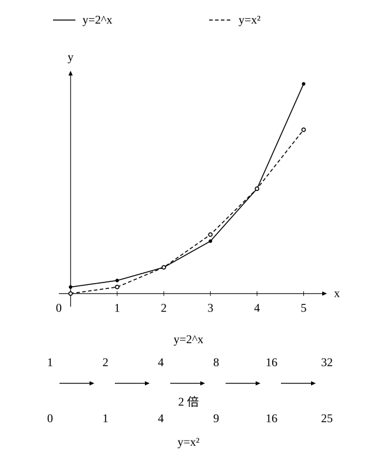
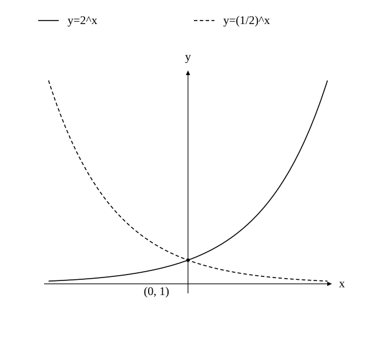

# L03 指数関数とそのグラフ——同じ倍率で変わる関数

- unit_id: hs-math-ii-exponential-logarithm
- 位置づけ: 単元第3レッスン（1.5時間）。L02 までで有理数まで広げた指数を実数まで広げ（値が 1 つに決まることを認めるだけ）、指数関数 y=a^x を置く。数学Ⅰ「二次関数」で身に付けた「表→グラフ→特徴を言葉にする」型を再び使い、二次関数との違いを「同じ倍率で変わる」の 1 点に絞って言う。底と 1 の大小で増加か減少かが決まることは、L04 の不等式で向きを決める根拠になる。
- distribution_status: published_draft
- license: CC-BY-4.0
- verify_required: 例題数値・記述は監修者検証必須。
- 主概念: ①指数を実数へ（直観的に）・指数関数 y=a^x の定義・y=x² との対比表（解説の例）・y=2^x と y=(1/2)^x のグラフと特徴（点 (0, 1)・x 軸に限りなく近づく・底と1の大小で増加と減少が決まる）②底をそろえた大小比較と、表・式・グラフの関連付け

---

## 1. 指数を実数へ——指数関数 y=a^x と、二次関数との対比

このレッスンの終わりに、次の3つができるようになることを目指す。

1. 指数関数 y=a^x（a>0、a≠1）のグラフを表から描き、特徴を 4 つ言葉にできる。
2. 底と 1 の大小から増加・減少を判断し、底をそろえて数の大小を比べられる。
3. 二次関数 y=x² との違いを「差が増える」と「同じ倍率」で説明できる。

L02 までで、2^x は x が整数や分数のとき値が決まった。x が √2 のような無理数のときはどうか。√2=1.4142… である。指数を有理数で細かく刻んで、2^1.4≒2.63902、2^1.414≒2.66475、2^1.4142≒2.66512 と計算していくと、値は 2.665… へとつながっていく。この単元では、この様子から 2^√2 の値が 1 つに決まる（2^√2≒2.665）と認めて先へ進む。電卓やグラフ描画ツールで確かめてもよい。

ここで認めたことの格を書いておく。指数が無理数のときの a^x は、この単元では厳密には定義しない。値が1つに決まることを認めて先へ進む。だから 2^√2 の値は = ではなく ≒ で書く。これで、a>0 のとき a^x の値がすべての実数 x について決まり、指数法則も実数の指数でそのまま使う。

a を 1 でない正の数とするとき、y=a^x で表される関数を、a を底とする x の**指数関数**という。底 a は a>0 かつ a≠1 である。x はすべての実数をとる。

底から 1 を除くのはなぜか。1^x はどんな x についても 1 で、x が動いても y が変化しない。底が 1 では値が変わらず、底と 1 の大小で増える・減るを言い分けることも、指数の大小を比べることもできないので、この単元では底 1 を除く。底が負だと困るのはなぜか。たとえば (−2)^(1/2) は 2 乗して −2 になる実数が無いので値が決まらない。L02 で底を正の数に限ったのはこのためで、指数関数の底も正の数に限る。

指数関数は、x が 1 増えるごとに y が同じ倍率（底 a 倍）になる関数である。数学Ⅰの二次関数 y=x² と並べて、増え方の違いを表で見る（次の対比表は、高等学校学習指導要領解説 数学編（平成30年告示）にある例による）。

| x | 0 | 1 | 2 | 3 | 4 | 5 |
|---|---|---|---|---|---|---|
| y=x² | 0 | 1 | 4 | 9 | 16 | 25 |
| 隣との差 | — | ＋1 | ＋3 | ＋5 | ＋7 | ＋9 |
| y=2^x | 1 | 2 | 4 | 8 | 16 | 32 |
| 隣との差 | — | ＋1 | ＋2 | ＋4 | ＋8 | ＋16 |
| 隣との比 | — | 2 | 2 | 2 | 2 | 2 |

y=x² は、隣との差が 1、3、5、…と一定の量ずつ増えていく。y=2^x は、隣との差が 1、2、4、…と倍々に増え、隣との比はどこでも 2 である。x=4 では両方とも 16 だが、x=5 で 2^x が 32 と上へ離れていく。この表では「差が一定の量ずつ増える」のが二次関数 y=x² であり「比がいつも同じ」なのが指数関数 y=2^x である。

:::guide
**同じ量ずつ増える／同じ倍率で増える**

「増え方が速い」と一言で言っても、2 つの型がある。一次関数は毎回同じ量ずつ変わり、二次関数は隣との差が毎回一定の量ずつ変わる（この表の y=x² では、差が 1、3、5、…と増える）。どちらも「差」で変わり方が決まる。指数関数は、差ではなく「比」で増え方が決まる。毎回同じ倍率でかけられるので、倍率が 1 より大きければ x を大きくするにつれて差は後になるほど大きくなり、この表でも x=5 で y=x² を追い越す。やがてどんな二次関数よりも大きくなることも知られているが、その理由はこの単元では示さない。L02 で「2 回で半分になるなら 1 回で 1/4 ずつ減る」が誤りだったのも同じ理由で、指数関数は一定の量ずつではなく一定の倍率で変わる。x を 1 ずつ増やした表を作ったら「隣との差」ではなく「隣との比」を見る癖をつけると、同じ倍率で変わるという指数関数の特徴が見えやすい（表の点の間の値までは、表だけでは決まらない）。
:::

:::zatsudan
身の回りの仕組みにも、指数関数の考えが使われている物がある。高等学校学習指導要領解説 数学編（平成30年告示）の総説には、指数関数の知識があれば預貯金やローンの仕組みは理解しやすいという記述がある。この教材では仕組みの式までは立ち入らない。
:::
<!-- zatsudan話題源: 内部調査要約 雑談枠許可リストZ3（高等学校学習指導要領解説 数学編・平成30年告示 総説の明文の範囲・複利の式は書かない）。出典の確認範囲内の内容のみ使用 -->

## 2. y=2^x と y=(1/2)^x のグラフ——特徴を 4 つ言葉にする

底が 1 より大きい例として y=2^x、底が 1 より小さい例として y=(1/2)^x を、同じ表に並べて描く。

| x | −3 | −2 | −1 | 0 | 1 | 2 | 3 |
|---|---|---|---|---|---|---|---|
| y=2^x | 1/8 | 1/4 | 1/2 | 1 | 2 | 4 | 8 |
| y=(1/2)^x | 8 | 4 | 2 | 1 | 1/2 | 1/4 | 1/8 |

表の点を打って、なめらかな曲線でつなぐ。整数でない x でも値が決まることは §1 で認めた。グラフが途切れずになめらかにつながることも、この単元では証明せずに認めて、点と点の間を曲線でつなぐ。グラフから読み取れる特徴を 4 つ、言葉にする。

1. y の値はいつも正である（グラフは x 軸より上にある）。
2. どちらも点 (0, 1) を通る（a^0=1 だから、底が何でも通る）。
3. グラフは x 軸に限りなく近づくが、x 軸に触れない（y=2^x は左へ行くほど、y=(1/2)^x は右へ行くほど）。
4. 底が 1 より大きいとき（a>1）、x が増えると y も増える（増加）。底が 1 より小さいとき（0<a<1）、x が増えると y は減る（減少）。

グラフが x 軸に触れないのはなぜか。a^x の値は常に正だからである。指数が負のときも a^(−n)=1/a^n は正の数で、0 や負の数になる x は無い。表で左へ進むと 1/2、1/4、1/8 と小さくなっていくが、どこまで進んでも 0 にはならない。

:::guide
**グラフが x 軸に触れない理由**

y=2^x のグラフを左へたどると、x 軸にどんどん近づいていく。表の値が 1/8、1/16、1/32 と半分ずつになっていくからである。ここで「いつかは 0 になるのではないか」と思うかもしれない。しかし半分にし続けても正の数は正の数のままで、0 にはならない。2^x=0 を満たす x は無いので、グラフは x 軸と交わらない。このように、曲線が限りなく近づいていく直線は漸近線と呼ばれる。この教材では「x 軸に限りなく近づく」と言葉で書き、記号は使わない。グラフを描くときは、左端（底が 1 より小さければ右端）が x 軸に近づきながら上にある形にする。x 軸と交わる形や、途中で水平になる形は、この特徴に反する。
:::

y=2^x と y=(1/2)^x のグラフが y 軸に関して対称なのはなぜか。(1/2)^x=(2^(−1))^x=2^(−x) だからである。y=(1/2)^x の x=3 での値は (1/2)^3=1/8 で、これは y=2^x の x=−3 での値 2^(−3)=1/8 と同じである。x の符号を変えると値が入れ替わるので、2 つのグラフは y 軸を折り目にして重なる。

:::guide
**(1/2)^x=2^(−x)**

底が 1 より小さい指数関数は、底が 1 より大きい指数関数の x の符号を変えた物として読める。(1/2)^x=2^(−x) という変形は、L01 の負の指数 a^(−n)=1/a^n と L02 の累乗の法則 (a^p)^q=a^(pq) を続けて使っただけである。この読み替えで、底が 1 より小さいグラフの特徴（右下がり・右へ行くほど x 軸に近づく）は、底が 1 より大きいグラフの特徴を左右に裏返した物だと分かる。新しく覚える形ではなく、知っている形の鏡像である。
:::

## 3. 底をそろえて大小を比べる——表・式・グラフの往復

特徴 4 を式で書く。底をそろえた 2 つの数の大小は、指数の大小で決まる。

- a>1 のとき、p<q ならば a^p<a^q（指数が大きい方が大きい）
- 0<a<1 のとき、p<q ならば a^p>a^q（指数が大きい方が小さい）

底が 1 より小さいときは向きが逆になる。(1/3)^3 と (1/3)^2 を比べると 1/27<1/9 で、指数が大きい (1/3)^3 の方が小さい。この向きの違いは、グラフが右上がりか右下がりかに対応している。底がそろっていない数は、まず底をそろえる。累乗根は L02 の分数の指数に直す。

**例題1** 次の 3 つの数を小さい順に並べよ。
√2、³√4、⁴√8

3 つとも 2 の累乗で書ける。√2=2^(1/2)、³√4=2^(2/3)、⁴√8=2^(3/4) である。底 2 は 1 より大きいから、指数が大きいほど値は大きい。1/2<2/3<3/4 だから、小さい順に **√2、³√4、⁴√8** である。

検算: 小数で確かめる。√2≒1.4142、³√4≒1.5874、⁴√8≒1.6818 で、確かにこの順である。

**例題2** (0.5)^0.5 と (0.5)^0.6 の大小を比べよ。

底 0.5 は 1 より小さいから、指数が大きいほど値は小さい。0.5<0.6 だから **(0.5)^0.5>(0.5)^0.6** である。

検算: 小数で確かめる。(0.5)^0.5≒0.7071、(0.5)^0.6≒0.6598 で、確かに (0.5)^0.5 の方が大きい。底を見ずに「指数が大きい方が大きい」とすると、向きを間違える。

表・式・グラフは行き来できる。式 y=2^x から表を作り、表からグラフを描き、グラフから「右上がり」を読んで式の底が 1 より大きいことに戻る。この往復は数学Ⅰの二次関数と同じ型である。二次関数で学んだグラフの平行移動も指数関数に使えるが、この単元では一言にとどめ、末尾の stretch で 1 問だけ確かめる。

答えを出したら、次の3つで自分の答えを確かめる。このレッスンの自己検査の型である。

1. x を 1 ずつ増やした表を作ったときは、隣どうしの比が底になっているか。
2. 大小を比べたときは、不等号の向きを、グラフが右上がりか右下がりかで確かめる。
3. x に 1 つ値を入れて、不等式が成り立つかを見る。

## 4. 練習

**問1** 指数関数 y=3^x について、次の問いに答えよ。
(1) x=−2、−1、0、1、2 のときの y の値を表にせよ。
(2) (1) の表の点を打ってグラフを描き、§2 の特徴 4 つがこのグラフでも成り立つことを確かめよ。

**問2** 次の 3 つの数を小さい順に並べよ。
(1) 2^0.3、4^0.1、8^0.2  (2) √3、³√9、⁴√27

**問3** 次の問いに答えよ。
(1) (1/2)^2、(1/2)^(−1)、(1/2)^0.5 を小さい順に並べよ。
(2) (1/4)^(1/3) と (1/2)^(1/2) の大小を比べよ。

**問4** 指数関数 y=2^x のグラフの特徴を 4 つ、自分の言葉で書け。それぞれについて、なぜそうなるかを 1 文ずつ添えよ。

**問5** y=2^x、y=3^x、y=(1/2)^x のグラフを同じ座標平面に描いたとき、次の問いに答えよ。
(1) 3 つのグラフが共通に通る点はどれか。
(2) x>0 の範囲では y=2^x と y=3^x のどちらが上にあるか。x<0 の範囲ではどちらが上にあるか。理由を 1 文で添えよ。
(3) 3 つのうち右下がりのグラフはどれか。

:::stretch
**S1** y=2^(x＋1) のグラフは、y=2^x のグラフを x 軸方向に −1 だけ平行移動した物として読める。一方で、指数法則を使うと 2^(x＋1)=2×2^x だから、y=2^x の y の値を 2 倍した物としても読める。
(1) x=2 のとき、2^(x＋1) と 2×2^x の値をそれぞれ計算し、一致することを確かめよ。
(2) 「x 軸方向に −1 だけ動かす」と「y を 2 倍する」が同じグラフになる理由を、指数法則の語を使って 2 文で説明せよ。
:::

対応解答: answer_key_L02-06.md

<!-- gen_nav:nav:start（自動生成・手編集しない） -->

---

[← 前のレッスン](lesson_02.md)｜[単元の目次](README.md)｜[解答](answer_key_L02-06.md)｜[次のレッスン →](lesson_04.md)

<!-- gen_nav:nav:end -->
