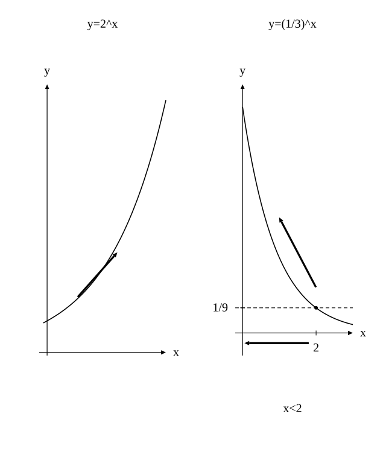

# L04 指数関数を含む方程式・不等式——底をそろえて指数を比べる

- unit_id: hs-math-ii-exponential-logarithm
- 位置づけ: 単元第4レッスン（1.5時間）。L03 で見た指数関数の性質（底をそろえれば指数どうしの比較に落ちる・底と 1 の大小で増加か減少かが決まる）を、方程式と不等式を解く道具として使う。置き換え t=a^x は数学Ⅰ「数と式」で学んだ置き換えの再訪で「t>0 を先に書く」型をここで固定する。この型は、L08 で対数の方程式・不等式を「真数は正」を先に書いて解く型と対になる。
- distribution_status: published_draft
- license: CC-BY-4.0
- verify_required: 例題数値・記述は監修者検証必須。
- 主概念: ①底をそろえて解く方程式と、底と1の大小で向きが決まる不等式 ②置き換え t=a^x（t>0 を先に書く）で二次方程式・二次不等式へ帰着・指数法則による式の変形

---

## 1. 底をそろえて解く——方程式

このレッスンの終わりに、次の3つができるようになることを目指す。

1. 両辺を同じ底の累乗にそろえて方程式・不等式を解き、底が 1 より小さいとき向きが逆になる理由をグラフで言える。
2. t=a^x（t>0 を先に書く）の置き換えで二次方程式・二次不等式に帰着して解ける。
3. 4^x=(2^x)^2・2^(x＋1)=2×2^x・2^x×2^(−x)=1 の変形ができる。

指数関数 y=a^x（a>0、a≠1）は、底が 1 より大きければ増加、1 より小さければ減少で、どちらにしても x が違えば y も違う。だから、底がそろった 2 つの累乗が等しいなら、指数が等しい。

- a^p=a^q ならば p=q（a>0、a≠1）

底 1 を除く理由はここでも効く。1^x=1^2 からは x は決まらない（1^x はいつも 1 だから）。この性質を使うと、x が指数にある方程式を解ける。両辺を同じ底の累乗にそろえ、指数どうしを等しいとおく。

4^x=32 を解いてみる。4 も 32 も 2 の累乗で書ける。4^x=(2^2)^x=2^(2x)、32=2^5 だから、2^(2x)=2^5 となり、2x=5、x=5/2 である。

検算: 解を元の式に戻す。4^(5/2)=(√4)^5=2^5=32 で、確かに成り立つ。

**例題1** 9^x=27 を解け。

9=3^2、27=3^3 だから、3^(2x)=3^3 となり、2x=3 から **x=3/2**

検算: 9^(3/2)=(√9)^3=3^3=27 で、確かに成り立つ。

:::guide
**ここで扱う物の格——教科書で扱われ、この単元でも本文で扱う**

このレッスンの内容は、教科書では指数関数を含む方程式・不等式、あるいは指数方程式・指数不等式と呼ばれる。底の変換公式、指数や対数を含む方程式・不等式、桁数や小数首位の問題は、学習指導要領解説の数学Ⅱ「指数関数・対数関数」の項には語が出てこないが、教科書では扱われており、この単元でも本文で扱う。新しい公式を覚えるのではなく、L03 の指数関数の性質（底をそろえれば指数で決まる・底と 1 の大小で向きが決まる）と、数学Ⅰの置き換えの型をそのまま使う。
:::

## 2. 不等式——底と 1 の大小で向きが決まる

不等式では、底と 1 の大小で指数の不等号の向きが決まる。L03 の特徴 4 を、そのまま使う。

- a>1 のとき、a^p<a^q ならば p<q（向きはそのまま）
- 0<a<1 のとき、a^p<a^q ならば p>q（向きが逆になる）

(1/3)^x>1/9 を解いてみる。1/9=(1/3)^2 だから、(1/3)^x>(1/3)^2 である。底 1/3 は 1 より小さいから、向きが逆になって x<2 である。

検算: 解の範囲の中と外から 1 点ずつ代入する。x=1 なら (1/3)^1=1/3>1/9 で成り立つ。x=3 なら (1/3)^3=1/27>1/9 は成り立たない。確かに x<2 が解である。

底が 1 より小さいとき不等号の向きが変わるのはなぜか。y=(1/3)^x のグラフが右下がりだからである。右下がりのグラフでは、y が大きい点ほど x は小さい。(1/3)^x>1/9 は「y が 1/9 より大きい」という条件で、グラフでそれに当たる x は 2 より小さい側にある。

:::guide
**向きが変わるのはグラフが右下がりだから**

「底が 1 より小さいときは不等号の向きを変える」を手順として覚えるだけだと、変え忘れたときに気づけない。向きの根拠はグラフにある。y=2^x のような右上がりのグラフでは、y が大きいほど x も大きい。y=(1/3)^x のような右下がりのグラフでは、y が大きいほど x は小さい。不等式 a^x>a^q は「y が a^q より大きい x はどこか」と読み、グラフが右上がりなら q より右、右下がりなら q より左が答えである。向きを変え忘れて (1/3)^x>1/9 から x>2 としたなら、x=3 を入れて 1/27>1/9 が成り立たないことですぐ分かる。解いたら必ず 1 点入れて確かめる。
:::

**例題2** (1/2)^x<1/8 を解け。

1/8=(1/2)^3 だから (1/2)^x<(1/2)^3 である。底 1/2 は 1 より小さいから、向きが逆になって **x>3**

検算: x=4 なら (1/2)^4=1/16<1/8 で成り立つ。x=2 なら (1/2)^2=1/4<1/8 は成り立たない。確かに x>3 である。

## 3. 置き換え t=a^x——t>0 を先に書く

同じ底にそろえられる累乗が 2 種類あり、片方がもう片方の 2 乗になる式（たとえば 4^x=(2^x)^2 と 2^x）は、指数法則で片方の形にそろえてから、置き換えで二次方程式に直す。先に、よく使う 3 つの変形を確かめておく。

- 4^x=(2^2)^x=2^(2x)=(2^x)^2（4^x は 2^x の 2 乗である）
- 2^(x＋1)=2^x×2^1=2×2^x（指数の ＋1 は 2 倍である）
- 2^x×2^(−x)=2^(x−x)=2^0=1（2^(−x) は 2^x の逆数である）

4^x を 2^x で表すとどうなるか。4^x=(2^x)^2 である。x=3 で確かめると 4^3=64 で、(2^3)^2=8^2=64 と一致する。2^(x＋1) を 2^x＋2 と書くのは誤りで、x=4 で確かめると 2^5=32 に対して 2^4＋2=18 で一致しない。2^(x＋1)=2×2^x が正しく、x=4 なら 2×2^4=32 で一致する。

4^x−5×2^x＋4=0 を解いてみる。4^x=(2^x)^2 だから、t=2^x とおくと（t>0）、t²−5t＋4=0 となる。左辺を因数分解して (t−1)(t−4)=0 だから t=1、4 で、どちらも t>0 を満たす。t=2^x に戻すと 2^x=1 から x=0、2^x=4 から x=2 である。よって x=0、2 である。

検算: x=0 なら 4^0−5×2^0＋4=1−5＋4=0、x=2 なら 4^2−5×2^2＋4=16−20＋4=0 で、どちらも成り立つ。

t=2^x とおいたとき t>0 を先に書くのはなぜか。2^x は常に正だから、t が負や 0 になる x は無く、負の t は x に戻せないからである。反例で確かめる。4^x＋2^x−6=0 を t=2^x（t>0）とおくと t²＋t−6=0、(t＋3)(t−2)=0 だから t=−3、2 である。t=−3 は t>0 に反するので捨て、t=2 から 2^x=2、x=1 である。t>0 を書かずに進めると、2^x=−3 という解けない式が答えに紛れ込む。

:::guide
**置き換えたら範囲も置き換える**

数学Ⅰ「数と式」で、式の一部を 1 つの文字に置き換えて因数分解した。そのときは因数分解が目的だったので、置き換えた文字がどんな値をとれるかを確かめる必要がなかった。しかし t=2^x の t は、x がどんな実数でも 2^x>0 だから、正の数しかとれない。置き換えた瞬間に「t>0」を式の横に書く。この 1 行が、t の二次方程式を解いた後に「どの解を x に戻してよいか」を決める。t=−3 を捨てる根拠は、この 1 行にしかない。この単元では、置き換えるたびに範囲も一緒に置き換える、を固定の手順にする。L08 では t=log_a x の置き換えが出てくるが、そのときは t に制限が無い。範囲は置き換える式ごとに違うので、毎回その場で確かめる。
:::

不等式も同じ手順で解ける。4^x−2^(x＋1)−8<0 を解いてみる。4^x=(2^x)^2、2^(x＋1)=2×2^x だから、t=2^x とおくと（t>0）、t²−2t−8<0 となる。因数分解して (t−4)(t＋2)<0 だから −2<t<4 である。これと t>0 を合わせて 0<t<4、つまり 0<2^x<4 である。2^x>0 はいつも成り立つので、2^x<4=2^2 から x<2 である。

検算: x=1 なら 4−4−8=−8<0 で成り立つ。x=3 なら 64−16−8=40<0 は成り立たない。x=2 なら 16−8−8=0 で、ちょうど境界である。確かに x<2 である。

**例題3** 3^(2x)−4×3^x＋3=0 を解け。

3^(2x)=(3^x)^2 だから、t=3^x とおくと（t>0）、t²−4t＋3=0、(t−1)(t−3)=0 で t=1、3 である。どちらも正だから、3^x=1 から x=0、3^x=3 から x=1 である。よって **x=0、1**

検算: x=0 なら 1−4＋3=0、x=1 なら 9−12＋3=0 で、どちらも成り立つ。

## 4. 手順の型

指数関数を含む方程式・不等式は、次の手順で解く。

1. 両辺を同じ底の累乗にそろえる。累乗根や分数は指数に直し、2^(x＋1) のような形は 2×2^x に直す。
2. 両辺がそれぞれ同じ底の累乗 1 つになったら、方程式なら指数どうしを等しいとおく。不等式なら、底と 1 の大小で向きを決めてから指数を比べる（底が 1 より小さければ向きが逆）。累乗の和が残る式は 3 へ進む。
3. 同じ底の累乗が 2 種類（a^x と、その 2 乗の a^(2x)）あれば t=a^x とおき、その場で t>0 を書く。
4. t の二次方程式・二次不等式を解き、t>0 に合う解だけを x に戻す。
5. 解を元の式に代入して確かめる。不等式は解の範囲の中と外から 1 点ずつ入れる。

答えを出したら、次の3つで自分の答えを確かめる。このレッスンの自己検査の型である。

1. 方程式の解は、元の式に代入して成り立つかを見る。
2. 不等式の解は、範囲の中と外から 1 点ずつ代入する（数学Ⅰ「二次関数」の二次不等式で使った型）。
3. 置き換えたときは、t の解が正かを、x に戻す前に見る。

## 5. 練習

**問1** 次の方程式を解け。
(1) 5^x=125  (2) 8^x=16  (3) 4^x=1/32

**問2** 次の方程式を解け。
(1) 2^(x−1)=1/8  (2) 4^(x＋1)=1/2

**問3** 次の不等式を解け。
(1) 2^x>16  (2) 9^x<3

**問4** 次の不等式を解け。
(1) (1/3)^x≦1/27  (2) (1/4)^x>8

**問5** 次の方程式・不等式を解け。
(1) 9^x−10×3^x＋9=0  (2) 9^x＋3^x−12=0  (3) 4^x−6×2^x＋8<0

**問6** 底が 1 より小さい指数関数を含む不等式を解くとき、指数の不等号の向きが逆になるのはなぜか。「グラフ」の語を使って2文で説明せよ。

:::stretch
**S1** 3^x＋3^(−x)=4 のとき、9^x＋9^(−x) の値を求めよ。（ヒント: 3^x＋3^(−x) を 2 乗し、3^x×3^(−x)=1 を使う。）
:::

対応解答: answer_key_L02-06.md

<!-- gen_nav:nav:start（自動生成・手編集しない） -->

---

[← 前のレッスン](lesson_03.md)｜[単元の目次](README.md)｜[解答](answer_key_L02-06.md)｜[次のレッスン →](lesson_05.md)

<!-- gen_nav:nav:end -->
