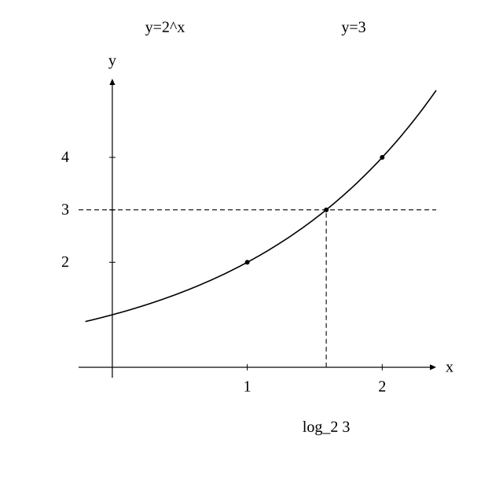
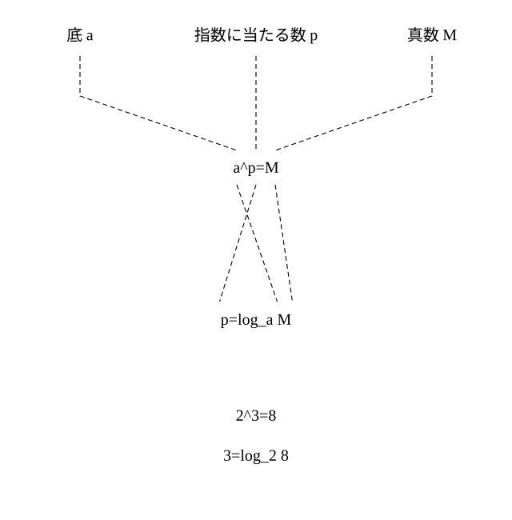

# L05 対数——「何乗すると M になるか」を表す数

- unit_id: hs-math-ii-exponential-logarithm
- 位置づけ: 単元第5レッスン（1.5時間）。ここから単元の後半、対数の側に入る。L03 の指数関数のグラフで「高さが 3 になる x」がただ 1 つあることを確かめ、その数に log_2 3 と名前を付ける。対数は a^p=M の p に付けた名前であって、新しい計算ではない。この定義と、指数の式と対数の式の往復は、L06 から L11 までのすべてのレッスンの冒頭で言い戻す。
- distribution_status: published_draft
- license: CC-BY-4.0
- verify_required: 例題数値・記述は監修者検証必須。
- 主概念: ①必要性（解説の例 2^x=3）→定義「a^p=M と p=log_a M は同じこと」・底と真数・値を挟んで見積もる（1<log_2 3<2）②指数の式と対数の式の往復・log_a a=1・log_a 1=0・a^(log_a M)=M・定義を自分の言葉で述べる

---

## 1. 2^x=3 の困りごと——答えに名前を付ける

このレッスンの終わりに、次の3つができるようになることを目指す。

1. 対数の定義を自分の言葉と式で述べられる。
2. a^p=M と p=log_a M を相互に書き換え、底・指数に当たる数・真数の 3 つのどれでも求められる。
3. log_a M の値を 2 つの整数の間に挟んで見積もれる。

L04 では、底をそろえて指数を比べれば方程式が解けた。2^x=4 なら x=2、2^x=8 なら x=3 である。では 2^x=3 はどうか。3 は、これまでのように指数が整数や分数の 2 の累乗の形には書けないので、底をそろえる方法が使えない。2^1=2 と 2^2=4 の間に 3 があるので x は 1 と 2 の間にあるはずだが、その値を今まで学んだ数（整数・分数・累乗根）で書くことができない（この例は、高等学校学習指導要領解説 数学編（平成30年告示）にある例による）。

答えが無いわけではない。y=2^x のグラフを思い出そう。L03 で見たとおり、このグラフは右上がりで、x が増えると y は 1/8、1/4、…、2、4、8 と増え続け、途切れない。だから、高さが 3 になる点はグラフ上にただ 1 つある。その点の x 座標が、2^x=3 を満たす数である。

今までの数で書けないなら、名前を付ければよい。中3で、2 乗すると 2 になる正の数を今までの数で書けなかったとき、その数に √2 と名前を付けた。同じ発想で、2 を何乗すると 3 になるかを表す数に **log_2 3** と名前を付ける。log_2 3 は「2^x=3 の答え」に付けた名前であって、新しい計算の手順ではない。

名前を付けただけでも、大きさは分かる。log_2 3 はなぜ 1 と 2 の間にあるのか。2^1=2<3<4=2^2 であり、2^x は x が増えると増えるからである。高さ 3 の点は、高さ 2 の点（x=1）と高さ 4 の点（x=2）の間にある。だから 1<log_2 3<2 である。さらに細かく挟むこともできる。2^1.5=2^(3/2)=√8≒2.8284 で 3 より小さいから、高さ 3 の点は x=1.5 より右にある。よって 1.5<log_2 3<2 である。

:::guide
**log は答えに付けた名前**

記号 log を見ると、何か新しい計算をしなければならないように見える。しかし log_2 3 は「2 を何乗すると 3 になるか」という問いの答えに付けた名前にすぎない。√2 が「2 乗すると 2 になる正の数」の名前だったのと同じである。√2 を見たら、計算の手順より先に「2 乗すると 2 になる正の数」という数そのものを読む。log_2 3 も同じで、見たら「2 を何乗すると 3 になるか」と読み直せばよい。答えが整数や分数で書ける場合（log_2 8 など）は、その値を書く。書けない場合（log_2 3 など）は、名前のまま置いておき、必要なら大きさを挟んで見積もる。記号が先ではなく、困りごとが先で、記号はそれを書き留めるために後から来た。
:::

## 2. 定義——底と真数、大きさを挟む

一般に書く。a を 1 でない正の数、M を正の数とする。a を何乗すると M になるかを表す数を、a を底とする M の**対数**といい、log_a M と書く。式で書くと、次の 2 つは同じことの言い換えである。

- a^p=M ⇔ p=log_a M（a>0、a≠1、M>0）

言葉で固定しておく: **log_a M は a を何乗すると M になるかを表す数**である。log_a M の a を**底**といい、M は教科書では**真数**と呼ばれる。教科書やノートでは底を log の右下に小さく書く。この教材では log_a M と書き、log のすぐ後ろの a が底、その後ろの M が真数である。指数の式 a^p=M の 3 つの量（底 a・指数に当たる数 p・真数 M）は、対数の式 p=log_a M の 3 つの量と同じ物で、並べ方が違うだけである。

条件を確かめておく。log_2 (−4) や log_2 0 を考えないのはなぜか。2^p は常に正で、−4 や 0 になる p は無いからである。だから真数 M は正の数に限る（M>0）。底から 1 を除くのは、1^p はいつも 1 で、1 を何乗しても 5 にはならず、log_1 5 のような物が決められないからである。底が負のときの困りごとは L03 で見たとおりである。

大きさを挟む手順も一般に書く。a>1 のとき、a^n<M<a^(n＋1) ならば n<log_a M<n＋1 である。M を底 a の累乗で上下から挟めば、log_a M は 2 つの整数の間に入る。§1 の 1<log_2 3<2 がこの形である。底が 1 より小さいときは向きが逆になるが、それは L07 で扱う。

:::guide
**ここで使う語の格——真数は教科書で呼ばれる名**

log_a x は学習指導要領に用語・記号として挙げられ、対数の語は指導事項の本文にある。一方で、真数・底の変換公式・桁数・小数首位は教科書で呼ばれる名で、学習指導要領の用語・記号（累乗根・log_a x・常用対数）には入っていない。この教材では、教科書で広く使われている語なので「真数」と呼ぶが、指導要領の指定語ではないことを承知しておく。語の格がどうであれ、やることは 1 つで、log_a M を見たら「a を何乗すると M になるか」と読み直す。真数という名前を覚えるより、その読み直しができることの方が大切である。
:::

## 3. 往復——3 方向と、定義から出る 3 つの式

指数の式と対数の式を行き来してみる。対数の値は、指数の式に戻せばすぐ分かる。

- log_2 8=3（2^3=8 だから）
- log_3 (1/9)=−2（3^(−2)=1/9 だから）
- log_(1/2) 8=−3（(1/2)^(−3)=8 だから）
- log_7 √7=1/2（7^(1/2)=√7 だから）
- log_4 8=3/2（4^(3/2)=(√4)^3=8 だから）

3 つの量のどれを求めるかで、3 方向の往復がある。指数に当たる数を求める: 2^p=32 なら p=5 で、log_2 32=5 である。底を求める: a^3=125 なら a=5 で、log_5 125=3 である。真数を求める: 3^4=M なら M=81 で、log_3 81=4 である。どの方向でも、迷ったら指数の式に戻して「何を何乗すると何になるか」を言葉で言う。

定義から、次の 3 つの式が出る。a>0、a≠1、M>0 とする。

- log_a a=1（a^1=a だから）
- log_a 1=0（a^0=1 だから）
- a^(log_a M)=M

log_a 1=0 はなぜか。a を 0 乗すると 1 になる（a^0=1）からである。a^(log_a M)=M はなぜ成り立つか。log_a M は「a をその数だけ乗じると M になる数」だから、a をその数だけ乗じれば M になる。数で見ると log_7 7=1（7^1=7）、log_7 1=0（7^0=1）、2^(log_2 5)=5（log_2 5 は 2 を何乗すると 5 になるかを表す数だから）である。

**例題1** log_2 (1/4) の値を求めよ。

2 を何乗すると 1/4 になるか。2^(−2)=1/4 だから log_2 (1/4)=**−2**

検算: 対数の値 p を得たら a^p を計算して M に戻る。2^(−2)=1/2^2=1/4 で、確かに真数に戻る。

**例題2** log_4 2 の値を求めよ。

4 を何乗すると 2 になるか。4^(1/2)=√4=2 だから log_4 2=**1/2**

検算: 4^(1/2)=2 で真数に戻る。log_2 4=2 とは別の数であることに注意する。底と真数を取り違えると値が変わる。

**例題3** log_(1/3) 9 の値を求めよ。

1/3 を何乗すると 9 になるか。(1/3)^(−2)=3^2=9 だから log_(1/3) 9=**−2**

検算: (1/3)^(−2)=1/(1/3)^2=1/(1/9)=9 で真数に戻る。

**例題4** log_2 ³√2 の値を求めよ。

³√2=2^(1/3) だから log_2 ³√2=**1/3**

検算: (2^(1/3))^3=2 で、2^(1/3) は確かに 3 乗して 2 になる数である。

**例題5** log_4 (1/8) の値を求めよ。

4 を何乗すると 1/8 になるか。4=2^2、1/8=2^(−3) だから、4^p=2^(2p)=2^(−3) で 2p=−3、p=−3/2 である。log_4 (1/8)=**−3/2**

検算: 4^(−3/2)=1/4^(3/2)=1/(√4)^3=1/8 で真数に戻る。

読み違いの例を 2 つ見ておく。log_2 8 を 4 と答えるのは、2×4=8 と「かけ算」で読んでいる。log_2 8 は「2 を何乗すると 8 になるか」であり、2^3=8 だから 3 である。log_8 2 と log_2 8 を取り違えるのは、底と真数を読み分けていない。log_8 2 は 8 を何乗すると 2 になるかで、8^(1/3)=2 だから 1/3 である。

:::guide
**どれが底でどれが真数か迷ったら指数の式に戻す**

log_a M の底と真数は、どちらが右下でどちらが後ろか、慣れるまでは迷う。迷ったら記号の形で覚えようとせず、指数の式に戻す。log_8 2 を見たら「8 の何乗が 2 か」と言葉にして 8^p=2 と書き直す。8^(1/3)=2 だから答えは 1/3 である。log_2 8 なら「2 の何乗が 8 か」で 2^p=8、答えは 3 である。正の整数の指数で言えば、底は「かける数」であり、指数に当たる数は「かける回数」であり、真数は「かけた結果」である。指数が負や分数のときも 3 つの役割は同じで、対数はこのうち「何乗するか」に当たる数を指している。この 3 つの役割を言葉で言えれば、記号の並び順は後から付いてくる。
:::

答えを出したら、次の2つで自分の答えを確かめる。このレッスンの自己検査の型である。

1. 対数の値 p を得たら、a^p を計算して M に戻るか（例題1〜5の検算）。
2. 値を整数 n と n＋1 の間に挟んだときは、a^n と a^(n＋1) で M を挟めているか。

## 4. 定義を述べる

このレッスンの締めくくりは、計算ではなく「述べる」ことである。対数の定義を、選択肢から選ぶのではなく、自分の言葉と式で書いてみる。言葉では「log_a M は a を何乗すると M になるかを表す数」であり、式では「a^p=M ⇔ p=log_a M（a>0、a≠1、M>0）」である。この 1 文と 1 行が、L06 から先のすべてのレッスンの出発点になる。

:::guide
**選べることと述べられることは違う**

対数の定義を書いた式を見せられて「正しい物を選べ」と言われれば、選べる人は多いだろう。しかし、何も見ずに定義を書き、その定義を使って log_4 8 の値を出し、なぜそうなるかを説明する、となると難しさが一段上がる。選べることと、使えること・述べられることは別の力である。この教材が重く見るのは、記号を知っているかではなく、定義に戻って式を書き換えられるかである。だから練習では「書く・使う・述べる」の 3 つを置き、選ぶ形の問いは置かない。定義を自分の言葉で述べられるようになったら、次のレッスンで性質を自分で導く。
:::

## 5. 練習

**問1** 次の問いに答えよ。
(1) 2^6=64 を、対数を使った式で表せ。
(2) log_5 125=3 を、指数を使った式で表せ。
(3) log_3 81 の値を求めよ。  (4) log_2 (1/32) の値を求めよ。
(5) log_(1/3) 27 の値を求めよ。  (6) log_16 2 の値を求めよ。

**問2** 次の式を満たす底 a の値を求めよ。a は 1 でない正の数とする。
(1) log_a 64=3  (2) log_a (1/8)=−3  (3) log_a 6=1/2

**問3** 次の式を満たす真数 M の値を求めよ。
(1) log_2 M=5  (2) log_3 M=−2  (3) log_4 M=3/2

**問4** 次の対数の値を、連続する 2 つの整数の間に挟んで表せ。
(1) log_2 7  (2) log_5 100

**問5** 対数の定義を、自分の言葉で 1 文と、式で 1 行、書け。式には底と真数の条件を添えよ。

**問6** a を 1 でない正の数、M を正の数とする。対数の定義から、次の 2 つの式を 1〜2 行で導け。
(1) log_a 1=0  (2) a^(log_a M)=M

:::stretch
**S1** log_2 3 と 3/2 の大小を比べよ。指数の式に戻し、2^(3/2) と 3 の大小から判断すること。
:::

対応解答: answer_key_L02-06.md

<!-- gen_nav:nav:start（自動生成・手編集しない） -->

---

[← 前のレッスン](lesson_04.md)｜[単元の目次](README.md)｜[解答](answer_key_L02-06.md)｜[次のレッスン →](lesson_06.md)

<!-- gen_nav:nav:end -->
