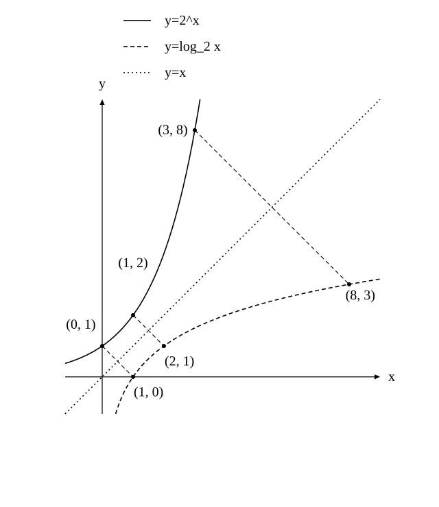
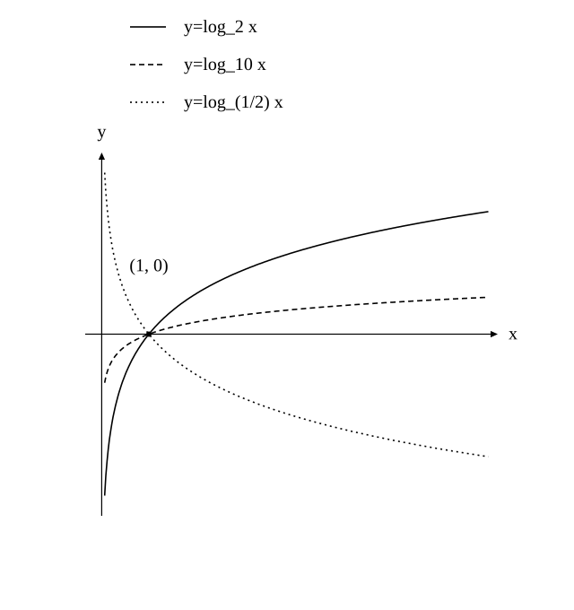
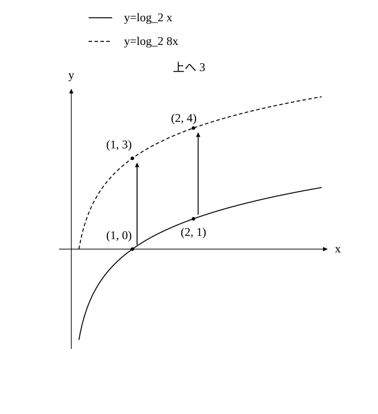

# L07 対数関数とそのグラフ——指数関数を逆から読む

- unit_id: hs-math-ii-exponential-logarithm
- 位置づけ: 単元第7レッスン（1.5時間）。L05 の対数の定義と L03 の指数関数のグラフを合わせて、対数関数 y=log_a x のグラフを描く。y=log_a x は x=a^y のことなので、指数関数の表の x と y を入れ替えればグラフの点が出る。定義域 x>0 を先に書く型と、底と 1 の大小で増減が決まることは、L08 で対数を含む方程式・不等式を解くときの根拠になる。真数を定数倍したグラフが上下の平行移動になることは、L06 の性質 1 行で出る。
- distribution_status: published_draft
- license: CC-BY-4.0
- verify_required: 例題数値・記述は監修者検証必須。
- 主概念: ①y=log_a x は x=a^y のこと・指数関数の表の x と y を入れ替えてグラフを描く（x>0・点 (1, 0)・y 軸に限りなく近づく・底と1の大小）・直線 y=x に関する対称を確かめる ②底を変えたグラフと真数を定数倍したグラフ（上下の平行移動として読む）・大小比較

---

## 1. 表の入れ替えとグラフ——特徴を 4 つ言葉にする

前のレッスンの定義を言い戻しておく。log_a M は a を何乗すると M になるかを表す数で、a^p=M と p=log_a M は同じことである。往復を 1 問。log_4 (1/2) の値はいくつか。4 を何乗すると 1/2 になるかを考えると、4^(−1/2)=1/√4=1/2 だから log_4 (1/2)=−1/2 である。

このレッスンの終わりに、次の3つができるようになることを目指す。

1. y=log_a x を x=a^y のこととして捉え、指数関数の表の x と y を入れ替えてグラフを描ける。
2. 対数関数のグラフの特徴を 4 つ言い、底と 1 の大小で増減を判断して対数の大小を比べられる。
3. 底を変えたときと真数を定数倍したときのグラフの変化を、式から説明できる。

a を 1 でない正の数とするとき、y=log_a x で表される関数を、a を底とする x の**対数関数**という（a>0、a≠1）。定義に戻ると、y=log_a x は x=a^y のことである。a^y=x と y=log_a x は同じ対応を 2 通りに書いた物で、対数関数は、指数関数 x=a^y を y の側から読んだ物にすぎない。x は真数だから x>0 であり、y はすべての実数をとる。

だから、対数関数の表は指数関数の表から作れる。y=2^x の表を書き、x と y を入れ替える。

| x | −2 | −1 | 0 | 1 | 2 | 3 |
|---|---|---|---|---|---|---|
| y=2^x | 1/4 | 1/2 | 1 | 2 | 4 | 8 |

x と y を入れ替えると、これがそのまま y=log_2 x の表になる。たとえば 2^3=8 は log_2 8=3 と同じことだから、点 (3, 8) が点 (8, 3) に移る。

| x | 1/4 | 1/2 | 1 | 2 | 4 | 8 |
|---|---|---|---|---|---|---|
| y=log_2 x | −2 | −1 | 0 | 1 | 2 | 3 |

グラフを描くときは、先に定義域 x>0 を書く。x≦0 の所には点が無い。表の点を打ち、なめらかな曲線でつなぐと、y=log_2 x のグラフは右上がりで、左へ行くほど y 軸に近づく。底が 1 より小さい y=log_(1/2) x も同じ手順で描ける。(1/2)^y=x から、点は (4, −2)、(2, −1)、(1, 0)、(1/2, 1)、(1/4, 2)、(1/8, 3) で、グラフは右下がりである。

グラフから読み取れる特徴を 4 つ、言葉にする。

1. 定義域は x>0 で、グラフは y 軸より右にある。値域はすべての実数である。
2. どの底でも点 (1, 0) を通る。
3. グラフは y 軸に限りなく近づくが、y 軸に触れない。
4. 底が 1 より大きいとき（a>1）、x が増えると y も増える（増加）。底が 1 より小さいとき（0<a<1）、x が増えると y は減る（減少）。

どの底でも点 (1, 0) を通るのはなぜか。log_a 1=0 だからである（a^0=1 を対数の式に書き直した物）。x≦0 で考えないのはなぜか。x=a^y で、a^y は常に正だからである。a^y が 0 や負の数になる y は無い。y 軸に限りなく近づくのはなぜか。指数関数 y=a^x のグラフが x 軸に限りなく近づくことを、x と y を入れ替えて読んだからである。y=log_2 x の表で x を 1/4、1/8、1/16 と小さくすると y は −2、−3、−4 と下がり続け、x が 0 になることはない。

y=2^x と y=log_2 x を同じ座標平面に描くと、直線 y=x を折り目にして重なる。点 (3, 8) と点 (8, 3) のように、一方のグラフの点の x 座標と y 座標を入れ替えた点が、もう一方のグラフの点になるからである。この単元では、このことを点の対応で確かめるまでにとどめ、一般の証明はしない。

:::guide
**対数関数のグラフは指数関数のグラフを逆から読んだもの**

対数関数は新しい曲線を覚える物ではない。y=log_a x は x=a^y のことだから、指数関数の表で「x を決めて y を出す」向きを「y を決めて x を出す」向きに読み替えただけである。表の x と y を入れ替えればグラフの点が出て、特徴 4 つも指数関数の特徴を入れ替えた物になる。指数関数が点 (0, 1) を通ることは対数関数が点 (1, 0) を通ることに、指数関数の値がいつも正であることは対数関数の定義域が x>0 であることに、指数関数が x 軸に限りなく近づくことは対数関数が y 軸に限りなく近づくことに対応する。グラフの形を忘れたら、指数関数の表を書いて入れ替える。
:::

:::guide
**定義域を先に書く**

対数関数のグラフを描くとき、最初にすることは点を打つことではなく、x>0 と書くことである。真数は正の数に限るので、x≦0 の所にグラフは無い。このひと手間を省くと、曲線を左へ伸ばして y 軸と交わらせたり、x が負の所まで描いたりしやすい。式の形が y=log_2 (x−3) のように変わっても、やることは同じで、真数 x−3 が正になる x の範囲（x>3）を先に書いてから点を打つ。次のレッスンで対数を含む方程式を解くときも、この「真数は正を先に書く」が手順の最初に来る。
:::

**例題1** 対数関数 y=log_3 x について、x=1/3、1、3、9 のときの y の値を表にし、グラフを描け。

3^y=x から、3^(−1)=1/3、3^0=1、3^1=3、3^2=9 である。

| x | 1/3 | 1 | 3 | 9 |
|---|---|---|---|---|
| y=log_3 x | −1 | 0 | 1 | 2 |

定義域 x>0 を書き、この 4 点を打ってなめらかな曲線でつなぐ。底 3 は 1 より大きいから、グラフは右上がりで、点 (1, 0) を通り、左へ行くほど y 軸に近づく。

検算: 点を 1 つとり x=a^y で戻す。点 (9, 2) について 3^2=9 で、確かに表の対応が成り立つ。求めた定義域 x>0 に、4 点の x 座標 1/3、1、3、9 がすべて入っている。

:::guide
**ここで扱う物の格——x=a^y のこととして捉える**

y=log_a x と y=a^x の関係は、この単元では「y=log_a x は x=a^y のこと」として捉える程度にとどめる。2 つの関数の関係を一般に述べる言葉と理論は数学Ⅲで学ぶ物で、ここでは立てない。グラフが直線 y=x に関して対称であることも、点 (3, 8) と (8, 3) のような点の対応で確かめるまでで、証明はしない。確かめ方は 1 つで、一方のグラフの点の座標を入れ替えた点が、もう一方のグラフの表に載っているかを見る。この程度の捉え方で、L08 以降の方程式・不等式・桁数の計算はすべて進められる。
:::

## 2. 底を変える・真数を定数倍する——式から読む

底を変えると、グラフはどう変わるか。y=log_10 x は 10^y=x だから、点 (1, 0)、(10, 1)、(100, 2) を通る。y=log_2 x と比べると、x=8 で log_2 8=3 に対して log_10 8 はおよそ 0.903 で、x>1 では底が大きい方が低い所を通る。底が 1 より大きいときは、底が小さいほど、同じ x になるまでに何乗するかを表す数が大きくなるからである。どの底のグラフも点 (1, 0) を通り、x=1 の左右で上下が入れ替わる（底が 2 と 10 の 2 本では、0<x<1 でどちらの値も負で、底が小さい方が低い）。底が 1 より小さい y=log_(1/2) x は右下がりである。

次に、真数を定数倍する。y=log_2 8x のグラフは、y=log_2 x のグラフをどう動かした物か。「横に 8 倍」と読みたくなるが、式を直すと違うことが分かる。L06 の積の性質で log_2 8x=log_2 8＋log_2 x=3＋log_2 x だから、y=log_2 8x のグラフは、y=log_2 x のグラフを y 軸方向に 3 だけ平行移動した物（上へ 3）である。x=2 で確かめると log_2 16=4 で、3＋log_2 2=3＋1=4 と一致する。

y=log_2 8x のグラフが上に動くのはなぜか（横に 8 倍ではないのか）。積の性質で log_2 8x=3＋log_2 x となり、どの x でも y の値が 3 だけ大きくなるからである。真数の定数倍は、対数の側では定数の足し算になる。割る場合も同じで、y=log_2 (x/4)=log_2 x−log_2 4=log_2 x−2 は、y=log_2 x を y 軸方向に −2 だけ平行移動した物（下へ 2）である。x=8 で確かめると log_2 2=1 で、3−2=1 と一致する。一般に、k>0、x>0 として log_a kx=log_a k＋log_a x だから、真数を k 倍したグラフは上下の平行移動である。

混同の例を 1 つ見ておく。log_2 2x と 2 log_2 x は別の物である。x=4 で確かめると、log_2 2x=log_2 8=3 だが、2 log_2 x=2 log_2 4=4 である。前者は真数の定数倍（上へ 1 の平行移動）、後者は対数の値の定数倍で、グラフも違う。

最後に、対数の大小を比べる。対数関数が a>1 なら増加、0<a<1 なら減少であることをそのまま使う。真数は正とする。

- a>1 のとき、0<p<q ならば log_a p<log_a q（真数が大きい方が大きい）
- 0<a<1 のとき、0<p<q ならば log_a p>log_a q（真数が大きい方が小さい）

log_2 3 と log_2 5 では、底 2 は 1 より大きいから log_2 3<log_2 5 である。log_(1/2) 3 と log_(1/2) 5 では、底 1/2 は 1 より小さいから向きが逆になり log_(1/2) 3>log_(1/2) 5 である。整数と対数を比べるときは、整数を同じ底の対数に直す。2 と log_3 10 では、2=log_3 9 と書き直せるから、9<10 と底 3>1 から log_3 9<log_3 10、すなわち 2<log_3 10 である。

**例題2** log_3 7 と log_3 8 の大小を比べよ。

底 3 は 1 より大きいから、真数が大きい方が大きい。7<8 だから **log_3 7<log_3 8** である。

検算: 底と 1 の大小と、増減の向きが合っているかを見る。底 3>1 で y=log_3 x は増加だから、真数が大きいほど値は大きい。3^1=3<7<8<9=3^2 で、どちらの値も 1 と 2 の間にあり、グラフの右上がりの部分で 7 より 8 の方が高い。

答えを出したら、次の3つで自分の答えを確かめる。このレッスンの自己検査の型である。

1. 点を 1 つとり、x=a^y で戻るか（例題1の検算）。
2. 求めた定義域に、打った点の x 座標が入っているか。
3. 底と 1 の大小と、増減の向きが合っているか（例題2の検算）。

## 3. 練習

**問1** 対数関数 y=log_(1/3) x について、次の問いに答えよ。
(1) x=1/9、1/3、1、3、9 のときの y の値を表にせよ。
(2) (1) の表の点を打ってグラフを描き、§1 の特徴 4 つがこのグラフでも成り立つことを確かめよ。

**問2** 対数関数 y=log_2 x のグラフの特徴を 4 つ、自分の言葉で書け。それぞれについて、なぜそうなるかを 1 文ずつ添えよ。

**問3** y=log_2 x、y=log_10 x、y=log_(1/2) x のグラフを同じ座標平面に描いたとき、次の問いに答えよ。
(1) 3 つのグラフが共通に通る点はどれか。
(2) x>1 の範囲では y=log_2 x と y=log_10 x のどちらが上にあるか。0<x<1 の範囲ではどちらが上にあるか。x=8 と x=1/2 の値で確かめたうえで、理由を 1 文で添えよ。
(3) 3 つのうち右下がりのグラフはどれか。

**問4** 次の問いに答えよ。
(1) y=log_3 9x のグラフは、y=log_3 x のグラフをどのように平行移動した物か。式を直して答えよ。
(2) y=log_2 (x/8) のグラフは、y=log_2 x のグラフをどのように平行移動した物か。式を直して答えよ。
(3) y=log_2 2x と y=2 log_2 x は同じグラフか。x=4 のときのそれぞれの y の値を求めて答えよ。

**問5** 次の 2 つの数の大小を比べよ。
(1) log_5 3 と log_5 4  (2) log_(1/2) 5 と log_(1/2) 7  (3) 3 と log_2 10

:::stretch
**S1** 関数 y=log_2 (x−3)＋1 について、次の問いに答えよ。
(1) 定義域を求めよ。
(2) x=4、5、7 のときの y の値を求め、通る点を 3 つ書け。
(3) このグラフは y=log_2 x のグラフをどのように平行移動した物か。
:::

対応解答: answer_key_L07-11.md

<!-- gen_nav:nav:start（自動生成・手編集しない） -->

---

[← 前のレッスン](lesson_06.md)｜[単元の目次](README.md)｜[解答](answer_key_L07-11.md)｜[次のレッスン →](lesson_08.md)

<!-- gen_nav:nav:end -->
