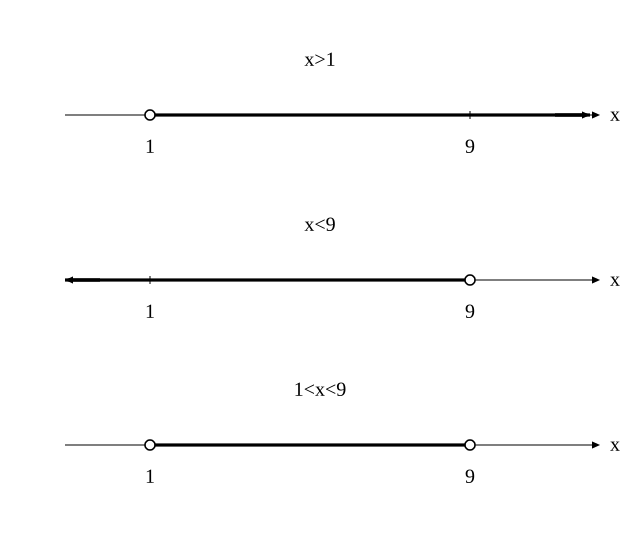

# L08 対数関数を含む方程式・不等式——「真数は正」を先に書く

- unit_id: hs-math-ii-exponential-logarithm
- 位置づけ: 単元第8レッスン（1.5時間）。L07 で見た対数関数の性質（定義域は x>0・底と 1 の大小で増減が決まる）を、方程式と不等式を解く道具として使う。手順は 4 段で固定し、最初に「真数は正」を書く。この 1 行を省くと、条件に合わない値が答えの形をして紛れ込む。置き換え t=log_a x は L04 の t=a^x（t>0）と対になる型だが、今度は t に制限が無い。区間つきの最大・最小は数学Ⅰ「二次関数」の再訪である。
- distribution_status: published_draft
- license: CC-BY-4.0
- verify_required: 例題数値・記述は監修者検証必須。
- 主概念: ①「真数は正」→同じ底の対数にそろえる→真数を比べる、の手順と、定義の形へ戻して解く型 ②底と1の大小で向きが決まる不等式・置き換え t=log_a x による二次式への帰着と最大・最小

---

## 1. 方程式——「真数は正」を先に書く

前のレッスンの定義を言い戻しておく。log_a M は a を何乗すると M になるかを表す数で、a^p=M と p=log_a M は同じことである。往復を 1 問。log_5 (1/25) の値はいくつか。5 を何乗すると 1/25 になるかを考えると、5^(−2)=1/25 だから log_5 (1/25)=−2 である。

このレッスンの終わりに、次の3つができるようになることを目指す。

1. 対数を含む方程式を「真数は正」を先に書いて解き、条件に合わない解を除ける。
2. 対数を含む不等式を、底と 1 の大小で向きを決めて解ける。
3. t=log_a x の置き換え（t に制限なし）で二次方程式と区間つきの最大・最小を解ける。

対数関数 y=log_a x（a>0、a≠1）は、底が 1 より大きければ増加、1 より小さければ減少で、どちらにしても真数が違えば値も違う。だから、底がそろった 2 つの対数が等しいなら、真数が等しい。また、対数の式は定義でいつでも指数の式に戻せる。X>0、Y>0 として、

- log_a X=log_a Y ならば X=Y
- log_a X=p ならば X=a^p（定義の形へ戻す）

log_2 (x−1)=3 を解いてみる。最初に、真数が正であることを書く。x−1>0 だから x>1 である。次に、定義の形へ戻す。log_2 (x−1)=3 は 2^3=x−1 と同じことだから、x−1=8、x=9 である。最後に、最初の条件と照らす。x=9 は x>1 を満たすので、解は x=9 である。

検算: 解を元の式に戻す。x=9 のとき log_2 (9−1)=log_2 8=3 で、確かに成り立つ。真数 9−1=8 は正である。

対数が 2 つある式は、L06 の性質で 1 つにまとめてから同じ手順をとる。log_3 (x＋2)＋log_3 (x−6)=2 を解いてみる。真数は正だから、x＋2>0 かつ x−6>0、すなわち x>6 である。積の性質で左辺をまとめると log_3 (x＋2)(x−6)=2 で、定義の形へ戻すと (x＋2)(x−6)=3^2=9 である。展開して整理すると x²−4x−21=0、因数分解して (x−7)(x＋3)=0 だから x=7、−3 である。ここで最初の条件 x>6 と照らす。x=7 は満たすが、x=−3 は満たさない。よって解は x=7 である。

検算: x=7 のとき log_3 9＋log_3 1=2＋0=2 で成り立つ。x=−3 を元の式に入れようとすると、真数 x＋2=−1 が負になり、log_3 (−1) は定められない。

なぜ最初に「真数は正」を書くのか。書かないと、x=−3 のような条件に合わない値が、答えの形をして紛れ込むからである。x=−3 は二次方程式 (x−7)(x＋3)=0 の解としては正しい。しかし元の式の真数を負にするので、元の方程式の解ではない。方程式を変形して得た二次方程式は、元の式より広い範囲の x を解に持ちうるので、最初に書いた条件で絞る。

この手順を 4 段にまとめる。(1) 真数は正、を書く。(2) 両辺を同じ底の対数にそろえる（性質で 1 つにまとめる・整数は log_a a^p に直す）。(3) 真数を比べる（定義の形へ戻す）。(4) (1) の条件と照らして、合わない解を除く。詳しくは §4 に書く。

:::guide
**「真数は正」を最初に書く理由**

手順の最後に条件と照らすのに、なぜ最初に書くのか。最後にまとめて確かめればよいようにも見える。しかし、途中で性質を使って対数を 1 つにまとめた瞬間に、元の式には無かった x が入り込む余地ができる。log_3 (x＋2)＋log_3 (x−6) は x>6 でしか意味を持たないが、まとめた log_3 (x＋2)(x−6) は x<−2 でも真数が正になる（負×負は正）。まとめる前に x>6 と書いておけば、どの範囲で式を扱っているかが途中で揺れない。条件を「書き忘れたら後で思い出す物」ではなく「式を変形する前の約束」として置く。この約束は、L04 で t=2^x とおいた瞬間に t>0 を書いたのと同じ型である。
:::

**例題1** log_3 (x−2)=2 を解け。

真数は正だから x−2>0、すなわち x>2 である。定義の形へ戻すと x−2=3^2=9 だから x=11 で、x>2 を満たす。よって **x=11**

検算: log_3 (11−2)=log_3 9=2 で成り立つ。

**例題2** log_2 x＋log_2 (x−2)=3 を解け。

真数は正だから x>0 かつ x−2>0、すなわち x>2 である。積の性質で log_2 x(x−2)=3 となり、定義の形へ戻すと x(x−2)=2^3=8 である。x²−2x−8=0、(x−4)(x＋2)=0 から x=4、−2 で、x>2 を満たすのは x=4 だけである。よって **x=4**

検算: log_2 4＋log_2 2=2＋1=3 で成り立つ。x=−2 は真数 x が負になるので除く。

:::guide
**ここで扱う物の格——教科書で扱われ、この単元でも本文で扱う**

このレッスンの内容は、教科書では対数関数を含む方程式・不等式、あるいは対数方程式・対数不等式と呼ばれる。底の変換公式、指数や対数を含む方程式・不等式、桁数や小数首位の問題は、学習指導要領解説の数学Ⅱ「指数関数・対数関数」の項には語が出てこないが、教科書では扱われており、この単元でも本文で扱う。新しい公式は無い。L05 の定義（指数の式へ戻す）と L06 の性質（1 つにまとめる）と L07 のグラフ（増減で向きが決まる）を、手順の 4 段に並べただけである。
:::

## 2. 不等式——底と 1 の大小で向きが決まる

不等式では、底と 1 の大小で真数の不等号の向きが決まる。L07 の増減をそのまま使う。真数は正とする。

- a>1 のとき、log_a X<log_a Y ならば 0<X<Y（向きはそのまま）
- 0<a<1 のとき、log_a X<log_a Y ならば X>Y>0（向きが逆になる）

log_2 (x−1)<3 を解いてみる。真数は正だから x>1 である。右辺の 3 を底 2 の対数に直すと 3=log_2 8 で、log_2 (x−1)<log_2 8 となる。底 2 は 1 より大きいから向きはそのままで、x−1<8、すなわち x<9 である。これと x>1 を合わせて、解は 1<x<9 である。

検算: 解の範囲の中と外から 1 点ずつ代入する。x=5 なら log_2 4=2<3 で成り立つ。x=10 なら log_2 9 はおよそ 3.17 で、3 より小さくない。確かに 1<x<9 である。

書き落としの例を見ておく。解を x<9 とだけ書くと、x=0 も含んでしまう。x=0 では真数 x−1=−1 が負で、log_2 (−1) は定められない。最初に書いた x>1 は、不等式でも最後まで効いている。

底が 1 より小さいとき向きが逆になるのはなぜか。y=log_(1/2) x のグラフが右下がりで、値が小さい点ほど真数は大きいからである（L07）。log_(1/2) (x−1)<3 を解いてみる。真数は正だから x>1 である。3=log_(1/2) (1/8) だから（(1/2)^3=1/8）、log_(1/2) (x−1)<log_(1/2) (1/8) となる。底 1/2 は 1 より小さいから向きが逆になり、x−1>1/8、すなわち x>9/8 である。これと x>1 を合わせると、解は x>9/8 である。

検算: x=2 なら log_(1/2) 1=0<3 で成り立つ。x=1.05 なら真数は 0.05 で、log_(1/2) 0.05 はおよそ 4.32 となり、3 より小さくない。確かに x>9/8 である。向きを変え忘れて x<9/8 とすると、x=1.05 で成り立たないことからすぐ分かる。

**例題3** log_(1/3) (x＋1)>−2 を解け。

真数は正だから x＋1>0、すなわち x>−1 である。−2=log_(1/3) 9 だから（(1/3)^(−2)=9）、log_(1/3) (x＋1)>log_(1/3) 9 となる。底 1/3 は 1 より小さいから向きが逆になり、x＋1<9、すなわち x<8 である。x>−1 と合わせて **−1<x<8**

検算: x=0 なら log_(1/3) 1=0>−2 で成り立つ。x=10 なら真数 11 は 9 より大きく、底 1/3 の対数は減少だから log_(1/3) 11<log_(1/3) 9=−2 で、成り立たない。

## 3. 置き換え t=log_a x——今度は制限なし

log_2 x と (log_2 x)^2 が混ざった式は、t=log_2 x とおいて二次方程式に直す。(log_2 x)^2−3 log_2 x＋2=0 を解いてみる。真数は正だから x>0 である。t=log_2 x とおくと t²−3t＋2=0、(t−1)(t−2)=0 だから t=1、2 である。t=log_2 x に戻すと、log_2 x=1 から x=2、log_2 x=2 から x=4 である。どちらも x>0 を満たすので、解は x=2、4 である。

検算: x=2 なら 1−3＋2=0、x=4 なら 4−6＋2=0 で、どちらも成り立つ。

t=log_2 x に範囲の制限が無いのはなぜか。対数関数の値域はすべての実数だからである（L07 の特徴 1）。x が正の数の全体を動くと、t=log_2 x は負の数も 0 も正の数もすべてとる。L04 の t=2^x では t>0 だったが、今度の t は何でもよい。ここに t>0 を付けてしまうと、正しい解を捨てることになる。たとえば (log_2 x)^2=1 の解は t=1 と t=−1 の両方で、x=2 と x=1/2 の 2 つが解である。

:::guide
**置き換えたら範囲も置き換える（今度は制限なし）**

L04 では、t=2^x とおいた瞬間に t>0 を書いた。その型をそのまま持ってくると、t=log_2 x でも t>0 を書きたくなる。しかし範囲は置き換える式ごとに違い、その場で確かめる物である。2^x は常に正だから t>0 だったが、log_2 x は x>1 で正、x=1 で 0、0<x<1 で負と、すべての実数をとる。だから t=log_2 x には制限が無く、代わりに元の x に x>0（真数は正）が付く。「置き換えたら範囲も置き換える」の中身は、毎回「この t はどんな値をとれるか」と問うことであって、t>0 と書くことではない。区間つきの問題では、x の範囲が t の範囲に写る。底が 1 より大きければ対数関数は増加なので端の値をそのまま写せるが、底が 1 より小さければ減少なので端が入れ替わる。
:::

区間つきの最大・最小も、同じ置き換えで数学Ⅰ「二次関数」の問題に直る。1≦x≦8 のとき、y=(log_2 x)^2−2 log_2 x の最大値と最小値を求めてみる。t=log_2 x とおく。1≦x≦8 が t ではどの範囲に変わるか。底 2 は 1 より大きく log_2 x は増加だから、端の値をそのまま写して、x=1 で t=0、x=8 で t=3、すなわち 0≦t≦3 である。y=t²−2t=(t−1)²−1 だから、0≦t≦3 の範囲で、最小値は t=1 のとき −1、最大値は t=3 のとき 9−6=3 である。t を x に戻すと、t=1 は x=2、t=3 は x=8 である。よって、x=2 で最小値 −1、x=8 で最大値 3 をとる。

検算: t=0（x=1）で y=0、t=1（x=2）で y=−1、t=3（x=8）で y=3 で、確かに −1 が最小、3 が最大である。1≦x≦8 が 0≦t≦3 に変わるのはなぜか。底 2>1 で log_2 x が増加するから、x の端の値 1 と 8 がそのまま t の端の値 0 と 3 になる。

**例題4** (log_3 x)^2−log_3 x−2=0 を解け。

真数は正だから x>0 である。t=log_3 x とおくと t²−t−2=0、(t−2)(t＋1)=0 だから t=2、−1 である。log_3 x=2 から x=9、log_3 x=−1 から x=1/3 で、どちらも x>0 を満たす。よって **x=9、1/3**

検算: x=9 なら t=2 で 4−2−2=0、x=1/3 なら t=−1 で 1＋1−2=0 で、どちらも成り立つ。t=−1 を「負だから捨てる」としないこと。

## 4. 手順の型

対数関数を含む方程式・不等式は、次の手順で解く。

1. 真数は正、を書く。真数が 2 つ以上あれば、すべてが正になる x の範囲を求める。
2. 両辺を同じ底の対数にそろえる。対数が 2 つ以上あれば性質で 1 つにまとめ、整数 p は log_a a^p に直す。
3. 真数を比べる。方程式なら真数どうしを等しいとおく（定義の形へ戻す）。不等式なら、底と 1 の大小で向きを決めてから真数を比べる（底が 1 より小さければ向きが逆）。
4. 1 の条件と照らし、合わない解を除く。
5. log_a x と (log_a x)^2 が混ざっていれば、2〜3 の代わりに t=log_a x とおいて t の二次方程式を解き、x に戻してから 4 の照合をする。t に制限は無い。区間つきなら x の範囲を t の範囲に写す。
6. 解を元の式に代入して確かめる。不等式は解の範囲の中と外から 1 点ずつ入れる。

答えを出したら、次の3つで自分の答えを確かめる。このレッスンの自己検査の型である。

1. 解を真数に代入して、真数が正になっているか。
2. 解を元の式に代入して、成り立つか。
3. 不等式の解は、範囲の中と外から 1 点ずつ代入する（L04 と同じ型）。

## 5. 練習

**問1** 次の方程式を解け。
(1) log_5 (2x−1)=2  (2) log_2 x＋log_2 (x−3)=2  (3) log_3 (x＋1)＋log_3 (x−1)=1

**問2** 次の不等式を解け。
(1) log_3 (x−2)<2  (2) log_2 (x＋1)≧3

**問3** 次の不等式を解け。
(1) log_(1/2) (x−3)>−2  (2) log_(1/3) x≦−1

**問4** 次の方程式を解け。置き換えた文字がどんな値をとれるかも書くこと。
(1) (log_2 x)^2−5 log_2 x＋6=0  (2) (log_3 x)^2＋log_3 x−6=0

**問5** 1≦x≦27 のとき、y=(log_3 x)^2−4 log_3 x の最大値と最小値を求めよ。また、そのときの x の値も答えよ。

**問6** 対数を含む方程式を解くとき、最初に「真数は正」を書くのはなぜか。条件を書かなかったときに紛れ込む値の例を 1 つ挙げて、2 文で説明せよ。

:::stretch
**S1** 不等式 log_(1/2) (x−1)<3 を、次の 2 通りの方法で解き、どちらも同じ解になることを確かめよ。
(1) 底 1/2 が 1 より小さいので向きが逆になる、として解く。
(2) 底の変換公式で log_(1/2) (x−1)=−log_2 (x−1) と直してから、底 2 の不等式として解く。
:::

対応解答: answer_key_L07-11.md

<!-- gen_nav:nav:start（自動生成・手編集しない） -->

---

[← 前のレッスン](lesson_07.md)｜[単元の目次](README.md)｜[解答](answer_key_L07-11.md)｜[次のレッスン →](lesson_09.md)

<!-- gen_nav:nav:end -->
