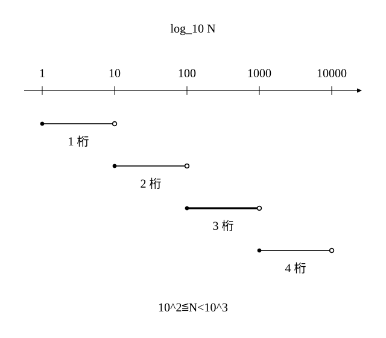

# L09 常用対数——桁数と小数首位

- unit_id: hs-math-ii-exponential-logarithm
- 位置づけ: 単元第9レッスン（1.5時間）。底が 10 の対数（常用対数）を使って、大きな累乗が何桁の数かと、1 より小さい数で初めて 0 でない数字が現れる位を求める。核は 10^n≦N<10^(n＋1) と n≦log_10 N<n＋1 が同じことで、桁数は「10 の何乗か」へ戻して決める。常用対数の値は問題文で与え、表は載せない。ここで身に付ける「両辺の常用対数をとる」は、L10 の活用でそのまま使う。
- distribution_status: published_draft
- license: CC-BY-4.0
- verify_required: 例題数値・記述は監修者検証必須。
- 主概念: ①a×10^n の表記（自足説明）と常用対数・大きな累乗の桁数を log_10 の整数部分から求める（挟む不等式）②対数の値を整数部分と小数部分に分けて元の数へ戻す・小数首位

---

## 1. 直接計算が手に負えない例——10 の何乗かで数を見る

前のレッスンの定義を言い戻しておく。log_a M は a を何乗すると M になるかを表す数で、a^p=M と p=log_a M は同じことである。往復を 1 問。log_10 1000 の値はいくつか。10 を何乗すると 1000 になるかを考えると、10^3=1000 だから log_10 1000=3 である。

このレッスンの終わりに、次の3つができるようになることを目指す。

1. 正の数を a×10^n（1≦a<10）の形に表し、常用対数の値から累乗の桁数を挟む不等式で求められる。
2. 常用対数の値を整数部分と 0 以上 1 未満の小数部分に分け、小数部分から元の数の大きさ（1 以上 10 未満の数）へ戻せる。
3. 1 より小さい数で初めて 0 でない数字が現れる位を求められる。

3^50 は何桁の数か。直接かけ算で求めてみる。3^1=3、3^2=9、3^3=27、3^4=81、3^5=243 と進み、3^10=59049 で 5 桁になる。ここから 50 乗まで、あと 40 回 3 をかけ続けることになり、数はどんどん長くなる。手計算では手に負えない。

しかし、知りたいのが桁数だけなら、3^50 の値そのものは要らない。3^50 が「10 の何乗に近いか」が分かれば、桁数は決まる。この見方を作るために、先に数の表し方を 1 つ確かめておく。

中学で、大きな数を 1 以上 10 未満の数と 10 の累乗の積で表した。この教材では、正の数 N を N=a×10^n（1≦a<10、n は整数）の形に表す。45000=4.5×10^4 であり、負の指数を使えば小さな数も同じ形で書けて、0.0072=7.2×10^(−3) である。a は小数点の前に 0 でない数字が 1 つだけ来るように選び、n は小数点を動かした回数で、元の数が 10 以上なら正、1 未満なら負にとる（45000 は小数点を左へ 4 つ動かして n=4、0.0072 は右へ 3 つ動かして n=−3）。

この形で見ると、桁数は 10 の累乗で決まる。100=10^2 は 3 桁、1000=10^3 は 4 桁である。3 桁の数は 100 以上 1000 未満の整数だから、N が 3 桁であることと 10^2≦N<10^3 は同じことである。一般に、正の整数 N が n＋1 桁であることと、10^n≦N<10^(n＋1) は同じことである。45000=4.5×10^4 なら 10^4≦45000<10^5 で、確かに 5 桁である。整数が何桁の数かを求める問題は、教科書では桁数の問題と呼ばれる。

## 2. 常用対数と桁数——挟む不等式を対数に直す

10 を底とする対数 log_10 M を、M の**常用対数**という。log_10 100=2、log_10 1000=3、log_10 0.01=−2 のように、M が 10 の整数乗なら値は整数である。M が 10 の整数乗でないとき、たとえば log_10 2 や log_10 3 は整数にならず、今までの数で簡単には書けない。その値はおよそ log_10 2≒0.3010、log_10 3≒0.4771 で、この教材では、必要な値を問題文で与える。

10^n≦N<10^(n＋1) の 3 つの数の常用対数をとる。y=log_10 x は底 10 が 1 より大きいから増加で、大小の向きは変わらない。log_10 10^n=n、log_10 10^(n＋1)=n＋1 だから、

- 10^n≦N<10^(n＋1) と n≦log_10 N<n＋1 は同じことである。

つまり、N の常用対数の整数部分が n なら、N は n＋1 桁である。桁数は、常用対数の整数部分に 1 を足した数である。

3^50 に戻る。log_10 3≒0.4771 を使うと、L06 の累乗の性質で log_10 3^50=50 log_10 3≒50×0.4771=23.855 である。23≦23.855<24 だから 10^23≦3^50<10^24 で、3^50 は 24 桁の数である。直接かけ算をしなくても、桁数だけは分かった。

検算: 小さい累乗で同じ手順を試す。2^10=1024 は 4 桁の数で、log_10 2^10=10×0.3010=3.010、3≦3.010<4 から 4 桁となり、一致する。

同じ型で 2^40 を見る。log_10 2≒0.3010 から log_10 2^40=40×0.3010=12.04 で、12≦12.04<13 だから 2^40 は 13 桁である。

10^2=100 は 3 桁なのに、log_10 100=2 なのはなぜか。桁数は整数部分そのものではなく、整数部分に 1 を足した数だからである。10^2≦N<10^3 を満たす数が 3 桁で、その常用対数は 2 以上 3 未満である。整数部分 2 に 1 を足して 3 桁になる。12.04 を見て 12 桁と答えるのは、この 1 を足し忘れた誤りである。

:::guide
**桁数は整数部分に 1 を足す——10^2 は 3 桁**

常用対数の整数部分をそのまま桁数と答えたくなる。手順を覚えるより、100 で確かめる癖をつける方が確実である。100 は 3 桁で、log_10 100=2 である。だから「整数部分 2 → 3 桁」で、1 を足す。この 1 は、10^n が n＋1 桁の数であること（10^0=1 は 1 桁、10^1=10 は 2 桁、10^2=100 は 3 桁）から来ている。答えを出したら、出した桁数 n＋1 で 10^n≦N<10^(n＋1) を書き直し、その不等式の常用対数が n≦log_10 N<n＋1 に戻るかを見る。桁数で迷ったら、必ず 100 に戻る。
:::

:::guide
**0.3010 は覚えなくてよい**

log_10 2≒0.3010 や log_10 3≒0.4771 は、この教材では問題文で与える。値を暗記することが目的ではなく、与えられた値を「10 の何乗か」として読み、整数部分と小数部分に分けて使えることが目的だからである。与えられる値は近似であり、≒ で書く。近似を重ねると最終の値が少しずれることもある。たとえば 2^40 を 10^12 で割った値はおよそ 1.0995 だが、10^0.04 はおよそ 1.0965 で、この差は 0.3010 という丸めによる物である。桁数のような整数の答えは、対数の小数部分が 0 や 1 のすぐ近くでなければ、この程度のずれでは変わらない。ただし元の数を小数で答えるときは「およそ」を付ける。
:::

**例題1** log_10 2≒0.3010 とする。5^30 は何桁の数か。

log_10 5 は与えられていないが、表に無くても出せるか。5=10/2 だから、商の性質で log_10 5=log_10 10−log_10 2=1−0.3010=0.6990 である。よって log_10 5^30=30 log_10 5≒30×0.6990=20.97 で、20≦20.97<21 だから 10^20≦5^30<10^21 となり、5^30 は **21 桁** の数である。

検算: 小さい累乗で同じ手順を試す。5^2=25 は 2 桁で、2×0.6990=1.398、1≦1.398<2 から 2 桁となり、一致する。

:::zatsudan
対数は、人間の感じ方に関係する尺度にも使われている。高等学校学習指導要領解説 数学編（平成30年告示）は、音の強さの単位や星の明るさの単位、地震の規模を表す尺度など、人間の感じ方に関係する尺度に対数が活用されていることを挙げている。この教材では、それぞれの尺度の定め方や実際の値には立ち入らない。
:::
<!-- zatsudan話題源: 内部調査要約 雑談枠許可リストZ1（高等学校学習指導要領解説 数学編・平成30年告示 イ(ウ) の明文の範囲。音の強さ・星の明るさ・地震の規模の尺度に対数が活用されている、まで。定義式と実測値は書かない）。出典の確認範囲内の内容のみ使用 -->

## 3. 整数部分と小数部分に分けて戻す——小数首位

今度は逆向きに、常用対数の値から元の数を求める。log_10 N=4.6990 のとき、N はどのくらいの大きさか。4.6990 を整数部分 4 と小数部分 0.6990 に分ける。N=10^4.6990=10^4×10^0.6990 で、整数部分 4 は 10 の 4 乗、つまり N が 10^4 以上 10^5 未満の大きさ（整数なら 5 桁）であることを表す。小数部分 0.6990 は、例題1 で見たとおり log_10 5 の近似値だから、10^0.6990≒5 である。よって N≒5×10^4=50000 である。

小数部分が「1 以上 10 未満の数の対数」に当たるのはなぜか。N=a×10^n（1≦a<10）と書くと、積の性質で log_10 N=log_10 a＋log_10 10^n=n＋log_10 a である。log_10 1=0、log_10 10=1 で、常用対数は増加だから、1≦a<10 のとき 0≦log_10 a<1 である。つまり、整数部分 n は 10 の何乗かを表し、小数部分 log_10 a は a の常用対数を表す。小数部分から a を読み、整数部分から 10^n を読めば、N=a×10^n に戻る。

log_10 N=3.4771 なら、3＋0.4771 と分け、0.4771≒log_10 3 だから N≒3×10^3=3000 である。log_10 2≒0.3010、log_10 3≒0.4771、log_10 5≒0.6990、log_10 7≒0.8451 のような値の小さな一覧を問題文で与え、小数部分と照らして a を読む。

:::guide
**対数の値を数へ戻すときは整数部分と小数部分に分ける**

log_10 N=4.6990 を見て「10 を 4.6990 乗した数」と読んでも、その値は直接には出てこない。対数の値を数へ戻すときは、まず整数部分と小数部分に分ける。整数部分は 10 の累乗（桁の位置）、小数部分は 1 以上 10 未満の数（先頭の数字の形）を表す。この 2 段の読み替えが、桁数を求めるときの逆の操作になっている。桁数を求めるときは、累乗の常用対数を計算して整数部分だけを見た。数へ戻すときは、小数部分も見て、与えられた値のどれと一致するかを照らす。与えられた値に無い小数部分が出てきたら、2 つの値の間に挟んで「どの数とどの数の間か」まで言えば足りる。
:::

**例題2** log_10 2≒0.3010 とする。log_10 N=5.3010 を満たす N はおよそいくつか。

5.3010=5＋0.3010 と分ける。0.3010≒log_10 2 だから、N=10^5×10^0.3010≒2×10^5=**200000** である。

検算: 逆引きした N の常用対数を計算して元の値に戻す。log_10 (2×10^5)=log_10 2＋5≒0.3010＋5=5.3010 で、一致する。

次に、1 より小さい数を見る。0.0072=7.2×10^(−3) は、小数第 3 位に初めて 0 でない数字 7 が現れる。一般に、0<N<1 の数 N について、小数第 k 位に初めて 0 でない数字が現れることと、10^(−k)≦N<10^(−k＋1) は同じことで、常用対数をとると −k≦log_10 N<−k＋1 である。初めて 0 でない数字が現れる位を求める問題は、教科書では小数首位の問題と呼ばれる。

(1/3)^20 を見る。log_10 (1/3)^20=20 log_10 (1/3)=−20 log_10 3≒−20×0.4771=−9.542 である。負の対数の整数部分はどう取るか。小数部分は 0 以上 1 未満にとる、という約束を守ると、−9.542=−10＋0.458 で、整数部分は −10、小数部分は 0.458 である。−10≦−9.542<−9 だから 10^(−10)≦(1/3)^20<10^(−9) で、(1/3)^20 は小数第 10 位に初めて 0 でない数字が現れる。整数部分を −9 と取って小数第 9 位と答えるのは誤りである。−9.542 は −9 より小さいので、−9≦log_10 N は成り立たない。

**例題3** log_10 2≒0.3010 とする。0.2^15 は小数第何位に初めて 0 でない数字が現れるか。

0.2=2/10 だから log_10 0.2=log_10 2−1≒0.3010−1=−0.6990 である。log_10 0.2^15=15×(−0.6990)=−10.485 で、−11≦−10.485<−10 だから 10^(−11)≦0.2^15<10^(−10) となり、初めて 0 でない数字が現れるのは **小数第 11 位** である。

検算: 小さい累乗で同じ手順を試す。0.2^2=0.04 は小数第 2 位で、2×(−0.6990)=−1.398、−2≦−1.398<−1 から小数第 2 位となり、一致する。

:::guide
**ここで扱う物の格——桁数と小数首位は教科書で呼ばれる名**

底の変換公式、指数や対数を含む方程式・不等式、桁数や小数首位の問題は、学習指導要領解説の数学Ⅱ「指数関数・対数関数」の項には語が出てこないが、教科書では扱われており、この単元でも本文で扱う。また、真数・底の変換公式・桁数・小数首位は教科書で呼ばれる名で、学習指導要領の用語・記号（累乗根・log_a x・常用対数）には入っていない。常用対数そのものは学習指導要領の用語・記号である。桁数と小数首位の問題で使うのは、L05 の定義と L06 の性質と「10^n≦N<10^(n＋1) と n≦log_10 N<n＋1 は同じこと」の 1 行だけで、新しい公式は無い。
:::

## 4. 手順の型

桁数と小数首位は、次の手順で求める。

1. 累乗 a^k の常用対数を、累乗の性質で k log_10 a に直す。log_10 a が与えられていなければ、積・商の性質で与えられた値から作る（log_10 5=1−log_10 2、log_10 6=log_10 2＋log_10 3 など）。
2. 値を計算し、整数部分 n と小数部分（0 以上 1 未満）に分ける。負の値では、整数部分を 1 つ下に取る（−9.542=−10＋0.458）。ただし −2 のように値が整数なら、そのまま −2＋0 と分ける。
3. n≦log_10 N<n＋1 を 10^n≦N<10^(n＋1) に戻す。n が 0 以上で N が正の整数なら N は n＋1 桁（整数でなければ 10^n 以上 10^(n＋1) 未満の大きさ）、N が 1 より小さく n が負（n=−k）なら N は小数第 k 位に初めて 0 でない数字が現れる。
4. 対数の値から元の数へ戻すときは、整数部分を 10 の累乗、小数部分を与えられた値と照らして 1 以上 10 未満の数に読み、a×10^n の形に組み立てる。

答えを出したら、次の3つで自分の答えを確かめる。このレッスンの自己検査の型である。

1. 出した桁数 n＋1 で 10^n≦N<10^(n＋1) を書き直し、常用対数が n≦log_10 N<n＋1 に戻るか。
2. 小さい累乗（2^10=1024 は 4 桁）で同じ手順を試し、一致するか。
3. 逆引きした N の常用対数を計算して、元の値に戻るか（例題2の検算）。

## 5. 練習

**問1** 次の数を a×10^n（1≦a<10、n は整数）の形で表せ。(3) は小数で表せ。
(1) 3200000  (2) 0.00048  (3) 2.5×10^(−3)

**問2** log_10 2≒0.3010、log_10 3≒0.4771 とする。次の数は何桁の数か。
(1) 2^50  (2) 3^30

**問3** log_10 2≒0.3010、log_10 3≒0.4771 とする。次の数は何桁の数か。常用対数の性質を使って、底の常用対数を与えられた値から作ること。
(1) 6^20  (2) 75^20

**問4** 常用対数の値の一覧を次のとおりとする。

| M | 2 | 3 | 5 | 7 |
|---|---|---|---|---|
| log_10 M | 0.3010 | 0.4771 | 0.6990 | 0.8451 |

次の式を満たす N はおよそいくつか。a×10^n の形で答えよ。
(1) log_10 N=3.8451  (2) log_10 N=6.4771  (3) log_10 N=2.9542

**問5** log_10 2≒0.3010、log_10 3≒0.4771 とする。次の数は、小数第何位に初めて 0 でない数字が現れるか。
(1) 0.5^20  (2) (2/3)^30

**問6** 正の整数の桁数が、その常用対数の整数部分に 1 を足した数になるのはなぜか。10^2=100 の例を使って 2 文で説明せよ。

:::stretch
**S1** log_10 2≒0.3010、log_10 3≒0.4771、log_10 7≒0.8451 とする。3^50 は 24 桁の数である（§2）。log_10 3^50≒23.855 の小数部分 0.855 を、log_10 7 と、log_10 2 から性質で作った log_10 8 の間に挟むことで、3^50 の最高位（いちばん左）の数字を求めよ。
:::

対応解答: answer_key_L07-11.md

<!-- gen_nav:nav:start（自動生成・手編集しない） -->

---

[← 前のレッスン](lesson_08.md)｜[単元の目次](README.md)｜[解答](answer_key_L07-11.md)｜[次のレッスン →](lesson_10.md)

<!-- gen_nav:nav:end -->
