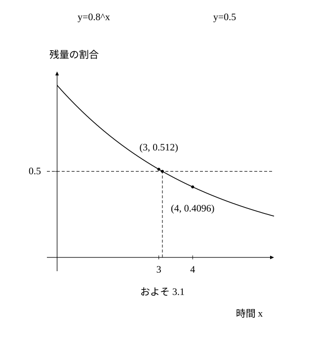
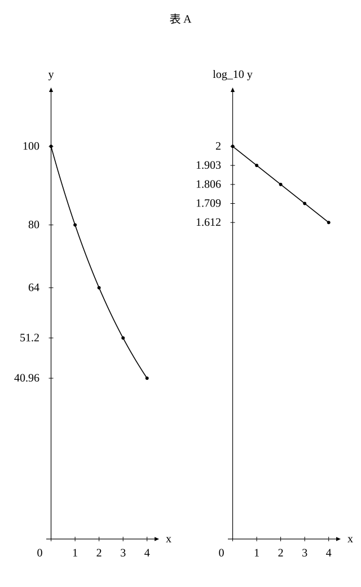

# L10 指数・対数の活用——式を立て、対数で解き、事象へ戻す

- unit_id: hs-math-ii-exponential-logarithm
- 位置づけ: 単元第10レッスン（1.5時間）。一定の割合で変わる事象を指数の式に翻訳し（L02 の再訪）、両辺の常用対数をとって解き（L09）、得た数を事象の言葉に戻す。この 3 段を固定の手順にする。表の値が指数関数とみなせるかを「等間隔ごとの倍率が一定か」で吟味し、常用対数をとると一次関数になることを見る。
- distribution_status: published_draft
- license: CC-BY-4.0
- verify_required: 例題数値・記述は監修者検証必須。
- 主概念: ①一定の割合で変わる事象を指数の式に翻訳する（n 回で p 倍なら1回あたり p^(1/n) 倍）・解説の活用例（薬の体内残量）を3段で解く ②指数関数とみなしてよいかの吟味と、常用対数をとると一次関数になること（片対数方眼紙の考え）

---

## 1. 翻訳の型——1 回ごとに r 倍なら n 回後は r^n 倍

前のレッスンの定義を言い戻しておく。log_a M は a を何乗すると M になるかを表す数で、a^p=M と p=log_a M は同じことである。往復を 1 問。log_10 0.01 の値はいくつか。10 を何乗すると 0.01 になるかを考えると、10^(−2)=1/100=0.01 だから log_10 0.01=−2 である。

このレッスンの終わりに、次の3つができるようになることを目指す。

1. 一定の割合で変わる事象を r^n の式に翻訳し「n 回で p 倍」を 1 回分の倍率に直せる。
2. 指数の式の両辺の常用対数をとって n を求め、負の数で割るとき不等号の向きを変えられる。
3. 得た数を事象の言葉に戻し、表の値が指数関数とみなせるかを倍率で吟味できる。

ある量が、1 回ごとに同じ倍率 r で変わるとする（r>0）。最初の量を 1 とすると、1 回後は r 倍、2 回後は r×r=r^2 倍、n 回後は r^n 倍である。これが、事象を指数の式に翻訳する型である。1 回ごとに 1.2 倍になる量は、2 回後に 1.2^2=1.44 倍になる。

逆向きの翻訳は L02 で見た。同じ倍率で n 回変化して p 倍になったとき（p>0）、1 回あたりの倍率は p^(1/n) 倍である。2 時間で 1.44 倍になった量は、1 時間あたり 1.44^(1/2)=√1.44=1.2 倍である。どちらの翻訳も「毎回同じ倍率で変わる」と仮定したときに成り立つ。

「3 回で 2 倍」は「1 回で 2/3 倍」ではない、なぜか。2/3 倍を 3 回続けると (2/3)^3 はおよそ 0.296 倍で、2 倍にならないからである。1 回分の倍率 r は r^3=2 を満たす数、すなわち r=2^(1/3) でおよそ 1.26 倍である。回数で割ってよいのは、一定の量ずつ変わる物の全体の増減量（3 回で 6 増えたなら 1 回で 2）であって、倍率そのものを回数で割る計算は、一定の倍率で変わる物には使えない。

:::guide
**「3回で2倍」は「1回で 2/3 倍」ではない**

事象を式にするとき、最初に決めることは「何が一定か」である。毎回同じ量ずつ増えるなら、3 回で 6 増えた量は 1 回で 2 増える（割り算）。毎回同じ倍率で増えるなら、3 回で 2 倍になった量は 1 回で 2^(1/3) 倍になる（累乗根）。この 2 つを取り違えると、式を立てた時点で答えが合わなくなる。問題文に「一定の割合で」「毎回同じ割合で」とあれば倍率が一定で、1 回あたりの倍率は p^(1/n) と書く。L02 で「2 回で半分なら 1 回で 1/4 ずつ減る」が誤りだったのと同じ話である。翻訳が合っているかは、出した 1 回分の倍率を n 回かけて p に戻るかで確かめる。
:::

## 2. 解説の活用例を 3 段で——翻訳→対数で解く→事象へ戻す

ある薬を飲んだとき、1 時間後の薬の体内残量が 80％ であるとする。体内残量が 50％ 以下になるのは、薬を飲んだおよそ何時間後か（この例は、高等学校学習指導要領解説 数学編（平成30年告示）にある活用の例による）。

第 1 段、翻訳する。1 時間ごとに残量が同じ倍率で変わるとみなし、整数でない時刻にも同じ式が使えると仮定して、飲んだときの量を 1 とすると、1 時間後は 0.8 倍、n 時間後は 0.8^n 倍である。残量が 50％ 以下になる条件は 0.8^n≦0.5 である。

第 2 段、対数で解く。n は指数にあるので、両辺の常用対数をとる。log_10 2≒0.3010 とする。両辺はどちらも正で、y=log_10 x は増加だから、大小の向きは変わらない。n log_10 0.8≦log_10 0.5 である。log_10 0.8=log_10 (8/10)=3 log_10 2−1≒3×0.3010−1=−0.0970、log_10 0.5=log_10 (1/2)=−log_10 2≒−0.3010 だから、この近似値で計算すると n×(−0.0970)≦−0.3010 である。両辺を −0.0970 で割る。負の数で割るので不等号の向きが変わり、n≧0.3010/0.0970≒3.10 である。

第 3 段、事象へ戻す。「n はおよそ 3.10 以上」を事象の言葉にするとどうなるか。薬を飲んでからおよそ 3.1 時間を過ぎると、体内残量が 50％ 以下になる。答えは、およそ 3.1 時間後である。

確かめ: 得た n を元の式に戻す。0.8^3=0.512 で 0.5 より大きく、0.8^4=0.4096 で 0.5 以下である。だから 3 時間後はまだ 50％ より多く、整数の時間で見れば 4 時間後が初めて 50％ 以下になる。3.10 という境は、確かに 3 と 4 の間にある。

両辺の常用対数をとっても大小が変わらないのはなぜか。両辺がどちらも正の数で、底 10 の対数関数は増加だからである（L07）。負や 0 の辺に対数をとることはできない。この計算で不等号の向きが変わるのはなぜか。割る数 log_10 0.8 が負で、負の数で両辺を割ると不等号の向きが変わるという不等式の性質を使うからである。1 より小さい正の数の常用対数は負になる（10^0=1 より小さい数は、10 の負の数乗である）。

:::guide
**負の数で割ると向きが変わる**

0.8^n≦0.5 の両辺の常用対数をとった後、n の係数 log_10 0.8 が負の数になる。ここで、数学Ⅰ「数と式」の不等式で学んだ「負の数で両辺を割ると不等号の向きが変わる」をそのまま使う。向きを変え忘れると n≦3.10 となり「3.1 時間後までは 50％ 以下」という、事象と逆の答えになる。減る事象（1 回ごとの倍率が 1 より小さい）を、このように両辺の常用対数をとって解くときは、必ず負の数で割る場面が来る。増える事象（倍率が 1 より大きい）では係数が正なので向きは変わらない。どちらの場合も、出した n の前後の整数を元の式に入れて（0.8^3 と 0.8^4）、境がそこにあるかを確かめれば、向きの誤りはすぐ見つかる。
:::

:::guide
**数の答えを事象の言葉に直す**

「n はおよそ 3.10 以上」は、数学の中での答えである（3.10 は与えた近似値で計算した境で、厳密な境は log_10 0.5／log_10 0.8 である）。事象の問いは「およそ何時間後か」だから、答えは「およそ 3.1 時間後」と時間の言葉で書く。さらに、時間を整数で数えるなら「4 時間後に初めて 50％ 以下になる」と言い直せる。どちらを答えにするかは問いの聞き方で決まるが、数を出して終わりにせず、元の事象の言葉に戻して意味が通るかを読む。「3.1 時間後」が「飲んだ直後」や「10 時間後」なら、翻訳か計算のどこかが違っている。この「戻す」段を落とすと、正しい計算をしても問いに答えたことにならない。
:::

**例題1** ある量が、1 回ごとに 1.05 倍になる。最初の量の 2 倍以上になるのは、初めて何回目か。log_10 1.05≒0.0212、log_10 2≒0.3010 とする。

翻訳: n 回後は 1.05^n 倍で、条件は 1.05^n≧2 である。対数で解く: 両辺の常用対数をとると n log_10 1.05≧log_10 2、n×0.0212≧0.3010 で、係数は正だから向きはそのままで n≧0.3010/0.0212≒14.2 である。事象へ戻す: n は回数（整数）だから、初めて 2 倍以上になるのは **15 回目** である。

検算: 1.05^14 はおよそ 1.980 で 2 より小さく、1.05^15 はおよそ 2.079 で 2 以上である。境は確かに 14 と 15 の間にある。

**例題2** ある量が、1 回ごとに 0.6 倍になる。最初の量の 0.1 倍以下になるのは、初めて何回目か。log_10 2≒0.3010、log_10 3≒0.4771 とする。

翻訳: 条件は 0.6^n≦0.1 である。対数で解く: log_10 0.6=log_10 (6/10)=log_10 2＋log_10 3−1≒0.3010＋0.4771−1=−0.2219、log_10 0.1=−1 だから、n×(−0.2219)≦−1 である。負の数で割るので向きが変わり、n≧1/0.2219≒4.51 である。事象へ戻す: 初めて 0.1 倍以下になるのは **5 回目** である。

検算: 0.6^4 はおよそ 0.130 で 0.1 より大きく、0.6^5 はおよそ 0.078 で 0.1 以下である。

## 3. 指数関数とみなせるか——倍率で吟味し、常用対数で直線にする

事象を指数の式に翻訳してよいのは、毎回同じ倍率で変わるときだけである。表の値を見て、指数関数とみなせるかを吟味する。次の 2 つの表は、吟味のために置いた仮の値である。

| x | 0 | 1 | 2 | 3 | 4 |
|---|---|---|---|---|---|
| 表 A の y | 100 | 80 | 64 | 51.2 | 40.96 |
| 表 B の y | 100 | 80 | 60 | 40 | 20 |

表 A は、隣との比が 80/100=64/80=51.2/64=40.96/51.2=0.8 でどこも同じである。等間隔ごとの倍率が一定だから、指数関数 y=100×0.8^x とみなせる。表 B は、隣との差が 20 でどこも同じだが、隣との比は 0.8、0.75、…と変わっていき、一定でない。差が一定なのは一次関数の変わり方で、指数関数とはみなせない。L03 で見た「差が一定」と「比が一定」の違いが、ここで事象を見分ける物差しになる。

指数関数とみなせた表 A について、y=100×0.8^x の両辺の常用対数をとる。log_10 y=log_10 100＋x log_10 0.8≒2−0.0970x である。右辺は x の一次式だから、log_10 y を縦軸にとって点を打つと、点は一直線に並ぶ。x=0 から 4 までの log_10 y の値はおよそ 2、1.903、1.806、1.709、1.612 で、隣との差が −0.097 で一定である。縦軸を対数の目盛りにした方眼紙は片対数方眼紙と呼ばれ、指数関数の形をした物がそこでは直線に見える。一般に y=k a^x（k>0、a>0、a≠1）なら log_10 y=log_10 k＋x log_10 a で、どの指数関数も常用対数をとると x の一次式になる（a=1 なら log_10 a=0 で、右辺は定数になる）。最初の値 k=100 を落として log_10 y=x log_10 0.8 と書かないこと。

:::guide
**課題学習の題材——温めた液体が冷める様子**

高等学校学習指導要領解説 数学編（平成30年告示）には、課題学習の例として、温めた液体を室温の部屋に置いたときに冷めていく様子（室温との温度差の減り方）を指数関数とみなし、片対数グラフを使って式を作る題材がある。実測した値の表から「指数関数とみなしてよいか」を倍率で吟味し、常用対数をとって一次式に直す、という §3 の考え方がそのまま使われる。この教材では題材の中身には立ち入らず、考え方の紹介にとどめる。
:::

:::zatsudan
対数で定められた尺度は、理科にもある。水溶液の性質を表す pH も、対数で定められた尺度の 1 つである。この教材では、その定め方や数値には立ち入らない。
:::
<!-- zatsudan話題源: 内部調査要約 雑談枠許可リストZ4（高等学校学習指導要領解説 理数編 理数数学Ⅰ の例示の範囲・一般論の一言。定義式の導出と数値は書かない）。出典の確認範囲内の内容のみ使用 -->

## 4. 手順の型

一定の割合で変わる事象の問題は、次の 3 段で解く。

1. 翻訳する。1 回ごとに r 倍なら n 回後は r^n 倍、n 回で p 倍なら 1 回あたり p^(1/n) 倍。最初の量を 1（または k）として、条件を r^n≦c や r^n≧c の形に書く。
2. 対数で解く。両辺の常用対数をとり（両辺が正であることを確かめる）、n log_10 r と log_10 c を与えられた値から性質で作る。log_10 r が負なら、割るときに不等号の向きを変える。
3. 事象へ戻す。n の値を、回数・時間などの事象の言葉に直す。回数が整数なら、境の前後の整数を元の式に入れて確かめる。

答えを出したら、次の3つで自分の答えを確かめる。このレッスンの自己検査の型である。

1. 得た n の前後の整数を元の式に戻し、境がそこにあるか（0.8^3 と 0.8^4 の確かめ）。
2. 1 回分の倍率を n 回かけて、p 倍に戻るか。
3. 答えを事象の言葉にして、意味が通るか読む。

## 5. 練習

**問1** 次の問いに答えよ。
(1) ある量が、1 回ごとに 1.5 倍になる。5 回後には最初の何倍になるか。
(2) ある量が、1 回ごとに 0.9 倍になる。3 回後には最初の何倍になるか。

**問2** 次の問いに答えよ。毎回同じ倍率で変わるとする。
(1) ある量が 2 回で 2.25 倍になった。1 回あたり何倍か。
(2) ある量が 3 回で 0.343 倍になった。1 回あたり何倍か。
(3) ある量が 5 回で 1/32 倍になった。1 回あたり何倍か。

**問3** ある量が、1 回ごとに 0.7 倍になる。最初の量の 0.01 倍以下になるのは、初めて何回目か。log_10 7≒0.8451 とする。

**問4** ある量が、1 時間ごとに 1.2 倍になる。log_10 2≒0.3010、log_10 3≒0.4771 とする。
(1) 最初の量の 10 倍以上になるのは、初めて何時間後か（整数の時間で答えよ）。
(2) (1) の結果を、事象の言葉で 1 文に直せ。

**問5** 次の 2 つの表は、吟味のために置いた仮の値である。

| x | 0 | 1 | 2 | 3 | 4 |
|---|---|---|---|---|---|
| 表 C の y | 160 | 80 | 40 | 20 | 10 |
| 表 D の y | 160 | 130 | 100 | 70 | 40 |

(1) 指数関数とみなせるのはどちらの表か。理由を 1 文で添えよ。
(2) (1) で選んだ表の y を、y=k a^x の形の式で表せ。
(3) log_10 2≒0.3010 として、(1) で選んだ表の log_10 y の値を x=0 から 4 まで求め、隣との差が一定であることを確かめよ。

:::stretch
**S1** §2 の例で、1 時間後に残る割合を 80％ から変えると、残量が 50％ 以下になるまでの時間はどう変わるか。log_10 2≒0.3010、log_10 3≒0.4771、log_10 7≒0.8451 とする。
(1) 1 時間後に残る割合が 90％ のとき、初めて 50％ 以下になるのは何時間後か（整数の時間で答えよ）。
(2) 1 時間後に残る割合が 70％ のとき、同じ問いに答えよ。
(3) 残る割合が大きいほど時間が長くなる理由を、log_10 r の符号と大きさの言葉で 1 文で説明せよ。
:::

対応解答: answer_key_L07-11.md

<!-- gen_nav:nav:start（自動生成・手編集しない） -->

---

[← 前のレッスン](lesson_09.md)｜[単元の目次](README.md)｜[解答](answer_key_L07-11.md)｜[次のレッスン →](lesson_11.md)

<!-- gen_nav:nav:end -->
