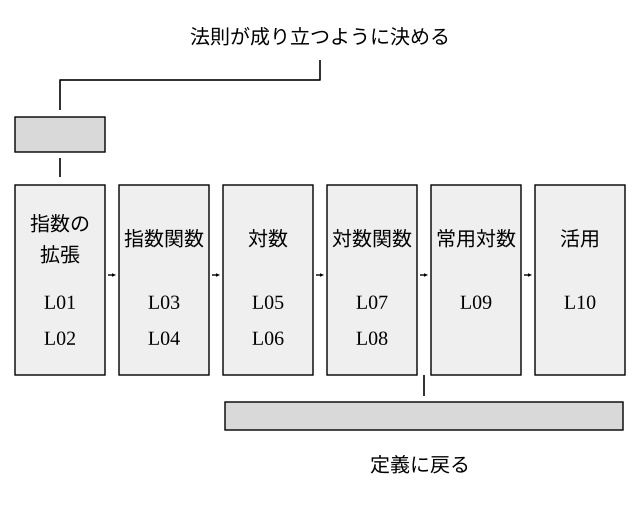

# L11 単元のまとめ——定義に戻る

- unit_id: hs-math-ii-exponential-logarithm
- 位置づけ: 単元第11レッスン（1.5時間）。L01〜L10 の総括回。**新しい概念・新しい用語は立てない**。単元を 6 段（指数の拡張→指数関数→対数→対数関数→常用対数→活用）と 2 本の背骨（法則が成り立つように決める・定義に戻る）で見渡し、各ブロックの総合問題を定義に戻って解き、典型的な誤り 4 つを自分で見つけて直す。最後に、この先の単元で何を学ぶかを予告する。
- distribution_status: published_draft
- license: CC-BY-4.0
- verify_required: 例題数値・記述は監修者検証必須。
- 主概念: ①単元マップと各ブロックの総合演習・誤りの再検査 ②後続予告（境界文1回ずつ）・新出なし宣言

---

## 1. 単元マップ——6 段と 2 本の背骨

前のレッスンの定義を言い戻しておく。log_a M は a を何乗すると M になるかを表す数で、a^p=M と p=log_a M は同じことである。往復を 1 問。log_7 49 の値はいくつか。7 を何乗すると 49 になるかを考えると、7^2=49 だから log_7 49=2 である。

このレッスンの終わりに、次の3つができるようになることを目指す。

1. 指数の拡張→指数関数→対数→対数関数→常用対数→活用の 6 段を、2 本の背骨（法則が成り立つように決める・定義に戻る）で言える。
2. 各ブロックの総合問題を、定義に戻って解ける。
3. 単元の典型的な誤り 4 つを自分で見つけて直せる。

この単元は 6 段でできている。指数の拡張（L01・L02）→指数関数（L03・L04）→対数（L05・L06）→対数関数（L07・L08）→常用対数（L09）→活用（L10）である。6 段を貫く背骨は 2 本ある。1 本目は「法則が成り立つように決める」で、0 と負の整数と分数の指数は、正の整数のときの指数法則がそのまま成り立つように決めた。2 本目は「定義に戻る」で、対数の性質は指数法則へ戻って導き、対数関数のグラフは指数関数の表を入れ替え、方程式は定義の形へ戻し、桁数は 10 の何乗かへ戻した。指数の側を通す語りは「同じ倍率で変わる」で、一次関数の「同じ量ずつ」や、L03 の表の二次関数 y=x² の「差が一定の量ずつ増える」と対比した。

読み終えた今、次の 5 つの文を自分の言葉で言えるかを確かめる。言えない物があれば、括弧のレッスンへ戻る。

1. 2^0=1 や 2^(−1)=1/2 は、指数法則がそこで止まらないように決めた値である（L01）。
2. a^(1/2) は a の半分ではなく、2 回かけると a になる倍率（√a）である（L02）。
3. log_a M は、a を何乗すると M になるかを表す数で、a^p=M と p=log_a M は同じことである（L05）。
4. 底が 1 より小さいとき、指数や対数の不等式の向きが逆になるのは、グラフが右下がりだからである（L04・L08）。
5. 大きな数の桁数は、常用対数の整数部分に 1 を足した数である（L09）。

単元を通して守ってきた条件と記法の約束を、1 つの表にまとめておく。

| 対象 | 条件・約束 | 初出 |
|---|---|---|
| 指数の範囲 | 整数（L01）→有理数（L02）→実数（L03・値が 1 つに決まると認める） | L01 |
| 底 a（指数法則） | 整数の指数では a≠0。有理数以降は a>0 | L01・L02 |
| 底 a（指数関数・対数） | a>0、a≠1 | L03・L05 |
| 真数 M | M>0。方程式・不等式では「真数は正」を手順の最初に書く | L05・L08 |
| 累乗根 | a>0、n は 2 以上の整数。ⁿ√a は正の方 | L02 |
| 置き換え | t=a^x は t>0。t=log_a x は制限なし。置き換えたら範囲も置き換える | L04・L08 |
| 不等号の向き | a>1 ならそのまま、0<a<1 なら逆（指数・対数とも）。理由はグラフの右上がり・右下がり | L03〜L04・L07〜L08 |
| 常用対数の値 | 問題文で与える（覚えなくてよい） | L09 |
| 桁数 | n≦log_10 N<n＋1 ⇔ n＋1 桁（N は正の整数）。小数部分は 0 以上 1 未満にとる | L09 |
| 記法 | a^n・a^(m＋n)・2^(−3)・a^(1/n)・(a^m)^n・ⁿ√a・³√8・log_a M・log_2 (x−1)・log_(1/2) x・log_10 2 | L01・L05 |

:::guide
**この単元で覚えるのは、指数法則と対数の定義の 1 行。残りは作れる**

11 レッスンを振り返ると、式や性質がたくさん出てきたように見える。しかし、覚える物として置いたのは、L01 の指数法則 3 本と L05 の定義 1 行（a^p=M ⇔ p=log_a M）だけである。a^0=1 も a^(1/n)=ⁿ√a も、指数法則が成り立つように決めた物で、忘れたら「法則が止まらないように」と考えて作り直せる。対数の性質 3 本も底の変換公式も、M=a^p とおいて指数法則へ戻せば 3 行で出る。桁数の不等式も、定義で指数の式に戻した物にすぎない。だから、この単元で式や性質を忘れたときに戻る場所は、指数法則と対数の定義の 2 か所である。そこに、底の条件・グラフの増減・10 進表記の約束・「毎回同じ倍率」という事象の仮定を添えれば、各レッスンの手順は作り直せる。この 2 つに戻れることが、この単元の到達点である。
:::

## 2. 総合演習——定義に戻って解く

各ブロックから 1 問ずつ、定義に戻って解く。解き方の型は、それぞれのレッスンのとおりである。

**例題1** 次の問いに答えよ。
(1) 16^(3/4) の値を求めよ。
(2) ある量が、同じ倍率で 4 回変化して 16 倍になった。1 回あたり何倍か。

(1) a^(m/n)=(ⁿ√a)^m を使う。16^(3/4)=(⁴√16)^3=2^3=**8** である。(2) 1 回分の倍率を r とすると r^4=16 だから、r=16^(1/4)=⁴√16=**2 倍** である。

検算: (1) は法則へ戻す。(16^(3/4))^4=16^3=4096 で、8^4=4096 と一致する。(2) は倍率を 4 回かけて戻す。2^4=16 で、確かに 16 倍になる。

**例題2** 次の問いに答えよ。
(1) log_2 x=5 を満たす x の値を求めよ。
(2) log_6 2＋log_6 18 の値を求めよ。

(1) 真数は正だから x>0。定義の形へ戻すと、log_2 x=5 は 2^5=x と同じことだから、x=**32** で、x>0 を満たす。(2) 積の性質で log_6 2＋log_6 18=log_6 (2×18)=log_6 36 で、36=6^2 だから **2** である。

検算: (1) は a^p を計算して M に戻る。2^5=32 で一致する。(2) はまとめた後の真数を底の累乗で戻す。6^2=36=2×18 で一致する。

**例題3** log_10 2≒0.3010 とする。対数関数 y=log_10 x のグラフ上で、x=5^30 に当たる点の高さ y を求め、5^30 が何桁の数かを答えよ。

log_10 5=1−log_10 2≒0.6990 だから、点の高さは y=log_10 5^30=30 log_10 5≒30×0.6990=20.97 である。y=log_10 x のグラフ上で高さ 20 の点は x=10^20、高さ 21 の点は x=10^21 で、グラフは右上がりだから、高さ 20.97 の点の x は 10^20 と 10^21 の間にある。20≦20.97<21 から 10^20≦5^30<10^21 で、5^30 は **21 桁** の数である。

検算: 出した桁数で 10^n≦N<10^(n＋1) を書き直す。21 桁なら 10^20≦5^30<10^21 で、その常用対数は 20≦log_10 5^30<21 となり、20.97 がこの範囲にある。

## 3. 誤りの再検査——どこが誤りか、なぜ誤りか

次の 4 つは、この単元で注意したい誤りや手順の省略を含む答案である。どこを直すか、正しい答えは何か、なぜ直すのか（誤りなら、なぜ誤りか）を 1 文で書く、の 3 つを自分でやってから、下の答えを読む。

**例題4** 答案「9^0=0、9^(1/2)=4.5」の誤りを直せ。

どちらも誤りである。正しくは 9^0=**1**、9^(1/2)=√9=**3** である。なぜ誤りか。9^0 は、指数法則 9^0×9^n=9^n が止まらないように 1 と決めた値であり、0 では法則が壊れる。9^(1/2) は 9 の半分ではなく、2 回かけると 9 になる正の数である。

**例題5** 答案「log_2 (8＋8)=log_2 8＋log_2 8=6」の誤りを直せ。

和の対数を対数の和に分けた所が誤りである。正しくは log_2 (8＋8)=log_2 16=**4** である。なぜ誤りか。積の性質は真数のかけ算を対数の足し算に変える物で、log の中の足し算をそのまま外の足し算にする性質は無い。

**例題6** 答案「(1/2)^x<1/8 の解は x<3」の誤りを直せ。

不等号の向きが誤りである。1/8=(1/2)^3 で、底 1/2 は 1 より小さいから向きが逆になり、正しくは **x>3** である。なぜ誤りか。y=(1/2)^x のグラフは右下がりで、値が小さい点ほど x は大きいからである。x=4 を入れると (1/2)^4=1/16<1/8 で成り立ち、x=2 では 1/4<1/8 で成り立たない。

**例題7** 答案「log_2 (x−3)=1 を解く。x−3=2 だから x=5」の誤りを直せ。

答えの値 5 は合っており、定義の形へ戻した x−3=2 からは真数が正であることも自動的に決まるので、数学としては誤っていない。直す所は、この教材の手順で約束した「真数は正」を最初に書くことを省いた点である。正しくは、最初に真数 x−3>0、すなわち x>3 を書き、定義の形へ戻して x−3=2^1=2、x=5 とし、x=5 が x>3 を満たすことを確かめて **x=5** とする。なぜ直すのか。対数が 2 つある式を性質でまとめると、条件に合わない値が答えの形をして紛れ込むことがあり、最初に条件を書いておけば見落とさずに除けるからである（問7 がその例。最後に元の式の真数へ代入して確かめても除けるが、この教材では最初に書く手順にそろえる）。

例題4〜6 の誤りに共通するのは、定義や決めた根拠に戻っていないことである。9^0 は法則に、log の性質は指数法則に、不等号の向きはグラフに、それぞれ戻れば誤りはその場で見つかる。例題7 は誤りではないが、真数の条件を最初に書く手順に戻れば、問7 のような紛れ込みを見落とさない。この単元の自己検査の型を 1 つの表に集めておく。

| 場面 | 自己検査の型 | 初出 |
|---|---|---|
| 累乗根・分数の指数の値を出した | 値が正で、n 乗して元の数（a または a^m）に戻るか | L02 |
| 1 回分の倍率を出した | 倍率を n 回かけて p 倍に戻るか | L02・L10 |
| 値を挟んで見積もった | 出した値が挟んだ 2 つの値の間にあるか | L02・L05 |
| 対数の値 p を出した | a^p を計算して M に戻るか | L05 |
| 性質で式を直した | まとめた真数を底の累乗で戻すか。値が分かる対数なら、直す前と後を別々に計算して一致するか | L06 |
| グラフを描いた | 点を 1 つとり、指数関数なら y=a^x、対数関数なら x=a^y で戻るか。底と 1 の大小と増減の向きが合っているか | L03・L07 |
| 方程式を解いた | 対数を含む式なら、解を真数に代入して正か。元の式に代入して成り立つか | L04・L08 |
| 不等式を解いた | 解の範囲の中と外から 1 点ずつ代入する | L04・L08 |
| 桁数を出した | 10^n≦N<10^(n＋1) に書き直す。小さい累乗で同じ手順を試す | L09 |
| 事象を解いた | n の前後の整数を元の式に戻す。答えを事象の言葉にして意味が通るか読む | L10 |

## 4. 後続予告——この先で学ぶこと

この単元で扱わなかったことを、学習指導要領解説の言葉で確かめておく。y=log_a x と y=a^x の関係を一般に述べることについて、高等学校学習指導要領解説 数学編（平成30年告示）は「逆関数については，『数学Ⅲ』の『（1）極限』の内容」としている。この単元では、y=log_a x は x=a^y のことと捉え、2 つのグラフが直線 y=x に関して対称であることを点の対応で確かめるまでにとどめた。

指数関数や対数関数の変化の速さを調べることについて、同じ解説は「指数関数，対数関数…などの関数の微分法，積分法については，『数学Ⅲ』で取り扱う」としている。また、底として特別な数を使うことについて「自然対数の底 e は，『数学Ⅲ』ではじめて取り扱う」としている。この単元の底は 2 や 1/2 や 10 のような簡単な数だけだった。

この単元で何度も使った「同じ倍率で変わる数の並び」は、数学B「数列」で名前を付けて改めて扱う。

:::guide
**この単元の先にある物**

この単元の道具は、数学の中だけでなく、理科の各科目でも使われる。高等学校学習指導要領解説 数学編（平成30年告示）は、理科の各科目を履修するにあたって早めに学んでおく方がよい場合には、この単元を他の内容より早く履修させることも考えられる、と述べている。この教材が数学Ⅱの他の単元の内容を前提にしなかったのは、そのためである。この先、どの場面で指数や対数に出会っても、戻る場所は同じで、指数法則と対数の定義である。
:::

## 5. 練習

**問1** 次の問いに答えよ。
(1) 27^(2/3) の値を求めよ。
(2) 8^(−1/3) の値を求めよ。
(3) ある量が、同じ倍率で 3 回変化して 125 倍になった。1 回あたり何倍か。

**問2** 次の問いに答えよ。
(1) log_3 x=4 を満たす x の値を求めよ。
(2) log_2 12＋log_2 (4/3) の値を求めよ。
(3) log_5 50−log_5 2 の値を求めよ。

**問3** 次の問いに答えよ。
(1) 対数関数 y=log_3 x のグラフ上で、高さ y が 2 になる点と −1 になる点の x 座標をそれぞれ求めよ。
(2) log_10 7≒0.8451 とする。7^20 は何桁の数か。

**問4** 答案「8^0=0、8^(1/3)=8/3」について、どこが誤りか、正しい値は何か、なぜ誤りかを 1 文で書け。

**問5** 答案「log_4 (8＋8)=log_4 8＋log_4 8=3」について、どこが誤りか、正しい値は何か、なぜ誤りかを 1 文で書け。

**問6** 答案「(1/3)^x<1/27 の解は x<3」について、どこが誤りか、正しい解は何か、なぜ誤りかを 1 文で書け。

**問7** 答案「log_3 (x＋2)＋log_3 (x−4)=3 を解く。(x＋2)(x−4)=27 から x²−2x−35=0、(x−7)(x＋5)=0 で、x=7、−5」について、どこが誤りか、正しい解は何か、なぜ誤りかを 1 文で書け。

:::stretch
**S1** log_3 5 と log_2 3 の大小を比べよ。それぞれを 3/2 と比べることで判断すること（指数の式に戻し、3^(3/2) と 5、2^(3/2) と 3 の大小を使う）。
:::

対応解答: answer_key_L07-11.md

<!-- gen_nav:nav:start（自動生成・手編集しない） -->

---

[← 前のレッスン](lesson_10.md)｜[単元の目次](README.md)｜[解答](answer_key_L07-11.md)

<!-- gen_nav:nav:end -->
