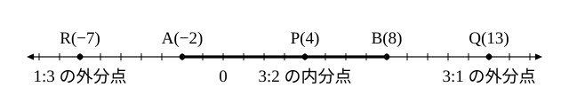

# L01 数直線上の点——距離・内分点・外分点

- unit_id: hs-math-ii-figures-and-equations
- 位置づけ: 単元第1レッスン（1.5時間）。数学Ⅱ「図形と方程式」の入口。この単元では、図形を「条件を満たす点の集合」として見て、座標と方程式で図形を調べる方法を学ぶ。その最初の一歩として、数直線上の点を実数で表し、2点間の距離と「線分を与えられた比に分ける点」（内分点・外分点）を、1つの式で扱えるようにする。ここで身につけた式は、L02 で座標平面へそのまま持ち上げる。
- distribution_status: published_draft
- license: CC-BY-4.0
- verify_required: 例題数値・記述は監修者検証必須。
- 主概念: ①前提診断（数直線上の2点の距離・座標を読む）と数直線上の2点間の距離 ②線分を与えられた比に分ける点（内分点・外分点を1つの式で・外分は分母を正にして計算・中点＝1:1 の内分点）

---

## 0. 本編の前に——2つの前提を確かめる

この単元は、中学で学んだ「座標」と、数学Ⅰ「数と式」で学んだ「数直線上の距離」の上に立つ。先に2問だけ確かめておこう。

**確認A** 数直線上の2点 A(−3)、B(5) の間の距離を求めよ。

**確認B** 座標平面上の2点 A(4, −1)、B(−2, −1) について、2点を結ぶ線分 AB は x 軸に平行か、y 軸に平行か。また、その長さを求めよ。

（ここから下は答え。先に自分の答えを紙に書いてから読もう。）

確認A: B の座標から A の座標を引いて 5−(−3)=8。距離は **8** である。
確認B: 2点の y 座標がどちらも −1 で等しい（同じ高さに横に並ぶ）から、線分 AB は **x 軸に平行**である。長さは x 座標の差で、4−(−2)=**6**。

:::guide
**この2問で手が止まったら、戻る場所がある**

確認Aで「5−3=2」としたなら、負の数の引き算（5−(−3)=5＋3）を数直線の上で見直しておこう。「数直線上の2点の距離は、座標の差の絶対値である」という言い方は、数学Ⅰ「数と式」の絶対値のレッスンで使ったものである。確認Bで線分の向きが読めなかったなら、中1「比例と反比例」の座標の導入へ戻る。x 座標が等しい2点を結ぶと y 軸に平行な線分、y 座標が等しい2点を結ぶと x 軸に平行な線分になる。この単元は、この「座標の差」を何度も使う。
:::

## 1. 数直線上の点と2点間の距離

数直線の上に点 P をとると、P に対応する実数がただ1つ決まる。この実数を点 P の**座標**といい、座標が a である点 P を P(a) と書く（座標の語は中1から使っている）。逆に、実数を1つ決めれば、数直線上の点がただ1つ決まる。つまり、数直線上の点と実数は1対1に対応している。

2点 A(a)、B(b) の間の距離 AB は、座標の差の絶対値で表せる。

AB = |b−a|

a<b なら b−a、a>b なら a−b で、どちらの場合も「大きい方から小さい方を引く」ことになる。a=b なら距離は 0 である。

**例題1** 次の2点間の距離を求めよ。
(1) A(−4)、B(3)  (2) A(2)、B(−6)

(1) AB=|3−(−4)|=|7|=**7**
(2) AB=|−6−2|=|−8|=**8**

検算は数直線に2点を打って目盛りを数えればよい。(2) では、2 から 0 まで 2 目盛り、0 から −6 まで 6 目盛りで、合わせて 8 である。

## 2. 線分を与えられた比に分ける点——内分点

線分 AB 上に点 P をとる。AP と PB の長さの比が m:n（m、n は正の数）であるとき、P は線分 AB を m:n に**内分する**（ないぶんする）といい、P を線分 AB の**内分点**という。

A(a)、B(b) を a<b として、線分 AB を m:n に内分する点 P の座標 p を求めよう。P は A と B の間にあり、A から P までの長さは AB 全体の m/(m＋n) 倍である。AB の長さは b−a だから、

p = a＋(m/(m＋n))(b−a)

通分して整理すると（分子は (m＋n)a＋m(b−a)=ma＋na＋mb−ma=na＋mb）、

p = ((m＋n)a＋m(b−a))/(m＋n) = (na＋mb)/(m＋n)

a>b の場合も、同じ式が成り立つ（P は B から見て A の側へ、全体の n/(m＋n) だけ進んだ点である。式を作り直してみると同じ形になる。たとえば A(8)、B(−2) を 3:2 に内分する点は (2×8＋3×(−2))/(3＋2)=2 で、AP=6、PB=4 だから確かに 3:2 である）。したがって、

**線分 AB を m:n に内分する点の座標は (na＋mb)/(m＋n)** である。

分子は「n を A の座標に、m を B の座標に掛けて足す」——比の数と端の組が入れ違いになる（m は B の座標に、n は A の座標に掛かる）ことに注意しよう。A に近い点ほど A の座標の重みが大きくなるので、A の座標には（P から B までの比の数である）n が掛かる。

**例題2** 2点 A(−2)、B(8) について、線分 AB を 3:2 に内分する点 P の座標を求めよ。

p=(2×(−2)＋3×8)/(3＋2)=(−4＋24)/5=20/5=**4**

検算: AP=|4−(−2)|=6、PB=|8−4|=4 で、AP:PB=6:4=3:2 となり、確かに 3:2 に内分している。

特に m=n=1 のとき、すなわち線分 AB を 1:1 に内分する点の座標は (a＋b)/2 である。線分 AB のちょうど真ん中にあるこの点は、線分 AB の**中点**と呼ばれる。例題2の A(−2)、B(8) の中点の座標は (−2＋8)/2=3 である。

## 3. 外分点——分母を正にして計算する

こんどは、線分 AB の**延長上**の点 Q を考える。AQ と QB の長さの比が m:n（m≠n）であるとき、Q は線分 AB を m:n に**外分する**（がいぶんする）といい、Q を線分 AB の**外分点**という。

Q がどちら側にあるかは、比の大小で決まる。m>n なら Q は B の外側（A から遠い側）にあり、m<n なら Q は A の外側にある。「前の数が大きければ B の外側、後ろの数が大きければ A の外側」と覚えておくとよい。AQ:QB=m:n の前の数 m は A の側（AQ）、後ろの数 n は B の側（QB）の長さを表すので、まとめると「比の数が小さい方の端の外側」になる（内分点の式で掛ける相手とは逆の組み合わせである）。

A(a)、B(b)（a<b）で m>n のとき、Q は B の外側にあり、AQ は AB の m/(m−n) 倍である（AQ を m 個分、QB を n 個分とすると、AB=AQ−QB は m−n 個分だから、AQ は AB の m/(m−n) 倍）。よって

q = a＋(m/(m−n))(b−a) = ((m−n)a＋m(b−a))/(m−n) = (−na＋mb)/(m−n)

m<n の場合は Q が A の外側にあり、AQ は AB の m/(n−m) 倍だから q=a−(m/(n−m))(b−a)=(na−mb)/(n−m) となる。分子と分母に −1 を掛けると同じ式 (−na＋mb)/(m−n) になる（このときは分母 m−n が負になる）。a>b のときも同じである。m>n なら Q は B の外側にあって q=a−(m/(m−n))(a−b)、m<n なら Q は A の外側にあって q=a＋(m/(n−m))(a−b) で、どちらも整理すると (−na＋mb)/(m−n) になる（たとえば A(8)、B(−2) を 3:1 に外分する点は (−1×8＋3×(−2))/(3−1)=−7 で、AQ=15、QB=5 だから確かに 3:1 であり、Q は B の外側にある）。したがって、

**線分 AB を m:n に外分する点の座標は (−na＋mb)/(m−n)** である。

内分点の式と見比べると、n の符号を変えただけである。内分と外分は別々の公式ではなく「線分を与えられた比に分ける点」という同じ考えの、比の向きが違う2つの場合である。

m<n のときは分母が負になって計算を間違えやすい。そこで、分子と分母の両方に −1 を掛けて、**分母を正にしてから計算する**。すなわち、m<n のときは

q = (na−mb)/(n−m)

と書き直して計算する。値は同じである。

**例題3** 2点 A(−2)、B(8) について、線分 AB を 3:1 に外分する点 Q の座標を求めよ。

3>1 だから Q は B の外側にある。q=(−1×(−2)＋3×8)/(3−1)=(2＋24)/2=26/2=**13**

検算: AQ=|13−(−2)|=15、QB=|8−13|=5 で、AQ:QB=15:5=3:1。Q は確かに B の外側（13>8）にある。

**例題4** 2点 A(−2)、B(8) について、線分 AB を 1:3 に外分する点 R の座標を求めよ。

1<3 だから R は A の外側にある。分母を正にして、r=(3×(−2)−1×8)/(3−1)=(−6−8)/2=−14/2=**−7**

検算: AR=|−7−(−2)|=5、RB=|8−(−7)|=15 で、AR:RB=5:15=1:3。R は確かに A の外側（−7<−2）にある。

:::guide
**外分点が線分の「外」に出るのはなぜか**

AQ:QB=3:1 とは「A から Q までが、Q から B までの3倍」ということである。Q が A と B の間にあるなら AQ＋QB=AB だが、Q が B の外側にあるなら AQ−QB=AB になる。例題3では AQ=15、QB=5 で、その差 10 がちょうど AB の長さである。内分点では2つの長さの「和」が AB、外分点では「差」が AB——図で長さを書き込んでみると、外分点が線分の外に出る理由が見える。計算の前に、数直線に A と B を打ち、比の数が小さい方の端の外側に Q の見当をつける。この「見当」を毎回つけておくと、符号の間違いを自分で見つけられる。
:::

:::guide
**比の数を掛ける相手の取り違え**

内分点の式 (na＋mb)/(m＋n) で、m を a に、n を b に掛けてしまう取り違えが起こりうる。例題2でそうすると (3×(−2)＋2×8)/5=10/5=2 となり、AP:PB=4:6=2:3 で、比が逆になる。比が逆になるだけなので、答えが線分の内側に収まってしまい、間違いに気づきにくい。だからこそ、答えを出したら AP と PB の長さを実際に計算して比を確かめる。「答えの検算は、比を長さで確かめること」——このレッスンの手順の型の最後の一手である。
:::

## 4. 手順の型

1. 数直線に A と B を打ち、求める点の位置に見当をつける（内分点なら A と B の間、外分点なら比の数が小さい方の端の外側）。
2. 内分点は (na＋mb)/(m＋n)、外分点は (−na＋mb)/(m−n) に代入する。外分で m<n のときは分母を正にして (na−mb)/(n−m) で計算する。
3. 求めた座標が手順 1 の見当と合っているかを見る。
4. 求めた点から A、B までの長さを計算し、比が与えられたとおりになっていることを確かめる。

:::zatsudan
この単元で学ぶ方法は、解析幾何学と呼ばれる。座標を用いて図形を方程式で表し、その性質を調べる方法である。中学までの図形の学習では、図形の性質は合同や相似を使って説明した。この単元では、点を座標という数に、図形を方程式という式に置き換える。すると、図形の問題が計算の問題に変わる。このレッスンで扱った「線分を比に分ける点」も、作図で求める方法とは別に、座標では1つの式の計算で求められるようになった。
:::
<!-- zatsudan話題源: 内部調査要約 雑談枠許可リストZ1（高等学校学習指導要領解説 数学編（平成30年告示）が本単元を「解析幾何学における方法」と位置づける記述の範囲。人名は出典にないため出さない）。出典の確認範囲内の内容のみ使用 -->

## 5. 練習

**問1** 次の2点間の距離を求めよ。
(1) A(3)、B(11)  (2) A(−5)、B(2)  (3) A(−1)、B(−9)

**問2** 2点 A(−6)、B(4) について、次の点の座標を求めよ。
(1) 線分 AB を 2:3 に内分する点
(2) 線分 AB の中点
(3) 線分 AB を 4:1 に内分する点

**問3** 2点 A(−6)、B(4) について、次の点の座標を求めよ。
(1) 線分 AB を 3:1 に外分する点
(2) 線分 AB を 1:3 に外分する点
(3) 線分 AB を 5:3 に外分する点

**問4** 数直線上に4点 A(1)、B(7)、P(5)、Q(10) がある。
(1) 点 P は線分 AB をどのような比に内分するか。
(2) 点 Q は線分 AB をどのような比に外分するか。

**問5** 2点 A(2)、B(5) について、線分 AB を 2:1 に内分する点を P、2:1 に外分する点を Q とする。P、Q の座標を求め、4点 A、B、P、Q を数直線上の左から順に並べよ。

**問6** 2点 A(0)、B(6) について、線分 AB を 1:4 に外分する点の座標を、外分点の式にそのまま代入する方法と、分母を正にしてから計算する方法の2通りで求めよ。そのうえで「分母を正にして計算する」ことを勧める理由を2〜3文で説明せよ。

---

:::stretch
**S1** 線分 AB を m:n に外分する点の式 (−na＋mb)/(m−n) は、内分点の式 (na＋mb)/(m＋n) の n を −n に置き換えたものである。このことは「m:n に外分する点は、m:(−n) に内分する点とみなせる」と読める。
(1) 2点 A(−6)、B(4) について、線分 AB を 3:1 に外分する点の座標を、内分点の式に m=3、n=−1 を代入して求め、問3(1) の答えと一致することを確かめよ。
(2) 「比の一方を負の数にする」ことが、図の上では何を意味するかを、AQ と QB の向きに注目して1〜2文で説明せよ。
:::

対応解答: answer_key_L01-06.md

<!-- gen_nav:nav:start（自動生成・手編集しない） -->

---

[単元の目次](README.md)｜[解答](answer_key_L01-06.md)｜[次のレッスン →](lesson_02.md)

<!-- gen_nav:nav:end -->
