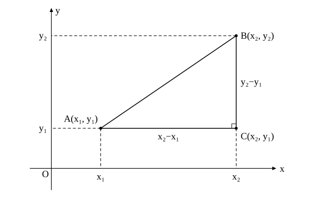
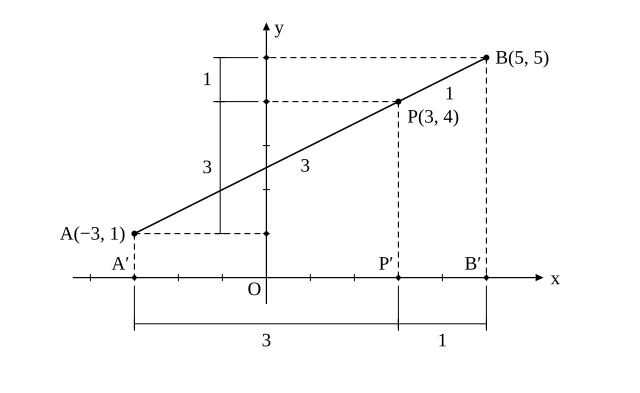

# L02 平面上の点——2点間の距離と内分点・外分点

- unit_id: hs-math-ii-figures-and-equations
- 位置づけ: 単元第2レッスン（2時間）。L01 の数直線上の式を、座標平面へ持ち上げる回。2点間の距離は、中3「三平方の定理」で「直角三角形を見つけて」求めていたものを、公式 √((x₂−x₁)²＋(y₂−y₁)²) に一般化する。内分点・外分点は、x 座標と y 座標を別々に見て L01 の式をそれぞれに使う。この2つの式は、円の方程式（L07）と軌跡（L10）の土台になる。
- distribution_status: published_draft
- license: CC-BY-4.0
- verify_required: 例題数値・記述は監修者検証必須。
- 主概念: ①三平方の定理から2点間の距離の公式を導く・根号を含む距離の計算 ②x 座標・y 座標へ分けて数直線に落とす内分点・外分点の座標

---

## 1. 2点間の距離——直角三角形を見つける

座標平面上の2点 A(x₁, y₁)、B(x₂, y₂) の間の距離を求めよう（x₁ は「1つ目の点の x 座標」を表す1つの文字で、右下の小さい数字は番号である。掛け算や2乗の意味はない）。中3では、A と B を結ぶ線分を斜辺とする直角三角形を見つけて、三平方の定理を使った。同じことを、文字のまま行う。

x₁≠x₂、y₁≠y₂ のとき、点 C(x₂, y₁) をとると、AC は x 軸に平行で長さ |x₂−x₁|、BC は y 軸に平行で長さ |y₂−y₁| であり、角 C は直角である。三平方の定理から

AB² = (x₂−x₁)²＋(y₂−y₁)²

（2乗すると絶対値の記号は外れる。）AB>0 だから、

**AB = √((x₂−x₁)²＋(y₂−y₁)²)**

これが**2点間の距離**の公式である。特に、原点 O と点 P(x, y) の距離は OP=√(x²＋y²) となる。

y₂=y₁（2点が x 軸に平行に並ぶ）のときも、この式は AB=√((x₂−x₁)²)=|x₂−x₁| となって正しい値を与える（たとえば x₂−x₁=−3 なら √((−3)²)=√9=3 で、2乗して根号をとると符号がとれる）。x₂=x₁（2点が y 軸に平行に並ぶ）のときも同様に AB=|y₂−y₁| となる。L01 の数直線上の距離は、この公式の特別な場合である。

**例題1** 次の2点間の距離を求めよ。
(1) A(1, 2)、B(4, 6)  (2) A(−2, 3)、B(3, −2)  (3) O(0, 0)、P(−3, 4)

(1) AB=√((4−1)²＋(6−2)²)=√(9＋16)=√25=**5**
(2) AB=√((3−(−2))²＋(−2−3)²)=√(25＋25)=√50=**5√2**
(3) OP=√((−3)²＋4²)=√(9＋16)=**5**

(2) のように、根号の中が平方数にならないときは、√50=√(25×2)=5√2 のように根号の中をできるだけ簡単にして答える（数学Ⅰ「数と式」の根号の計算）。

:::guide
**引く順番を気にしなくてよい理由**

距離の公式で「x₂−x₁ か x₁−x₂ か」で迷うことがある。答えは「どちらでもよい」である。(x₂−x₁)²=(x₁−x₂)² だから、2乗した時点で引く順番の違いは消える。例題1(2) で x₂−x₁=3−(−2)=5 とせずに x₁−x₂=−5 としても、2乗すれば同じ 25 になる。距離の公式は、三平方の定理を座標の言葉で書き直しただけのものである。忘れたら、2点を打って直角三角形を描き、横と縦の長さを座標の差から読めばよい。公式より先に「直角三角形を見つける」（中3の言い方）が身についていれば、公式はいつでも作り直せる。
:::

**例題2** 3点 A(−1, 0)、B(3, 2)、C(1, 6) を頂点とする三角形 ABC はどのような三角形か。

3辺の長さの2乗を計算する。
AB²=(3−(−1))²＋(2−0)²=16＋4=20
BC²=(1−3)²＋(6−2)²=4＋16=20
CA²=(−1−1)²＋(0−6)²=4＋36=40

AB²=BC² だから AB=BC。さらに AB²＋BC²=20＋20=40=CA² だから、三平方の定理の逆（3辺について a²＋b²=c² が成り立てば、長さ c の辺の向かいの角は直角）により、いちばん長い辺 CA の向かいの角 B は直角である。よって三角形 ABC は **∠B=90° の直角二等辺三角形**である。

辺の長さそのものではなく、2乗のままで比べると根号を外す手間が省ける。三角形の形を調べるときは、まず3辺の2乗を並べてみるとよい。

**例題3** 2点 A(−1, 2)、B(3, 4) から等しい距離にある x 軸上の点 P の座標を求めよ。

P は x 軸上にあるから、P(t, 0) とおける。PA=PB より PA²=PB² だから、

(t＋1)²＋(0−2)² = (t−3)²＋(0−4)²
t²＋2t＋1＋4 = t²−6t＋9＋16
8t = 20
t = 5/2

よって **P(5/2, 0)** である。

検算: PA²=(5/2＋1)²＋4=49/4＋16/4=65/4、PB²=(5/2−3)²＋16=1/4＋64/4=65/4 で一致する。

例題3では「距離を求める」のではなく、距離の条件から点を求めた。式を「使う」向きと「逆向きに使う」向きの両方を、この単元では毎回練習する。

## 2. 平面上の内分点・外分点——x と y を別々に

2点 A(x₁, y₁)、B(x₂, y₂) を結ぶ線分 AB を m:n に内分する点 P の座標を求めよう。

A、P、B から x 軸に垂線を下ろし、x 軸との交点をそれぞれ A′、P′、B′ とする。点から直線に下ろした垂線とその直線との交点は、垂線の**足**（すいせんのあし）と呼ばれる。3本の垂線は平行だから、中3で学んだ「平行線と線分の比」により、A′P′:P′B′=AP:PB=m:n である。つまり、x 軸上で P′ は線分 A′B′ を m:n に内分する。A′、B′ の座標は x₁、x₂ だから、L01 の式により P′ の座標、すなわち P の x 座標は (nx₁＋mx₂)/(m＋n) である（AB が y 軸に平行なときは x 座標がすべて等しいので、この式はそのまま成り立つ）。y 座標についても、y 軸に垂線を下ろして同じことをすればよい。

**線分 AB を m:n に内分する点の座標は ((nx₁＋mx₂)/(m＋n), (ny₁＋my₂)/(m＋n))**

同じ理由で、外分点も座標ごとに L01 の式を使う。

**線分 AB を m:n に外分する点の座標は ((−nx₁＋mx₂)/(m−n), (−ny₁＋my₂)/(m−n))**

m<n のときは、L01 と同じく分母を正にして ((nx₁−mx₂)/(n−m), (ny₁−my₂)/(n−m)) で計算する。特に、線分 AB の中点の座標は ((x₁＋x₂)/2, (y₁＋y₂)/2) である。

**例題4** 2点 A(−3, 1)、B(5, 5) について、次の点の座標を求めよ。
(1) 線分 AB を 3:1 に内分する点 P  (2) 線分 AB を 3:1 に外分する点 Q  (3) 線分 AB の中点 M

(1) x 座標は (1×(−3)＋3×5)/(3＋1)=12/4=3、y 座標は (1×1＋3×5)/(3＋1)=16/4=4。よって **P(3, 4)**
(2) x 座標は (−1×(−3)＋3×5)/(3−1)=18/2=9、y 座標は (−1×1＋3×5)/(3−1)=14/2=7。よって **Q(9, 7)**
(3) x 座標は (−3＋5)/2=1、y 座標は (1＋5)/2=3。よって **M(1, 3)**

検算（(1)）: AP=√((3＋3)²＋(4−1)²)=√45=3√5、PB=√((5−3)²＋(5−4)²)=√5 で、AP:PB=3√5:√5=3:1 となる。(2) も同様に AQ=√(144＋36)=6√5、QB=√(16＋4)=2√5 で 3:1 である。

:::guide
**平面の内分点は「数直線2本の問題」に分けて考える**

平面上の内分点の式は、文字がいくつも並んで見えるが、新しいことは何もない。x 座標だけを見れば L01 の数直線の問題、y 座標だけを見ればもう1本の数直線の問題である。上の対応図で、P から x 軸へ下ろした垂線の足が、x 軸上で A′B′ を同じ比に分けている——この「軸へ落とす」見方が、平面の問題を数直線の問題に分ける根拠になっている。計算するときも、x 座標を求め終えてから y 座標に取りかかると、m と n の掛け先を取り違えにくい。検算は L01 と同じで、距離の比を実際に計算して確かめる。そのうえで、求めた点が直線 AB の上にあることと、内分なら A と B の間・外分なら線分の外側にあることも確かめる（比だけでは内分と外分の区別がつかない）。距離の公式（§1）がここで早速使われる。
:::

**例題5** 点 A(2, −1) と点 P(4, 3) がある。P が線分 AB を 2:3 に内分するとき、点 B の座標を求めよ。

B(x, y) とおく。P は AB を 2:3 に内分するから、

(3×2＋2x)/(2＋3)=4、(3×(−1)＋2y)/(2＋3)=3

第1式から 6＋2x=20、x=7。第2式から −3＋2y=15、y=9。よって **B(7, 9)** である。

検算: A(2, −1)、B(7, 9) を 2:3 に内分する点の x 座標は (3×2＋2×7)/5=20/5=4、y 座標は (3×(−1)＋2×9)/5=15/5=3 で、P(4, 3) に一致する。

:::guide
**3頂点の座標を平均した点——このレッスンの S1 で扱う**

三角形の頂点と、向かい合う辺の中点を結ぶ線分を、頂点の側から 2:1 に内分する点は、内分点の式で計算すると、3頂点の x 座標の平均と y 座標の平均を座標にもつ点になる（S1 で確かめる）。どの辺から始めても同じ点が得られるので、3本の線分は1点で交わり、その点はどの線分も 2:1 に内分している。この点は、数学A「図形の性質」で三角形の重心と呼ばれる点である。この単元では名前より先に、座標で「3頂点の平均」として計算できることを押さえておけばよい。
:::

## 3. 手順の型

1. **距離**: 座標の差を2つ作る→それぞれ2乗する→足す→根号をつける→根号の中を簡単にする。三角形の形を調べるときは、2乗のまま3辺を比べる。
2. **内分点・外分点**: x 座標と y 座標を別々に L01 の式で計算する。外分で m<n のときは分母を正にする。
3. **検算**: 求めた点と両端の距離を計算し、比が与えられたとおりかを確かめる。あわせて、求めた点が直線 AB 上にあり、内分なら A と B の間、外分なら比の数が小さい方の端の外側にあることを図で確かめる（距離の比だけでは内分点と外分点の区別がつかない。例題4の P と Q はどちらも比が 3:1 である）。「点を求めよ」の逆向きの問題では、求めた点を使って内分点を計算し直し、与えられた点に戻ることを確かめる。

## 4. 練習

**問1** 次の2点間の距離を求めよ。
(1) A(2, 1)、B(5, 5)
(2) A(−3, 4)、O(0, 0)
(3) A(−2, 3)、B(4, −1)
(4) A(1, 4)、B(1, −3)

**問2** 3点 A(0, 1)、B(3, 4)、C(6, 1) を頂点とする三角形 ABC はどのような三角形か。3辺の長さの2乗を比べて答えよ。

**問3** 2点 A(−4, 2)、B(6, 7) について、次の点の座標を求めよ。
(1) 線分 AB を 2:3 に内分する点
(2) 線分 AB の中点
(3) 線分 AB を 2:3 に外分する点
(4) 線分 AB を 3:2 に外分する点

**問4** 次の点 B の座標を求めよ。
(1) 線分 AB の中点が M(1, −2) で、A(−3, 4) であるとき
(2) 点 P(2, 5) が線分 AB を 1:2 に内分し、A(0, 3) であるとき

**問5** 2点 A(1, 3)、B(5, 1) から等しい距離にある y 軸上の点 P の座標を求めよ。

**問6** 点 P(x, y) が原点 O から距離 3 の位置にあるとする。
(1) x と y が満たす式を書け。
(2) このような点 P は（x、y は整数とは限らない）、何個あるか、あるいは無数にあるか。また、そのような点 P の全体はどのような図形になると予想されるか。1〜2文で答えよ（この予想は L07 で確かめる）。

---

:::stretch
**S1** 三角形 ABC の頂点を A(x₁, y₁)、B(x₂, y₂)、C(x₃, y₃) とする。辺 BC の中点を M とし、線分 AM を 2:1 に内分する点を G とする。
(1) M の座標を求めよ。
(2) G の座標が ((x₁＋x₂＋x₃)/3, (y₁＋y₂＋y₃)/3) となることを示せ。
(3) A(1, 2)、B(5, −1)、C(3, 8) のとき、G の座標を求めよ。
:::

対応解答: answer_key_L01-06.md

<!-- gen_nav:nav:start（自動生成・手編集しない） -->

---

[← 前のレッスン](lesson_01.md)｜[単元の目次](README.md)｜[解答](answer_key_L01-06.md)｜[次のレッスン →](lesson_03.md)

<!-- gen_nav:nav:end -->
