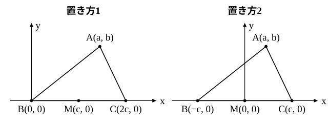

# L03 座標を使った証明——座標軸の置き方と中線定理

- unit_id: hs-math-ii-figures-and-equations
- 位置づけ: 単元第3レッスン（1.5時間）。L02 の距離の公式を使って、図形の性質を「証明する」回。座標を使った証明では、座標軸をどこに置くかで計算の量が大きく変わる。同じ三角形に2通りの座標軸を置いて比べたあと、中線定理を座標で証明し、三平方の定理による証明と読み比べる。座標による証明は、L06（点と直線の距離）で直線の方程式を使う形へ広がる。
- distribution_status: published_draft
- license: CC-BY-4.0
- verify_required: 例題数値・記述は監修者検証必須。
- 主概念: ①座標軸を図形に合わせて置く（頂点や中点を原点に・辺を軸に）と計算量の違い ②中線定理の座標による証明と三平方の定理による証明の比較

---

## 1. 座標軸をどこに置くか——同じ三角形に2通り

図形の性質を座標で証明するとき、座標軸は自分で置く。図形は最初から座標平面の上に乗っているわけではないので、置き方は自由である。ただし、置き方によって計算の量が大きく変わる。

三角形 ABC と、辺 BC の中点 M を考える。座標軸の置き方を2通り比べてみよう。

- **置き方1**: 頂点 B を原点に、辺 BC を x 軸の正の向きに置く。B(0, 0)、C(2c, 0)（c>0）、A(a, b) とおくと、M(c, 0) である。
- **置き方2**: 中点 M を原点に、辺 BC を x 軸に置く。M(0, 0)、B(−c, 0)、C(c, 0)（c>0）、A(a, b) とおく。

どちらの置き方でも三角形は同じである（ただし原点の位置が違うので、同じ文字 a でも表す値は違う。置き方1の a は、置き方2の a に c を足した値にあたる）。では、次の節の中線定理に出てくる式 AB²＋AC² を計算してみよう。

置き方1: AB²=a²＋b²、AC²=(a−2c)²＋b²=a²−4ac＋4c²＋b²。和は 2a²−4ac＋4c²＋2b²。
置き方2: AB²=(a＋c)²＋b²、AC²=(a−c)²＋b²。和は (a＋c)²＋(a−c)²＋2b²=2a²＋2c²＋2b²。

置き方2の方が項が少なく、途中の ac の項が打ち消し合ってきれいに消える。中点 M を原点に置いたことで、B と C の座標が −c と c という対称な形になったためである。

:::guide
**座標の置き方に「正解」は1つではない**

置き方1も置き方2も、どちらも正しい証明ができる。違うのは計算の長さだけである。目安は3つ。(a) 頂点か中点のうち、計算の中心になる点を原点に置く。(b) 辺の1つを x 軸に重ね、その辺上の点の y 座標を 0 にする。(c) 対称な形（−c と c など）が作れるなら作る。この「計算が簡単になるように座標軸を選ぶ」ことが、座標を使う方法のよさ（学習指導要領解説の言い方では「座標のよさ」）の1つである。文字の個数が減るほど、また 0 になる座標が増えるほど、計算は短くなる。最初に置き方を少し考えることが、後の計算を大きく節約する。
:::

## 2. 中線定理を座標で証明する

三角形の頂点と、向かい合う辺の中点を結ぶ線分は**中線**（ちゅうせん）と呼ばれる。中線について、次の等式が成り立つ。

**中線定理** 三角形 ABC の辺 BC の中点を M とすると、AB²＋AC²=2(AM²＋BM²)

（この定理と、次の節で行う2つの証明の比較は、高等学校学習指導要領解説 数学編（平成30年告示）が本単元の例として挙げているものである。）

**例題1** 中線定理を、座標を使って証明せよ。

置き方2を使う。M(0, 0)、B(−c, 0)、C(c, 0)、A(a, b) とおく（c>0）。

AB²=(a＋c)²＋b²
AC²=(a−c)²＋b²
AM²=a²＋b²
BM²=c²

よって
AB²＋AC²=(a＋c)²＋(a−c)²＋2b²=2a²＋2c²＋2b²
2(AM²＋BM²)=2(a²＋b²＋c²)=2a²＋2b²＋2c²

両辺が一致するので、AB²＋AC²=2(AM²＋BM²) が成り立つ。（証明終わり）

この証明では、A(a, b) の a、b にどんな値が入っても同じ計算が通る。A が BC の上側にあっても下側にあっても（b の符号が違っても）、A から BC に下ろした垂線の足が線分 BC の内側にあっても外側にあっても（a が −c と c の間にあってもなくても）、場合を分けずに1回の計算で済んでいる。

検算として、具体的な三角形で両辺を計算してみる。B(−2, 0)、C(2, 0)、A(3, 1) とすると、AB²=25＋1=26、AC²=1＋1=2、左辺は 28。AM²=9＋1=10、BM²=4、右辺は 2×14=28 で一致する。

## 3. 三平方の定理による証明と読み比べる

同じ中線定理を、座標を使わずに証明してみよう。

**例題2** 中線定理を、三平方の定理を使って証明せよ。

A から直線 BC に垂線を下ろし、その足を H とする。BM=CM=d、MH=h、AH=k とおく。H が M より C の側にある場合を考える。

BH=d＋h、CH=d−h（H が線分 BC の外側にあるときは CH=h−d だが、2乗すれば同じである）。三角形 ABH、ACH、AMH で三平方の定理を使うと、

AB²=k²＋(d＋h)²、AC²=k²＋(d−h)²、AM²=k²＋h²

よって
AB²＋AC²=2k²＋2d²＋2h²=2(k²＋h²)＋2d²=2(AM²＋BM²)

H が M より B の側にある場合は、B と C の役割を入れ替えれば同じである。H が M に一致する場合は h=0 として成り立つ。H が C に一致する場合（h=d）は三角形 ACH ができないが、AC=AH=k だから AC²=k²＋(d−h)²=k² はそのまま成り立ち、H が B に一致する場合も B と C の役割を入れ替えれば同じである。（証明終わり）

2つの証明を並べてみる。三平方の定理による証明は、垂線の足 H がどこにあるかで場合を分ける必要があった（M より C の側・B の側・M に一致・線分の外側）。座標による証明では、その場合分けが A(a, b) の a、b の符号に吸収されて、1回の計算で済んだ。一方で、三平方の定理による証明は、図を見れば「なぜ成り立つか」が直角三角形の形で見えるという長所がある。

:::guide
**なぜ2つの方法を読み比べるのか**

座標による証明のよさは、場合分けが減ること、そして、座標を適切に置いて条件を式にできれば、あとは計算で結論までたどり着けることにある。この中線定理の証明では、図形の性質を見抜く必要がなく、距離の公式に代入するだけで済んだ。一方で、初等幾何（合同・相似・三平方の定理を使う中学までの方法）による証明は、図形のどの性質が効いているかが見える。どちらが上ということではなく、道具が2つあるということである。この単元の後半で学ぶ円や軌跡でも「図で考える」と「式で計算する」を往復する。2つの証明を読み比べる経験は、その往復の練習になっている。
:::

## 4. 距離の公式で図形の性質を証明する

**例題3** 長方形 ABCD と、平面上の任意の点 P（どこにとってもよい点）について、PA²＋PC²=PB²＋PD² が成り立つことを証明せよ。

頂点 A を原点に、辺 AB を x 軸に、辺 AD を y 軸に置く。A(0, 0)、B(a, 0)、C(a, b)、D(0, b)（a>0、b>0）とおき、P(x, y) とする。

PA²＋PC²=x²＋y²＋(x−a)²＋(y−b)²
PB²＋PD²=(x−a)²＋y²＋x²＋(y−b)²

右辺どうしは同じ4つの項の和だから、PA²＋PC²=PB²＋PD² が成り立つ。（証明終わり）

長方形の2辺を座標軸に重ねたことで、4頂点の座標に 0 が4つ現れ、証明が2行で終わった。点 P には何の条件もないので、P(x, y) の x、y はどんな値でもよい。長方形の内側でも外側でも成り立つ。

:::guide
**任意の点を文字で置くということ**

例題3の P(x, y) は「どこにあってもよい点」である。x、y に具体的な数を入れて確かめると、その1つの点についてしか確かめたことにならない。文字のまま計算が通ったから、すべての点で成り立つと言える。これは、中3や数学Ⅰで乗法公式を文字のまま導いたのと同じ考え方である。逆に言えば、証明の中で「a=3 とする」のように具体的な数を入れてしまうと、その図形についてしか示せていない。座標を使った証明では、図形を決める量（辺の長さや頂点の位置）を文字で置き、その文字がどんな値でも計算が通ることを確かめる。
:::

## 5. 手順の型

1. 図形を決める点のうち、計算の中心になる点（頂点・中点）を原点に置き、辺の1つを x 軸に重ねる。対称な形（−c と c）が作れるなら作る。
2. 残りの頂点を文字で置く（a、b、c など）。文字の個数はできるだけ少なくする。
3. 証明したい等式の両辺を、距離の公式で文字の式に直す。
4. 両辺を整理して一致することを確かめる。
5. 最後に、具体的な座標を1組入れて両辺の値が一致するか検算する（証明の代わりにはならないが、計算間違いを捕まえる）。

## 6. 練習

**問1** 三角形 ABC の頂点を B(−3, 0)、C(3, 0)、A(1, 4) とし、辺 BC の中点を M とする。AB²＋AC² と 2(AM²＋BM²) をそれぞれ計算し、中線定理が成り立つことを確かめよ。

**問2** AB=AC の二等辺三角形 ABC で、辺 BC の中点を M とし、辺 BC 上の点 P（B、C と異なる）をとる。このとき AB²−AP²=BP×PC が成り立つことを、M を原点、直線 BC を x 軸として B(−c, 0)、C(c, 0)、A(0, a)、P(p, 0)（a>0、c>0、−c<p<c）とおいて証明せよ。

**問3** 問2の等式を、B を原点、辺 BC を x 軸の正の向きに置いて B(0, 0)、C(2c, 0)、A(c, a)、P(p, 0)（0<p<2c）とおく置き方でも証明し、問2の計算と分量を比べよ。

**問4** 平行四辺形 ABCD について、AC²＋BD²=2(AB²＋AD²) が成り立つことを証明せよ。A(0, 0)、B(a, 0)、D(b, c) とおくと、平行四辺形の対角線がそれぞれの中点で交わる（中2）ことから、C の座標は (a＋b, c) と置ける（BD の中点 ((a＋b)/2, c/2) が AC の中点でもあるから）。

**問5** 座標軸の置き方を選ぶとき、どんなことを目安にするか。問2と問3の計算を比べて、2〜3文で書け。

---

:::stretch
**S1** 四角形 ABCD の対角線 AC と BD の中点が一致するならば、四角形 ABCD は平行四辺形であることを、座標を使って証明せよ。A(0, 0)、B(a, 0)、D(b, c)（a>0、c>0）とおき、C の座標を (s, t) とする。
(1) 対角線 AC の中点と対角線 BD の中点が一致することから、s、t を a、b、c で表せ。
(2) AB=DC かつ AD=BC であることを距離の公式で示し「両組の対辺がそれぞれ等しい四角形は平行四辺形である」（中2）ことから結論を導け。
:::

対応解答: answer_key_L01-06.md

<!-- gen_nav:nav:start（自動生成・手編集しない） -->

---

[← 前のレッスン](lesson_02.md)｜[単元の目次](README.md)｜[解答](answer_key_L01-06.md)｜[次のレッスン →](lesson_04.md)

<!-- gen_nav:nav:end -->
