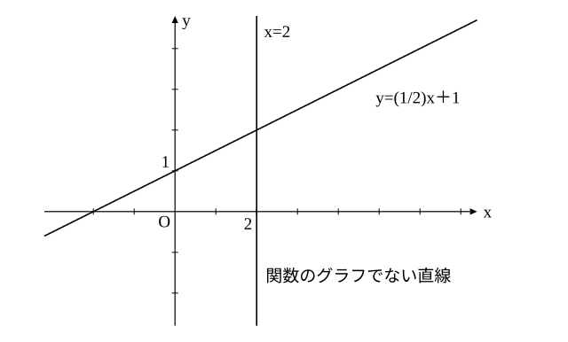

# L04 直線の方程式——すべての直線は x，y の一次方程式

- unit_id: hs-math-ii-figures-and-equations
- 位置づけ: 単元第4レッスン（2時間）。中2「一次関数」で「グラフ」として見ていた直線を「方程式を満たす点 (x, y) の集合」として見直す回。この見方に立つと、y 軸に平行な直線 x=k も含めて、すべての直線が x、y の一次方程式で表せる。後半では、1点と傾き・2点から直線の方程式を求める。ここで固めた「直線＝点の集合」の見方は、円（L07）・軌跡（L10）・領域（L11）でそのまま使う。
- distribution_status: published_draft
- license: CC-BY-4.0
- verify_required: 例題数値・記述は監修者検証必須。
- 主概念: ①前提診断（一次関数の式から傾きと y 軸との交点・連立方程式の解と交点）→直線＝方程式を満たす点 (x, y) の集合・y 軸に平行な直線 x=k を含む「すべての直線」と関数のグラフとの違い ②1点と傾き・2点を通る直線の方程式

---

## 0. 本編の前に——2つの前提を確かめる

このレッスンは中2「一次関数」の上に立つ。先に2問確かめておこう。

**確認A** 一次関数 y=−2x＋3 のグラフについて、傾きと、y 軸との交点の座標を答えよ。

**確認B** 2直線 y=x＋1 と y=−2x＋7 の交点の座標を、連立方程式を解いて求めよ。

（ここから下は答え。先に自分の答えを紙に書いてから読もう。）

確認A: 傾きは **−2**（x が 1 増えると y は 2 減る）、y 軸との交点は x=0 のときの点で **(0, 3)** である。
確認B: 交点では y の値が等しいから x＋1=−2x＋7、3x=6、x=2。y=2＋1=3。交点は **(2, 3)** である。

:::guide
**ここで止まったら、中2「一次関数」へ**

確認Aで傾きの意味（x が 1 増えたときの y の増え方）や y 軸との交点の読み方（x=0 を代入する）が曖昧なら、中2「一次関数」の単元（傾きと切片を学ぶ所。本サイトの教材では、その単元の第3〜第4レッスン）で扱っている。確認Bの「交点の座標＝連立方程式の解」も同じ単元の後半の内容である。このレッスンではこの2つを前提にする。「傾き」「切片」の語は中2のまま使い、定義し直さない。
:::

## 1. 直線とは何か——方程式を満たす点の集合

中2では、二元一次方程式 2x−y＋1=0 のグラフを、y=2x＋1 と変形して一次関数のグラフとして描いた。ここで、描いた直線と方程式の関係をもう一度言葉にしておこう。

方程式 2x−y＋1=0 を満たす x、y の組は無数にある。(0, 1)、(1, 3)、(−1, −1) のような整数の組だけでなく、(1/2, 2) や (√2, 2√2＋1) のような組も満たす。これらの組を座標にもつ点を座標平面にすべて打つと、1本の直線になる。逆に、その直線上のどの点をとっても、その座標は方程式を満たす。

つまり、**直線は、方程式を満たす点 (x, y) 全部の集合**である。中1の作図で「条件を満たす点の集まり」と言っていたものを、この単元では**点の集合**と呼ぶ。方程式 2x−y＋1=0 が「条件」で、直線がその条件を満たす点の集合である。このとき、2x−y＋1=0 をこの**直線の方程式**という。

ここで大切なのは、x と y は**実数全体**を動くということである。直線上の点は、格子点（こうしてん）と呼ばれる整数の座標をもつ点だけではない。直線はすき間なくつながっている。

## 2. y 軸に平行な直線 x=k——関数のグラフではない直線

一次関数 y=mx＋n のグラフは直線である（中2の y=ax＋b と同じ式。この単元では a、b を ax＋by＋c=0 の係数に使うので、傾きを m、y 軸との交点の y 座標を n と書く）。では、すべての直線は y=mx＋n の形で表せるだろうか。

y 軸に平行な直線を考えよう。点 (2, 0)、(2, 1)、(2, −3)、(2, 5) はすべて x 座標が 2 で、y 座標は何でもよい。これらの点全部の集合は、点 (2, 0) を通り y 軸に平行な直線である。この直線上の点は「x 座標が 2 である」という条件だけを満たしているので、この直線の方程式は

x=2

である。y はどんな実数でもよいので、式に y が現れない。この直線は、x=2 に対して y の値が1つに決まらないので、一次関数のグラフではない。y=mx＋n の形では表せないが、x、y の一次方程式 ax＋by＋c=0 の形（a=1、b=0、c=−2）では表せる。

一般に、点 (k, 0) を通り y 軸に平行な直線の方程式は **x=k** である。同じように、点 (0, k) を通り x 軸に平行な直線の方程式は y=k である（こちらは、x の値を決めると y の値が k の1つに決まるので、関数のグラフでもある）。

以上をまとめると、

**すべての直線は、x、y の一次方程式 ax＋by＋c=0（a、b の少なくとも一方は 0 でない）で表される。逆に、この形の方程式は直線を表す**。

b≠0 なら y=−(a/b)x−(c/b) と変形できて傾き −a/b の直線、b=0 なら x=−c/a で y 軸に平行な直線である。

:::guide
**x=2 を「横の直線」と描いてしまう理由と、直し方**

方程式 x=2 の表す図形を、x 軸に平行な（横向きの）直線として描いてしまう考え方がある。「x 軸の 2 のところ」という言葉から、x 軸に沿った線を思い浮かべるためだろう。直し方は簡単で、方程式を満たす点を実際に3つ打つことである。(2, 0)、(2, 1)、(2, −3)——x 座標が 2 の点は、x 軸上の 2 の真上と真下に縦に並ぶ。だから x=2 は縦の直線である。「方程式の表す図形が分からなくなったら、方程式を満たす点を3つ打つ」——この単元を通して使える確かめ方である。もう1つ。x=2 には傾きを考えない。傾きは「x が 1 増えたときの y の増え方」だが、この直線上では x が増えないので、傾きという量そのものが定義できない。「傾きが無限大」とは言わないでおく。
:::

中2の一次関数の見方と、この単元の直線の方程式の見方を並べておく。中2の見方を否定するのではなく、見方を「関数」から「点の集合」へ広げている。

| 見方 | 一次関数のグラフ（中2） | 直線の方程式（この単元） |
|---|---|---|
| 式の形 | y=mx＋n（x を決めると y が決まる） | ax＋by＋c=0（x と y は対等） |
| y 軸に平行な直線 | 表せない | x=k として表せる |
| 座標軸の目盛り | x 軸と y 軸で単位が違ってもよい | x 軸と y 軸で同じ単位にする（長さや角を扱うため） |

## 3. 1点と傾きから——y−y₁=m(x−x₁)

点 (x₁, y₁) を通り、傾きが m の直線の方程式を求めよう。

この直線上の点 (x, y)（x≠x₁）をとると（x₁、y₁ は通る点の座標で決まった数、x、y は直線上のどの点でもよい座標である）、(x₁, y₁) から (x, y) まで x は x−x₁ 増え、y は y−y₁ 増える。傾きは「y の増えた量を x の増えた量で割った値」で、これが m だから (y−y₁)/(x−x₁)=m、すなわち

y−y₁=m(x−x₁)

点 (x₁, y₁) 自身も、この式に代入すると 0=0 で満たしている。したがって、

**点 (x₁, y₁) を通り傾き m の直線の方程式は y−y₁=m(x−x₁)**

**例題1** 次の直線の方程式を求めよ。
(1) 点 (2, −1) を通り、傾きが 3 の直線
(2) 点 (4, 1) を通り、傾きが −1/2 の直線

(1) y−(−1)=3(x−2) より y＋1=3x−6、すなわち **y=3x−7**
(2) y−1=−(1/2)(x−4) より y=−(1/2)x＋3。両辺を 2 倍して整理すると **x＋2y−6=0**（y=−(1/2)x＋3 でもよい）

検算: (1) に x=2 を代入すると y=6−7=−1 で、点 (2, −1) を通る。(2) に (4, 1) を代入すると 4＋2−6=0 で成り立つ。

## 4. 2点を通る直線——傾きは数値から、そして文字へ

異なる2点 A(x₁, y₁)、B(x₂, y₂) を通る直線の方程式を求めよう。x₁≠x₂ なら、傾きは

m=(y₂−y₁)/(x₂−x₁)

で、あとは §3 の形に A の座標を入れればよい。x₁=x₂ なら（2点は異なるので y₁≠y₂）、2点は縦に並んでいるので、直線は y 軸に平行で、方程式は x=x₁ である。

**例題2** 次の2点を通る直線の方程式を求めよ。
(1) (1, 2)、(4, 8)  (2) (−2, 3)、(−2, 7)  (3) (3, 1)、(−1, 1)

(1) 傾きは (8−2)/(4−1)=6/3=2。点 (1, 2) を通るから y−2=2(x−1)、すなわち **y=2x**
(2) 2点の x 座標がどちらも −2 だから、直線は y 軸に平行で **x=−2**
(3) 傾きは (1−1)/(−1−3)=0。点 (3, 1) を通るから y−1=0(x−3)、すなわち **y=1**（x 軸に平行な直線）

検算: (1) に (4, 8) を代入すると 8=2×4 で成り立つ。(2) は (−2, 7) の x 座標が −2 で成り立つ。(3) は (−1, 1) の y 座標が 1 で成り立つ。

まとめると、x₁≠x₂ のとき、2点 (x₁, y₁)、(x₂, y₂) を通る直線の方程式は

y−y₁=((y₂−y₁)/(x₂−x₁))(x−x₁)

と書ける。この式を丸ごと覚えるより「傾きを計算してから、1点と傾きの形に入れる」という2段の手順として身につける方が、x₁=x₂ の場合（傾きが計算できない場合）にも気づきやすい。

:::guide
**x 軸との交点と y 軸との交点が分かっているとき**

直線が x 軸と点 (a, 0) で、y 軸と点 (0, b) で交わっているとする（a≠0、b≠0）。この2点を通る直線として §4 の手順で求めると、傾きは (b−0)/(0−a)=−b/a で、y=−(b/a)x＋b。両辺を b で割って移項すると x/a＋y/b=1 と書ける（ここでの a、b は交点の座標で、ax＋by＋c=0 の係数とは別の数である）。「x 座標を a で、y 座標を b で割って足すと 1」という形で、x 軸・y 軸との交点から直線を書き下せる（a は x 切片、b は y 切片と呼ばれる。中2の「切片」は、この y 切片にあたる）。覚えていなくても、2点を通る直線として計算すれば同じ式が出る。式の形を1つ増やすより「2点が分かれば直線は決まる」という1つの手順に戻れることの方が大切である。
:::

## 5. 手順の型

1. 与えられた情報を分類する——「1点と傾き」か「2点」か。
2. 2点のときは、まず x 座標が等しいかを見る。等しければ x=k の形。等しくなければ傾きを (y₂−y₁)/(x₂−x₁) で計算する。
3. y−y₁=m(x−x₁) に代入し、y=mx＋n または ax＋by＋c=0 の形に整理する。
4. 通るはずの点の座標を代入して、成り立つことを検算する（2点なら両方）。

## 6. 練習

**問1** 次の方程式の表す直線について、直線上の点を2つ求めて座標平面に直線を描き、その直線が y 軸に平行か、x 軸に平行か、どちらでもないかを答えよ。
(1) 2x−3y＋6=0  (2) x＋4=0  (3) 3y−6=0

**問2** 次の直線の方程式を求めよ。
(1) 点 (1, 4) を通り、傾きが −2 の直線
(2) 点 (−3, 2) を通り、傾きが 1/3 の直線
(3) 点 (5, −2) を通り、x 軸に平行な直線
(4) 点 (5, −2) を通り、y 軸に平行な直線

**問3** 次の2点を通る直線の方程式を求めよ。
(1) (2, 1)、(5, 7)  (2) (−1, 4)、(3, −4)  (3) (3, 5)、(3, −1)  (4) (−2, −3)、(4, 0)

**問4** x 軸と点 (6, 0) で、y 軸と点 (0, 3) で交わる直線の方程式を求め、ax＋by＋c=0（a、b、c は整数）の形で書け。

**問5** 直線 3x−2y＋4=0 について、次の点がこの直線上にあるかどうかを、代入して判定せよ。
(1) (2, 5)  (2) (1/3, 5/2)  (3) (−2, 1)
また、(2) の結果から分かることを「直線上の点」という言葉を使って1文で書け。

**問6** 直線 ax−y＋1=0 が点 (2, 7) を通るとき、定数 a の値と、この直線の傾きを求めよ。

---

:::stretch
**S1** 3点 A(−1, −4)、B(2, 2)、C(k, 8) が同じ直線上にあるように、定数 k の値を定めよ。また「3点が同じ直線上にある」ことを、傾きの言葉で言い換えて1文で書け。
:::

対応解答: answer_key_L01-06.md

<!-- gen_nav:nav:start（自動生成・手編集しない） -->

---

[← 前のレッスン](lesson_03.md)｜[単元の目次](README.md)｜[解答](answer_key_L01-06.md)｜[次のレッスン →](lesson_05.md)

<!-- gen_nav:nav:end -->
