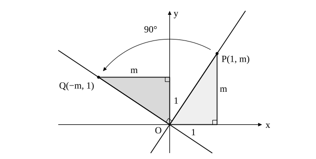

# L05 2直線の関係——平行・垂直・交点

- unit_id: hs-math-ii-figures-and-equations
- 位置づけ: 単元第5レッスン（2時間）。L04 で直線を方程式で表せるようになったので、こんどは2本の直線の関係を方程式から読む回。平行は「傾きが等しい」・垂直は「傾きの積が −1」だが、後者は暗記ではなく、直角三角形を 90° 回して重ねる図から導く。交点は連立方程式の解であり（中2の再訪）、共有点の個数と解の個数が対応する。垂直条件は L06（点と直線の距離・対称な点）と L09（円の接線）で繰り返し使う。
- distribution_status: published_draft
- license: CC-BY-4.0
- verify_required: 例題数値・記述は監修者検証必須。
- 主概念: ①平行条件（傾きが等しい）・垂直条件（傾きの積が −1）を直角三角形を回して重ねる図で根拠づける・y 軸に平行な直線に垂直な直線 ②2直線の交点＝連立方程式の解・共有点の個数と解の個数・ある点を通り与えられた直線に平行／垂直な直線

---

## 1. 平行条件——傾きが等しい

2直線 y=m₁x＋n₁ と y=m₂x＋n₂ を考える。傾きは「x が 1 増えたときの y の増え方」だから、傾きが等しい2直線は、同じ向きに進む。すなわち

**2直線が平行であるための条件は m₁=m₂**（逆に m₁≠m₂ なら、2式から y を消した (m₁−m₂)x=n₂−n₁ が x についてただ1つの解をもつので、2直線は1点で交わり、平行ではない）

m₁=m₂ で n₁≠n₂ なら、2直線は平行で共有点をもたない。m₁=m₂ かつ n₁=n₂ なら2直線は一致する。この単元では、一致する場合も平行に含めて考える。

y 軸に平行な直線どうし（x=k₁ と x=k₂）も、もちろん平行である。

## 2. 垂直条件——傾きの積が −1

2直線 y=m₁x＋n₁ と y=m₂x＋n₂ が垂直になる条件を求めよう。平行移動しても直線の向きは変わらないので、どちらも原点を通るとして考えてよい。すなわち、y=m₁x と y=m₂x が垂直になる条件を調べる。

直線 y=m₁x は、原点 O と点 P(1, m₁) を通る。横 1、縦 m₁ の直角三角形 OAP（A(1, 0)）を考える。この直角三角形を、原点を中心に 90° 回すと、横と縦が入れ替わって、横 m₁・縦 1 の直角三角形になる。P の行き先は点 Q(−m₁, 1) である（原点を中心に左回りに 90° 回した場合。横に 1 進んで縦に m₁ 上がる向きが、横に m₁ 戻って縦に 1 上がる向きに変わる。m₁ が負のときは縦の辺が下向きになるだけで、回し方は同じである。たとえば m₁=−2 なら P(1, −2) は Q(2, 1) に移る）。

直線 OP を 90° 回した直線は OQ であり、m₁≠0 のとき、OQ の傾きは 1/(−m₁)=−1/m₁ である（m₁=0 のときは OQ が y 軸になり、これはあとで述べる x=k の場合である）。OP と OQ は垂直だから、y=m₁x に垂直な直線の傾きは −1/m₁ であり、

m₁×(−1/m₁)=−1

逆に、m₁m₂=−1 なら m₂=−1/m₁ で、直線 y=m₂x は OQ と一致するから、2直線は垂直である。以上から、

**2直線が垂直であるための条件は m₁m₂=−1**

（2直線がどちらも y 軸に平行でないとき。）

:::guide
**積が −1 は暗記ではなく、直角三角形を回した結果の言い換え**

垂直条件を「傾きを掛けて −1」と丸暗記すると、符号を忘れたり逆数を忘れたりしやすい。上の図に戻ろう。傾き m の直線は「横に 1 進むと縦に m 上がる」直角三角形で表せる。この三角形を 90° 回すと「横に m 戻ると縦に 1 上がる」三角形になる——横と縦が入れ替わり、向きが1つ反転する。だから垂直な直線の傾きは「m の逆数で、符号が反対」の −1/m である。忘れたら、方眼の上で「横 1・縦 m」の三角形を描き、90° 回して読めばよい。たとえば傾き 2 の直線に垂直な直線は、横 2・縦 1 で左上がりだから傾き −1/2 である。
:::

傾きが定義できない場合、つまり y 軸に平行な直線 x=k については、別に考える。**直線 x=k に垂直な直線は、x 軸に平行な直線 y=k′（k′ は k とは別の定数）である**（図を描けば明らかで、計算はいらない）。垂直条件 m₁m₂=−1 は、両方の直線に傾きがあるときの条件であることに注意しよう。

**例題1** 点 (4, 3) を通り、直線 y=2x−1 に (1) 平行な直線 (2) 垂直な直線 の方程式をそれぞれ求めよ。

(1) 平行だから傾きは 2。y−3=2(x−4) より **y=2x−5**
(2) 垂直だから傾き m は 2m=−1、m=−1/2。y−3=−(1/2)(x−4) より y=−(1/2)x＋5、すなわち **x＋2y−10=0**

検算: (1) (2) とも x=4 を代入すると y=3 になり、点 (4, 3) を通る。(2) の傾き −1/2 と 2 の積は −1 である。

**例題2** 直線 3x＋y−2=0 に垂直で、原点を通る直線の方程式を求めよ。

3x＋y−2=0 を変形すると y=−3x＋2 で、傾きは −3。垂直な直線の傾き m は (−3)m=−1 より m=1/3。原点を通るから **y=(1/3)x**（x−3y=0 でもよい）

:::guide
**一般形のままで平行・垂直を判定する式**

直線が ax＋by＋c=0 の形で与えられたとき、毎回 y=… に直して傾きを読むのは手間である。2直線 a₁x＋b₁y＋c₁=0、a₂x＋b₂y＋c₂=0 について、b₁≠0、b₂≠0 なら傾きは −a₁/b₁、−a₂/b₂ だから、平行条件 −a₁/b₁=−a₂/b₂ は a₁b₂−a₂b₁=0、垂直条件 (−a₁/b₁)(−a₂/b₂)=−1 は a₁a₂＋b₁b₂=0 と書き直せる（どちらも両辺に b₁b₂ を掛けて整理する）。この2つの式は、b₁ や b₂ が 0 のとき（y 軸に平行な直線を含むとき）にもそのまま成り立つ。b₁=0 なら a₁≠0 だから、平行条件 a₁b₂−a₂b₁=0 は b₂=0（相手も y 軸に平行）と同じこと、垂直条件 a₁a₂＋b₁b₂=0 は a₂=0（相手が x 軸に平行）と同じことになる（b₂=0 のときも同様）。たとえば x=3（a₁=1、b₁=0）と y=−2（a₂=0、b₂=1）では a₁a₂＋b₁b₂=0 で、確かに垂直である。傾きの式で場合分けが要るところを、一般形の式は1本で扱える。
:::

## 3. 2直線の交点——連立方程式の解

2直線の交点は、両方の直線上にある点である。つまり、両方の方程式を同時に満たす (x, y) であり、それは2つの方程式を連立して解いたときの解にほかならない。中2で「連立方程式の解は2直線の交点の座標」と学んだことの再訪である。

**例題3** 2直線 2x−y−1=0 と x＋y−5=0 の交点の座標を求めよ。

2式を辺々（へんぺん。左辺どうし、右辺どうしを）足すと 3x−6=0、x=2。x＋y−5=0 に代入して y=3。交点は **(2, 3)** である。

検算: 2×2−3−1=0、2＋3−5=0 で、どちらの方程式も満たす。

**例題4** 2直線 x−2y＋1=0 と 2x−4y＋5=0 の共有点を調べよ。

第1式を 2 倍すると 2x−4y＋2=0。これと第2式を辺々引くと 0×x＋0×y＋3=0、すなわち 3=0 となって、どんな x、y でも成り立たない。連立方程式は解をもたず、2直線は**共有点をもたない**。実際、どちらも傾きが 1/2 で、y 軸との交点が違う（1/2 と 5/4）から、平行で重ならない2直線である。

2直線の共有点の個数と、連立方程式の解の個数は、次のように対応する。

| 2直線の位置関係 | 共有点の個数 | 連立方程式の解 |
|---|---|---|
| 1点で交わる（傾きが異なる。一方だけが y 軸に平行な場合も含む） | 1個 | ただ1組 |
| 平行で一致しない | 0個 | 解なし |
| 一致する | 無数 | 無数の組 |

:::guide
**交点を求めることと連立方程式を解くことが同じである理由**

直線を「方程式を満たす点の集合」（L04）として見ると、この対応はほとんど言葉の言い換えである。直線に l（小文字のエル）という名前を付ける。点 (x, y) が直線 l 上にあることと、(x, y) が l の方程式を満たすことは同じである。点 (x, y) が2直線の両方の上にあることと、(x, y) が2つの方程式を両方満たすこと、つまり (x, y) が連立方程式の解であることも同じである。だから、交点が1つなら解も1組、交点がなければ解もなく、直線が重なっていれば解は無数にある。連立方程式を解いて 3=0 のような式が出たら、それは「両方を満たす点は存在しない」＝「平行で交わらない」という図形の事実を、式が教えてくれているのだと読む。
:::

**例題5** 2直線 y=2x−4 と y=−x＋5 の交点を通り、直線 x＋3y=1 に垂直な直線の方程式を求めよ。

交点: 2x−4=−x＋5 より x=3、y=2。交点は (3, 2)。
直線 x＋3y=1 の傾きは −1/3 だから、垂直な直線の傾きは 3。
y−2=3(x−3) より **y=3x−7**

検算: x=3 のとき y=9−7=2 で交点を通る。傾き 3 と −1/3 の積は −1 である。

## 4. 手順の型

1. 2直線の方程式を y=mx＋n の形に直し、傾きを読む（y に直せなければ x=k の形で、y 軸に平行）。
2. 平行なら傾きが等しいか、垂直なら傾きの積が −1 か（一方が x=k なら、平行は他方も x=k′ の形か、垂直は他方が y=k′ の形か）で判定する。
3. 交点は連立方程式を解く。解なしなら平行で交わらない、無数なら一致。
4. 「ある点を通り平行／垂直な直線」は、手順 2 で傾きを決めてから、L04 の y−y₁=m(x−x₁) に入れる。求める直線が y 軸に平行になるときは、傾きを使わず x=x₁ と書く。
5. 通る点を代入して検算する。

## 5. 練習

**問1** 次の2直線は、平行か、垂直か、どちらでもないかを答えよ。
(1) y=3x＋1、y=3x−4
(2) y=(2/3)x＋1、3x＋2y＋4=0
(3) 2x−y＋3=0、4x−2y＋1=0
(4) x=3、y=−2

**問2** 次の直線の方程式を求めよ。
(1) 点 (−1, 2) を通り、直線 4x−2y＋3=0 に平行な直線
(2) 点 (−1, 2) を通り、直線 4x−2y＋3=0 に垂直な直線
(3) 点 (3, −4) を通り、直線 x=1 に平行な直線
(4) 点 (3, −4) を通り、直線 x=1 に垂直な直線

**問3** 次の2直線の共有点を調べよ。交わるなら交点の座標を求め、交わらないならその理由を、一致するならそのことを答えよ。
(1) 3x＋2y=7、x−y=−1
(2) 2x−3y＋6=0、4x−6y−1=0
(3) x＋2y−4=0、3x＋6y−12=0

**問4** 2直線 x−y＋1=0 と x＋2y−8=0 の交点を通り、直線 2x＋y=0 に平行な直線の方程式を求めよ。

**問5** 2直線 ax＋2y＋1=0 と 3x＋(a−1)y−2=0 について、次の場合の定数 a の値を求めよ（傾きで考えるときは、y の係数が 0 になる a の値のときを先に別に調べる。guide の一般形の式を使ってもよい）。
(1) 2直線が平行である。
(2) 2直線が垂直である。

**問6** 「2直線 3x＋y−5=0 と x−2y＋3=0 の交点の座標を求める」という問題を解いた人が「連立方程式を解けば交点が求まる理由が分からない」と言っている。直線を「方程式を満たす点の集合」として説明する2〜3文を書け（交点の座標も求めよ）。

---

:::stretch
**S1** 三角形 ABC の頂点を A(0, 4)、B(−2, 0)、C(4, 0) とする。
(1) 頂点 B から辺 AC に下ろした垂線を含む直線（B を通り AC に垂直な直線）の方程式を求めよ。
(2) 頂点 C から辺 AB に下ろした垂線を含む直線の方程式を求めよ。
(3) (1) と (2) の直線の交点 H の座標を求め、直線 AH が辺 BC に垂直であることを確かめよ。この結果は、三角形の3つの頂点から向かい合う辺に下ろした3本の垂線が1点で交わることを、この三角形について確かめたことになる。この点は、教科書で三角形の垂心（すいしん）と呼ばれることがある。
:::

対応解答: answer_key_L01-06.md

<!-- gen_nav:nav:start（自動生成・手編集しない） -->

---

[← 前のレッスン](lesson_04.md)｜[単元の目次](README.md)｜[解答](answer_key_L01-06.md)｜[次のレッスン →](lesson_06.md)

<!-- gen_nav:nav:end -->
