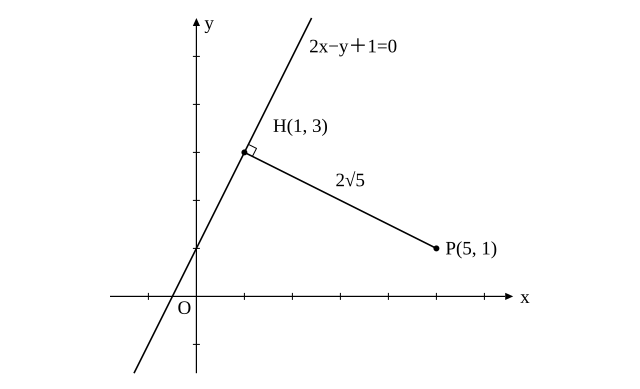
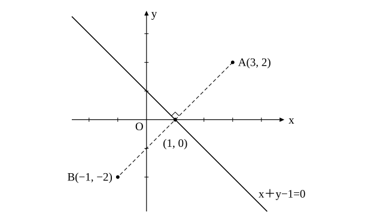

# L06 点と直線の距離——垂線の足から公式へ・直線に関して対称な点

- unit_id: hs-math-ii-figures-and-equations
- 位置づけ: 単元第6レッスン（2時間）。まとまり「点と直線」の最後の回。点から直線までの距離を、まず L05 の垂直条件と交点で「垂線の足」を求める素朴な方法で計算し、その計算を一般化して公式 |ax₁＋by₁＋c|/√(a²＋b²) を導く。公式は「導く→使う→逆向きに使う」の3段で扱う。後半では、直線に関して対称な点を「中点が直線上・結ぶ線分が直線に垂直」の2条件で求め、直線の方程式を使った証明を1つ行う。点と直線の距離は、円と直線の位置関係（L08）と接線（L09）で毎回使う道具になる。
- distribution_status: published_draft
- license: CC-BY-4.0
- verify_required: 例題数値・記述は監修者検証必須。
- 主概念: ①垂線の足を求める素朴解法と点と直線の距離の公式の比較・公式を「導く→使う→逆向きに使う」 ②直線に関して対称な点（中点が直線上・結ぶ線分が垂直）・直線の方程式を利用した図形の性質の証明

---

## 1. 素朴解法——垂線の足を求める

点 P と直線 l があるとき、P から l に下ろした垂線と l との交点が、L02 で見た垂線の足である。点 P と直線 l の距離とは、P から垂線の足までの長さのことである（P から l 上の点までの長さのうち、最も短いもの）。

**例題1** 点 P(5, 1) と直線 l: 2x−y＋1=0 の距離を求めよ。

l の傾きは 2 だから、P を通り l に垂直な直線の傾きは −1/2（L05）。その方程式は y−1=−(1/2)(x−5)、すなわち x＋2y−7=0。
この直線と l の交点 H を求める。l から y=2x＋1 として代入すると x＋2(2x＋1)−7=0、5x=5、x=1、y=3。よって垂線の足は H(1, 3)。
PH=√((5−1)²＋(1−3)²)=√(16＋4)=√20=**2√5**

この方法は、垂直な直線の方程式（L05）と交点（連立方程式）と距離の公式（L02）を順に使うだけで、新しい知識はいらない。手順が3段あるぶん長いが、いつでも使える。

## 2. 公式を導く

例題1の計算を、文字のまま一度だけやっておこう。点 P(x₁, y₁) と直線 l: ax＋by＋c=0 の距離 d を求める。

垂線の足を H とする。P が l 上にあるときは H=P で距離は 0 であり、下で導く公式も 0 を返す。以下は P が l 上にない場合で考える。PH は l に垂直である。a≠0、b≠0 のとき、l の傾きは −a/b だから、PH の傾きは b/a（積が −1 になる）、すなわち PH は「x 方向に a 進むと y 方向に b 進む」向きの線分である。P からこの向きへ、a と b の t 倍ずつ（x 方向に at、y 方向に bt）進んだ点が H であるとする（t は実数で、逆向きに進むときは負）。すると、H の座標は

H(x₁＋at, y₁＋bt)

と表せる（b=0 のとき l は y 軸に平行で PH は x 軸に平行、a=0 のとき l は x 軸に平行で PH は y 軸に平行だから、どちらもこの形に含まれる）。

H は l 上にあるから、a(x₁＋at)＋b(y₁＋bt)＋c=0。これを t について解くと

(a²＋b²)t=−(ax₁＋by₁＋c)
t=−(ax₁＋by₁＋c)/(a²＋b²)

PH の長さは、座標の差 at と bt から

PH=√((at)²＋(bt)²)=√(t²(a²＋b²))=|t|√(a²＋b²)（t² の根号は |t| になる）。ここに |t|=|ax₁＋by₁＋c|/(a²＋b²) を入れると、PH=(|ax₁＋by₁＋c|/(a²＋b²))×√(a²＋b²)=|ax₁＋by₁＋c|/√(a²＋b²)（a²＋b² は √(a²＋b²) の2乗だから、√(a²＋b²) で約分できる）

したがって、

**点 (x₁, y₁) と直線 ax＋by＋c=0 の距離 d は d=|ax₁＋by₁＋c|/√(a²＋b²)**

例題1で確かめる。P(5, 1)、l: 2x−y＋1=0 だから、d=|2×5−1×1＋1|/√(2²＋(−1)²)=|10|/√5=10/√5=2√5（分母と分子に √5 を掛けて、分母の根号をなくす。数学Ⅰ「数と式」の根号の計算）で、素朴解法の答えと一致する。このとき t=−(2×5−1×1＋1)/(2²＋(−1)²)=−2 で、H(5＋2×(−2), 1＋(−1)×(−2))=H(1, 3) となり、垂線の足も例題1と一致する。

特に、原点 O と直線 ax＋by＋c=0 の距離は |c|/√(a²＋b²) である。

:::guide
**公式は素朴解法の答えを一般化したもの——忘れたら垂線の足を求め直せばよい**

この公式は、例題1でやった「垂線の足を求めて距離を測る」計算を、数の代わりに文字で1回やった結果である。だから公式を忘れても、素朴解法で同じ答えに着く。ただし、素朴解法は3段（垂直な直線→交点→距離）で、途中に分数が出やすい。公式は「直線の方程式に点の座標を代入して、絶対値をとり、√(a²＋b²) で割る」の1段で済む。使い分けの目安は、距離だけが要るなら公式、垂線の足の座標そのものも要るなら素朴解法である。公式を使うときは、直線の方程式を必ず ax＋by＋c=0 の形（右辺を 0 にした形）に直してから代入する。y=2x＋1 のままで係数を読むと、c の符号を間違える。
:::

:::guide
**分子に絶対値がつく理由、分母が √(a²＋b²) になる理由**

分子の ax₁＋by₁＋c は、直線の式の左辺に点の座標を入れた値で、点が直線のどちら側にあるかで正にも負にもなる（直線上なら 0）。距離は負にならないので、絶対値をつける。この「符号が側を表す」という性質は、L11 の領域でもう一度使う。分母の √(a²＋b²) は、導き方の中で、PH の向きを「x 方向に a、y 方向に b」と表したときの、1回分の進みの長さである（ここでの a、b は点の座標ではない）。同じ直線でも 2x−y＋1=0 と 4x−2y＋2=0 のように係数を何倍にも書けるが、分子と分母が同じ倍率で変わるので、距離の値は変わらない。分母は、係数を何倍に書いても距離の値が変わらないようにする役目ももっている。
:::

## 3. 公式を使う・逆向きに使う

**例題2** 次の点と直線の距離を求めよ。
(1) 原点 O と直線 3x＋4y−10=0
(2) 点 (1, −2) と直線 3x＋4y−10=0
(3) 点 (2, 3) と直線 y=(1/2)x−1

(1) d=|−10|/√(9＋16)=10/5=**2**
(2) d=|3×1＋4×(−2)−10|/5=|−15|/5=**3**
(3) 直線を x−2y−2=0 の形に直す。d=|2−6−2|/√(1＋4)=6/√5=**6√5/5**

**例題3** 点 (2, 1) と直線 x−y＋k=0 の距離が 2√2 であるとき、定数 k の値を求めよ。

|2−1＋k|/√(1＋1)=2√2 より |k＋1|=2√2×√2=4。よって k＋1=4 または k＋1=−4、すなわち **k=3、−5**

検算: k=3 のとき |2−1＋3|/√2=4/√2=2√2、k=−5 のとき |2−1−5|/√2=4/√2=2√2 で、どちらも成り立つ。k の値が2つ出るのは、点 (2, 1) から距離 2√2 の位置に、傾き 1 の直線が両側に1本ずつあるからである。

例題2が公式を「使う」向き、例題3が「逆向きに使う」向きである。逆向きでは絶対値を外すときに2つの場合が出ることが多い。図を描いて、答えが2つあるのが自然かを確かめる。

## 4. 直線に関して対称な点

中1で学んだ対称移動を、座標で行う。点 A を直線 l に関して対称移動した点を B とする。A が l 上にあれば B は A 自身である。A が l 上にないとき、l は線分 AB の垂直二等分線である。すなわち、

- (i) 線分 AB の中点は l 上にある。
- (ii) 直線 AB は l に垂直である。

この2条件を、L02 の中点の座標と L05 の垂直条件で式にすれば、B の座標が求まる。

**例題4** 点 A(3, 2) と直線 l: x＋y−1=0 に関して対称な点 B の座標を求めよ。

B(p, q) とおく。
(i) 中点 ((3＋p)/2, (2＋q)/2) が l 上にあるから、(3＋p)/2＋(2＋q)/2−1=0。整理して p＋q＋3=0。
(ii) l の傾きは −1。AB の傾きは (q−2)/(p−3) で、垂直だから (q−2)/(p−3)×(−1)=−1、すなわち (q−2)/(p−3)=1、q−2=p−3。整理して q=p−1。
(ii) を (i) に代入して p＋(p−1)＋3=0、p=−1、q=−2。よって **B(−1, −2)** である。

検算: 中点は ((3−1)/2, (2−2)/2)=(1, 0) で、1＋0−1=0 を満たす。AB の傾きは (−2−2)/(−1−3)=1 で、l の傾き −1 との積は −1。2条件とも成り立つ。

:::guide
**対称な点の2条件は、中1の「対称の軸は垂直二等分線」の言い直し**

中1の対称移動では「対称の軸は、対応する2点を結ぶ線分の垂直二等分線になる」ことを学んだ。例題4の (i) は「二等分」（中点が軸上）、(ii) は「垂直」を、それぞれ座標の式にしただけである。条件が2つ、未知数が p と q の2つで、例題4ではこの2式を連立すると解がちょうど1組求まる。(ii) を書くときは「垂直だから傾きの積が −1」を使うが、l が y 軸に平行（x=k）なら傾きの積は使えない。その場合は、A(x₁, y₁) と対称な点は y 座標が同じで、x 座標は中点の x 座標が k になるように決まる（B(2k−x₁, y₁)）と直接分かる。l が x 軸に平行（y=k）のときも、直線 AB が y 軸に平行になって傾きの積は使えないので、同じように B(x₁, 2k−y₁) と直接求める。図を先に描いて、軸の向きを確かめてから式を立てる。
:::

## 5. 直線の方程式を使って図形の性質を証明する

**例題5** 三角形の3辺の垂直二等分線は1点で交わることを、座標を使って証明せよ。

L03 の置き方2を使う。辺 BC の中点を原点に置き、B(−c, 0)、C(c, 0)、A(a, b)（c>0、b≠0）とする。

辺 BC の垂直二等分線は、原点を通り BC（x 軸）に垂直な直線だから、y 軸、すなわち x=0 である。
辺 AB の中点は ((a−c)/2, b/2)。AB の傾きは b/(a＋c)（a≠−c のとき）だから、垂直二等分線の傾きは −(a＋c)/b で、方程式は y−b/2=−((a＋c)/b)(x−(a−c)/2)。
この直線と x=0 の交点の y 座標は、x=0 を代入すると y−b/2=−((a＋c)/b)×(−(a−c)/2)=((a＋c)(a−c))/(2b)（− の符号が2つ掛かって打ち消し合う）。b/2=b²/(2b) と通分して y=b/2＋(a²−c²)/(2b)=(b²＋a²−c²)/(2b)。
辺 AC の中点は ((a＋c)/2, b/2)。AC の傾きは b/(a−c)（a≠c のとき）だから、垂直二等分線の傾きは −(a−c)/b で、方程式は y−b/2=−((a−c)/b)(x−(a＋c)/2)。
x=0 を代入すると y=b/2＋((a−c)(a＋c))/(2b)=(b²＋a²−c²)/(2b)。

辺 AB、辺 AC の垂直二等分線は、どちらも x=0 上の同じ点 (0, (a²＋b²−c²)/(2b)) を通る。したがって3本の垂直二等分線はこの1点で交わる。（証明終わり）

（a=−c または a=c のときは AB または AC が y 軸に平行で、その垂直二等分線は x 軸に平行な直線 y=b/2 になる。このときも同じ結論が成り立つ。たとえば a=c なら、AC の垂直二等分線 y=b/2 と x=0 の交点は (0, b/2) で、AB の垂直二等分線が x=0 と交わる点 (0, (b²＋a²−c²)/(2b)) も a=c を入れると (0, b/2) になる。a=−c のときも同じである。）

この交点は、3頂点から等しい距離にある点でもある（垂直二等分線上の点は、その辺の両端から等距離だから）。証明の中で L03 の座標の置き方、L02 の中点、L05 の垂直条件、L04 の直線の方程式が順に使われた。まとまり「点と直線」の道具が、1つの証明の中でそろって働いている。

## 6. 手順の型

1. **距離**: 直線を ax＋by＋c=0 の形に直す→点の座標を左辺に代入→絶対値をとる→√(a²＋b²) で割る。垂線の足の座標が要るときは、垂直な直線と交点から求める（素朴解法）。
2. **逆向き**: 距離の式を立て、絶対値を外すときに2つの場合を考える。図で答えの個数を確かめる。
3. **対称な点**: まず元の点が直線上にあるかを確かめる。直線上にあれば、その点自身が答えである。直線上になければ、未知の点を (p, q) とおいて「中点が直線上」「結ぶ線分が直線に垂直」の2式を連立する。
4. **検算**: 距離は公式と素朴解法の一方で他方を確かめる。対称な点は（元の点が直線上にないとき）2条件に戻して確かめる。

## 7. 練習

**問1** 次の点と直線の距離を求めよ。
(1) 原点 O と直線 3x−4y＋5=0
(2) 点 (2, −1) と直線 4x＋3y−15=0
(3) 点 (1, 3) と直線 y=2x−4
(4) 点 (−2, 5) と直線 x=3

**問2** 点 P(0, 6) と直線 l: x−2y＋2=0 について、次の問いに答えよ。
(1) P から l に下ろした垂線の足 H の座標を求めよ。
(2) 線分 PH の長さを、H の座標から距離の公式で求める方法と、点と直線の距離の公式で求める方法の2通りで計算し、一致することを確かめよ。

**問3** 次の問いに答えよ。
(1) 点 (1, 2) と直線 3x＋4y＋k=0 の距離が 3 であるとき、定数 k の値を求めよ。
(2) 直線 x＋y−2=0 からの距離が √2 である x 軸上の点の座標をすべて求めよ。

**問4** 次の点の座標を求めよ。
(1) 点 (4, 1) と直線 x−y＋1=0 に関して対称な点
(2) 点 (3, 3) と直線 2x＋y−4=0 に関して対称な点

**問5** 3点 A(1, 1)、B(5, 2)、C(2, 5) を頂点とする三角形 ABC について、次の問いに答えよ。
(1) 直線 AB の方程式を求めよ。
(2) 点 C と直線 AB の距離を求めよ。
(3) 三角形 ABC の面積を求めよ（AB を底辺、(2) の距離を高さとみる）。

**問6** 点と直線の距離の公式 d=|ax₁＋by₁＋c|/√(a²＋b²) について、分子に絶対値がつく理由と、分母が √(a²＋b²) になる理由を、§2 の導き方をたどって2〜3文で説明せよ。

---

:::stretch
**S1** 平行な2直線 l₁: 3x−4y＋2=0 と l₂: 3x−4y−8=0 について、次の問いに答えよ。
(1) l₁ 上の点を1つ求め、その点と l₂ の距離を計算せよ（これが2直線 l₁、l₂ の距離である）。
(2) 一般に、平行な2直線 ax＋by＋c₁=0 と ax＋by＋c₂=0 の距離が |c₁−c₂|/√(a²＋b²) で表されることを示せ。
:::

対応解答: answer_key_L01-06.md

<!-- gen_nav:nav:start（自動生成・手編集しない） -->

---

[← 前のレッスン](lesson_05.md)｜[単元の目次](README.md)｜[解答](answer_key_L01-06.md)｜[次のレッスン →](lesson_07.md)

<!-- gen_nav:nav:end -->
