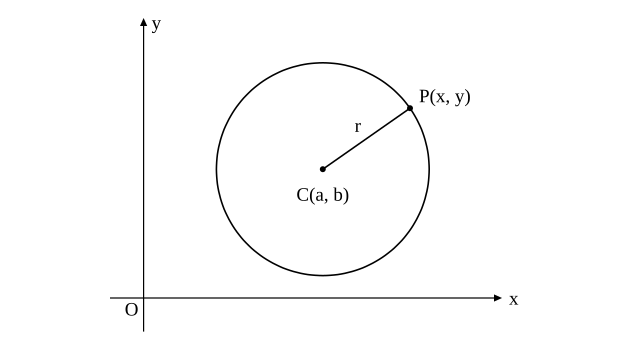

# L07 円の方程式——中心と半径・標準形と一般形

- unit_id: hs-math-ii-figures-and-equations
- 位置づけ: 単元第7レッスン（2時間）。「円」のまとまり（L07〜L09）の最初の回。L01〜L06 で点と直線を座標と方程式で表してきた見方を、円へ広げる。円を「定点からの距離が一定である点の集合」と見て、距離の公式から円の方程式 (x−a)²＋(y−b)²=r² を導き、展開した形 x²＋y²＋lx＋my＋n=0 との間を往復する。L08（円と直線）・L09（接線）の土台になる。
- distribution_status: published_draft
- license: CC-BY-4.0
- verify_required: 例題数値・記述は監修者検証必須。
- 主概念: ①円＝定点からの距離が一定である点の集合→距離の公式から (x−a)²＋(y−b)²=r²・条件（中心と半径・直径の両端・通る3点）から円の方程式を求める ②展開した形 x²＋y²＋lx＋my＋n=0 を平方完成して中心と半径を読む・この形の式が常に円を表すとは限らない

---

## 0. 本編の前に——2つの前提を確かめる

円の方程式は、L02 の距離の公式と、数学Ⅰ「二次関数」の平方完成の2つでできている。本編に入る前に、この2つを別々に確かめておく。

**確認A** 2点 A(1, 2)、B(4, 6) の間の距離を求めよ。

**確認B** x²−4x＋1 を平方完成せよ（(x−p)²＋q の形にせよ）。

（ここから下は答え。先に自分の答えを紙に書いてから読もう。）

確認A: AB=√((4−1)²＋(6−2)²)=√(9＋16)=√25=**5**。
確認B: x の係数 −4 の半分 −2 を使う。(x−2)²=x²−4x＋4 だから x²−4x=(x−2)²−4 で、x²−4x＋1=(x−2)²−4＋1=**(x−2)²−3**。

:::guide
**どちらかで手が止まったら**

確認Aは、2点を結ぶ線分を斜辺とする直角三角形を見つけて三平方の定理を使う計算で、L02 で公式の形にまとめた。x の差と y の差をそれぞれ2乗して足し、根号をつける。ここで迷ったら L02 の §1 に戻る。確認Bは、x の係数の半分を使って (x−2)² を作り、余分に足した 4 を引く手順である。数学Ⅰ「二次関数」で放物線の頂点を読むために使った手そのものなので、そこへ戻って手順を確かめてから本編に進むとよい。この2つがそろえば、このレッスンに新しい計算はない。
:::

## 1. 円を点の集合として見る——中1の定義を座標の言葉に

中学1年の「平面図形」で、円は「ある点から等しい距離にある点の集まり」として学んだ。この見方を、座標平面の上で使う。

点 C(a, b) を中心とし、半径が r（r>0）の円を考える。点 P(x, y) がこの円の周上にあるとは、**P と C の距離が r に等しい**ということである。L02 の距離の公式で書くと

CP=√((x−a)²＋(y−b)²)=r

両辺とも 0 以上だから、2乗しても同じ条件を表す（−3 と 3 のように符号だけが違う数は2乗するとどちらも 9 になるが、0 以上の数どうしなら、2乗が等しければもとの数も等しい）。よって

(x−a)²＋(y−b)²=r²

逆に、この式を満たす点 (x, y) は C からの距離が r なので、円の周上にある。したがって、**中心 (a, b)、半径 r の円は、方程式 (x−a)²＋(y−b)²=r² を満たす点 (x, y) 全部の集合**である。この方程式を、円の方程式という。特に、中心が原点 O のときは x²＋y²=r² となる。

L04 で「直線とは、方程式 ax＋by＋c=0 を満たす点 (x, y) 全部の集合」と見た。円も同じ見方で「方程式を満たす点全部の集合」として1つの式に表せた。この単元では、図形をいつもこの目で見る。

**例題1** 中心 (2, −1)、半径 3 の円の方程式を求めよ。

a=2、b=−1、r=3 を当てはめて、(x−2)²＋(y−(−1))²=3²、すなわち

(x−2)²＋(y＋1)²=9

検算: 中心から右へ 3 進んだ点 (5, −1) は周上にあるはずである。代入すると (5−2)²＋(−1＋1)²=9＋0=9 で成り立つ。y の項が (y＋1)² になることに注意する（b=−1 だから y−b=y＋1）。

(x−a)²＋(y−b)²=r² の形は、中心と半径がそのまま読める形で、教科書では円の方程式の**標準形**と呼ばれる。

**例題2** 中心が (1, 3) で、点 (4, −1) を通る円の方程式を求めよ。

半径は中心と通る点の距離だから、r²=(4−1)²＋(−1−3)²=9＋16=25。よって

(x−1)²＋(y−3)²=25

検算: 点 (4, −1) を代入すると 9＋16=25 で成り立つ。半径は r=5 だが、方程式に要るのは r² なので、根号を外す手間はいらない。

:::guide
**円の方程式は距離の公式そのもの**

(x−a)²＋(y−b)²=r² を新しい公式として覚え込む必要はない。この式は「点 (x, y) と点 (a, b) の距離が r」を2乗して書いただけで、中身は L02 の距離の公式である。だから、中心や半径を求める問題でつまったら、いつでも「距離が r」という言葉に戻れる。例題2で半径を求めたのも、中心と通る点の距離を計算しただけである。式の形を忘れたときに戻る場所は「距離」だ、と覚えておくと、L08 で直線との位置関係を調べるときにも、L09 で接線を引くときにも、同じ場所へ戻れる。
:::

## 2. 条件から円の方程式を求める——直径の両端

**例題3** 2点 A(−1, 2)、B(5, 6) を直径の両端とする円の方程式を求めよ。

直径の両端が分かっているので、中心は線分 AB の中点、半径は中心から A までの距離である。中点は L02 の式（1:1 の内分点）で ((−1＋5)/2, (2＋6)/2)=(2, 4)。半径の2乗は、中心 (2, 4) と A(−1, 2) の距離の2乗で (2−(−1))²＋(4−2)²=9＋4=13。よって

(x−2)²＋(y−4)²=13

検算: もう一方の端 B(5, 6) を代入すると (5−2)²＋(6−4)²=9＋4=13 で成り立つ。直径の両端は両方とも周上にあるので、使わなかった方の端で確かめるのが早い。

## 3. 展開した形——一般形から中心と半径を読む

例題1の円 (x−2)²＋(y＋1)²=9 を展開して整理すると

x²＋y²−4x＋2y−4=0

このように、円の方程式は x²＋y²＋lx＋my＋n=0（l、m、n は定数。l は小文字のエルで、数字の 1 ではない。m、n は L04 の y=mx＋n の m、n とは別の数である）の形にも書ける。教科書ではこの形を円の方程式の**一般形**と呼ぶ。この形の特徴は、**x² と y² の係数が等しく（ここでは 1 にそろえてある）、xy の項がない**ことである。

一般形で与えられた円の中心と半径を知りたいときは、逆に標準形へ戻す。使う手は平方完成である。

**例題4** 方程式 x²＋y²＋6x−4y−3=0 はどのような図形を表すか。

x について、y について、それぞれ平方完成する。

x²＋6x=(x＋3)²−9、y²−4y=(y−2)²−4 だから

(x＋3)²−9＋(y−2)²−4−3=0、すなわち (x＋3)²＋(y−2)²=16

これは**中心 (−3, 2)、半径 4 の円**を表す。

検算: 中心から上へ 4 進んだ点 (−3, 6) をもとの式に代入すると 9＋36−18−24−3=0 で成り立つ。

:::guide
**一般形から中心を読むのは、数学Ⅰで頂点を読んだ手と同じ**

数学Ⅰ「二次関数」では、y=x²＋6x＋5 の頂点を知るために x²＋6x=(x＋3)²−9 と平方完成した。一般形の円で中心を読む操作は、これを x と y の両方について行うだけである。x の係数の半分を2乗して足し引きする、という手順は変わらない。気をつけたい考え違いは2つで、y²−4y の方で符号を落として (y＋2)² としてしまうことと、−9 と −4 を引き忘れて右辺の 16 を誤ることである。平方完成が済んだら、中心から半径ぶん動いた点を1つもとの式に代入して確かめる（例題4の検算の形）習慣にするとよい。
:::

一般形に見える式が、いつも円を表すとは限らない。

**例題5** 次の方程式はどのような図形を表すか。
(1) x²＋y²−2x＋4y＋5=0  (2) x²＋y²＋2x−6y＋14=0

(1) 平方完成すると (x−1)²−1＋(y＋2)²−4＋5=0、すなわち (x−1)²＋(y＋2)²=0。2乗の和が 0 になるのは x−1=0 かつ y＋2=0 のときだけだから、この式を満たす点は**点 (1, −2) の1つだけ**である（円ではない）。
(2) (x＋1)²−1＋(y−3)²−9＋14=0、すなわち (x＋1)²＋(y−3)²=−4。左辺は 0 以上、右辺は負なので、この式を満たす点は**1つもない**。

一般に、x²＋y²＋lx＋my＋n=0 を平方完成すると (x＋l/2)²＋(y＋m/2)²=(l²＋m²−4n)/4 となる。右辺が正のときだけ円を表し、0 なら1点、負なら表す図形はない。

## 4. 3点を通る円——一般形に代入して連立する

**例題6** 3点 A(−1, 5)、B(6, 4)、C(2, −4) を通る円の方程式を求めよ。

中心も半径も分かっていないときは、一般形 x²＋y²＋lx＋my＋n=0 とおいて、3点の座標を代入する。

A: 1＋25−l＋5m＋n=0 より −l＋5m＋n=−26 ……①
B: 36＋16＋6l＋4m＋n=0 より 6l＋4m＋n=−52 ……②
C: 4＋16＋2l−4m＋n=0 より 2l−4m＋n=−20 ……③

②−① から 7l−m=−26、②−③ から 4l＋8m=−32 すなわち l＋2m=−8。後者から l=−8−2m を前者に入れて 7(−8−2m)−m=−26、−15m=30、m=−2。よって l=−4。③に戻して −8＋8＋n=−20、n=−20。求める円は

x²＋y²−4x−2y−20=0

平方完成すると (x−2)²＋(y−1)²=25 で、中心 (2, 1)、半径 5 の円である。

検算: 3点を代入する。A: 1＋25＋4−10−20=0、B: 36＋16−24−8−20=0、C: 4＋16−8＋8−20=0。すべて成り立つ。

3点の座標を代入すると l、m、n についての連立一次方程式ができ、それを解けばよい。標準形 (x−a)²＋(y−b)²=r² に代入しても解けるが、未知数の2乗が現れて計算が重くなる。**一般形は「3点を通る円」のような、中心の分からない問題で力を発揮する**。

:::guide
**3点を通る円は1つに決まる——三角形の外接円**

同じ直線上にない3点を通る円は、ちょうど1つ決まる。この円は、3点を頂点とする三角形の**外接円**と教科書で呼ばれる。中1の作図で、三角形の3つの頂点から等しい距離にある点を垂直二等分線の交点として求めたことがあるなら、それがこの円の中心である。例題6の中心 (2, 1) が本当に A、B、C から等距離かは、距離の2乗を3回計算すれば確かめられる（どれも 25 になる）。連立方程式を解いたあと、こうして「中心が3点から等距離」という円の定義に戻って確かめると、計算違いに自分で気づける。
:::

:::zatsudan
同じ数学Ⅱの教科書でも、出版社や版によって、本文で扱う項目と「研究」「探究」のような別枠で扱う項目の線引きが違うことがある。たとえば「2つの円の位置関係」「三角形の重心の座標」「2つの図形の共有点を通る図形」は、ある教科書では本文に、別の教科書では研究や探究の欄に置かれている。この教材で stretch に回した項目の一部はそれにあたる。教科書の目次を見比べると、本文と発展の分け方が出版社によってどう違うかが見えてくる。
:::
<!-- zatsudan話題源: 内部調査要約 雑談枠許可リストZ4（啓林館『数学Ⅱ』授業担当計画〔令和4年度〕・啓林館『新編数学Ⅱ』年間指導計画〔令和4年度〕・数研出版『数学Ⅱ』『新編 数学Ⅱ』シラバス〔令和4年度用〕の項目名と本文・研究・探究の区分の範囲。個別の教科書名と項目の対応は本文に書かない）。出典の確認範囲内の内容のみ使用 -->

## 5. 手順の型

1. 中心と半径が分かるとき: (x−a)²＋(y−b)²=r² に当てはめる。半径は r² の形で使う。
2. 直径の両端が分かるとき: 中点が中心、中心から一方の端までの距離が半径。
3. 通る3点が分かるとき: 一般形 x²＋y²＋lx＋my＋n=0 に3点を代入し、l、m、n の連立方程式を解く。
4. 一般形から中心と半径を読むとき: x と y のそれぞれについて平方完成する。右辺が正なら円、0 なら1点、負なら図形なし。
5. 検算: 求めた方程式に、周上にあるはずの点（与えられた点・中心から半径ぶん動いた点）を代入する。

## 6. 練習

**問1** 次の円の方程式を求めよ。
(1) 中心 (3, −2)、半径 4
(2) 中心が原点、半径 √7
(3) 中心が (−1, 4) で、点 (2, 0) を通る
(4) 2点 (−3, 1)、(5, 7) を直径の両端とする

**問2** 次の方程式はどのような図形を表すか。円ならば中心と半径を答えよ。
(1) x²＋y²−8x＋6y=0
(2) x²＋y²＋4x−2y＋1=0
(3) x²＋y²−6y＋9=0
(4) x²＋y²＋2x＋4y＋6=0

**問3** 円 (x＋2)²＋(y−1)²=9 について、次の問いに答えよ。
(1) 中心の座標と半径を答えよ。
(2) この円と x 軸との交点の座標を求めよ。
(3) 点 (1, 1) と点 (0, 3) は、それぞれこの円の周上・内部・外部のどこにあるか。中心からの距離を計算して答えよ（中心からの距離が半径より小さい点は円の内部、大きい点は外部にある）。

**問4** 3点 A(1, 0)、B(4, 3)、C(0, 3) を通る円の方程式を求め、中心の座標と半径を答えよ。

**問5** 方程式 x²＋y²＋4x−2y＋k=0 について、次の問いに答えよ。
(1) この方程式が円を表すような定数 k の値の範囲を求めよ。
(2) k=5 のとき、この方程式はどのような図形を表すか。

**問6** 中心 (a, b)、半径 r の円の方程式が (x−a)²＋(y−b)²=r² になる理由を「距離」という言葉を使って2〜3文で説明せよ。

---

:::stretch
**S1** 3点 A(−2, 0)、B(4, 0)、C(0, 4) について、次の問いに答えよ。
(1) 3点を通る円の方程式を求め、中心 M の座標を答えよ。
(2) M が線分 AB の垂直二等分線の上にあることを、M の座標から確かめよ。
(3) 線分 AC の垂直二等分線の方程式を求め、M がその上にもあることを確かめよ。この結果から、3点を通る円の中心が「各辺の垂直二等分線の交点」であることをどう説明できるか、1〜2文で述べよ。
:::

対応解答: answer_key_L07-09.md

<!-- gen_nav:nav:start（自動生成・手編集しない） -->

---

[← 前のレッスン](lesson_06.md)｜[単元の目次](README.md)｜[解答](answer_key_L07-09.md)｜[次のレッスン →](lesson_08.md)

<!-- gen_nav:nav:end -->
