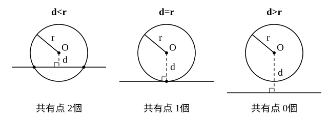

# L08 円と直線の位置関係——共有点の個数を2つの方法で

- unit_id: hs-math-ii-figures-and-equations
- 位置づけ: 単元第8レッスン（2時間）。円と直線が2点で交わるか、1点で接するか、離れているかを調べる回。共有点の座標は、円と直線の方程式を連立して求める。共有点の個数は、連立してできる二次方程式の実数解の個数で調べる方法と、円の中心と直線の距離 d を半径 r と比べる方法の2つがあり、同じ例題で両方を試して使い分けを覚える。最後に、円が直線から切り取る弦の長さを d と r から求める。L09 の接線につながる。
- distribution_status: published_draft
- license: CC-BY-4.0
- verify_required: 例題数値・記述は監修者検証必須。
- 主概念: ①円と直線の共有点＝連立方程式の実数解。個数は「二次方程式の実数解の個数」と「中心と直線の距離 d と半径 r の大小」の2法で判定できる ②共有点の座標と、円が直線から切り取る弦の長さ（d と r と弦の半分でできる直角三角形）

---

## 1. 共有点の座標——連立方程式を解く

L05 で、2直線の交点は連立方程式の解として求めた。円と直線でも同じで、両方の方程式を同時に満たす点 (x, y) が共有点である。

**例題1** 円 x²＋y²=25 と直線 y=x＋1 の共有点の座標を求めよ。

直線の式を円の式に代入して y を消去する。x²＋(x＋1)²=25 より 2x²＋2x−24=0、両辺を 2 で割って x²＋x−12=0、(x＋4)(x−3)=0。よって x=3 または x=−4。y=x＋1 から、x=3 のとき y=4、x=−4 のとき y=−3。共有点は

(3, 4)、(−4, −3)

検算: (3, 4) を円の式に入れると 9＋16=25、直線の式に入れると 4=3＋1。(−4, −3) も 16＋9=25、−3=−4＋1 で、どちらも両方の式を満たす。

共有点は「両方の式を満たす点」なので、検算は必ず両方の式で行う。

## 2. 方法①——二次方程式の実数解の個数で調べる

例題1では、y を消去してできた x の二次方程式が異なる2つの実数解をもち、共有点も2個だった。共有点の x 座標は、この二次方程式の実数解にほかならない。だから、**共有点の個数は、連立してできる二次方程式の実数解の個数と一致する**。

二次方程式 ax²＋bx＋c=0（a≠0）の実数解の個数は、解の公式 x=(−b±√(b²−4ac))/(2a) の根号の中 b²−4ac の符号で決まる。正なら異なる2つの実数解、0 なら ± の違いがなくなって解は1つ（2つの解が重なったものと見て重解という）、負なら根号の中が負になり、実数の範囲に解はない。数学Ⅰ「二次関数」で放物線と x 軸の共有点の個数を調べたときと同じ判断である。この式 b²−4ac は、教科書で二次方程式の**判別式**と呼ばれ、D で表される。

**例題2** 円 x²＋y²=5 と直線 y=2x＋k の共有点の個数を、定数 k の値によって分類せよ。

y=2x＋k を代入して x²＋(2x＋k)²=5、整理して 5x²＋4kx＋k²−5=0（a=5、b=4k、c=k²−5 にあたる）。この二次方程式の判別式は

D=(4k)²−4×5×(k²−5)=16k²−20k²＋100=100−4k²=4(25−k²)

D>0 すなわち k²<25、つまり −5<k<5 のとき共有点は2個（k² が 25 より小さいのは、k が −5 と 5 の間にあるとき）、D=0 すなわち k=±5 のとき1個、D<0 すなわち k<−5 または 5<k のとき0個である。

## 3. 方法②——中心と直線の距離 d を半径 r と比べる

同じ例題2を、図で考える。円の中心 O から直線までの距離を d とする。d が半径 r より小さければ直線は円の内側を通るので共有点は2個、d=r なら直線は円にちょうど触れて共有点は1個、d>r なら離れていて0個である。

d は L06 の点と直線の距離の公式で求める。直線 y=2x＋k を 2x−y＋k=0 と書き直すと、原点との距離は

d=|2×0−0＋k|/√(2²＋(−1)²)=|k|/√5

半径は r=√5 だから、d<r は |k|/√5<√5、すなわち |k|<5、すなわち −5<k<5 と同じ条件で、このとき2個。|k|=5 で1個、|k|>5 で0個。方法①と同じ結果になった。

2つの方法を比べる。

| | 方法①（判別式） | 方法②（距離と半径） |
|---|---|---|
| 使う道具 | 連立して得た二次方程式の判別式 | 点と直線の距離の公式 |
| 分かること | 個数。さらに方程式を解けば共有点の座標も | 個数。図の様子が直接見える |
| 計算量 | 代入と展開があり多め | 距離の公式1回で済む |

**共有点の座標まで要るなら方法①、個数だけでよいなら方法②が速い**。どちらか片方しか使えない場面はほとんどないので、慣れるまでは両方で解いて答えが一致することを確かめるとよい。

:::guide
**実数解の個数と共有点の個数が同じになる理由**

方法①で、方程式の解の個数を数えると図形の共有点の個数が分かるのはなぜか。共有点とは、円の式と直線の式を両方満たす点である。直線が y=mx＋n の形のとき、直線の式を代入して y を消すと、残るのは「共有点の x 座標が満たすべき条件」で、それが二次方程式になる。二次方程式の実数解1つに対して、直線の式から y が1つ決まるので、共有点が1つ対応する。逆に共有点があれば、その x 座標は解である（直線が x=k の形なら、x=k を代入して y の二次方程式を作り、y について同じことを言えばよい）。つまり、実数解と共有点は1対1に対応している。方程式の解を「図形の上の点」と読み替えるこの見方が、この単元の中心である。方程式が実数解をもたないとき、図の上では直線が円から離れている。式と図を往復して、両方で同じことを言えるようにしておこう。
:::

:::guide
**d と r の比較は、図を描くと一目で分かる**

方法②のよさは、計算の前に結論の見当がつくことである。円と直線をざっと描き、中心から直線へ垂線を下ろしてみる。垂線の長さが半径より短ければ交わる、長ければ離れる。この図があれば、計算結果が「半径 √5 の円で d=7 なのに2個」のような矛盾を含んでいたとき、すぐに気づける。逆に、方法①で判別式の符号を計算しただけだと、符号の計算違いに気づく手がかりが式の中にしかない。だから、方法①で解くときも、図を1枚添えて方法②の目で結果を見直すことを勧める。式で答えを出し、図で答えを確かめる。この往復が身につくと、この先の接線（L09）や領域（L11）でも同じ確かめ方が使える。
:::

## 4. 円が直線から切り取る弦の長さ

円と直線が2点で交わるとき、2つの共有点を結ぶ線分、つまり弦（げん）の長さを求める。共有点の座標を求めて距離を計算してもよいが、方法②の d と r を使うと速い。

**例題3** 円 (x−1)²＋(y−1)²=9 が直線 x＋y−4=0 から切り取る弦の長さを求めよ。

中心 (1, 1) と直線の距離は d=|1＋1−4|/√(1²＋1²)=2/√2=√2。半径は r=3。中学で学んだように、円の中心から弦に下ろした垂線は弦を2等分するので、中心・垂線の足・弦の端の3点でできる直角三角形の斜辺が r、1辺が d、残りの1辺が弦の半分である。三平方の定理から、弦の半分の長さは

√(r²−d²)=√(9−2)=√7

よって弦の長さは **2√7** である。

検算: d<r（√2<3）なので確かに2点で交わっている。d²＋(√7)²=2＋7=9=r² で、直角三角形の関係も合う。

## 5. 手順の型

1. 共有点の座標: 直線の式を円の式に代入して1文字を消去し、二次方程式を解く。得られた解を直線の式に戻して、もう1つの座標を求める。検算は円と直線の両方の式で。
2. 共有点の個数（方法①）: 連立して得た二次方程式の判別式 D の符号で、正なら2個・0 なら1個・負なら0個。
3. 共有点の個数（方法②）: 中心と直線の距離 d を点と直線の距離の公式で求め、半径 r と比べる。d<r なら2個・d=r なら1個・d>r なら0個。
4. 弦の長さ: 2√(r²−d²)。
5. 図を1枚描いて、結果が図と合っているかを見る。

## 6. 練習

**問1** 次の円と直線の共有点の座標を求めよ。
(1) 円 x²＋y²=10、直線 y=x−2
(2) 円 x²＋y²=4、直線 y=x＋2√2

**問2** 円 x²＋y²=9 と直線 y=−x＋k の共有点の個数を、定数 k の値によって分類せよ。判別式を使って調べること。

**問3** 円 (x−2)²＋(y−1)²=4 と次の直線の共有点の個数を、中心と直線の距離を求めて答えよ。
(1) 3x＋4y=0
(2) x−y＋1=0
(3) 4x−3y−20=0

**問4** 円 x²＋y²=25 が直線 3x−4y＋15=0 から切り取る弦の長さを求めよ。

**問5** 円 x²＋y²=r²（r>0）と直線 4x＋3y−10=0 について、次の問いに答えよ。
(1) この円と直線が接する（共有点が1個になる）ときの r の値を求めよ。
(2) この円と直線が共有点をもつような r の値の範囲を求めよ。

**問6** 円と直線の共有点の個数を調べる2つの方法（判別式による方法、中心と直線の距離による方法）について、それぞれの長所を1つずつ挙げ、2〜3文で説明せよ。

---

:::stretch
**S1** 円 x²＋y²=10 と直線 y=x＋k が2点で交わり、その2点を結ぶ弦の長さが 2√6 であるとき、定数 k の値を求めよ。
:::

対応解答: answer_key_L07-09.md

<!-- gen_nav:nav:start（自動生成・手編集しない） -->

---

[← 前のレッスン](lesson_07.md)｜[単元の目次](README.md)｜[解答](answer_key_L07-09.md)｜[次のレッスン →](lesson_09.md)

<!-- gen_nav:nav:end -->
