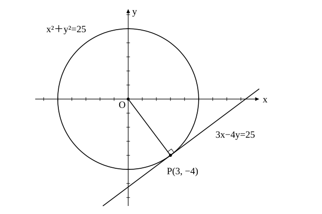

# L09 円の接線——半径に垂直・円外の点から

- unit_id: hs-math-ii-figures-and-equations
- 位置づけ: 単元第9レッスン（2時間）。「円」のまとまりの最後の回。円と1点だけを共有する直線（接線）を「接点を通る半径と接線は垂直」という中学の円の性質から導く。円 x²＋y²=r² 上の点 (x₁, y₁) における接線 x₁x＋y₁y=r² を導いて使い、逆向きに接点を求め、円の外の点から引いた接線を、接点をおく方法と「中心と直線の距離＝半径」の方法の2つで求める。stretch で2つの円の位置関係に触れる。
- distribution_status: published_draft
- license: CC-BY-4.0
- verify_required: 例題数値・記述は監修者検証必須。
- 主概念: ①接点が分かっている接線を「半径 ⊥ 接線」（L05 の垂直条件）から導き、x₁x＋y₁y=r² を「導く→使う→逆向きに使う」 ②円外の点から引いた接線を、接点をおく方法と「中心と直線の距離＝半径」の方法の2法で求める。「どの円の半径か」を確かめてから式を立てる

---

## 1. 接線とは——共有点が1個の直線

L08 で、円と直線の共有点が1個になる場合を見た。このとき直線は円に**接する**といい、その直線を円の**接線**、共有点を**接点**という（中学の円の学習でも使った言葉である）。中学で学んだ大切な性質を1つ思い出す。**円の接線は、接点を通る半径に垂直である**。この1行から、接線の方程式が出てくる。

## 2. 接点が分かっている接線——垂直条件から導く

**例題1** 円 x²＋y²=25 上の点 P(3, −4) における接線の方程式を求めよ。

中心 O(0, 0) と接点 P(3, −4) を結ぶ半径 OP の傾きは −4/3。接線は OP に垂直だから、L05 の垂直条件（傾きの積が −1）より、接線の傾きは 3/4。点 P を通るので

y−(−4)=(3/4)(x−3)、すなわち 4y＋16=3x−9、3x−4y=25

検算: P(3, −4) を代入すると 9＋16=25 で通る。原点とこの直線の距離は |−25|/√(9＋16)=25/5=5 で半径に等しいから、確かに接している（L08 の方法②）。

同じことを文字で行う。円 x²＋y²=r² 上の点 P(x₁, y₁) における接線を求める。x₁≠0、y₁≠0 のとき、OP の傾きは y₁/x₁、接線の傾きは −x₁/y₁ だから

y−y₁=−(x₁/y₁)(x−x₁)

両辺に y₁ を掛けて y₁y−y₁²=−x₁x＋x₁²、移項して x₁x＋y₁y=x₁²＋y₁²。P は円上の点だから x₁²＋y₁²=r²。よって

**円 x²＋y²=r² 上の点 (x₁, y₁) における接線の方程式は x₁x＋y₁y=r²**

x₁x は x₁×x のことで、x₁、y₁ は接点の座標（決まった数）、x、y は接線上の点の座標である。例題1で確かめると、(x₁, y₁)=(3, −4)、r²=25 を入れて 3x−4y=25 となり、上で求めた式と一致する。

x₁=0 または y₁=0 のときも、この式は正しい。たとえば接点が (r, 0) なら、式は rx=r²、すなわち x=r となる。これは y 軸に平行な直線で、傾きを使う導き方では扱えなかった場合だが、円の右端に立つ縦の接線として図と合っている。接点が (0, −r) なら y=−r で、x 軸に平行な接線である。

:::guide
**接線の公式は、暗記しなくても垂直条件から出せる**

x₁x＋y₁y=r² は覚えておくと速いが、忘れても困らない。「接点を通る半径に垂直」を使えば、半径の傾きから接線の傾きが出て、接点を通る直線として式が書ける。例題1でやった手順は、それだけである。公式の形が「円の式 x²＋y² の x の1つを x₁ に、y の1つを y₁ に置き換えた形」になっていることに気づくと、思い出しやすい。ただし、この置き換えの形はあくまで結果の見た目で、理由は垂直条件にある。中心が原点でない円では、この置き換えの形はそのままでは使えないが、垂直条件からの導き方はそのまま使える（L13 の総合演習で扱う）。理由を言えるようにしておけば、公式の形が使えない場面でも自分で式を作れる。
:::

**例題2** 直線 x＋3y=10 は円 x²＋y²=10 の接線である。接点の座標を求めよ。

接点を (x₁, y₁) とすると、接線は x₁x＋y₁y=10 と書けるはずである。これが x＋3y=10 と同じ直線で、右辺がどちらも 10 なので係数がそのまま一致し、x₁=1、y₁=3。接点は **(1, 3)** である。

検算: (1, 3) は円上にある（1＋9=10）。また原点と直線の距離は 10/√(1＋9)=√10 で半径 √10 に等しく、確かに接線である。

例題1は公式を「導いて使う」問題、例題2は「逆向きに使う」問題である。式の形を見て接点を読み取れることは、次の節で円外の点からの接線を求めるときに効く。

## 3. 円の外の点から引いた接線——2つの方法

円の外にある点からは、円に2本の接線が引ける。図を先に描いて、答えが2本になることを確かめてから計算に入る。

**例題3** 点 A(3, 1) から円 x²＋y²=5 に引いた接線の方程式を求めよ。

（方法1: 接点をおく）接点を P(x₁, y₁) とすると、接線は x₁x＋y₁y=5 と書ける。これが A(3, 1) を通るから 3x₁＋y₁=5 ……①。P は円上にあるから x₁²＋y₁²=5 ……②。①から y₁=5−3x₁ を②に代入して x₁²＋(5−3x₁)²=5、10x₁²−30x₁＋20=0、x₁²−3x₁＋2=0、(x₁−1)(x₁−2)=0。x₁=1 のとき y₁=2、x₁=2 のとき y₁=−1。接点は (1, 2) と (2, −1) で、接線は

x＋2y=5、2x−y=5

（方法2: 傾きをおく）A(3, 1) を通り傾き m の直線は y−1=m(x−3)、すなわち mx−y−3m＋1=0。これが円に接する条件は、中心 O と直線の距離が半径 √5 に等しいことである（点と直線の距離の公式で a=m、b=−1、c=−3m＋1 とし、原点の座標を代入する）。

|−3m＋1|/√(m²＋1)=√5

両辺を2乗して (1−3m)²=5(m²＋1)、9m²−6m＋1=5m²＋5、4m²−6m−4=0、2m²−3m−2=0、(2m＋1)(m−2)=0。m=2 のとき 2x−y−5=0、m=−1/2 のとき −(1/2)x−y＋(3/2)＋1=0、両辺を −2 倍して x＋2y−5=0。方法1と同じ2本が得られた。

検算: 2x−y=5 に A(3, 1) を代入すると 6−1=5、x＋2y=5 に代入すると 3＋2=5 で、どちらも A を通る。

方法2では「中心と直線の距離＝半径」の代わりに、直線の式を円の式に代入して判別式 D=0 としてもよい（L08 の方法①）。計算は距離の方が軽いことが多い。

:::guide
**傾きをおく方法には、見落とす接線がある**

方法2で y−1=m(x−3) とおいたとき、この式で表せるのは A を通る直線のうち、y 軸に平行な直線 x=3 を除いた全部である（L04 で見たように、x=3 には傾きがない）。例題3では2本とも傾きをもつ直線だったので問題なかったが、もし接線の1本が y 軸に平行なら、方法2では m の方程式が1つの解しか返してこない。「接線は2本あるはず」と図で先に確かめておけば、1本しか出てこなかったときに「x=k の形の直線を忘れていないか」と自分で疑える。方法1（接点をおく）ではこの見落としが起こらない。この違いは練習の問4で実際に体験する。
:::

## 4. 「距離＝半径」の半径は、どの円の半径か

「中心と直線の距離が半径に等しい」は、円が1つしかない問題では迷わない。円が2つ出てくる問題では、**どの円の中心と、どの円の半径を組にしているか**を、式を書く前に自分に言ってから式にする。

**例題4** 2つの円 C₁: x²＋y²=4 と C₂: (x−4)²＋(y−2)²=1 がある。点 A(4, 2) から円 C₁ に引いた接線の方程式を求めよ。

求めるのは C₁ の接線だから、使うのは「C₁ の中心 O(0, 0) と直線の距離が、C₁ の半径 2 に等しい」である。点 A(4, 2) は C₂ の中心でもあるが、C₂ はこの問題を解くのに使わない。とくに、C₂ の半径 1 を「距離＝半径」の半径に使ってはいけない。

A(4, 2) を通り傾き m の直線 y−2=m(x−4)、すなわち mx−y−4m＋2=0 について

|−4m＋2|/√(m²＋1)=2

両辺を2乗して (2−4m)²=4(m²＋1)、16m²−16m＋4=4m²＋4、12m²−16m=0、4m(3m−4)=0。m=0 のとき y=2、m=4/3 のとき 4x−3y−10=0。接線は

y=2、4x−3y−10=0

検算: y=2 と O の距離は 2 で C₁ の半径に等しい。4x−3y−10=0 と O の距離は 10/5=2 で同じく等しい。A(4, 2) はどちらの直線も通る（2=2、16−6−10=0）。y 軸に平行な直線 x=4 は O からの距離が 4 で接線ではないので、見落としはない。

:::guide
**2つの円がある問題で、半径を取り違えないために**

例題4で、もし「距離＝半径」の半径に C₂ の半径 1 を使ってしまうと、出てくるのは「O からの距離が 1 の直線」であり、C₁ の内側を通って2点で交わる直線になる。式を立てる前に「いま接させたい円はどれか。その中心はどこで、半径はいくつか」を声に出して確かめる。円が一般形で与えられているなら、L07 の平方完成で中心と半径を先に読み出しておく。半径を取り違えたときは、2つの円の半径の値が違う限り、検算で「求めた直線と、接させたい円の中心との距離」を計算して接させたい円の半径と照らせば食い違いが見つかるので、検算をこの形で行う習慣が防波堤になる。
:::

:::zatsudan
この単元で方程式に表す図形は直線と円だが、数学Cの「平面上の曲線」では、考察の範囲を放物線・楕円（だえん）・双曲線まで広げる。どれも「ある点とある直線からの距離が等しい点」「2つの定点からの距離の和が一定である点」「2つの定点からの距離の差の絶対値が一定である点」という距離の条件をもとに定義される（その点と直線の位置や、和や差の値の範囲に付く細かい条件は、数学Cで学ぶ）。つまり、円を「定点からの距離が一定である点の集合」と見た L07 の見方が、そのまま次の曲線たちの定義の型になっている。
:::
<!-- zatsudan話題源: 内部調査要約 雑談枠許可リストZ3（高等学校学習指導要領解説 数学編（平成30年告示）数学C「(2)平面上の曲線と複素数平面」の「考察の範囲を直線や円から放物線，楕円，双曲線まで広げ」と、各曲線を距離の条件を満たす点の軌跡として定義する記述の範囲。式・名称の由来・人名は出さない）。出典の確認範囲内の内容のみ使用 -->

## 5. 手順の型

1. 接点 (x₁, y₁) が分かっているとき: 円 x²＋y²=r² なら x₁x＋y₁y=r²。理由は「接点を通る半径と接線は垂直」。中心が原点でない円では、半径の傾きから垂直条件で接線の傾きを出して、接点を通る直線を書く（半径が x 軸に平行なら接線は x=x₁、半径が y 軸に平行なら接線は y=y₁ と直接書く）。
2. 接線の式から接点を読むとき: x₁x＋y₁y=r² の形と見比べる。
3. 円外の点から引くとき: 図を描いて2本あることを確かめる。方法1＝接点 (x₁, y₁) をおき「点を通る」「円上にある」の連立。方法2＝傾き m をおき「中心と直線の距離＝半径」。方法2では y 軸に平行な直線 x=k を別に確かめる。
4. 円が2つある問題では、接させたい円の中心と半径の組を先に言葉で確かめる。
5. 検算: 接点が円上にあること、直線が与えられた点を通ること、中心と直線の距離が半径に等しいこと。

:::guide
**この先の stretch で扱う「2つの円」について**

接線の方程式や点と直線の距離の公式は、学習指導要領解説では「円と直線の位置関係」「点と直線の距離について考察」という形で書かれていて、公式の形は教科書が本文に置いている。この教材もそれにならって本文で扱った。一方、2つの円の位置関係は学習指導要領解説に無く、理数数学Ⅱが追加する内容で、教科書によって本文か探究かが分かれる。この単元では発展として扱う。考え方は難しくない。2つの円の中心の間の距離を d、半径を r₁、r₂（r₁≧r₂）とすると、d が r₁＋r₂ より大きければ2つの円は離れていて、等しければ外側で接する。d が r₁＋r₂ より小さく、2つの半径の差より大きければ2点で交わる。d が半径の差 r₁−r₂ に等しければ内側で接し、差より小さければ一方が他方の内部にある（ただし r₁=r₂ で d=0 のときは、2つの円は同じ円で重なる）。図を描いて d と半径の和・差を見比べる、という L08 の方法②と同じ発想である。
:::

## 6. 練習

**問1** 次の円上の点における接線の方程式を求めよ。
(1) 円 x²＋y²=13 上の点 (2, −3)
(2) 円 x²＋y²=16 上の点 (0, −4)
(3) 円 x²＋y²=9 上の点 (−3, 0)

**問2** 直線 x−2y=5 は円 x²＋y²=5 の接線である。接点の座標を求めよ。また、中心と直線の距離を計算して、この直線が確かに接線であることを確かめよ。

**問3** 点 (2, 4) から円 x²＋y²=10 に引いた接線の方程式と、そのときの接点の座標を、接点を (x₁, y₁) とおく方法で求めよ。

**問4** 点 (3, 1) から円 x²＋y²=9 に引いた接線の方程式を、傾きを m とおく方法で求めよ。接線は2本あるはずである。1本しか求まらなかったら、その理由を述べて残りの1本を答えよ。

**問5** 2つの円 C₁: x²＋y²=9、C₂: (x−6)²＋(y−8)²=4 と直線 l: 3x＋4y−15=0 がある。ある人が「C₂ の中心と l の距離は 7 で、C₁ の半径 3 と等しくないから、l は C₁ に接しない」と述べた。この判断のどこが誤りかを指摘し、l が C₁ に接するかどうか、C₂ に接するかどうかを、それぞれどの中心とどの半径を組にして判定したかを明記して答えよ。

**問6** 円 x²＋y²=r² 上の点 (x₁, y₁)（x₁≠0、y₁≠0）における接線の方程式が x₁x＋y₁y=r² になる理由を「半径と接線は垂直」を使って2〜3文で説明せよ。

---

:::stretch
**S1** 2つの円 C₁: x²＋y²=9、C₂: (x−a)²＋y²=4（a>0）について、中心の間の距離 a と、2つの半径の和 5・差 1 を比べることで、2つの円の共有点の個数を調べる。a=6、a=5、a=3、a=1、a=1/2 のそれぞれについて、共有点の個数を答え、2つの円の位置関係を言葉で述べよ。

**S2** 2つの円 C₁: x²＋y²=25 と C₂: x²＋y²−12x−6y＋35=0 について、次の問いに答えよ。
(1) C₁ の方程式から C₂ の方程式を辺々引いて得られる一次方程式を求めよ。
(2) C₁ と C₂ の共有点は、(1) の直線の上にある。その理由を1〜2文で述べよ。
(3) 「(1) の直線の上の点は、すべて C₁ と C₂ の共有点である」は正しいか。正しくなければ、直線上の点を1つ挙げて確かめよ。
(4) C₁ と C₂ の共有点の座標を求めよ。
:::

対応解答: answer_key_L07-09.md

<!-- gen_nav:nav:start（自動生成・手編集しない） -->

---

[← 前のレッスン](lesson_08.md)｜[単元の目次](README.md)｜[解答](answer_key_L07-09.md)｜[次のレッスン →](lesson_10.md)

<!-- gen_nav:nav:end -->
