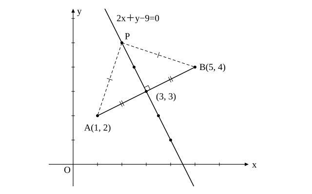
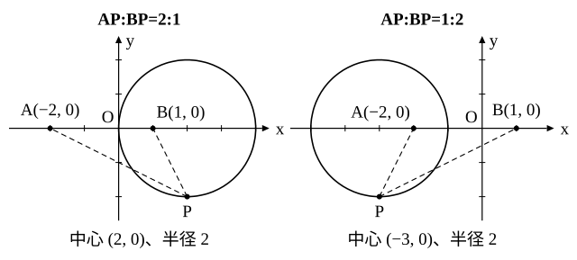

# L10 軌跡——条件を満たす点の集合と「逆の確認」

- unit_id: hs-math-ii-figures-and-equations
- 位置づけ: 単元第10レッスン（2時間）。「軌跡と領域」のまとまり（L10〜L12）の最初の回。中1で「条件を満たす点の集まり」として作図した図形を、座標を使って方程式で求める。求める点を (x, y) とおき、条件を式にし、式の表す図形を読み、最後に逆にその図形上の点が条件を満たすことを確かめる、という4段の型を固定する。2点から等距離の点（垂直二等分線）、2定点からの距離の比が一定の点（比の2つの数がどちらも正で、1:1 でなければ円）、直角三角形の頂点（除く点のある円）、動く点に連動する中点の軌跡を扱う。
- distribution_status: published_draft
- license: CC-BY-4.0
- verify_required: 例題数値・記述は監修者検証必須。
- 主概念: ①軌跡＝条件を満たす点全体の集合。4段の型（(x, y) とおく→条件を式に→図形を読む→逆を確かめる）と「両辺が 0 以上なら2乗しても同じ条件になる」 ②除く点のある軌跡（直角三角形の頂点＝直径の両端を除く）と、条件を変えたとき軌跡がどう変わるかの観察

---

## 1. 軌跡とは——「点の集まり」から「点の集合」へ

中1の「平面図形」で、線分の垂直二等分線を「2点から等しい距離にある点の集まり」として作図し、円を「中心から等しい距離にある点の集まり」として学んだ。高校では、この「条件を満たす点の集まり」を、**条件を満たす点全体の集合**と言い、その集合が作る図形を、その条件を満たす点の**軌跡**（きせき）という。

L04 で直線を、L07 で円を「方程式を満たす点の集合」と見た。軌跡の問題は、この見方を逆向きに使う。「こういう条件を満たす点は、どんな図形を描くか」を、座標と方程式で答えるのである。

## 2. 4段の型——2点から等距離の点

**例題1** 2点 A(1, 2)、B(5, 4) から等しい距離にある点 P の軌跡を求めよ。

(1) 求める点を P(x, y) とおく。
(2) 条件 AP=BP を x、y の式で表す。両辺とも 0 以上だから、2乗した AP²=BP² と同じ条件である。

(x−1)²＋(y−2)²=(x−5)²＋(y−4)²

展開して整理すると −2x−4y＋5=−10x−8y＋41、8x＋4y−36=0、すなわち

2x＋y−9=0

(3) この式の表す図形は直線である。
(4) 逆に、この直線上の点 (x, y) は 2x＋y−9=0 を満たす。ここから上の整理を下から上へたどると (x−1)²＋(y−2)²=(x−5)²＋(y−4)²、つまり AP²=BP² に戻る。AP も BP も 0 以上だから、AP=BP を満たす。

よって、求める軌跡は**直線 2x＋y−9=0** である。

検算: 線分 AB の中点 (3, 3) はこの直線上にある（6＋3−9=0）。AB の傾きは (4−2)/(5−1)=1/2、直線の傾きは −2 で、積は −1。つまりこの直線は AB の垂直二等分線で、中1の作図の結果と合う。

例題1の解き方を、この単元では次の**4段の型**として固定する。

1. 求める点を P(x, y) とおく。
2. 与えられた条件を、x、y の式で表す。
3. その式がどんな図形を表すかを読む。
4. **逆に**、その図形上の点が条件を満たすことを確かめる。条件を満たさない点があれば除く。

:::guide
**(4) の「逆に」は、なぜ要るのか**

(1)〜(3) で書いたのは「条件を満たす点は、この図形の上にある」という向きである。図形の上の点が全部条件を満たすかどうかは、途中の式変形が1つ残らず逆にたどれるときに限って言え、それを確かめて書くのが (4) である。もし図形の一部の点が条件を満たさないなら、軌跡はその図形から一部を除いたものになる（§4 の例題3がそうなる）。だから、(4) を確かめて初めて「軌跡はこの図形である」と言い切れる。「明らかなときは (4) を省いてよい」と教わることがあるが、明らかかどうかは、書いてみて初めて分かる。例題1のように式変形が全部逆にたどれるなら1行で済む。短くてよいから、必ず書く。なお、この「逆の確認」は教科書が手順として明文にしているもので、学習指導要領解説には明文がない。この考え方には、数学Ⅰ「集合と命題」で学ぶ「必要条件・十分条件」という名前がついている。
:::

## 3. 2定点からの距離の比が一定の点——比が正で 1:1 でなければ円になる

**例題2** 2点 A(−2, 0)、B(1, 0) からの距離の比が AP:BP=2:1 である点 P の軌跡を求めよ。

(1) P(x, y) とおく。
(2) AP:BP=2:1 は AP=2BP と同じである。両辺とも 0 以上だから AP²=4BP² と同じ条件で

(x＋2)²＋y²=4{(x−1)²＋y²}

展開して x²＋4x＋4＋y²=4x²−8x＋4＋4y²、整理して 3x²−12x＋3y²=0、両辺を 3 で割って x²−4x＋y²=0。平方完成して

(x−2)²＋y²=4

(3) これは中心 (2, 0)、半径 2 の円である。
(4) 逆に、この円上の点は上の式変形を逆にたどれるので AP=2BP を満たす。

よって、求める軌跡は**中心 (2, 0)、半径 2 の円**である。

検算: 円上の点 (4, 0) について、AP=6、BP=3 で比は 2:1。点 (0, 0) について AP=2、BP=1 で 2:1。どちらも条件を満たす。

「2乗しても同じ条件になる」ことを、ここでも使った。**a≧0、b≧0 のとき、a=b と a²=b² は同じ条件である**。距離はいつも 0 以上なので、距離の等式は安心して2乗できる。両辺の符号を確かめないまま2乗すると、余計な解が入り込むことがある（x=−2 を2乗すると x²=4 になり x=2 も含んでしまう）ので、2乗する前に両辺の符号を確かめる（両辺がともに 0 以上か、ともに 0 以下なら、2乗しても同じ条件のままである）。

比を変えると、軌跡はどう変わるだろうか。同じ2点で AP:BP=1:2 とすると、4AP²=BP² から (x＋3)²＋y²=4、つまり中心 (−3, 0)、半径 2 の円になる。円が A の側に移った。一般に、比が m:n（m、n は正で m≠n）でも、n²AP²=m²BP² を整理すると x² と y² の係数がともに n²−m²（0 ではない）になり、平方完成すると右辺が正の円の式になる（この2点では半径が 3mn/|n²−m²| と計算でき、必ず正である）。1:1 のときだけ x² と y² の項が消えて、直線になる。

:::guide
**条件を少し変えて、軌跡がどう動くかを自分で予想する**

図の2つの円を見比べてから、次の問いを自分に出してみよう。比を 1:1 にしたら軌跡はどうなるか（例題1の型に戻り、直線＝垂直二等分線になる。円が「限りなく大きくなって直線になった」と見ることもできる）。比を 3:1 にしたら、円は例題2の円より B に近づくか、小さくなるか（計算すると中心も半径も変わる。自分で確かめるとよい）。点 B を A に近づけたら円はどこへ行くか。こうして条件を動かして結果を予想し、式で確かめる練習は、コンピュータで点を動かして軌跡を観察する代わりになる。予想が外れたときこそ、式のどこが結果を決めているかが見えてくる。
:::

## 4. 除く点のある軌跡——直角三角形の頂点

**例題3** 2点 A(−3, 0)、B(3, 0) に対して、∠APB=90° となる点 P の軌跡を求めよ。

(1) P(x, y) とおく。P は A、B とは異なる点で、三角形 PAB ができるように直線 AB 上にはない。
(2) ∠APB=90° は、三平方の定理の逆から PA²＋PB²=AB² と同じ条件である。

(x＋3)²＋y²＋(x−3)²＋y²=36、整理して 2x²＋2y²＋18=36、すなわち x²＋y²=9

(3) これは中心 O、半径 3 の円で、線分 AB を直径とする円である。
(4) 逆に、この円上の点は PA²＋PB²=AB² を満たす。ただし、円上の点のうち **A(−3, 0) と B(3, 0) では三角形ができず、∠APB を考えられない**。

よって、求める軌跡は**円 x²＋y²=9 から2点 (−3, 0)、(3, 0) を除いたもの**である。

検算: 円上の点 (0, 3) について PA²=9＋9=18、PB²=18、和は 36=AB² で確かに直角である。

(4) で「除く点」が出てくる例である。(1)〜(3) だけを見て「軌跡は円 x²＋y²=9」と答えると、条件を満たさない2点まで含めてしまう。逆の確認を書いてこそ、この2点に気づける。中学で学んだ「直径に対する円周角は直角」を、座標で確かめ直したことにもなっている。

## 5. 動く点に連動する点の軌跡

**例題4** 点 Q が円 x²＋y²=16 の上を動くとき、点 A(6, 0) と Q を結ぶ線分 AQ の中点 P の軌跡を求めよ。

(1) P(x, y)、Q(s, t) とおく。
(2) P は AQ の中点だから x=(6＋s)/2、y=t/2。したがって s=2x−6、t=2y。Q は円上にあるから s²＋t²=16、これに代入して

(2x−6)²＋(2y)²=16。2x−6=2(x−3) だから左辺は 4(x−3)²＋4y² で、両辺を 4 で割って (x−3)²＋y²=4

(3) これは中心 (3, 0)、半径 2 の円である。
(4) 逆に、この円上の点 P(x, y) に対して Q(2x−6, 2y) をとると、Q は円 x²＋y²=16 上にあり、P は AQ の中点になる。

よって、求める軌跡は**中心 (3, 0)、半径 2 の円**である。

検算: Q=(4, 0) のとき中点は (5, 0) で、(5−3)²＋0=4 を満たす。Q=(0, 4) のとき中点は (3, 2) で、0＋4=4 を満たす。

この型では、動く点の座標を s、t のような別の文字でおき、求める点の x、y で表し直して、動く点の満たす式に代入する。文字が2組出てくるので「どちらが求める点の座標か」を最初に書いておく。

:::guide
**2乗すると余計な点が入り込むことがある——同じ条件でなくなる場面を知っておく**

軌跡の計算では、距離の式から根号を消すために2乗を使う。距離どうしの等式では両辺が 0 以上なので、2乗しても条件は変わらない。ところが、たとえば「AP−BP=1」のような差の条件を2乗すると「BP−AP=1」の場合まで一緒に拾ってしまう。式の変形が「同じ条件のまま」進んでいるか「条件が緩くなった」かを、変形のたびに意識する。緩くなった変形が1か所でもあれば、(4) の逆の確認で余分な点を除く必要が出てくる。逆に言えば、(4) を丁寧に書く習慣があれば、途中の変形で多少条件が緩んでも最後に修正できる。4段の型の (4) は、安全装置でもある。
:::

:::zatsudan
「いくつかの店のうち、自分の家から一番近いのはどれか」という問いは、近さを直線距離（地図の上でまっすぐ測った距離）で比べるなら、この単元の道具で答えられる。2つの店 A、B からの距離が等しい点の集まりは線分 AB の垂直二等分線で、その線のどちら側にいるかで A と B のどちらが近いかが決まる。店が3つ以上あっても、2つずつの垂直二等分線で平面を区切っていけば「どの店が最も近いか」で平面を分けた地図ができる。中1で作図した垂直二等分線が、こんな形で使われる。
:::
<!-- zatsudan話題源: 内部調査要約 雑談枠許可リストZ5（数研出版『数学Ⅱ』『新編 数学Ⅱ』シラバス〔令和4年度用〕の課題学習の項目名「最も近くにある店舗を判断する方法」「一番近い消防署」の範囲。店名・地名・設定の数値は出さない）。出典の確認範囲内の内容のみ使用（確認したのは項目名まで。垂直二等分線で平面を分ける説明は、この項目名から執筆者が数学的に書き下したもので、出典の本文で確かめた内容ではない） -->

## 6. 手順の型

1. 求める点を P(x, y) とおく（動く点があれば別の文字 (s, t) でおく）。
2. 条件を x、y の式で表す。距離の等式は両辺が 0 以上なので、2乗して根号を消してよい。
3. 式を整理して、直線か円かを読む（円なら平方完成して中心と半径を）。
4. 逆に、その図形上の点が条件を満たすかを確かめ、満たさない点があれば除く。
5. 検算: 図形上の具体的な点を1〜2個とって、もとの条件を直接確かめる。

## 7. 練習

**問1** 2点 A(−2, 1)、B(4, 3) から等しい距離にある点 P の軌跡を求めよ。求めた図形が線分 AB の垂直二等分線であることも確かめよ。

**問2** 2点 A(0, 0)、B(6, 0) からの距離の比が AP:BP=1:2 である点 P の軌跡を求めよ。また、比を AP:BP=1:1 に変えると軌跡はどうなるか答えよ。

**問3** 2点 A(0, 2)、B(0, −2) に対して、∠APB=90° となる点 P の軌跡を求めよ。除く点があれば明記すること。

**問4** 点 Q が円 x²＋y²=9 の上を動くとき、点 A(4, 2) と Q を結ぶ線分 AQ の中点 P の軌跡を求めよ。

**問5** ある条件を満たす点 P(x, y) について「P がその条件を満たすならば x²＋y²=4 が成り立つ」ことまでを示した。次のア、イのうち、ここまでの議論だけから言えるのはどちらか。また、P の軌跡が円 x²＋y²=4 の全体であると結論するには、さらに何を確かめる必要があるか、1〜2文で述べよ。
ア その条件を満たす点は、円 x²＋y²=4 の上にある。
イ 円 x²＋y²=4 の上の点は、その条件を満たす。

**問6** 軌跡を求める4段の型の最後の「逆に確かめる」を省いてはいけない理由を、例題3を例に挙げて2〜3文で説明せよ。

---

:::stretch
**S1** 2直線 y=0 と 3x−4y=0 の両方に接する円の中心 P の軌跡を求めよ。（円の中心から2直線までの距離が等しく、その距離が半径になる。半径は正の数なので、除く点に注意すること。両辺に絶対値がある等式 |A|=|B| は「A=B または A=−B」と同じである。）
:::

対応解答: answer_key_L10-12.md

<!-- gen_nav:nav:start（自動生成・手編集しない） -->

---

[← 前のレッスン](lesson_09.md)｜[単元の目次](README.md)｜[解答](answer_key_L10-12.md)｜[次のレッスン →](lesson_11.md)

<!-- gen_nav:nav:end -->
