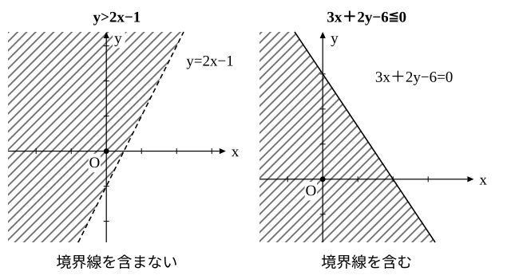
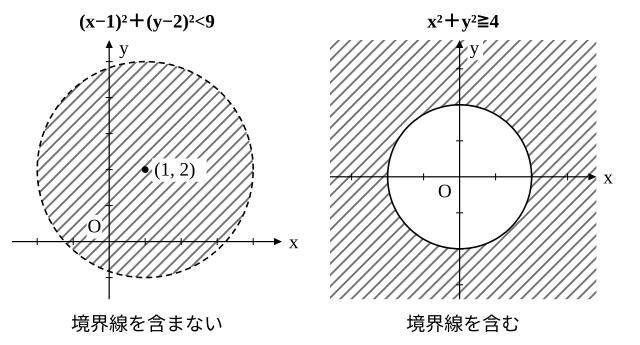

# L11 不等式の表す領域——境界を描いて点で確かめる

- unit_id: hs-math-ii-figures-and-equations
- 位置づけ: 単元第11レッスン（2時間）。x、y の不等式を満たす点 (x, y) 全体の集合（領域）を座標平面に図示する回。直線を境界とする領域、円を境界とする領域を「境界線を描く→片側の点を1つ代入→成り立つ側を塗る」の3段で求め、境界線を含むか含まないかを不等号・線種・答えの文の3つで書き分ける。逆に、言葉で与えられた領域を不等式で表す。L12 の連立不等式と線形計画法の土台。
- distribution_status: published_draft
- license: CC-BY-4.0
- verify_required: 例題数値・記述は監修者検証必須。
- 主概念: ①不等式の表す領域＝不等式を満たす点全体の集合。3段（境界線を描く→点を1つ代入→塗る）で図示し、境界線を含む（≦・≧・実線）と含まない（<・>・破線）を明記する ②円を境界とする領域（内部・外部）と、領域を不等式で表す逆向きの問題

---

## 1. 1変数から2変数へ——数直線の範囲から平面の部分へ

数学Ⅰで、不等式 x>3 の解を「条件を満たす x の値全部の集まり」として数直線上の範囲に表した。x と y の2つの文字を含む不等式、たとえば y>2x−1 でも同じ見方をする。この不等式を満たす (x, y) の組全部の集合を座標平面に描くと、数直線上の「範囲」ではなく、平面の「部分」になる。これを、**不等式 y>2x−1 の表す領域**という。

## 2. 直線を境界とする領域——3段で図示する

**例題1** 不等式 y>2x−1 の表す領域を図示せよ。

(1) 境界線を描く。不等号を等号にした方程式 y=2x−1 は直線で、これが領域の境目（**境界線**）になる。不等号が > なので境界線上の点は領域に含まれない。含まれないことを表すために、境界線は破線で描く。
(2) 境界線の片側の点を1つ選んで代入する。原点 (0, 0) を入れると 0>2×0−1、すなわち 0>−1 で成り立つ。
(3) 成り立った点 (0, 0) を含む側が、求める領域である。

答えは「直線 y=2x−1 の上側の部分。ただし、境界線を含まない」と書く。

**例題2** 不等式 3x＋2y−6≦0 の表す領域を図示せよ。

(1) 境界線 3x＋2y−6=0。不等号が ≦ なので境界線上の点も領域に含まれる。含まれることを表すために実線で描く。
(2) 原点 (0, 0) を代入すると −6≦0 で成り立つ。
(3) 原点を含む側が領域である。

答えは「直線 3x＋2y−6=0 について原点を含む側（下側）の部分。境界線を含む」。

**例題3** 不等式 x−2y>0 の表す領域を図示せよ。

(1) 境界線 x−2y=0 は原点を通る直線（y=(1/2)x）で、破線で描く。
(2) 境界線が原点を通るので、原点は代入に使えない。境界線上にない点、たとえば (2, 0) を代入すると 2−0>0 で成り立つ。
(3) (2, 0) を含む側が領域である。

答えは「直線 x−2y=0 について点 (2, 0) を含む側（下側）の部分。境界線を含まない」。

例題3の不等式を y について解くと y<(1/2)x になる。不等号が < なので「下側」になった。例題1は y>2x−1 で上側だった。ただし「> なら上側」を**型として覚えるのは勧めない**。例題3をもとの形 x−2y>0 のまま見ると不等号は > だが領域は下側であり、次の例題4のように境界線が y 軸に平行なら上下では言えない。どの形で与えられても迷わない方法は、点を1つ代入して確かめることである。

**例題4** 不等式 x>−2 の表す領域を図示せよ。

(1) 境界線 x=−2 は y 軸に平行な直線（L04）で、破線。
(2) 原点を代入すると 0>−2 で成り立つ。
(3) 原点を含む側、つまり直線 x=−2 の右側が領域である。境界線を含まない。

:::guide
**境界線の式は「等号にした方程式」の図形。不等号は「どちら側か」と「境界線を含むか」を決める**

領域の図示でやっていることを分けると2つしかない。1つは、不等号を等号に変えた方程式がどんな図形かを読むこと（これは L04・L07 でやった「方程式→図形」そのものである）。もう1つは、その図形で分けられた側のどちらを塗るかを決めることで、これは点を1つ代入すれば決まる。1点で決めてよいのは、直線の同じ側では式の値の符号が変わらないからである（y について解ける直線なら、同じ側の点は y が境界線上の y より大きいか小さいかがそろう。x=k 型なら x−k の符号がそろう）。境界線を含むかどうかは、不等号に等号がつくかで読む。「y>… は上、y<… は下」のような言い回しは、不等式を y について解いた形でしか使えず、x=k 型の境界線では意味をなさない。代入する点は、境界線上にない点なら何でもよい。原点が境界線上にあるときだけ、別の点に替える（例題3）。この2段構えが身につけば、円が境界線の場合（§3）も、連立不等式（L12）も、同じ手順で進められる。
:::

:::guide
**数学Ⅰの二次不等式との違い——x 軸上の範囲と平面の部分**

数学Ⅰで二次不等式 x²−4x＋3<0 を解いたとき、答え 1<x<3 は数直線上の範囲だった。放物線を描いて x 軸より下にある部分を見つけ、その x 座標の範囲を読んだ。あのときの図で答えとして示したのは放物線の一部やその下の部分ではなく、x 軸上の範囲である。このレッスンの領域は、それとは違い、平面そのものの一部を塗る。同じ「不等式を図で表す」でも、数学Ⅰでは実数 x の集合を数直線の上に、このレッスンでは座標の組 (x, y) の集合を平面の上に表していて、次元が1つ上がっている（例題4の x>−2 のように式に y が現れなくても、平面で考えるときは y がどんな値でもよい点の集合になる）。「境界線を含む・含まない」を数直線の ●（端の数を含む）と ○（含まない）の代わりに実線・破線で描き分けるのは、この次元の違いに合わせた表現である。
:::

## 3. 円を境界とする領域——内部と外部

**例題5** 次の不等式の表す領域を図示せよ。
(1) (x−1)²＋(y−2)²<9  (2) x²＋y²≧4

(1) 境界線は円 (x−1)²＋(y−2)²=9（中心 (1, 2)、半径 3）で、不等号が < なので破線。中心 (1, 2) を代入すると 0<9 で成り立つから、中心を含む側、つまり**円の内部**が領域である。境界線を含まない。
(2) 境界線は円 x²＋y²=4 で、≧ なので実線。中心 (0, 0) を代入すると 0≧4 で成り立たないから、中心を含まない側、つまり**円の外部**が領域である。境界線を含む。

円の場合、代入する点には中心を使うのが便利である。中心は境界線上にないので、いつでも使える。(x−a)²＋(y−b)²<r² は「中心からの距離が r より小さい点」だから内部、>r² は外部、と距離の言葉で読むこともできる（L07 の見方）。

## 4. 領域を不等式で表す——逆向き

図や言葉で与えられた領域を、不等式で表す。手順は図示の逆で、境界線の方程式を書き、領域の中の点を1つ代入して不等号の向きを決め、境界線を含むかどうかで、その向きの不等号に等号をつける（≦・≧）か、つけない（<・>）かを決める。

**例題6** 直線 2x−y=1 を境界線とし、点 (3, 1) を含む側の領域（境界線を含まない）を、不等式で表せ。

境界線の方程式は 2x−y=1。点 (3, 1) を左辺に代入すると 2×3−1=5 で、1 より大きい。よって領域の点では 2x−y>1 が成り立つ。境界線を含まないので不等号は >。答えは

2x−y>1

検算: 領域の中の別の点、たとえば (5, 0) を入れると 10>1 で成り立ち、反対側の点 (0, 0) を入れると 0>1 で成り立たない。

:::guide
**含む・含まないは3か所で書き分ける**

境界線を含むかどうかは、答えの中の3か所に同時に現れる。不等号（≦・≧ なら含む、<・> なら含まない）、図の線種（実線なら含む、破線なら含まない）、答えの文（「境界線を含む」「境界線を含まない」）である。この3つが食い違っている答案は、自分で見直せる。たとえば図を破線で描いたのに文に「境界線を含む」と書いていたら、どちらかが間違いである。逆向きの問題（領域→不等式）でも同じである。「境界線を含む」と指定されたら不等号に等号を入れる。この3か所の対応を毎回確かめることが、L12 で連立不等式の共通部分を扱うときの土台になる。
:::

## 5. 手順の型

1. 不等号を等号にした方程式の図形（直線か円）を境界線として描く。≦・≧ なら実線（含む）、<・> なら破線（含まない）。
2. 境界線上にない点を1つ選んで代入する（原点が使えれば原点、円なら中心、原点が境界線上なら別の点）。
3. 成り立てばその点を含む側、成り立たなければ反対側を塗る。
4. 答えの文に「境界線を含む」か「含まない」かを必ず書く。
5. 逆向き（領域→不等式）は、境界線の方程式→領域内の点を代入して向きを決定→含む・含まないで等号の有無、の順。

## 6. 練習

**問1** 不等式 2x−3y＋6>0 の表す領域について、次の各点がその領域に含まれるかどうかを、代入して答えよ。境界線上にある点は「境界線上」と答えること。
(1) (0, 0)  (2) (3, 4)  (3) (−3, 2)  (4) (1, −1)

**問2** 次の不等式の表す領域を図示せよ。答えには、境界線の方程式、境界線を含むか含まないか、どちら側かを言葉で書くこと。
(1) y≧−2x＋3  (2) 3x−2y<6  (3) x≦2  (4) y>−1

**問3** 次の不等式の表す領域を図示せよ。
(1) (x＋1)²＋(y−2)²≦4  (2) x²＋y²>9  (3) x²＋y²−4x＋2y<0
(4) 点 (1, 1) は (3) の領域に含まれるか。代入して答えよ。

**問4** 次の領域を不等式で表せ。
(1) 直線 x−y＋2=0 を境界線とし、点 (2, 1) を含む側。境界線を含む。
(2) 円 (x−3)²＋(y＋1)²=16 の外部。境界線を含まない。
(3) 直線 y=3 の上側。境界線を含まない。
(4) 中心 (0, 0)、半径 2 の円の内部と周。

**問5** ある人が、不等式 x−y>1 の表す領域を「不等号が > だから、直線 x−y=1 の上側」と答えた。原点 (0, 0) を代入して確かめ、この答えが正しいかどうかを理由とともに述べよ。

**問6** 境界線を含む領域と含まない領域とで、不等号・図の描き方・答えの書き方がそれぞれどう違うかを、2〜3文で説明せよ。

---

:::stretch
**S1** 不等式 (x−y)(x＋y)>0 の表す領域を図示せよ。（2つの数の積が正になるのは、両方とも正のときと、両方とも負のときである。「両方とも正」の領域は、x−y>0 の領域と x＋y>0 の領域が重なった部分である（両方とも負の場合も同じ考え方）。2つの場合の領域をそれぞれ求め、どちらかに入る点の全体を答えにする。）
:::

対応解答: answer_key_L10-12.md

<!-- gen_nav:nav:start（自動生成・手編集しない） -->

---

[← 前のレッスン](lesson_10.md)｜[単元の目次](README.md)｜[解答](answer_key_L10-12.md)｜[次のレッスン →](lesson_12.md)

<!-- gen_nav:nav:end -->
