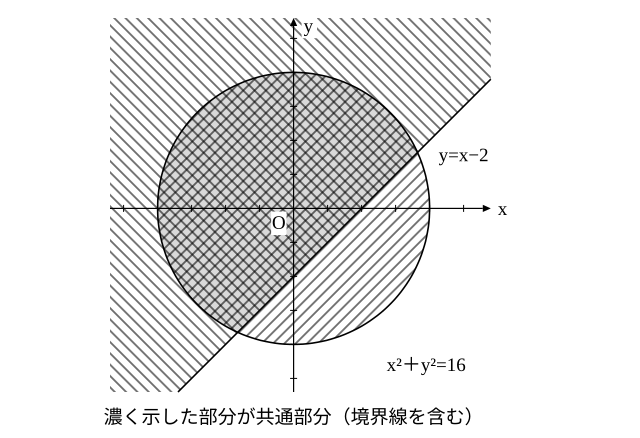
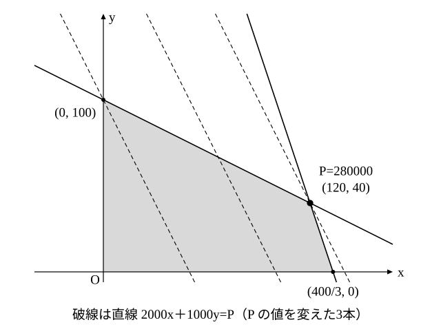

# L12 連立不等式の領域と最大・最小——線形計画法

- unit_id: hs-math-ii-figures-and-equations
- 位置づけ: 単元第12レッスン（2時間）。「軌跡と領域」のまとまりの最後の回。いくつかの不等式を同時に満たす点の集合（連立不等式の表す領域）を、各不等式の領域の共通部分として図示する。そのうえで、領域の中で x、y の1次式 ax＋by の値が最大・最小になる点を、直線 ax＋by=k を平行移動して端の点で読む。学習指導要領解説が挙げる製品と原料の例を、出典を示して例題にし、答えを元の場面に戻して意味を確かめる。
- distribution_status: published_draft
- license: CC-BY-4.0
- verify_required: 例題数値・記述は監修者検証必須。
- 主概念: ①連立不等式の表す領域＝各不等式の領域の共通部分（境界線が直線と円の混在を含む） ②領域の上で1次式 ax＋by の最大・最小を、直線 ax＋by=k を平行移動して端の点で読む（線形計画法と呼ばれる）。得られた解を元の事象の言葉に戻す

---

## 1. 連立不等式の表す領域——共通部分をとる

数学Ⅰで連立不等式を解くとき、それぞれの不等式の解を数直線に描き、**共通部分**を答えにした。x、y の連立不等式でも同じで、それぞれの不等式の表す領域を同じ座標平面に描き、重なっている部分（共通部分）が連立不等式の表す領域である。

**例題1** 連立不等式 y≧0、y≦x、x＋y≦4 の表す領域を図示せよ。

3つの不等式それぞれについて、L11 の3段を行う。
- y≧0: 境界線は x 軸（実線）。点 (0, 1) で 1≧0 が成り立つので、x 軸の上側。
- y≦x: 境界線は直線 y=x（実線）。原点は境界線上なので点 (1, 0) を使い、0≦1 が成り立つので、(1, 0) を含む側（直線 y=x の下側）。
- x＋y≦4: 境界線は直線 x＋y=4（実線）。原点で 0≦4 が成り立つので、原点側。

3つの領域の共通部分は、3直線で囲まれた三角形の内部と周である。頂点は、y=0 と y=x の交点 (0, 0)、y=0 と x＋y=4 の交点 (4, 0)、y=x と x＋y=4 の交点 (2, 2)。

答えは「3点 (0, 0)、(4, 0)、(2, 2) を頂点とする三角形の内部と周（境界線を含む）」。

検算: 三角形の内部の点 (2, 1) を3つの不等式に入れると、1≧0、1≦2、3≦4 で、すべて成り立つ。外の点 (3, 2) では 5≦4 が成り立たない。

**例題2** 連立不等式 x²＋y²≦16、y≧x−2 の表す領域を図示せよ。

- x²＋y²≦16: 境界線は円 x²＋y²=16（実線）。中心 (0, 0) で 0≦16 が成り立つので、円の内部と周。
- y≧x−2: 境界線は直線 y=x−2（実線）。原点で 0≧−2 が成り立つので、原点を含む側（上側）。

共通部分は、円の内部と周のうち、直線 y=x−2 の上側にある部分（境界線を含む）である。

検算: 点 (0, 3) は 9≦16、3≧−2 でともに成り立ち、領域に含まれる。点 (3, −1) は 10≦16 は成り立つが −1≧1 が成り立たず、含まれない。

連立不等式の領域では、境界線が2本以上あるので「どの境界線を含み、どの境界線を含まないか」を1本ずつ書く。

## 2. 領域の上で1次式の値を考える

**例題3** x、y が4つの不等式 x≧0、y≧0、x＋y≦5、x＋3y≦9 を満たすとき、x＋2y の最大値と最小値を求めよ。

まず領域を描く。4つの不等式の共通部分は、4点 (0, 0)、(5, 0)、(3, 2)、(0, 3) を頂点とする四角形の内部と周である（(3, 2) は x＋y=5 と x＋3y=9 の交点）。

次に、x＋2y=k とおく。k を1つ決めると、これは直線 y=−(1/2)x＋k/2 で、傾きが −1/2、y 軸との交点が (0, k/2) の直線である。k を変えると、この直線は傾きを保ったまま平行移動し、k が大きいほど上へ動く。

求めたいのは、**この直線が領域と共有点をもつ範囲で、k をどこまで大きく（小さく）できるか**である。直線を下から上へ平行移動していくと、領域に初めて触れるのは頂点 (0, 0) を通るとき（k=0）、領域から離れる直前に通るのは頂点 (3, 2) を通るとき（k=3＋4=7）である。直線の傾き −1/2 が、辺 x＋y=5 の傾き −1 と辺 x＋3y=9 の傾き −1/3 の間にあるので、離れる直前に触れるのは2辺の交わる頂点 (3, 2) になる。この頂点から右へは辺 x＋y=5 が直線より急に下がり、左へは辺 x＋3y=9 が直線よりゆるやかに上がるので、四角形はこの直線の下側に収まるからである。

よって、x＋2y は **(x, y)=(3, 2) のとき最大値 7、(x, y)=(0, 0) のとき最小値 0** をとる。

検算: 4つの頂点での値は、(0, 0) で 0、(5, 0) で 5、(3, 2) で 7、(0, 3) で 6。最大は 7、最小は 0 で合う。

:::guide
**直線を平行移動する＝k を変える。「領域から離れる直前」が最大**

x＋2y=k の k は「直線の位置」を表すつまみである。k を回すと直線が平行に動き、領域と重なっている間は、その k の値をとる点が領域の中にある。だから「領域の上での x＋2y の最大値」は「直線が領域と共有点をもつ k の最大」と言い換えられる。直線を動かして、領域から離れる直前に触れている点が答えの点である。領域が周を含む多角形なら、その点はいつも頂点のどれか（または辺全体）になる（境界線を含まない領域では、最大や最小がないこともある）。そこで実際の計算では、直線の傾きと辺の傾きを見比べてどの頂点で離れるかを判断し、その頂点の座標を代入する。慣れないうちは例題3の検算のように全部の頂点で値を計算して比べてもよい。ただし「頂点だけ調べればよい」のは領域が多角形のときで、円が境界に混ざる領域では、直線が円に接する点が答えになることもある（この型は L13 の stretch で1問だけ扱い、このレッスンの最大・最小の練習は多角形の領域に限る）。
:::

## 3. 元の場面へ戻す——線形計画法

**例題4** ある工場で製品 A、B を作る。製品 A を 1 個作るには原料 a が 1 kg、原料 b が 3 kg 必要で、製品 B を 1 個作るには原料 a が 2 kg、原料 b が 1 kg 必要である。原料 a は 1 日に 200 kg まで、原料 b は 400 kg まで使える。製品 A、B を 1 個売ったときの利益はそれぞれ 2000 円、1000 円である。1 日の利益を最大にするには、A、B を何個ずつ作ればよいか。

（この設定と数値は、高等学校学習指導要領解説 数学編（平成30年告示）が線形計画法の例として挙げているものである。）

| | 製品 A（1個あたり） | 製品 B（1個あたり） | 1日の使用限度量 |
|---|---|---|---|
| 原料 a | 1 kg | 2 kg | 200 kg |
| 原料 b | 3 kg | 1 kg | 400 kg |
| 利益 | 2000 円 | 1000 円 | |

1 日に A を x 個、B を y 個作るとする。個数は 0 以上だから x≧0、y≧0。原料 a の使用量は x＋2y kg で 200 kg 以下、原料 b の使用量は 3x＋y kg で 400 kg 以下だから

x＋2y≦200、3x＋y≦400

利益を P 円とすると P=2000x＋1000y で（ここでの P は点の名前ではなく、利益の金額を表す数である）、この P を最大にしたい。

4つの不等式の表す領域は、4点 (0, 0)、(400/3, 0)、(120, 40)、(0, 100) を頂点とする四角形の内部と周である（(120, 40) は x＋2y=200 と 3x＋y=400 の交点。3x＋y=400 から y=400−3x を代入して x＋800−6x=200、x=120、y=40）。

2000x＋1000y=P とおくと、これは傾き −2 の直線で、P が大きいほど上にある。傾き −2 は、辺 3x＋y=400 の傾き −3 と辺 x＋2y=200 の傾き −1/2 の間にあるので、直線を上へ平行移動して領域から離れる直前に通るのは、この2辺の交わる頂点 (120, 40) である。このとき P=2000×120＋1000×40=280000。

答えは、**A を 120 個、B を 40 個作るとき、利益は最大で 280000 円**である。

検算: 頂点での P は、(0, 0) で 0、(400/3, 0) で約 266667、(120, 40) で 280000、(0, 100) で 100000。最大は (120, 40) で合う。

答えを元の場面に戻して読む。A を 120 個、B を 40 個作ると、原料 a は 120＋80=200 kg、原料 b は 360＋40=400 kg で、どちらも使用限度いっぱいまで使い切っている。この例題では、利益が最大になるのは、2種類の原料がともに余らない作り方のときだった、と読める（最大になる頂点によっては、片方の原料が余ることもある）。頂点 (400/3, 0) は個数としては意味をもたない点だが、最大を与える頂点 (120, 40) は整数なので、この問題では答えとしてそのまま使える（最大を与える点が整数でないときは、stretch の S2 のように、領域の中の整数の点を調べる）。

このように、いくつかの1次不等式で表される条件のもとで、1次式の最大値・最小値を求める問題の解き方は、**線形計画法**と呼ばれる。

:::guide
**最大が1つの頂点で決まらないこともある**

例題3の領域で、x＋2y の代わりに x＋y の最大値を考えてみよう。x＋y=k は傾き −1 の直線で、辺 x＋y=5 と平行である。直線を上へ動かすと、頂点 (5, 0) と (3, 2) に同時に触れ、その辺全体で k=5 になる。この場合、最大値は 5 で、それを与える点は辺 x＋y=5 の上の点すべて（(5, 0) から (3, 2) まで）である。「最大値を与える点は頂点のどれか1つ」と決めつけると、この場合を取りこぼす。直線の傾きが辺の傾きと一致していないかを、図で確かめる。練習の問4がこの型である。
:::

:::guide
**この単元で扱う領域の範囲**

この単元の領域は、境界線が直線または円である場合に限っている。放物線を境界線とする領域、絶対値を含む不等式の表す領域、2つの図形の交点を通る図形、領域を使った命題の証明は、教科書によって研究や探究の欄に置かれる内容で、この単元の本文では扱わない（絶対値を含む場合だけ、stretch の S1 に発展として置いた）。線形計画法で扱う量は実数として動かしているが、製品の個数のように整数しか意味をもたない量では、領域の中の整数の点だけを調べる必要がある。stretch の S2 でその一例を扱う。
:::

:::zatsudan
線形計画法は「原料や時間に限りがあるとき、何をどれだけ作れば利益が最大になるか」「複数の配達先へどう配れば費用が最小になるか」のように、生産や配送の計画を立てる場面で使われる。この単元では2つの量 x、y で考えたが、量が3つ以上になっても「1次の条件のもとで1次式を最大・最小にする」という問題の形は同じで、量が増えるとコンピュータで解く。図を描いて直線を動かす、というこのレッスンの見方は、その出発点になっている。
:::
<!-- zatsudan話題源: 内部調査要約 雑談枠許可リストZ2（高等学校学習指導要領解説 数学編（平成30年告示）の指導事項イ（イ）「日常の事象や社会の事象」と線形計画法の例、啓林館『新編数学Ⅱ』年間指導計画〔令和4年度〕の探究の項目名「配送料を設定しよう」の範囲。企業名・実際の数値は出さない）。「量が増えるとコンピュータで解く」の1文は一般的な記述で、特定の出典に依らない。それ以外は出典の確認範囲内の内容のみ使用 -->

## 4. 手順の型

1. 連立不等式の領域: 各不等式について L11 の3段（境界線・点を代入・塗る）を行い、共通部分をとる。頂点（境界線どうしの交点）の座標を求めておく。
2. 1次式 ax＋by の最大・最小: ax＋by=k とおいて直線とみる。k を変えて平行移動し、領域と共有点をもつ k の最大・最小を読む。
3. 領域が周を含む多角形なら、直線の傾きと辺の傾きを比べて、離れる直前に触れる頂点を決める。辺と平行なら、その辺全体が答えの点。1次式が ax の形（y の係数が 0）なら直線 ax=k は y 軸に平行なので、左右に平行移動して判定する。
4. 検算: 頂点全部で値を計算して比べる。
5. 文章題では、変数の意味・不等式・答えの意味（何を何個、余る原料はあるか）を、元の場面の言葉で書く。

## 5. 練習

**問1** 次の連立不等式の表す領域を図示せよ。答えには、境界線と、境界線を含むか含まないか、どの部分かを言葉で書くこと。
(1) x−y＋1≧0、x＋2y−4≦0
(2) x²＋y²<9、x−y−1<0
(3) y≧0、y≦2x、x＋y≦6

**問2** 連立不等式 x²＋y²≦16、y≧x−2 の表す領域について、次の各点がその領域に含まれるかどうかを、代入して答えよ。
(1) (3, 2)  (2) (−1, −3)  (3) (4, 1)  (4) (2, −1)

**問3** x、y が4つの不等式 x≧0、y≧0、2x＋y≦8、x＋2y≦7 を満たすとき、次の問いに答えよ。
(1) 領域の頂点の座標をすべて求めよ。
(2) x＋y の最大値と最小値、およびそれらを与える x、y の値を求めよ。
(3) 3x＋y の最大値と、それを与える x、y の値を求めよ。

**問4** 問3の領域で、2x＋y の最大値を求めよ。また、最大値を与える点をすべて答えよ。

**問5** ある菓子店で、クッキー 1 箱を作るのに小麦粉 200 g とバター 100 g、ケーキ 1 個を作るのに小麦粉 100 g とバター 100 g を使う。1 日に使える小麦粉は 1200 g、バターは 800 g までである。クッキー 1 箱の利益は 300 円、ケーキ 1 個の利益は 200 円である。
(1) クッキーを x 箱、ケーキを y 個作るとして、条件を不等式で表せ。
(2) 利益を最大にするには、クッキーとケーキをそれぞれいくつ作ればよいか。そのときの利益も答えよ。
(3) (2) の作り方のとき、小麦粉とバターはそれぞれ何 g 余るか。

**問6** 線形計画法で、直線 ax＋by=k を平行移動して最大値を読むとき「直線が領域から離れる直前に通る点」で最大になる理由を、k と直線の位置の関係を使って2〜3文で説明せよ。

---

:::stretch
**S1** 不等式 |x|＋|y|≦2 の表す領域を図示せよ。（x≧0、y≧0 の場合、x≧0、y<0 の場合、x<0、y≧0 の場合、x<0、y<0 の場合に分けて絶対値を外し、それぞれの場合の領域を求めて合わせる。）

**S2** ある製作所で2種類の製品 P、Q を作る。製品 P を 1 個作るには工程1に 2 時間、工程2に 3 時間かかり、製品 Q を 1 個作るには工程1に 2 時間、工程2に 5 時間かかる。工程1には 1 日のべ 7 時間、工程2には 1 日のべ 14 時間まで使える（「のべ」は、その日に使う時間を全部足した合計のこと）。製品 P、Q の 1 個あたりの利益はそれぞれ 4 千円、5 千円で、どちらも整数個単位でしか作れない。（この設定と数値は、高等学校学習指導要領解説 数学編（平成30年告示）が課題学習の例として挙げているものである。）
(1) 1 日に P を x 個、Q を y 個作るとして、条件を不等式で表し、領域を図示せよ。
(2) x、y を実数として動かしたとき、利益 4x＋5y（千円）が最大になる点とその値を求めよ。その点は、個数として意味をもつか。
(3) x、y が 0 以上の整数のとき、領域の中の整数の点をすべて挙げ、利益が最大になる作り方とその利益を求めよ。(2) の点の近くの整数の点と比べて、気づいたことを1〜2文で述べよ。
:::

対応解答: answer_key_L10-12.md

<!-- gen_nav:nav:start（自動生成・手編集しない） -->

---

[← 前のレッスン](lesson_11.md)｜[単元の目次](README.md)｜[解答](answer_key_L10-12.md)｜[次のレッスン →](lesson_13.md)

<!-- gen_nav:nav:end -->
