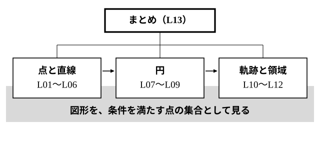

# L13 単元のまとめ——図形を点の集合として見る

- unit_id: hs-math-ii-figures-and-equations
- 位置づけ: 単元第13レッスン（2時間）。単元全体の総括回である。**新しい概念・新しい用語は立てない**。3つのまとまり（点と直線／円／軌跡と領域）を単元の地図で振り返り、単元の背骨「図形を、条件を満たす点の集合として見る」でつなぎ直す。各まとまりから1問ずつの総合演習と、x=k 型の直線・「どの円の半径か」の2つの再検査を行い、最後に、この単元の見方がこの先どの単元で使われるかを予告する。
- distribution_status: published_draft
- license: CC-BY-4.0
- verify_required: 例題数値・記述は監修者検証必須。
- 主概念: ①単元の地図と各まとまり1問の総合演習（式→図・図→式の往復／円と直線の位置関係を2法で／領域を点で確かめ・軌跡の逆の確認を書く）、x=k 型と「どの円の半径か」の再検査 ②後続単元への予告（先取りしない）

---

## 1. 単元の地図——3つのまとまりと1本の背骨

この単元は、点と直線（L01〜L06）、円（L07〜L09）、軌跡と領域（L10〜L12）の3つのまとまりでできていた。どのまとまりでも、やっていたことは1つである。**図形を「条件を満たす点 (x, y) 全部の集合」として見て、その条件を x、y の式に書く**。この見方が、単元全体を貫く背骨である。

| まとまり | レッスン | 「条件を満たす点の集合」として見た図形 |
|---|---|---|
| 点と直線 | L01〜L06 | 数直線上の点＝実数。直線＝方程式 ax＋by＋c=0 を満たす点の集合（y 軸に平行な x=k を含む）。2点間の距離・内分点と外分点・平行と垂直の条件・点と直線の距離 |
| 円 | L07〜L09 | 円＝定点からの距離が一定である点の集合＝(x−a)²＋(y−b)²=r²。円と直線の位置関係を判別式と「距離と半径」の2法で。接線は「半径に垂直」から |
| 軌跡と領域 | L10〜L12 | 軌跡＝条件を満たす点全体の集合（逆の確認まで書く）。領域＝不等式を満たす点の集合（境界線を描き、点を代入して側を決める）。連立不等式の領域の上で1次式の最大・最小 |

## 2. 背骨——条件を式に、式を図形に

この単元の問題は、大きく2つの向きに分かれる。**図→式**（条件から方程式や不等式を立てる）と、**式→図**（方程式や不等式が表す図形を読む）である。主な対応を1つの表にしておく。

| 条件（言葉） | 式 | 図形 |
|---|---|---|
| 点 (x₁, y₁) を通り、傾きが m | y−y₁=m(x−x₁) | 直線 |
| 点 (k, 0) を通り、y 軸に平行 | x=k | 直線（関数のグラフではない） |
| 点 (a, b) からの距離が r | (x−a)²＋(y−b)²=r² | 円 |
| 円 x²＋y²=r² 上の点 (x₁, y₁) で接する | x₁x＋y₁y=r² | 直線（接線） |
| 2点 A、B から等しい距離 | AP²=BP² を整理した一次方程式 | 直線（垂直二等分線） |
| 直線 ax＋by＋c=0 の一方の側（境界線を含まない） | ax＋by＋c>0 または <0（点を代入して決める） | 領域 |

式→図の向きでは、直線なら傾きと通る点、円なら平方完成して中心と半径、不等式なら境界線と代入した点で、図が描ける。図→式の向きでは、条件を「距離」「傾き」「点を通る」の言葉に直してから式にする。どちらの向きでも、最後に**図形上の点を1つ式に代入して確かめる**のが、この単元で通してきた検算の型である。

## 3. 総合演習——各まとまりから1問

**例題1**（点と直線）2点 A(1, 4)、B(5, 2) を通る直線を l とする。
(1) l の方程式を求めよ。
(2) 点 C(2, −1) と l の距離を求めよ。
(3) C を通り l に垂直な直線の方程式を求めよ。

(1) 傾きは (2−4)/(5−1)=−1/2。A を通るので y−4=−(1/2)(x−1)、両辺を 2 倍して 2y−8=−x＋1、すなわち **x＋2y−9=0**。
検算: B(5, 2) を代入すると 5＋4−9=0 で通る。
(2) 点と直線の距離の公式（L06）で、|2＋2×(−1)−9|/√(1²＋2²)=|−9|/√5=9/√5=**9√5/5**。
(3) l の傾きは −1/2 だから、垂直な直線の傾きは 2。C を通るので y＋1=2(x−2)、すなわち **2x−y−5=0**。
検算: 2つの直線の傾きの積は (−1/2)×2=−1 で垂直。C(2, −1) を代入すると 4＋1−5=0 で通る。

**例題2**（円）円 x²＋y²−4x−2y−5=0 と直線 x＋y−1=0 について答えよ。
(1) 円の中心と半径を求めよ。
(2) 円と直線の位置関係を、中心と直線の距離で判定し、判別式でも確かめよ。共有点があればその座標を求めよ。
(3) 共有点のうち x 座標が正のものにおける、円の接線の方程式を求めよ。

(1) 平方完成して (x−2)²＋(y−1)²=10。**中心 (2, 1)、半径 √10**。
(2) 中心 (2, 1) と直線の距離は d=|2＋1−1|/√2=2/√2=√2。半径 √10 より小さいので、**2点で交わる**。判別式でも確かめる。y=1−x を (1) の形 (x−2)²＋(y−1)²=10 に代入して (x−2)²＋(−x)²=10、2x²−4x−6=0、x²−2x−3=0。判別式は D=4＋12=16>0 で、確かに異なる2つの実数解をもつ。(x−3)(x＋1)=0 から x=3、−1。共有点は **(3, −2)、(−1, 2)**。
検算: (3, −2) を円の式に入れると 9＋4−12＋4−5=0、直線の式に入れると 3−2−1=0。(−1, 2) も 1＋4＋4−4−5=0、−1＋2−1=0。
(3) 接点は (3, −2)。この円の中心は原点ではないので、公式 x₁x＋y₁y=r² はそのまま使えない。L09 の導き方に戻る。中心 (2, 1) と接点 (3, −2) を結ぶ半径の傾きは (−2−1)/(3−2)=−3 だから、これに垂直な接線の傾きは 1/3。接点を通るので y＋2=(1/3)(x−3)、両辺を 3 倍して 3y＋6=x−3、すなわち **x−3y−9=0**。
検算: 中心 (2, 1) とこの直線の距離は |2−3−9|/√(1＋9)=10/√10=√10 で半径に等しい。確かに接線である。

**例題3**（軌跡と領域）
(1) 連立不等式 x²＋y²≦10、x＋y−1≧0 の表す領域を図示せよ。また、点 (2, 2) と点 (−1, 1) がこの領域に含まれるかを答えよ。
(2) 点 Q が円 x²＋y²=4 の上を動くとき、点 A(4, 0) と Q を結ぶ線分 AQ の中点 P の軌跡を求めよ。逆の確認まで書くこと。

(1) x²＋y²≦10 は円 x²＋y²=10 の内部と周（中心 (0, 0) で 0≦10 が成り立つ）。x＋y−1≧0 は直線 x＋y−1=0 について、原点で 0−1≧0 が成り立たないので、原点を含まない側。共通部分は、**円 x²＋y²=10 の内部と周のうち、直線 x＋y=1 について原点と反対の側にある部分**（境界線をどちらも含む）である。点 (2, 2) は 4＋4=8≦10、2＋2−1=3≧0 でともに成り立つので**含まれる**。点 (−1, 1) は 1＋1=2≦10 は成り立つが −1＋1−1=−1≧0 が成り立たないので**含まれない**。
(2) P(x, y)、Q(s, t) とおく。中点の条件から x=(4＋s)/2、y=t/2、すなわち s=2x−4、t=2y。Q は円上にあるから s²＋t²=4、代入して (2x−4)²＋(2y)²=4、両辺を 4 で割って (x−2)²＋y²=1。これは中心 (2, 0)、半径 1 の円である。逆に、この円上の点 P(x, y) に対して Q(2x−4, 2y) をとると、Q は円 x²＋y²=4 上にあり、P は AQ の中点になる。よって求める軌跡は**中心 (2, 0)、半径 1 の円**である。
検算: Q=(2, 0) のとき中点は (3, 0) で (3−2)²＋0=1。Q=(0, 2) のとき中点は (2, 1) で 0＋1=1。

:::guide
**総合演習で見るのは答えより往復の向き**

例題1〜3は、それぞれ「条件→式」と「式→図形」の往復を1回ずつ含むように組んである。例題1は2点という条件から直線の式を立て（図→式）、その式を使って距離を計算した。例題2は一般形の式から中心と半径を読み（式→図）、2つの方法で位置関係を判定し、接線を垂直条件から立て直した（図→式）。例題3は不等式から領域を読み（式→図）、点を代入して確かめ、中点という条件から軌跡の式を立てた（図→式）。この単元で身についたかどうかは、個々の公式を覚えているかより、問題を見たときに「いま自分はどちらの向きに進んでいるか」を言えるかで分かる。解き終えたら、各小問がどちらの向きだったかを自分で振り返ってみるとよい。
:::

## 4. 再検査——つまずきやすい2か所をもう一度

**再検査1**（x=k 型の直線）
(1) 点 (3, 5) を通り y 軸に平行な直線の方程式を求めよ。
(2) 点 (3, 5) を通り直線 y=−2 に垂直な直線の方程式を求めよ。
(3) (1) の直線は、x の関数のグラフ（x の値を決めると y の値が1つに決まる式のグラフ）か。

(1) y 軸に平行な直線上の点は x 座標がすべて等しい。**x=3**。
(2) 直線 y=−2 は x 軸に平行なので、それに垂直な直線は y 軸に平行である。(1) と同じく **x=3**。傾きの積で考えようとすると、y=−2 の傾きは 0 で、積を −1 にする傾きは存在しない。L05 で見たように、x 軸に平行な直線と y 軸に平行な直線の垂直は、傾きの積ではなく図で判断する。
(3) **グラフではない**。x=3 に対して y の値が1つに決まらない（y はどんな値でもよい）ので、関数の式にはならない。しかし、方程式 x=3 を満たす点 (x, y) の集合としては、確かに1本の直線である（L04）。

**再検査2**（どの円の半径か）円 C₁: (x−1)²＋(y−1)²=2 と C₂: x²＋y²=9、直線 l: x＋y=4 について、l は C₁ に接するか。C₂ に接するか。

C₁ について: C₁ の中心 (1, 1) と l の距離は |1＋1−4|/√2=2/√2=√2 で、**C₁ の半径 √2 に等しい**から、l は C₁ に接する。
C₂ について: C₂ の中心 (0, 0) と l の距離は |0＋0−4|/√2=4/√2=2√2 で、**C₂ の半径 3 とは等しくない**から、l は C₂ に接しない。2√2<3（2乗すると 8<9）なので、l は C₂ と2点で交わる。
「距離＝半径」の判定は、同じ円の中心と半径を組にして行う。C₁ の中心との距離を C₂ の半径と比べても、何も判定したことにならない。

:::guide
**再検査の2問を、なぜここで繰り返すのか**

x=k 型の直線と「どの円の半径か」の取り違えは、この単元の中で理解が曖昧なまま通り過ぎやすい2か所である。x=k は、中学の「一次関数のグラフ」の見方だけで直線をとらえていると、直線と認めにくい。L04 で「直線は方程式を満たす点の集合」と見方を広げたのは、この1本を仲間に入れるためだった。「どの円の半径か」は、公式そのものは正しく使えていても、問題の中に円が2つ出てきた瞬間に足をすくわれる型である。どちらも、公式の暗記だけでは防ぎにくい。「いま何と何を比べているか」を言葉で確かめる習慣が、防ぐ方法の1つになる。単元の最後にもう一度踏んでおくのはそのためである。
:::

## 5. この先へ——後続の単元で再び会う見方

この単元で身につけた「図形を点の集合として見て、式で表す」見方は、この先の単元で形を変えて何度も現れる。ここでは予告だけにとどめる。

- 直線や円を、向きと大きさをもつ量（ベクトル）で表す見方は、数学Cで学ぶ。
- 数学Cの「平面上の曲線」では、放物線・楕円・双曲線を、条件を満たす点の軌跡として定義し、方程式で表す。この単元の軌跡は直線と円までだった。
- 数学Ⅱの「微分・積分の考え」では、円に限らない曲線の接線の傾きを、微分という新しい道具で求める。この単元では円の接線を「半径に垂直」から導いた。
- 数学Ⅱの「指数関数・対数関数」では、指数や対数を含む方程式・不等式の表す図形や領域が、再び座標平面の上に現れる。

## 6. 練習

**問1** 直線 l: 2x−y＋3=0 について、次の問いに答えよ。
(1) l の傾きと、l と y 軸との交点の座標を答えよ。
(2) 点 (3, −1) を通り l に垂直な直線の方程式を求めよ。
(3) 点 (3, −1) と l の距離を求めよ。

**問2** 次の問いに答えよ。
(1) 点 (−2, 5) を通り y 軸に平行な直線の方程式を求めよ。
(2) 直線 x=4 と直線 y=−1 の交点の座標を答えよ。
(3) 点 (1, 3) を通り直線 x=−2 に垂直な直線の方程式を求めよ。
(4) 直線 x=2 は x の関数のグラフといえるか。理由を添えて1文で答えよ。

**問3** 円 x²＋y²＋2x−4y−4=0 と直線 3x＋4y＋5=0 について、次の問いに答えよ。
(1) 円の中心の座標と半径を求めよ。
(2) 円と直線の位置関係を、中心と直線の距離を使って判定せよ。
(3) 直線 y=x＋k がこの円に接するような定数 k の値を求めよ。

**問4** 円 C₁: (x−2)²＋y²=5 と C₂: x²＋(y−3)²=1、直線 l: x−2y＋3=0 がある。l は C₁、C₂ のそれぞれについて「接する」「2点で交わる」「共有点をもたない」のどれか。判定に使った中心と半径の組を明記して答えよ。

**問5** 連立不等式 (x−1)²＋y²≦4、x＋y≧1 について、次の問いに答えよ。
(1) 点 (2, 1)、(0, 0)、(1, −2) がそれぞれこの領域に含まれるかを、代入して答えよ。
(2) この領域を図示せよ（境界線と、含むか含まないか、どの部分かを言葉で書け）。

**問6** 点 Q が円 x²＋y²=16 の上を動くとき、点 A(8, 0) と Q を結ぶ線分 AQ の中点 P の軌跡を求めよ。逆の確認まで書くこと。

---

:::stretch
**S1** 円 C: x²＋y²=25 と直線 l: y=x＋1 について、次の問いに答えよ。
(1) C と l の共有点の座標を求めよ。
(2) (1) の各共有点における C の接線の方程式を求めよ。
(3) 連立不等式 x²＋y²≦25、y≧x＋1 の表す領域に、点 (−2, 3) は含まれるか。
(4) (3) の領域で、y−x の最大値と最小値を求めよ。それぞれを与える点もすべて答えよ（最大値は、直線 y−x=k が円に接するときに得られる。接点は、原点からこの直線に下ろした垂線の足である）。
:::

対応解答: answer_key_L13.md

<!-- gen_nav:nav:start（自動生成・手編集しない） -->

---

[← 前のレッスン](lesson_12.md)｜[単元の目次](README.md)｜[解答](answer_key_L13.md)

<!-- gen_nav:nav:end -->
