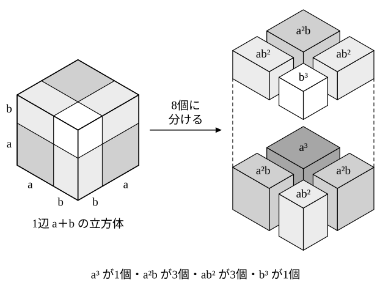

# L01 三次の乗法公式と因数分解——公式は4本・展開して戻す

- unit_id: hs-math-ii-various-expressions
- 位置づけ: 単元第1レッスン（2時間）。数学Ⅱ最初のレッスン。数学Ⅰ「数と式」で「3次式の乗法公式は数学Ⅱで学ぶ」と予告されていた公式を受け取る回である。前提の展開・因数分解を2問で確かめたあと、(a±b)³ の展開と a³±b³ の因数分解の公式4本を、中3・数学Ⅰの公式と同じく分配法則から導く。因数分解の答えは、必ず展開してもとの式に戻ることで確かめる。
- distribution_status: published_draft
- license: CC-BY-4.0
- verify_required: 例題数値・記述は監修者検証必須。
- 主概念: ①前提診断（中3の4公式・数学Ⅰの (ax＋b)(cx＋d)・置き換え）と (a±b)³ の公式を分配法則から導く ②a³±b³ の因数分解の公式と「展開して戻す」検算・(a＋b)³=a³＋b³ としてしまう誤りの反例

---

## 0. 本編の前に——展開と置き換えを2問で確かめる

この単元の計算は、中学3年と数学Ⅰ「数と式」で身につけた展開・因数分解の上に組み立てる。本編に入る前に、その土台を2問で確かめておこう。答え合わせはすぐ下にあるが、先に自分で解いてから読むこと。

**診断1** 次の式を展開せよ。
(1) (3x−2y)²  (2) (2x＋5)(3x−4)

**診断2** x−2=M とおいて、(x−2)²＋3(x−2)−10 を因数分解せよ。

答え合わせ:

- 診断1 (1) 中3の公式 (a−b)²=a²−2ab＋b² の a を 3x、b を 2y と読んで、(3x)²−2×3x×2y＋(2y)²=9x²−12xy＋4y²。
- 診断1 (2) 数学Ⅰの公式 (ax＋b)(cx＋d)=acx²＋(ad＋bc)x＋bd を使って、6x²＋(2×(−4)＋5×3)x＋5×(−4)=6x²＋7x−20。
- 診断2 M²＋3M−10=(M＋5)(M−2)。M を x−2 に戻して (x−2＋5)(x−2−2)=(x＋3)(x−4)。検算: 答えを展開すると x²−x−12。もとの式を直接展開しても (x²−4x＋4)＋(3x−6)−10=x²−x−12 で一致する。

:::guide
**どこで止まったかで、戻る場所が変わる**

2問とも迷わず解けたなら、このまま本編へ進んでよい。止まった人は、止まった場所を確かめてから戻ると早い。診断1(1) で止まったなら中3の4つの乗法公式（(a＋b)²・(a−b)²・(a＋b)(a−b)・(x＋a)(x＋b) の展開。数学Ⅰ「数と式」L01 で復習している）、診断1(2) なら数学Ⅰで加わった (ax＋b)(cx＋d) の公式（同 L02）、診断2なら「共通のまとまりを1つの文字に置き換える」見方と因数分解の手順（同 L02〜L04）に戻る。このレッスンで学ぶ3次の公式は、どれもこれらの2次の公式の上に組み立てる。土台が怪しいまま進むと、3次の計算で係数と符号を同時に追うことになり、どこで間違えたのかが自分で分からなくなる。逆に言えば、2次の公式が確かなら、3次の公式は「1段延ばすだけ」である。
:::

## 1. 数学Ⅱの入口——この単元の地図

数学Ⅱ最初の単元「いろいろな式」は、大きく3つの部分からなる。

- 式の計算（このレッスン〜L04）: 3次の乗法公式、二項定理、多項式の割り算、分数式。
- 等式・不等式の証明（L05〜L08）: どんな値を入れても成り立つ等式と、等式・不等式が成り立つことの証明。
- 複素数と方程式（L09〜L15）: 2乗すると負になる数を認めて、二次方程式や高次方程式を解く。

最後の L16 で全体をまとめる。3つの部分を貫くのは、**式をひとまとまりの対象として見る**という見方である。診断2で x−2 を M という1つの文字とみたように、式そのものを1つのものとして扱い、比べ、言い換える場面がこの先何度も出てくる。

数学Ⅰ「数と式」では、展開で新しく覚える公式は (ax＋b)(cx＋d) の1つだけであり、3次式の乗法公式は数学Ⅱで学ぶ、と予告していた。このレッスンはその3次の公式を受け取る回である。新しい公式は4本。そのどれもが、中3・数学Ⅰの公式と同じく分配法則から導ける。

## 2. (a＋b)³ を分配法則から導く

(a＋b)³ は (a＋b) を3回掛けたものである。最初の2つを中3の公式でまとめてから、残りの (a＋b) を分配法則で掛ける。

(a＋b)³ = (a＋b)(a＋b)² = (a＋b)(a²＋2ab＋b²)
= a(a²＋2ab＋b²)＋b(a²＋2ab＋b²)
= a³＋2a²b＋ab²＋a²b＋2ab²＋b³
= a³＋3a²b＋3ab²＋b³

a²b の項は、a×2ab から2個分、b×a² から1個分が出て、合わせて 3a²b になる。ab² の項も、a×b² から1個分、b×2ab から2個分で 3ab² になる。

次に (a−b)³ である。新しく計算し直さなくても、いま導いた式の b を −b に置き換えればよい。

(a−b)³ = (a＋(−b))³ = a³＋3a²(−b)＋3a(−b)²＋(−b)³ = a³−3a²b＋3ab²−b³

(−b)² は b² なので符号が＋に戻り、(−b)³ は −b³ なので−になる。その結果、符号は＋−＋−と交互に並ぶ。ここまでで、展開の公式が2本できた。

1. (a＋b)³ = a³＋3a²b＋3ab²＋b³
2. (a−b)³ = a³−3a²b＋3ab²−b³

この2本を**三次の乗法公式**という。

公式1を立体で見ておこう。縦・横・高さがどれも a＋b の立方体を、各辺を a と b の長さに分ける面で切ると、8個の直方体に分かれる。1辺 a の立方体が1個（体積 a³）、1辺 b の立方体が1個（b³）、縦・横・高さが a・a・b の直方体が3個（合わせて 3a²b）、a・b・b の直方体が3個（合わせて 3ab²）。8個の体積の和がもとの立方体の体積 (a＋b)³ に等しい、というのが公式1の中身である（立体として見るのは、a、b がどちらも正の数の場合の見取り図である）。

**例題1** 次の式を展開せよ。
(1) (x＋3)³  (2) (2a−b)³

(1) 公式1の a を x、b を 3 と読む。(x＋3)³ = x³＋3×x²×3＋3×x×3²＋3³ = x³＋9x²＋27x＋27。
(2) 公式2の a を 2a、b を b と読む。(2a−b)³ = (2a)³−3×(2a)²×b＋3×2a×b²−b³ = 8a³−12a²b＋6ab²−b³。(2a)³ は 2a³ ではなく、かっこごと3乗して 8a³ になる。

検算: (1) は x=1 を入れると、もとの式は 4³=64、展開後は 1＋9＋27＋27=64 で一致する。(2) は a=1, b=1 を入れると、もとの式は (2−1)³=1、展開後は 8−12＋6−1=1 で一致する。値を入れる検算は、一致しなければ誤りだと分かるが、一致しても正しいとは限らない。0 や、かっこの中が 0 になる値は、誤った式でも一致しやすいので避ける。

:::guide
**(a＋b)³ を a³＋b³ としたくなったら**

3乗の展開で起こりやすい誤りの1つが、(a＋b)³ を a³＋b³ としてしまう考え方だ。「3乗だから、それぞれを3乗すればよい」と見たくなるのは自然だが、数を1つ入れれば崩れる。a=b=1 なら (1＋1)³=8 に対して、1³＋1³ は 2 にしかならない。立方体の図で言えば、a³ と b³ の2個の立方体だけでは1辺 a＋b の立方体に遠く足りず、残りの6個の直方体（3a²b と 3ab²）がすき間を埋めている。数学Ⅰで (a＋b)² を a²＋b² としなかった理由（面積図のすき間の 2ab）と同じ構造が、1つ次元を上げて現れているだけである。迷ったら (a＋b)(a＋b)² と書き直して分配法則で開けば、公式を忘れていても必ず正しい式にたどり着ける。
:::

## 3. 3乗の和と差——因数分解の公式

今度は向きを逆にして、a³＋b³ と a³−b³ を積の形に表す。先に答えの形を示し、展開して確かめる。

(a＋b)(a²−ab＋b²) = a³−a²b＋ab²＋a²b−ab²＋b³ = a³＋b³

途中の −a²b と ＋a²b、＋ab² と −ab² が打ち消し合って、両端の a³ と b³ だけが残る。同じように

(a−b)(a²＋ab＋b²) = a³＋a²b＋ab²−a²b−ab²−b³ = a³−b³

左辺と右辺を入れかえて、因数分解の公式として読む。

3. a³＋b³ = (a＋b)(a²−ab＋b²)
4. a³−b³ = (a−b)(a²＋ab＋b²)

この2本を3次の**因数分解の公式**という。

これで公式は4本そろった。1・2は展開、3・4は因数分解に使う。符号の並びは、1つ目のかっこがもとの式と同じ符号、2つ目のかっこの真ん中の項（ab）がその反対の符号、最後の b² はいつも＋である。

**例題2** 次の式を因数分解せよ。
(1) x³＋8  (2) 27x³−1

(1) 8=2³ だから、x³＋8=x³＋2³。公式3の a を x、b を 2 と読んで、x³＋8=(x＋2)(x²−2x＋4)。
(2) 27x³=(3x)³、1=1³ だから、27x³−1=(3x)³−1³。公式4の a を 3x、b を 1 と読んで、27x³−1=(3x−1)(9x²＋3x＋1)。

因数分解の答えは、**展開して戻す**ことで必ず確かめる。(1) は (x＋2)(x²−2x＋4)=x³−2x²＋4x＋2x²−4x＋8=x³＋8、(2) は (3x−1)(9x²＋3x＋1)=27x³＋9x²＋3x−9x²−3x−1=27x³−1 で、どちらももとの式に戻る。

2つ目のかっこの x²−2x＋4 は、中3・数学Ⅰの公式ではこれ以上分解できない形であり、このまま答えにする（本当にこれ以上分解できないのかは、L10〜L12 で二次方程式の解と結びつけて確かめる）。

:::guide
**符号は覚えるより、展開して戻す**

公式3・4の2つ目のかっこは、真ん中の項の符号が1つ目のかっこと逆になる。これを丸暗記しようとすると、いざというときに「a²＋ab＋b² だったか、a²−ab＋b² だったか」と迷う。迷ったら展開すればよい。(a＋b)(a²＋ab＋b²) を展開すると a³＋2a²b＋2ab²＋b³ になって、a³＋b³ に戻らない。途中の項が打ち消し合わず、2倍になって残ってしまうからだ。真ん中の符号が逆になっているのは、まさに途中の項を打ち消すためである。そう理解しておけば、符号は「覚えるもの」から「展開すれば決まるもの」に変わる。この単元では、因数分解の答えを出したら毎回展開して戻す。これは検算であると同時に、公式を忘れたときに自分で公式を復元する方法でもある。
:::

## 4. 手順の型——共通因数・何の3乗か・展開して戻す

このレッスンで扱う3次の因数分解（3乗の和・差の公式に帰着するもの）は、次の順で進める。

1. 共通因数があれば、先にくくり出す（数学Ⅰと同じ）。
2. 各項が「何の3乗」になっているかを見る（8=2³、27x³=(3x)³、64=4³、125=5³ など）。まとまりが式なら、1つの文字に置き換えて考える。
3. 公式3・4に当てはめる。
4. 展開して戻す。

**例題3** 次の式を因数分解せよ。
(1) 2x³−54  (2) x⁶−1

(1) 共通因数 2 をくくり出すと 2(x³−27)。27=3³ だから、公式4で 2x³−54=2(x−3)(x²＋3x＋9)。検算: (x−3)(x²＋3x＋9)=x³−27 で、2倍すると 2x³−54 に戻る。
(2) x⁶=(x³)² と見て、x³=M とおくと M²−1=(M−1)(M＋1)（数学Ⅰの「2乗の差」の公式 a²−b²=(a＋b)(a−b)。展開の向きでは「和と差の積」と呼ぶ式）。M を戻して (x³−1)(x³＋1)。それぞれに公式4・3を使うと、

x⁶−1=(x−1)(x²＋x＋1)(x＋1)(x²−x＋1)

検算: 展開して戻す。公式4・3から (x−1)(x²＋x＋1)=x³−1、(x＋1)(x²−x＋1)=x³＋1 で、その積は (x³−1)(x³＋1)=x⁶−1 に戻る。値でも確かめると、x=2 を入れたとき、もとの式は 64−1=63、答えは 1×7×3×3=63 で一致する。

(2) は x⁶=(x²)³ と見て公式4から始めることもできる。ただしその道では (x²−1)(x⁴＋x²＋1) となり、2つ目のかっこをさらに分解するのに一工夫が要る（x⁴＋x²＋1 が2つの2次式の積に分解できることは、L03 の問1(4) の割り算で確かめる）。同じ式でも、どのまとまりを1つの文字とみるかで道の見通しが変わる。先に「2乗の差」を使うほうが、手持ちの公式だけで最後まで進める。

## 5. 練習

**問1** 次の式を展開せよ。
(1) (x＋4)³  (2) (3x−2)³  (3) (2a＋3b)³

**問2** 次の式を展開せよ。計算する前に、結果がどんな形になるかを予想してから始めること。
(1) (x−3)(x²＋3x＋9)  (2) (2a＋1)(4a²−2a＋1)  (3) (x＋2y)(x²−2xy＋4y²)

**問3** 次の式を因数分解せよ。答えは展開して戻し、もとの式になることを確かめよ。
(1) x³−125  (2) 8a³＋27b³  (3) 3x³＋24  (4) x⁴＋x

**問4** 次の式変形はどれも誤っている。1つの値を代入するか展開して戻すかして誤りであることを確かめ、正しい式に直せ。
(1) (x＋2)³=x³＋8
(2) x³−8=(x−2)(x²−2x＋4)
(3) (a−b)³=a³−3a²b−3ab²−b³

**問5** 次の式を、（ ）の中の見方を使って因数分解せよ。
(1) (x＋1)³−8（x＋1 を1つの文字とみる）
(2) x⁶−64（x³ を1つの文字とみる）

**問6** (a＋b)³ を展開すると 3a²b という項が現れる。その係数が 3 になる理由を、§2 の立方体の図を使って2〜3文で説明せよ（a・a・b の直方体がなぜ3個になるのかまで書くこと）。

---

:::stretch
**S1** a³＋b³＋c³−3abc を因数分解する。
(1) a³＋b³=(a＋b)³−3ab(a＋b) が成り立つことを、右辺を展開して確かめよ。
(2) (1) を使い、a＋b=M とおいて、a³＋b³＋c³−3abc を因数分解せよ。（ヒント: M³＋c³ に公式3を使い、残りの2つの項を −3ab でくくる。）
(3) (2) の答えと、もとの式の両方に a=1, b=2, c=3 を代入し、値が一致することを確かめよ。
:::

対応解答: answer_key_L01-04.md

<!-- gen_nav:nav:start（自動生成・手編集しない） -->

---

[単元の目次](README.md)｜[解答](answer_key_L01-04.md)｜[次のレッスン →](lesson_02.md)

<!-- gen_nav:nav:end -->
