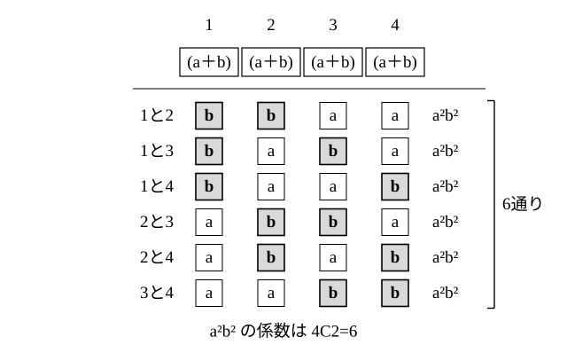

# L02 二項定理——(a＋b)ⁿ の係数を「選び方」で数える

- unit_id: hs-math-ii-various-expressions
- 位置づけ: 単元第2レッスン（2時間）。L01 で分配法則から導いた (a＋b)³ を「かっこから文字を選ぶ」見方で数え直し、(a＋b)ⁿ の展開の各項の係数が選び方の数 nCr になることを見いだして、二項定理を導く回である。nCr の記号は数学A「場合の数と確率」で学ぶものなので、冒頭で必要な分だけを確かめる。係数の並びの表（教科書でパスカルの三角形と呼ばれる）を読み、特定の項の係数を求める手順を型にする。
- distribution_status: published_draft
- license: CC-BY-4.0
- verify_required: 例題数値・記述は監修者検証必須。
- 主概念: ①nCr の前提確認と最小限の自給（n 個のかっこから b を r 個選ぶ選び方の数）→ (a＋b)ⁿ の一般項 nCr aⁿ⁻ʳbʳ ②係数の並び（パスカルの三角形と呼ばれる）と特定の項の係数を求める

---

## 0. 本編の前に——「選び方の数」nCr を確かめる

このレッスンでは、数学A「場合の数と確率」で学ぶ記号 nCr を使う。数学Aをまだ学んでいない人のために、必要なことだけをここで説明する。数学Aで学んだ人は、確かめるだけで §1 へ進んでよい。

A, B, C, D, E の5人から2人を選ぶ選び方を、全部書き出してみる。AB と BA は同じ2人なので、同じ選び方として1回だけ数える。

AB、AC、AD、AE、BC、BD、BE、CD、CE、DE

全部で10通りある。一般に、異なる n 個のものから r 個を選ぶ選び方の数を **nCr** と書く（C は組合せを表す英語 combination の頭文字。この教材では 5C2 のように半角の文字を並べて書く）。いまの例は 5C2=10 である。

書き出さずに計算する方法もある。1人目を選ぶのが5通り、そのそれぞれに対して2人目を選ぶのが4通りで、5×4=20。ただしこの20には、AB と BA のように同じ2人が「選んだ順番違い」で2回ずつ入っているので、2で割って 20/2=10 になる。一般には次のように計算する（分子・分母とも r 個の数を掛ける）。

nCr=n(n−1)…(n−r＋1)/(r(r−1)…×2×1)

分子は、順番をつけて r 個を選ぶ選び方の数である。選んだ r 個の1組は、並べる順番の違いで r(r−1)…×2×1 回ずつ重ねて数えられているので、分母のその数で割り戻している。

たとえば 6C2=(6×5)/(2×1)=15、6C3=(6×5×4)/(3×2×1)=20 である。さらに、次の約束と性質を使う。

- nC0=1（1つも選ばない選び方は「何も選ばない」の1通りと約束する）、nCn=1（全部選ぶ選び方も1通り）。
- nCr=nCn−r（右辺は「n 個から n−r 個を選ぶ選び方の数」で、C の右の n−r がひとかたまり。r 個を選ぶことは、残す n−r 個を選ぶことと同じだから）。たとえば 6C4=6C2=15。

:::guide
**二項定理と nCr の置き場所**

二項定理は本単元の用語。nCr の記号は数学A『場合の数と確率』で学ぶもので、ここでは展開の係数を数えるのに必要なことだけ説明する。数学Aでは nCr を使った場合の数や確率を詳しく扱うが、このレッスンで使うのは「n 個から r 個を選ぶ選び方が nCr 通りある」という意味と、上の計算の仕方だけである。数学Aを先に学んだ人は、そこで身につけた nCr が展開の係数としても使われるところに注目してほしい。まだ学んでいない人は、5人から2人を選ぶ書き出しの例を手がかりにすれば、このレッスンの範囲では足りる。
:::

## 1. (a＋b)³ を「選び方」で見直す

L01 では、(a＋b)³ を分配法則で展開して a³＋3a²b＋3ab²＋b³ を得た。ここでは同じ展開を、別の見方で数え直す。

(a＋b)³=(a＋b)(a＋b)(a＋b) を展開するとは「3つのかっこから a か b を1つずつ選んで掛け、それを全部の選び方について足す」ことである。1つ目・2つ目・3つ目のかっこから選ぶ文字を順に並べて書くと、選び方は

aaa、aab、aba、baa、abb、bab、bba、bbb

の 2×2×2=8 通りで、それぞれの積は a³、a²b（3回）、ab²（3回）、b³ になる。a²b が3回現れるのは「3つのかっこのうちどれか1つから b を選び、残りの2つから a を選ぶ」選び方が 3C1=3 通りあるからだ。同じように、ab² は b を2つ選ぶ 3C2=3 通り、a³ は b を1つも選ばない 3C0=1 通り、b³ は3つとも b を選ぶ 3C3=1 通りである。

(a＋b)³=3C0 a³＋3C1 a²b＋3C2 ab²＋3C3 b³

L01 の立方体の図で a²b の直方体が3個あったのは、b の長さの辺を縦・横・高さのどの向きに置くかが3通りあったからである。これは「3つのかっこのどれから b を選ぶか」と同じことを数えている。

## 2. (a＋b)⁴ と二項定理

同じ見方で (a＋b)⁴=(a＋b)(a＋b)(a＋b)(a＋b) を展開する。たとえば a²b² の項は、4つのかっこのうち2つから b を、残りの2つから a を選んだときに現れる。b を選ぶ2つのかっこの組は、1番目と2番目・1番目と3番目・1番目と4番目・2番目と3番目・2番目と4番目・3番目と4番目の 4C2=6 通りだから、a²b² の係数は 6 になる。

ほかの項も同じように数えると、

(a＋b)⁴=4C0 a⁴＋4C1 a³b＋4C2 a²b²＋4C3 ab³＋4C4 b⁴=a⁴＋4a³b＋6a²b²＋4ab³＋b⁴

この数え方は、かっこの個数が n 個になっても変わらない。n 個のかっこから b を r 個（残りの n−r 個からは a を）選ぶ選び方が nCr 通りあるので、aⁿ⁻ʳbʳ の係数は nCr になる。これを**二項定理**という。

(a＋b)ⁿ = nC0 aⁿ＋nC1 aⁿ⁻¹b＋nC2 aⁿ⁻²b²＋…＋nCr aⁿ⁻ʳbʳ＋…＋nCn bⁿ

どの項も、a の指数と b の指数の和は n である。nCr aⁿ⁻ʳbʳ は、r に 0, 1, 2, …, n を順に入れるとすべての項が出てくる代表の形で、展開式の**一般項**と呼ばれる。

**例題1** (x＋2)⁵ を展開せよ。

a を x、b を 2 と読む。5C0=1、5C1=5、5C2=10、5C3=10、5C4=5、5C5=1 だから、

(x＋2)⁵=x⁵＋5×x⁴×2＋10×x³×2²＋10×x²×2³＋5×x×2⁴＋2⁵
=x⁵＋10x⁴＋40x³＋80x²＋80x＋32

検算: x=1 を入れると、もとの式は 3⁵=243、展開後は 1＋10＋40＋80＋80＋32=243 で一致する。

**例題2** 次の展開式における、［ ］内の項の係数を求めよ。
(1) (2x−1)⁶ ［x⁴］  (2) (x＋2y)⁵ ［x²y³］

(1) (2x−1)⁶=(2x＋(−1))⁶ と見て、a を 2x、b を −1 と読む。一般項は 6Cr(2x)⁶⁻ʳ(−1)ʳ=6Cr×2⁶⁻ʳ×(−1)ʳ×x⁶⁻ʳ。x⁴ の項は 6−r=4、つまり r=2 のときだから、係数は 6C2×2⁴×(−1)²=15×16×1=240。
(2) a を x、b を 2y と読む。一般項は 5Cr x⁵⁻ʳ(2y)ʳ=5Cr×2ʳ×x⁵⁻ʳyʳ。x²y³ の項は r=3 のときだから、係数は 5C3×2³=10×8=80。

## 3. 係数の並び——パスカルの三角形と呼ばれる表

n=1 から n=6 までの (a＋b)ⁿ の係数 nC0, nC1, …, nCn を表に並べる。

| n | nC0 | nC1 | nC2 | nC3 | nC4 | nC5 | nC6 |
|---|---|---|---|---|---|---|---|
| 1 | 1 | 1 | | | | | |
| 2 | 1 | 2 | 1 | | | | |
| 3 | 1 | 3 | 3 | 1 | | | |
| 4 | 1 | 4 | 6 | 4 | 1 | | |
| 5 | 1 | 5 | 10 | 10 | 5 | 1 | |
| 6 | 1 | 6 | 15 | 20 | 15 | 6 | 1 |

n=3 の段は L01 の 1, 3, 3, 1、n=4 の段は §2 の 1, 4, 6, 4, 1 である。どの段も両端は 1（nC0=nCn=1）で、左右対称に並ぶ。左右対称になるのは、nCr=nCn−r、つまり「b を r 個選ぶことは、a を n−r 個選ぶことと同じ」だからである。この数の並びを三角形の形に書いたものは、教科書で**パスカルの三角形**と呼ばれる。この教材では、係数を読み取るための表として使う。表にない n の係数は、§0 の計算の仕方で nCr を求める。

:::zatsudan
二項定理の出番は、この単元で終わりではない。数学Bの「統計的な推測」では、同じ試行を、前の結果が次に影響しない形で何回も繰り返したときに、ある事柄がちょうど何回起こるかの確率の並び（二項分布と呼ばれる）を学ぶ。その確率の式に、このレッスンの nCr が係数としてそのまま現れる。学習指導要領解説の数学Bの説明にも、数学Ⅱの「いろいろな式」で二項定理を扱っていることが、つながりとして書かれている。展開の係数を数える道具が、確率の世界でも同じ形で働く。式の計算が、別の分野の土台になっている一例である。
:::
<!-- zatsudan話題源: 雑談枠許可リストZ3（高等学校学習指導要領解説 数学編（平成30年告示）数学B「(2)統計的な推測」の項に「『数学Ⅱ』の『（1）いろいろな式』では二項定理を取り扱い」の記述）。出典の確認範囲内の事実のみ使用 -->

## 4. 手順の型——特定の項の係数を求める

1. (a＋b)ⁿ の a と b に当たるものを、係数・符号ごと決める（(2x−1)⁶ なら a は 2x、b は −1）。
2. 一般項 nCr aⁿ⁻ʳbʳ を書き、数の部分と文字の部分に分ける。
3. 求める項の文字の指数から r を決める。
4. nCr、a の数の部分の累乗、b の数の部分の累乗（符号を含む）を掛けて係数を出す。
5. 検算: n が小さければ展開して確かめる。係数全体の和は、文字に全部 1 を代入した値に等しい（この確かめは、全部の項を展開したときに使う。1つの項の係数だけを求めたときは、r と指数の対応・符号・数の累乗を見直す）。

:::guide
**係数は nCr だけではない——符号と数の累乗を落とさない**

例題2(1) で起こりやすいのは、x⁴ の係数を 6C2=15 で止めてしまう考え方と、(−1)ʳ の符号を落とす考え方だ。一般項の 6Cr は「何通りの選び方で同じ文字の項が現れるか」を数えているだけで、選んだ1つ1つの積には (2x) の 2 や (−1) の符号がそのまま掛かっている。だから係数は「選び方の数」と「1回分の積の数の部分」を掛けたものになる。符号の決め方は簡単で、b=−1 を r 回掛けるのだから、r が偶数なら＋、奇数なら−である。また、文字に 1 を入れる検算は係数の和を確かめる強い道具になる。(2x−1)⁶ に x=1 を入れると 1⁶=1 だから、展開式の係数を全部足すと 1 になるはずだ。符号を1つでも落とすと、この和は合わなくなる。
:::

## 5. 練習

**問1** 二項定理を使って、次の式を展開せよ。
(1) (x＋1)⁵  (2) (a−2b)⁴  (3) (3x＋1)⁴

**問2** 次の展開式における、［ ］内の項の係数を求めよ。
(1) (x＋3)⁷ ［x⁵］  (2) (2x−1)⁸ ［x³］  (3) (x−3y)⁵ ［x²y³］

**問3** 二項定理を数の計算に使う。
(1) 11⁴ を (10＋1)⁴ とみて、二項定理で計算せよ。
(2) 11⁴ の各位の数字は、§3 の表の n=4 の段と同じ並びになる。一方、11⁵ を同じように計算しても、n=5 の段の 1, 5, 10, 10, 5, 1 がそのまま数字として並ぶことはない。その理由を説明せよ。

**問4** (x＋a)⁵ の展開式における x³ の係数が 40 であるとき、正の定数 a の値を求めよ（二項定理の式 (a＋b)ⁿ に当てはめるときは、x が a に、この問題の a が b に当たる）。

**問5** (a＋b)⁵ の展開式で a²b³ の係数が 5C3 になる理由を「5つのかっこ」「b を選ぶ」という言葉を使って説明せよ。また、この係数が 5C2 とも等しい理由を「a を選ぶ」という言葉を使って説明せよ。

**問6** (x＋1)⁴−(x−1)⁴ を計算せよ。計算する前に、二項定理の一般項を見て、どの次数の項が消えるかを予想すること。

---

:::stretch
**S1** (1＋x)⁶ を二項定理で展開した式を考える。
(1) x=1 を代入して、6C0＋6C1＋6C2＋6C3＋6C4＋6C5＋6C6 の値を求めよ。
(2) x=−1 を代入すると何が分かるか。(1) と合わせて、6C0＋6C2＋6C4＋6C6 の値を求めよ。
(3) (1) の値が、6つのかっこ (1＋x) のそれぞれで「1 か x か」を選ぶ選び方の総数と一致する理由を、1〜2文で説明せよ。
:::

対応解答: answer_key_L01-04.md

<!-- gen_nav:nav:start（自動生成・手編集しない） -->

---

[← 前のレッスン](lesson_01.md)｜[単元の目次](README.md)｜[解答](answer_key_L01-04.md)｜[次のレッスン →](lesson_03.md)

<!-- gen_nav:nav:end -->
