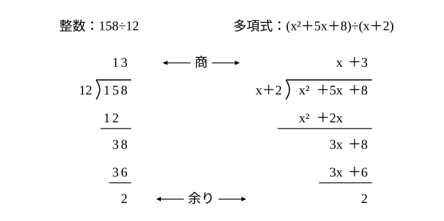

# L03 多項式の除法——整数の筆算と同じ形・A=BQ＋R

- unit_id: hs-math-ii-various-expressions
- 位置づけ: 単元第3レッスン（2時間）。中学では「多項式÷単項式」までだった割り算を「多項式÷多項式」へ広げる回である。小学校の整数の筆算 158÷12 と x²＋5x＋8 を x＋2 で割る筆算を並べ、同じ形で進むことを確かめてから、降べきの順・欠けた次数の扱いを型にする。割り算の結果を A=BQ＋R という等式で表す。そして「割り切れる」「余りが定数」などの条件を、この等式の言葉に言い換える練習をする。この等式は、L05 の恒等式と L13 の剰余の定理で再び使う。
- distribution_status: published_draft
- license: CC-BY-4.0
- verify_required: 例題数値・記述は監修者検証必須。
- 主概念: ①整数の筆算 158÷12 と x²＋5x＋8 を x＋2 で割る筆算の並置→多項式÷多項式の筆算・降べきの順・欠けた次数 ②A=BQ＋R（R=0、または R の次数<B の次数）と「余りが定数」「余りが 0」を式で言い換える

---

## 1. 整数の割り算を等式で書き直す

小学校で、158÷12 を筆算で計算した。商は 13、余りは 2 である。この結果は、割り算の記号を使わずに

158=12×13＋2

という等式で書ける。「割られる数＝割る数×商＋余り」の形であり、余りの 2 は割る数の 12 より小さい。余りが割る数より小さくなったところで、割り算は終わる。

このレッスンでは、同じことを多項式で行う。中学では多項式を単項式で割る計算（たとえば (6x²＋4x)÷2x）までを学んだ。ここからは、多項式を多項式で割る。

## 2. 多項式の筆算——整数の筆算と並べる

多項式を多項式で割る計算を**多項式の除法**という。x²＋5x＋8 を x＋2 で割る。筆算の進め方は、整数の筆算とそっくり同じである（この2つの割り算を並べる例は、高等学校学習指導要領解説 数学編（平成30年告示）に示されているものである）。

1. 割られる式の先頭の項 x² を、割る式の先頭の項 x で割る。x²÷x=x が商の最初の項になる。
2. x に割る式を掛けた x(x＋2)=x²＋2x を、割られる式の下に書いて引く。(x²＋5x)−(x²＋2x)=3x。次の項 ＋8 を下ろして 3x＋8。
3. 3x を x で割って ＋3 が商の次の項になる。3(x＋2)=3x＋6 を引いて、(3x＋8)−(3x＋6)=2。
4. 2 は x を含まない。割る式 x＋2 は x の1次式なので、2 をさらに x＋2 で割ろうとしても、商に立てる項が作れない（2÷x=2/x は x が分母に来て、多項式の項にならない。分数になってよいのは係数だけである）。ここで止まる。

商は x＋3、余りは 2 である。整数のときと同じく、結果を等式で書く。

x²＋5x＋8=(x＋2)(x＋3)＋2

2つの割り算を表で並べる。

| | 整数の割り算 | 多項式の割り算 |
|---|---|---|
| 割られるもの | 158 | x²＋5x＋8 |
| 割るもの | 12 | x＋2 |
| 商 | 13 | x＋3 |
| 余り | 2 | 2 |
| 止まる理由 | 余りの 2 が割る数の 12 より小さい | 余りの 2 の次数（0次）が、割る式 x＋2 の次数（1次）より低い |
| 結果の等式 | 158=12×13＋2 | x²＋5x＋8=(x＋2)(x＋3)＋2 |

違いは「止まる理由」の行だけである（x を含まない 0 以外の数は、0次の式と数える）。整数では余りの**大きさ**で、多項式では余りの**次数**で、割り算の終わりを決める。

:::guide
**多項式の筆算は、整数の筆算より素直**

整数の筆算では、商の数字を「たぶん 1、いや 2 か」と見当をつけて立て、引けなければ立て直す。繰り下がりにも気を配る。多項式の筆算には、この見当がいらない。商に立てる項は、毎回「いま残っている式の先頭の項 ÷ 割る式の先頭の項」で1つに決まるからだ。係数は負の数や分数になってもかまわないので、繰り下がりもない。だから、手順は「先頭どうしを割る→掛ける→引く→次の項を下ろす」の繰り返しだけになる。つまずきやすい所の1つは、引き算の符号である。−(3x＋6) を −3x＋6 としてしまうと、そこから先がすべてずれる。引く式はかっこごと符号を変える、と毎回意識しよう。検算は、結果の等式の右辺を展開して、割られる式に戻るかを見ればよい。
:::

## 3. 降べきの順と、欠けた次数の0

筆算の前に、割られる式と割る式をどちらも**降べきの順**（こうべきのじゅん。次数の高い項から順に並べる。数学Ⅰ「数と式」L01 の言葉）に整理しておく。途中の次数の項が欠けているときは、その場所に係数 0 の項を書いて位置をそろえる。

**例題1** 2x³−5x＋4 を x−2 で割った商と余りを求め、結果を等式で表せ。

2x³−5x＋4 には x² の項がない。そこで 2x³＋0x²−5x＋4 と書いて、筆算の位置をそろえる。

1. 2x³÷x=2x²。2x²(x−2)=2x³−4x² を引いて、(2x³＋0x²)−(2x³−4x²)=4x²。−5x を下ろして 4x²−5x。
2. 4x²÷x=4x。4x(x−2)=4x²−8x を引いて 3x。＋4 を下ろして 3x＋4。
3. 3x÷x=3。3(x−2)=3x−6 を引いて 10。10 は0次で、1次の x−2 より次数が低いので、ここで止まる。

商は 2x²＋4x＋3、余りは 10。等式で表すと

2x³−5x＋4=(x−2)(2x²＋4x＋3)＋10

検算: x=1 を入れると、左辺は 2−5＋4=1、右辺は (−1)×9＋10=1 で一致する。

**例題2** x³＋2x²−x＋3 を x²＋1 で割った商と余りを求めよ。

割る式の x²＋1 も、x の項が欠けている。x²＋0x＋1 と見ると、引き算の位置がそろう。

1. x³÷x²=x。x(x²＋1)=x³＋x を引いて、2x²−2x＋3。
2. 2x²÷x²=2。2(x²＋1)=2x²＋2 を引いて、−2x＋1。
3. −2x＋1 は1次で、2次の x²＋1 より次数が低いので、ここで止まる。

商は x＋2、余りは −2x＋1。割る式が2次式のときは、余りが1次式として残ることがある。検算: (x²＋1)(x＋2)＋(−2x＋1)=x³＋2x²＋x＋2−2x＋1=x³＋2x²−x＋3 で、割られる式に戻る。

:::guide
**欠けた次数に 0 を書くのは、305 の 0 と同じ**

整数の 305 は、十の位に 0 を書かないと 35 になってしまう。0 は「その位には何もない」ことを示すと同時に、ほかの数字の位置を正しく保っている。多項式で 0x² を書くのも同じ理由による。筆算では、同じ次数の項どうしを縦にそろえて引く。2x³−5x＋4 から 2x³−4x² を引くとき、x² の欄が空いていないと、−4x² を −5x の下に書いてしまい、次数の違う項どうしを引く誤りが起こる。0x² を書いておけば、引き算の相手が必ず同じ次数になる。割る式の側に欠けた次数があるときも、0 を補って見ると同じように位置がそろう。
:::

## 4. A=BQ＋R——割り算の結果を等式で表す

ここまでの結果をまとめる。多項式 A を、0 ではない多項式 B で割ったときの**商**を Q、**余り**を R とすると、

A=BQ＋R（R=0、または R の次数<B の次数）

という等式が成り立つ。この条件を満たす商 Q と余り R は、1組だけに決まる（筆算で、商に立てる項が毎回1つに決まることに対応する）。余りが 0 のとき、つまり A=BQ のとき、A は B で**割り切れる**という。整数の 158=12×13＋2 と同じ形であり、余りの条件だけが「大きさ」から「次数」に替わっている。

この等式は、x にどんな値を入れても成り立つ。例題1の検算で x=1 を入れて一致を確かめられたのは、そのためである。このように「どんな値を入れても成り立つ等式」は、L05 で恒等式として詳しく扱う。

文字が2種類以上ある多項式も、**1つの文字に着目**すれば（数学Ⅰ「数と式」L01 の見方）、1文字のときと同じように割れる（この単元では、割る式の、着目した文字の最高次の係数が数である場合だけを扱う）。

**例題3** x に着目して、x²＋3xy＋2y²＋x＋y を x＋y で割れ。

x に着目して降べきの順に整理すると、x²＋(3y＋1)x＋(2y²＋y)。y は数と同じ扱いにする。

1. x²÷x=x。x(x＋y)=x²＋xy を引いて、(2y＋1)x＋2y²＋y。
2. (2y＋1)x÷x=2y＋1。(2y＋1)(x＋y)=(2y＋1)x＋2y²＋y を引いて 0。

商は x＋2y＋1、余りは 0 で、割り切れる。つまり x²＋3xy＋2y²＋x＋y=(x＋y)(x＋2y＋1) であり、割り算によって因数分解ができたことになる。

A=BQ＋R は、逆向きにも使える。

**例題4** ある多項式 A を x−3 で割ると、商が x²＋1、余りが 4 である。A を求めよ。

A=BQ＋R に B=x−3、Q=x²＋1、R=4 を入れて、A=(x−3)(x²＋1)＋4=x³−3x²＋x−3＋4=x³−3x²＋x＋1。

## 5. 条件を式で言い換える

割り算についての言葉は、A=BQ＋R の R についての条件に言い換えられる。以下の記号 ⇔ は、その左と右が同じことを言いかえたもの（左が成り立てば右も成り立ち、右が成り立てば左も成り立つ）という意味で使う。

- 「A は B で割り切れる」⇔ 余り R が 0 ⇔ A=BQ と書ける（B は A の因数である）。
- 「A を B で割った余りが定数である」⇔ R が x を含まない ⇔ A=BQ＋c（c は定数）と書ける。割り切れる場合（c=0）もここに含まれる。
- 「B が2次式である」ならば、余りは1次以下であり、R=px＋q（p, q は定数）とおける。p=0 のときが「余りが定数」の場合である。

**例題5** x³−2x²＋ax＋3 を x²＋1 で割った余りを a を用いて表せ。また、余りが定数になるような定数 a の値を求めよ。

筆算で割る。

1. x³÷x²=x。x(x²＋1)=x³＋x を引いて、−2x²＋(a−1)x＋3。
2. −2x²÷x²=−2。−2(x²＋1)=−2x²−2 を引いて、(a−1)x＋5。

余りは (a−1)x＋5。これが定数になるのは、x の係数が 0 になるとき、つまり a−1=0 のときで、a=1。このとき余りは 5 である。なお、余りの定数項 5 はどんな a でも 0 にならないので、この式は x²＋1 で割り切れることはない。

:::guide
**余りが定数・余りが 0 を、式で言うと**？

「余りが定数になる」と言われて手が止まるのは、言葉のままでは計算に使えないからだ。そこで、まず余りを式で書く。2次式で割るなら、余りは1次以下だから px＋q とおける。すると「余りが定数」は「p=0」という係数の条件に変わり、割り切れることは「p=0 かつ q=0」という条件に変わる。例題5では、余りを実際に (a−1)x＋5 と計算してから、この言い換えを当てはめた。言葉→余りの式→係数の条件、という順に翻訳すれば、あとは方程式を解くだけになる。この翻訳は、L13 で剰余の定理を学ぶと、筆算をしなくてもできるようになる。
:::

## 6. 練習

**問1** 次の割り算の商と余りを求め、結果を A=BQ＋R の形の等式で表せ。
(1) (x²＋7x＋5)÷(x＋3)
(2) (3x³−2x²＋4)÷(x−1)
(3) (2x³＋x²−5x＋1)÷(x²＋2x−1)
(4) (x⁴＋x²＋1)÷(x²−x＋1)

**問2** x に着目して、x²＋2xy＋3y² を x＋y で割った商と余りを求めよ。また、余りに y が含まれていても割り算がそこで終わってよい理由を答えよ。

**問3** 次のことを、A=BQ＋R の形の等式や、余り R についての条件で表せ。
(1) 多項式 A は x−3 で割り切れる。
(2) 多項式 A を x²＋1 で割った余りは定数である。
(3) 3次式 A を2次式 B で割る。商 Q と余り R は、それぞれ何次の式か。

**問4** x³＋3x−1 をある多項式 B で割ると、商が x−1、余りが 2x＋1 である。B を求めよ（A=BQ＋R の等式に当てはめてから考えること）。

**問5** 多項式 x³＋ax＋b を x²＋x＋1 で割る（a, b は定数）。
(1) 商と余りを、a, b を用いて表せ。
(2) 余りが定数になるような a の値を求めよ。
(3) 割り切れるような a, b の値を求めよ。

**問6** 多項式の割り算の筆算が、余りの次数が割る式の次数より低くなったところで終わる理由を、2〜3文で説明せよ。

---

:::stretch
**S1** 3次式 A を x²−1 で割ると、余りが 2x＋1 になる。また、A の x³ の係数は 1、定数項は 4 である。
(1) 商 Q は何次式か。x³ の係数が 1 であることから、Q をどのような形におけばよいか答えよ。
(2) A を求めよ。
(3) 求めた A を実際に x²−1 で割り、余りが 2x＋1 になることを確かめよ。
:::

対応解答: answer_key_L01-04.md

<!-- gen_nav:nav:start（自動生成・手編集しない） -->

---

[← 前のレッスン](lesson_02.md)｜[単元の目次](README.md)｜[解答](answer_key_L01-04.md)｜[次のレッスン →](lesson_04.md)

<!-- gen_nav:nav:end -->
