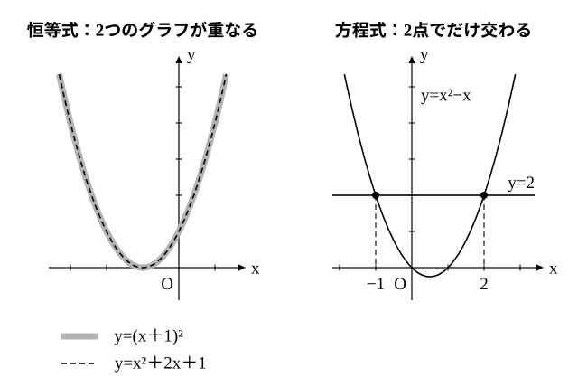

# L05 恒等式——「いつでも成り立つ」と未定係数法

- unit_id: hs-math-ii-various-expressions
- 位置づけ: 単元第5レッスン（2時間）。等式・不等式の証明のまとまり（L05〜L08）の入口。同じ「=」でも、文字にどんな値を入れても成り立つ等式（恒等式）と、恒等式ではない等式（方程式。成り立たせる値が無いこともある）があることを対比し、見分け方を身につける。恒等式になるように係数を決める未定係数法を、係数を比べる方法と値を代入する方法の2通りで扱い、L03 の割り算の等式 A=BQ＋R を恒等式として読み直す。L06 の等式の証明は、ある等式が恒等式であることを示す作業である。
- distribution_status: published_draft
- license: CC-BY-4.0
- verify_required: 例題数値・記述は監修者検証必須。
- 主概念: ①恒等式と方程式の対比（すべての x で成り立つ／ある x で成り立つ）と判定 ②未定係数法（係数を比べる・値を代入する）・A=BQ＋R を恒等式として読む（L03 の再訪）

---

## 1. 2つの「=」——いつでも成り立つか、ある x で成り立つか

次の2つの等式を比べる。

(ア) (x＋1)²=x²＋2x＋1  (イ) x²＋2x＋1=0

どちらにも「=」があり、x²＋2x＋1 という同じ式が出てくる。しかし、x にいろいろな値を入れてみると、2つの等式の性格はまったく違う。

| x | −2 | −1 | 0 | 1 | 2 |
|---|---|---|---|---|---|
| (x＋1)² の値 | 1 | 0 | 1 | 4 | 9 |
| x²＋2x＋1 の値 | 1 | 0 | 1 | 4 | 9 |

(ア) は、どの x でも左辺と右辺の値が等しい。実際、左辺を展開すると右辺とまったく同じ式になるので、x にどんな値を入れても成り立つ。一方 (イ) は、x²＋2x＋1 の値が 0 になる x=−1 でだけ成り立つ。

等式の両辺の式が、含まれている文字にどのような値を入れても（両辺の式が値をもつ限り）成り立つとき、その等式をその文字についての**恒等式**（こうとうしき）という。(ア) は x についての恒等式である。これに対して、恒等式ではない等式が方程式であり、(イ) のように、成り立たせる値があれば、その値が解である。x＋1=x＋2 のように、どんな値を入れても成り立たない等式も方程式であり、これは解をもたない。

等式が恒等式かどうかは、両辺をそれぞれ展開・整理して見分ける。同じ式になれば恒等式である。同じ式にならなければ、移項して整理し、方程式として解く（解がなければ、成り立つ x はない）。

**例題1** 次の等式は x についての恒等式か、方程式か。恒等式ならそのことを示し、方程式なら解を求めよ。
(1) (x−2)(x＋3)=x²＋x−6  (2) x²−x=2  (3) (x＋1)³−(x−1)³=6x²＋2  (4) 2(x＋3)=2x＋5

(1) 左辺を展開すると x²＋3x−2x−6=x²＋x−6 で、右辺と同じ式になる。**恒等式**である。
(2) 移項して x²−x−2=0、(x−2)(x＋1)=0。x=2, −1 のときだけ成り立つ**方程式**で、解は x=2, −1。
(3) 左辺を L01 の公式で展開すると (x³＋3x²＋3x＋1)−(x³−3x²＋3x−1)=6x²＋2 で、右辺と同じ式になる。**恒等式**である。
(4) 左辺は 2x＋6。2x＋6=2x＋5 を整理すると 6=5 となり、どんな x でも成り立たない。恒等式ではなく、解をもたない方程式である。

2つの等式の違いは、グラフで見るとはっきりする。恒等式の両辺を y＝（左辺）、y＝（右辺）としてかくと、2つのグラフは完全に重なる。方程式の場合は、2つのグラフが交わる点の x 座標だけが解になる。

:::guide
**1つの値で成り立っても、恒等式とは言えない**

(x＋2)²=x²＋4 は恒等式だろうか。x=0 を入れると、左辺も右辺も 4 で成り立つ。しかし x=1 を入れると、左辺は 9、右辺は 5 で成り立たない。この等式は、x=0 でだけ成り立つ方程式である（L01 で見た、(a＋b)³ を a³＋b³ としてしまう誤りの2乗版である）。恒等式とは「どんな値を入れても」成り立つ等式だから、いくつかの値で確かめただけでは恒等式だと言えない。逆に、成り立たない値が1つでも見つかれば、恒等式でないことは確定する。L01 以来の「1つの値を代入する検算」が、誤りを見つけるのには強いのに、正しさの証明にはならないのは、このためである。恒等式であることを示すには、両辺を展開・整理して同じ式になることを確かめる。
:::

## 2. 恒等式の係数——両辺の係数がそろう

恒等式の両辺を整理すると、同じ次数の項の係数がそれぞれ等しくなっている。このことを、いちばん簡単な形で確かめておく。

ax²＋bx＋c=0 が x についての恒等式である（どんな x でも成り立つ）とする。x=0 を入れると c=0。x=1 を入れると a＋b＋c=0、x=−1 を入れると a−b＋c=0 で、c=0 と合わせると a＋b=0、a−b=0 だから a=0, b=0。つまり、係数はすべて 0 である。逆に a=b=c=0 なら、どんな x でも成り立つ。

一般に、ax²＋bx＋c=a′x²＋b′x＋c′（a′, b′, c′ は、a, b, c とは別の定数）が x についての恒等式であることは、右辺を移項した (a−a′)x²＋(b−b′)x＋(c−c′)=0 が恒等式であることと同じだから、

ax²＋bx＋c=a′x²＋b′x＋c′ が x についての恒等式 ⇔ a=a′, b=b′, c=c′

が成り立つ。3次以上の式どうしでも同じで、両辺を整理したときに同じ次数の項の係数がそれぞれ等しいことが、恒等式であることと同じになる。この性質を使って、等式が恒等式になるように係数を決める方法を**未定係数法**という。

**例題2** 次の等式が x についての恒等式となるように、定数 a, b, c の値を定めよ。
x²−3x＋4=a(x−1)²＋b(x−1)＋c

方法1（係数を比べる）: 右辺を展開して x について整理すると、

a(x²−2x＋1)＋b(x−1)＋c=ax²＋(−2a＋b)x＋(a−b＋c)

左辺と係数を比べて、a=1、−2a＋b=−3、a−b＋c=4。これを解いて a=1, b=−1, c=2。

方法2（値を代入する）: 恒等式ならどんな x でも成り立つので、計算が楽になる値を入れる。x=1 を入れると 1−3＋4=c より c=2。x=0 を入れると 4=a−b＋c、x=2 を入れると 2=a＋b＋c。c=2 を使うと a−b=2、a＋b=0 だから、a=1, b=−1。

方法2 で求めた値は「x=0, 1, 2 の3つの値で成り立つ」ための条件にすぎない。そこで最後に、恒等式になっていることを確かめる。a=1, b=−1, c=2 のとき、右辺は (x−1)²−(x−1)＋2=x²−2x＋1−x＋1＋2=x²−3x＋4 となり、左辺と同じ式になる。よって a=1, b=−1, c=2。

この結果は、x²−3x＋4 を「x−1 のかたまり」で書き直すと (x−1)²−(x−1)＋2 になる、と読むこともできる。同じ式でも、何をひとまとまりとして見るかで、書き方が変わる。

:::guide
**係数を比べる方法と、値を代入する方法**

2つの方法には、それぞれ強みと注意点がある。係数を比べる方法は、右辺を展開する手間がかかるが、出てきた条件がそのまま恒等式であるための条件になるので、確かめの必要がない。値を代入する方法は、x=1 のように「かっこが 0 になる値」を選ぶと一気に係数が求まって速いが、得られるのは「代入した値で成り立つ」ための条件だけなので、最後に恒等式であることを確かめる。では、なぜ3つの値で確かめれば足りるのか。例題2 の両辺はどちらも2次以下の式だから、両辺の差も2次以下の式である。もし差が 0 でない式だとすると「差=0」は2次以下の方程式になり、成り立つ x は多くても2個しかない（数学Ⅰで学んだように、二次方程式の解は2個以下である）。それなのに3つの値で成り立ったのだから、差は 0、つまり恒等式だと分かる。最後の確かめを展開で行えば、この理屈に頼らなくても確実である。この教材では、等式が恒等式となるように定数の値を定める問題を値を代入する方法で解いたときは、最後の確かめを毎回書く。
:::

## 3. A=BQ＋R を恒等式として読み直す

L03 で、多項式 A を多項式 B で割ったときの商を Q、余りを R とすると、A=BQ＋R（R=0、または R の次数<B の次数）が成り立つことを学んだ。たとえば x²＋5x＋8 を x＋2 で割った結果は x²＋5x＋8=(x＋2)(x＋3)＋2 だった。右辺を展開すると x²＋5x＋6＋2=x²＋5x＋8 で左辺と同じ式になるから、この等式は x についての恒等式である。割り算の結果の等式は、いつでも恒等式になっている。

そこで、筆算を使わずに、未定係数法で商と余りを求めることもできる。

**例題3** x³＋2x²−3x＋1 を x²＋x−1 で割った商と余りを、未定係数法で求めよ。

3次式を2次式で割るので、商は1次式、余りは1次以下の式である。さらに、x³ の項は x² と商の x の項の積から出るので、商の x の係数は 1。そこで、商を x＋a、余りを bx＋c とおく（a, b, c は定数）。

x³＋2x²−3x＋1=(x²＋x−1)(x＋a)＋bx＋c

右辺を展開して整理すると、x³＋(a＋1)x²＋(a−1＋b)x＋(c−a)。これが左辺と恒等的に等しいので、係数を比べて a＋1=2、a−1＋b=−3、c−a=1。よって a=1, b=−3, c=2。

商は x＋1、余りは −3x＋2 である。筆算で割っても同じ結果になる（確かめてみよ）。

商と余りを「文字でおく」ときに、余りの次数が割る式の次数より低いことが、R の形（ここでは bx＋c）を決めている。A=BQ＋R の「R の次数<B の次数」という条件は、飾りではなく、未定係数法で式の形を決める道具になる。

:::guide
**恒等式は、この先どこで使うのか**

恒等式の未定係数法は学習指導要領解説では「取り扱うことも考えられる」とされる内容だが、教科書でも本文で扱われており、この単元でも本文で扱う。それは、この考え方がこの先の単元で道具として何度も出てくるからだ。この単元の後半では、L13 で A=BQ＋R に値を代入して剰余の定理を導く。数学Ⅱの「図形と方程式」では「k がどんな値でも成り立つ」という条件を、k についての恒等式として読む場面がある（練習の問5 がその形である）。数学Ⅱの後半の「微分・積分の考え」でも、2つの多項式を係数どうしで比べる見方が使われる。数学Bの「数列」では、n についての恒等式として係数を決める場面が出てくる。どの場面でも「どんな値でも成り立つ」を「係数がそろう」に言い換える、という同じ翻訳を使う。
:::

## 4. 練習

**問1** 次の等式は x についての恒等式か、方程式か。恒等式ならそのことを示し、方程式なら解を求めよ。方程式で解がなければ、そう答えよ。
(1) (x＋3)(x−3)=x²−9
(2) (x＋1)²=x²＋1
(3) x(x＋2)−(x＋1)²=−1
(4) (x−1)²=x²−2x

**問2** 次の等式が x についての恒等式となるように、定数 a, b, c の値を定めよ（(1) は a, b だけ）。係数を比べる方法を使うこと。係数を比べて出る式が文字の数より多いときは、求めた値が残りの式も満たすかを確かめること。
(1) 2x²＋5x−3=(x＋3)(ax＋b)
(2) x²＋4x＋1=a(x＋1)²＋b(x＋1)＋c

**問3** 等式 x²−x＋3=a(x−1)(x−2)＋b(x−1)＋c が x についての恒等式となるように、定数 a, b, c の値を、x に 1, 2, 0 を順に代入する方法で求めよ。また、求めた値で恒等式になっていることを確かめよ。

**問4** x³−4x²＋2x＋5 を x²−x＋2 で割った商と余りを、未定係数法で求めよ。また、筆算でも確かめよ。

**問5** 等式 kx＋2k−y＋3=0 が、k がどんな値であっても成り立つような x, y の値を求めよ。（ヒント: 左辺を k について整理し、k についての恒等式とみる。）

**問6** 次の考え方の誤りを指摘し、正しい結論を述べよ。
「(x＋1)²=x²＋1 は、x=0 を入れると両辺とも 1 になって成り立つ。だから、この等式は恒等式である。」

---

:::stretch
**S1** 次の等式が x についての恒等式となるように、定数 a, b の値を定めよ。ただし、分母を 0 にする x=−1, −3 は考えない。
1/((x＋1)(x＋3))=a/(x＋1)＋b/(x＋3)
（ヒント: 両辺に (x＋1)(x＋3) を掛けた等式が x についての恒等式になることを使ってよい。掛けたあとの等式は多項式どうしの恒等式なので、x=−1, −3 を代入してもよい。）
また、求めた a, b を使って右辺を通分し、左辺に戻ることを確かめよ。
:::

対応解答: answer_key_L05-08.md

<!-- gen_nav:nav:start（自動生成・手編集しない） -->

---

[← 前のレッスン](lesson_04.md)｜[単元の目次](README.md)｜[解答](answer_key_L05-08.md)｜[次のレッスン →](lesson_06.md)

<!-- gen_nav:nav:end -->
