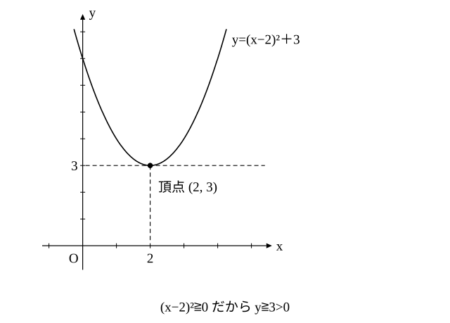

# L07 不等式の証明①——実数の平方は0以上・等号が成り立つとき

- unit_id: hs-math-ii-various-expressions
- 位置づけ: 単元第7レッスン（2時間）。L06 の等式の証明に続き、不等式が成り立つことを証明する回である。「すべての実数について成り立つ」ことを示すという約束を最初に言葉にし、A>B を示すには A−B>0 を示せばよい、という型を作る。道具は数学Ⅰ「数と式」L08 の不等式の性質と、実数の平方は 0 以上であるという実数の性質の2つである。≧ の不等式では、等号が成り立つときを毎回書く。両辺が正のときは、2乗して比べてもよいことも扱う。
- distribution_status: published_draft
- license: CC-BY-4.0
- verify_required: 例題数値・記述は監修者検証必須。
- 主概念: ①「すべての実数 a, b について」の約束と不等式の性質・A−B>0（≧0）を示す型・実数の平方≧0（平方完成へ） ②等号が成り立つときを必ず書く・正の数どうしは平方の大小で比べてよい（A²>B² ⇔ A>B）

---

## 1. 不等式を証明するとは——「すべての実数について」

不等式 A>B（または A≧B）を**証明する**とは、文字が**どんな実数であっても** A>B（または A≧B）が成り立つことを示すことである。そこで、不等式の証明では、冒頭に次のような1文を書いて約束をはっきりさせる。

「すべての実数 a, b について、〜が成り立つことを示す。」

条件があるときは「a>1, b>1 を満たすすべての実数 a, b について」のように、条件ごと書く。

この単元の不等式の証明は、文字がすべて実数であるとして行う。L09 で学ぶ虚数（2乗すると負になる数を含む数）には大小がなく、不等号で比べることができないからである。

証明の道具の1つ目は、数学Ⅰ「数と式」L08 で学んだ不等式の性質①〜④である。とくに性質②（a>b ならば a−c>b−c）で c を b にすると、a>b ならば a−b>0。逆に a−b>0 ならば、性質①（a>b ならば a＋c>b＋c）で両辺に b を足して a>b。つまり

a>b ⇔ a−b>0

だから、A>B を示すには、A−B>0 を示せばよい。等式の証明で 左辺−右辺=0 を示したのと同じ形で、今度は 左辺−右辺 が正（または 0 以上）であることを示す。そのために、左辺−右辺 を「正の数の積」や「0 以上の数の和」の形に変形する。正の数と正の数の和・積はどちらも正である。

**例題1** a>1, b>1 のとき、ab＋1>a＋b を証明せよ。

a>1, b>1 を満たすすべての実数 a, b について示す。

左辺−右辺=ab＋1−a−b=a(b−1)−(b−1)=(a−1)(b−1)

a>1, b>1 より a−1>0, b−1>0 だから、(a−1)(b−1)>0。つまり 左辺−右辺>0 であり、ab＋1>a＋b が成り立つ。

:::guide
**文字は「どんな値でも」の代表**

文字を含む式の大小は、数どうしの大小より難しく感じられる。3 と 5 なら一目で比べられるのに、ab＋1 と a＋b はどちらが大きいのか、すぐには見えない。この難しさの原因は、計算の難しさとは限らない。a や b が「どんな値でもよい」ことが、はっきり意識されていないことにもある。a=2, b=3 なら 7 と 5 で左が大きい。では a=1.1, b=100 なら？ 例題1 の証明は、条件を満たす限り、どんな a, b を選んでも左が大きいことを、一度に言い切っている。だから冒頭の「すべての実数 a, b について」は飾りではない。「これから示すのは、1つの値についてではなく全部についてだ」という約束を、自分にも読み手にも宣言する1文である。値を入れて確かめるのは、証明の前の見通しと後の検算として使えばよい。
:::

## 2. 実数の平方は 0 以上

証明の道具の2つ目は、**実数の性質**である。

実数 a について、a²≧0。等号が成り立つのは a=0 のときに限る。

理由は、場合を分ければ分かる。a>0 なら a²=a×a は正の数どうしの積で正。a<0 なら −a>0 で、a²=(−a)×(−a) はやはり正。a=0 なら a²=0 である。

2つの実数 a, b についても、a²≧0、b²≧0 だから a²＋b²≧0 であり、等号が成り立つのは a=0 かつ b=0 のときに限る（どちらかが 0 でなければ、その2乗が正になるから）。

**例題2** すべての実数 x について、x²−4x＋7>0 が成り立つことを証明せよ。

数学Ⅰの二次関数で学んだ平方完成を使う。

x²−4x＋7=(x²−4x＋4)−4＋7=(x−2)²＋3（x の係数 −4 の半分 −2 を2乗した 4 を、足して引く）

(x−2)² は実数の平方だから (x−2)²≧0。よって (x−2)²＋3≧3>0 であり、すべての実数 x について x²−4x＋7>0 が成り立つ。

y=x²−4x＋7=(x−2)²＋3 のグラフは、頂点が (2, 3) の下に凸の放物線で、いつも x 軸より上にある。これが「すべての実数 x について正」の見え方である。

**例題3** すべての実数 a, b について、不等式 a²＋b²≧2ab を証明せよ。また、等号が成り立つのはどのようなときか。

左辺−右辺=a²−2ab＋b²=(a−b)²

(a−b)² は実数の平方だから (a−b)²≧0。よって a²＋b²≧2ab。等号が成り立つのは a−b=0、つまり **a=b のとき** である。

## 3. 等号が成り立つとき

≧ は「> または =」を表す記号である。だから A≧B を証明したら「A=B になるのはどのようなときか」も調べて書く。例題3 では、(a−b)²=0 になるのは a=b のときだけなので「等号は a=b のときに成り立つ」と書いた。

検算にもなる。a=b=2 を入れると、左辺は 4＋4=8、右辺は 2×2×2=8 で、確かに等しい。a=4, b=1 なら、左辺は 17、右辺は 8 で、左辺のほうが大きい。

:::guide
**等号が成り立つときを書く理由**

a²＋b²≧2ab は「a²＋b² はいつも 2ab 以上」という主張である。これに「等号は a=b のとき」を添えると、主張はもう一段強くなる。a=b のときには本当に等しくなるのだから、2ab をそれより少しでも大きい式に置き換えた不等式（たとえば a²＋b²≧2ab＋1）は、もう成り立たない。つまり等号の条件は、この不等式がぎりぎりまで正しく、これ以上きつくはできないことを示している。この情報は、次の L08 で最小値を求めるときに欠かせない。「≧ だから、どこかで等号になるはず」とも限らないので、等号が成り立つかどうかは、式を見て確かめてから書く。成り立つときの値を1組入れて、両辺が本当に等しくなるかを見ておけば、書き間違いも防げる。
:::

## 4. 正の数どうしは、平方で比べてよい

根号を含む式の大小は、そのままでは比べにくい。そこで、両辺が正の数であることを確かめてから、2乗して比べる。A>0, B>0 のとき、

A²−B²=(A−B)(A＋B)

で、A＋B>0 だから、A²−B² と A−B の符号は一致する。つまり、

A>0, B>0 のとき、A>B ⇔ A²>B²

（≧ についても同じことが成り立つ）。A≧0, B≧0 のときも、A≧B ⇔ A²≧B² が成り立つ（A＋B=0 になるのは A=B=0 のときだけで、そのときは両辺とも 0 である）。つまり、0 以上の数どうしは2乗で比べてよい。

**例題4** a>0, b>0 のとき、√a＋√b>√(a＋b) を証明せよ。

両辺はともに正である。両辺をそれぞれ2乗して、その差をとると、

(√a＋√b)²−(√(a＋b))²=(a＋2√a√b＋b)−(a＋b)=2√(ab)

a>0, b>0 より √(ab)>0 だから、(√a＋√b)²>(√(a＋b))²。両辺とも正なので、√a＋√b>√(a＋b) が成り立つ。

数学Ⅰ「数と式」L06 では、√2＋√3 と √5 が等しくないことを数で確かめた。例題4 は「√a＋√b は √(a＋b) よりいつも大きい」ことを、すべての正の数 a, b について示したことになる。

:::guide
**平方で比べてよいのは、両辺が正（0 以上）のときだけ**

2乗して比べる方法は便利だが、両辺の符号を確かめずに使うと誤る。たとえば −3<2 だが、2乗すると 9>4 で大小が逆になる。負の数を2乗すると、数直線の上で 0 を中心に折り返してから大きさを比べることになるので、もとの大小が保たれないのである。A²−B²=(A−B)(A＋B) で、A も B も 0 以上なら A＋B≧0 となり、A²−B² と A−B の符号がそろう。どちらかが負だと、このことは言えない。だから、根号の式を2乗して比べる前に「両辺はともに正である」と1行書く。根号 √ のついた数は 0 以上なので、a, b が正なら √a＋√b のような式は正だと言える。一方、√a−√b のような差は、正か負かを先に確かめる必要がある。
:::

## 5. 手順の型——不等式の証明

1. 「すべての実数 … について」（条件があれば条件ごと）を書く。
2. 左辺−右辺 を作って整理する（≦ や < の不等式では、右辺−左辺 を作ると符号を考えやすい）。
3. 因数分解して各因数の符号を調べるか、平方完成して「(…)²＋正の数」や「(…)²＋(…)²」の形にする。
4. 0 との大小から結論を書く。両辺が正なら、両辺をそれぞれ2乗した式の差を調べてもよい。
5. ≧ の不等式では、等号が成り立つときを書く。
6. 検算: 等号が成り立つ値や、別の値を入れて、不等式が成り立っているか確かめる。

## 6. 練習

**問1** a>b, x>y のとき、ax＋by>ay＋bx を証明せよ。

**問2** すべての実数について、次の不等式を証明せよ。また、等号が成り立つのはどのようなときか答えよ。
(1) 4a²＋b²≧4ab
(2) x²＋y²≧2(x＋y−1)
(3) (x＋y)²≦2(x²＋y²)

**問3** すべての実数 x について、x²＋6x＋10>0 が成り立つことを証明せよ。

**問4** すべての実数 a, b について、a²−ab＋b²≧0 が成り立つことを、a に着目して平方完成する方法で証明せよ。また、等号が成り立つのはどのようなときか答えよ。

**問5** a>b>0 のとき、√a−√b<√(a−b) を証明せよ。（ヒント: 両辺が正であることを確かめてから、2乗の差を調べる。）

**問6** 次の問いに答えよ。
(1) 「すべての実数 a について a²>0 である」は正しいか。理由をつけて答え、正しくなければ、正しい文に直せ。
(2) x²＋y²≧2xy の等号が成り立つのは x=y のときである。x=3, y=3 のときと x=3, y=1 のときのそれぞれについて両辺の値を計算し、この文の意味を確かめよ。

---

:::stretch
**S1** すべての実数 a, b, c について、a²＋b²＋c²≧ab＋bc＋ca を証明せよ。また、等号が成り立つのはどのようなときか答えよ。（ヒント: 左辺−右辺 を2倍して、2乗の和の形に変形する。）
:::

対応解答: answer_key_L05-08.md

<!-- gen_nav:nav:start（自動生成・手編集しない） -->

---

[← 前のレッスン](lesson_06.md)｜[単元の目次](README.md)｜[解答](answer_key_L05-08.md)｜[次のレッスン →](lesson_08.md)

<!-- gen_nav:nav:end -->
