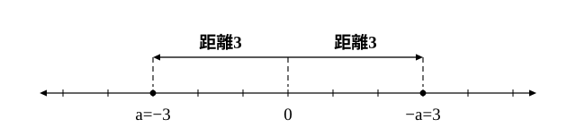
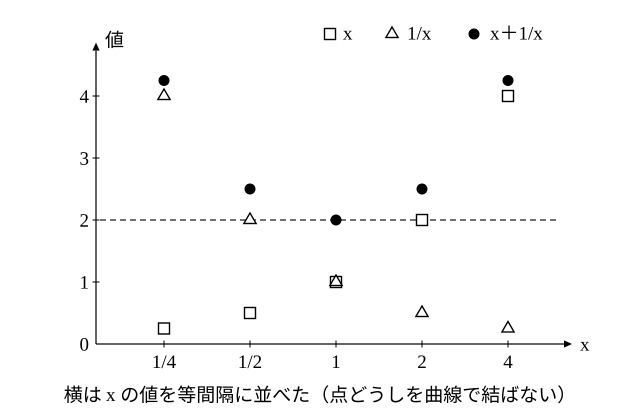

# L08 不等式の証明②——絶対値の性質と相加・相乗平均の関係

- unit_id: hs-math-ii-various-expressions
- 位置づけ: 単元第8レッスン（2時間）。L07 の「A−B が 0 以上であることを示す」型に、証明の道具を2つ加える回である。1つ目は絶対値の性質で、数学Ⅰ「数と式」L07 の「絶対値＝数直線上の距離」から導き、|a＋b|≦|a|＋|b| の証明に使う。2つ目は相加・相乗平均の関係で、正の数 a, b について (a＋b)/2≧√(ab) を証明し、式の最小値を求めるのに使う。最小値を答えるときは、等号が成り立つ値を必ず書く。等式・不等式の証明のまとまり（L05〜L08）の最後のレッスンである。
- distribution_status: published_draft
- license: CC-BY-4.0
- verify_required: 例題数値・記述は監修者検証必須。
- 主概念: ①絶対値の性質（絶対値はもとの数以上・絶対値の2乗はもとの数の2乗・積の絶対値は絶対値の積・和の絶対値は絶対値の和以下）を数直線上の距離から導いて用いる ②相加・相乗平均の関係 (a＋b)/2≧√(ab)（a>0, b>0・等号は a=b のとき）の証明と最小値への利用・等号が成り立つ値を必ず書く

---

## 1. 絶対値の性質——数直線上の距離から

数学Ⅰ「数と式」L07 で、実数 a の絶対値 |a| を、数直線上で原点から a までの距離として学んだ。a≧0 なら |a|=a、a<0 なら |a|=−a（たとえば |−3|=−(−3)=3）である。

数直線の上で、a と −a は原点について対称な位置にあり、どちらも原点からの距離は |a| である。たとえば a=−3 なら、−a=3 で、|a|=3。

この見方から、次の性質が導ける（a, b は実数）。

1. |a|≧0。また |a|≧a、|a|≧−a
2. |a|²=a²
3. |ab|=|a||b|

1 は、|a| が a と −a のうち小さくない方（a≧0 なら a、a<0 なら −a）に等しいことから分かる。どちらの場合も、|a| は a 以上であり、−a 以上でもある。2 は、|a| が a か −a のどちらかで、どちらを2乗しても a² になることから分かる。3 は、2 を使って確かめられる。|ab|²=(ab)²=a²b²=|a|²|b|²=(|a||b|)² で、|ab| も |a||b| も 0 以上だから、L07 の「0 以上の数どうしは2乗で比べてよい」により、|ab|=|a||b|。

:::guide
**絶対値の性質は、距離で読めば覚えなくてよい**

3つの性質は、公式として覚えるだけでなく、距離の言葉で読み直せる。|a|≧a は「原点からの距離は、数直線上の位置（負の数なら左側）以上」と読む。a が正なら両者は等しく、a が負なら位置は負の数、距離は正の数なので、距離のほうが大きい。|ab|=|a||b| は「1 を a 倍すると原点からの距離は |a| 倍になり、さらに b 倍すると |b| 倍になる。だから ab の原点からの距離は |a|×|b| である」と読める。そして次の §2 で示す |a＋b|≦|a|＋|b| は「原点から a だけ進み、そこから b だけ進んだとき、原点からの距離は、進んだ道のりの合計を超えない」と読める。同じ向きに進めば道のりの合計に等しく、逆向きに進めば戻った分だけ短くなる。この読み方をしておけば、等号がいつ成り立つかも見当がつく。
:::

## 2. |a＋b|≦|a|＋|b| を証明する

**例題1** すべての実数 a, b について、|a＋b|≦|a|＋|b| を証明せよ。また、等号が成り立つのはどのようなときか。

両辺はともに 0 以上だから、2乗の差を調べればよい（L07）。性質2・3を使うと、

(|a|＋|b|)²−|a＋b|²=(|a|²＋2|a||b|＋|b|²)−(a＋b)²=(a²＋2|ab|＋b²)−(a²＋2ab＋b²)=2(|ab|−ab)

性質1 から |ab|≧ab なので、2(|ab|−ab)≧0。よって (|a|＋|b|)²≧|a＋b|² であり、両辺とも 0 以上だから |a＋b|≦|a|＋|b|。

等号が成り立つのは |ab|=ab のとき、つまり ab≧0 のときである。a と b が同じ符号のときか、少なくとも一方が 0 のときに等号が成り立つ。

検算: a=3, b=5 なら |8|=8、|3|＋|5|=8 で等しい（同じ符号）。a=3, b=−5 なら |−2|=2、|3|＋|−5|=8 で、左辺のほうが小さい（異なる符号）。

## 3. 相加平均と相乗平均

2つの正の数 a, b について、(a＋b)/2 を a と b の**相加平均**（そうかへいきん）、√(ab) を a と b の**相乗平均**（そうじょうへいきん）という。たとえば a=2, b=8 なら、相加平均は 5、相乗平均は √16=4。a=1, b=9 なら、相加平均は 5、相乗平均は 3。a=b=4 なら、どちらも 4 である。これらの例では、いつも相加平均が相乗平均以上になっている。このことは、正の数 a, b について一般に成り立つ。

**相加・相乗平均の関係**: a>0, b>0 のとき、

(a＋b)/2≧√(ab)　（等号が成り立つのは a=b のとき）

証明: a>0, b>0 だから、a=(√a)²、b=(√b)²、√(ab)=√a√b と書ける。よって

(a＋b)/2−√(ab)=((√a)²−2√a√b＋(√b)²)/2=(√a−√b)²/2≧0

等号が成り立つのは √a−√b=0、つまり √a=√b のときで、a, b は正だから a=b のときである。

この関係は、両辺を2倍した形 **a＋b≧2√(ab)**（a>0, b>0・等号は a=b のとき）で使うことが多い。

:::zatsudan
平均と呼ばれるものは、相加平均と相乗平均だけではない。2つの正の数については、ほかにも調和平均や2乗平均平方根と呼ばれる平均があり、4つの平均の大小関係を不等式で比べることができる。教科書によっては、これを数学Ⅱの課題学習の題材として取り上げている。どの平均も、2つの数が等しいときには、その数そのものに一致する。
:::
<!-- zatsudan話題源: 雑談枠許可リストZ2（数研出版『数学Ⅱ』シラバス・観点別評価規準例〔令和4年度用〕の課題学習1「いろいろな平均とその大小関係」と規準「相加平均，相乗平均，調和平均，2乗平均平方根の大小関係について，不等式を使って考察することができる」の範囲。式の導入はしない）。出典の確認範囲内の事実のみ使用 -->

## 4. 最小値に使う——等号が成り立つ値を必ず書く

x>0 のときの x＋1/x の値を、いくつかの x で調べてみる。

| x | 1/4 | 1/2 | 1 | 2 | 4 |
|---|---|---|---|---|---|
| 1/x | 4 | 2 | 1 | 1/2 | 1/4 |
| x＋1/x | 17/4 | 5/2 | 2 | 5/2 | 17/4 |

x が大きくなると 1/x は小さくなり、x が小さくなると 1/x は大きくなる。2つを足した x＋1/x は、表の中では x=1 のときの 2 が最も小さい。

表で調べた値は、限られた x についての結果にすぎない。どんな正の数 x についても 2 以上であることを、相加・相乗平均の関係で示す。

**例題2** x>0 のとき、x＋1/x の最小値を求めよ。

x>0 より 1/x>0。相加・相乗平均の関係から

x＋1/x≧2√(x×1/x)=2

等号が成り立つのは x=1/x のとき、つまり x²=1 のときで、x>0 より x=1。

よって、**最小値は 2**（x=1 のとき）。

この答えは2つの事実を組み合わせている。1つは「x＋1/x はいつも 2 以上」であり、もう1つは「x=1 のとき、実際に 2 になる」である。この2つがそろって、はじめて「最小値は 2」と言える。たとえば「x>0 のとき x＋1/x≧1」も正しい不等式だが、x＋1/x=1 となる x は存在しないので、1 は最小値ではない。

**例題3** a>0, b>0 のとき、(a＋b)(1/a＋1/b)≧4 を証明せよ。また、等号が成り立つのはどのようなときか。

左辺を展開すると 1＋a/b＋b/a＋1=2＋(a/b＋b/a)。a/b>0, b/a>0 だから、相加・相乗平均の関係より

a/b＋b/a≧2√((a/b)×(b/a))=2

よって (a＋b)(1/a＋1/b)≧2＋2=4。等号が成り立つのは a/b=b/a のとき、つまり a²=b² のときで、a>0, b>0 より a=b のときである。

:::guide
**等号は確かめるもの——「等号がないから最小値はない」ではない**

相加・相乗平均の関係を使って最小値を求めるとき、2つの考え方の誤りがよく見られる。1つは「≧2 が示せたから、最小値は 2」と、等号が成り立つかを確かめずに答えてしまうもの。もう1つはその逆で「≧ は下からおさえているだけで、ぴったり 2 になるとは限らないから、最小値はない（または分からない）」と考えてしまうものだ。正しい手順は、この2つの間にある。不等式を示したら、次に「等号が成り立つ値が、実際に条件の範囲にあるか」を調べる。あれば、その値のとき式は下限の値に届くので、それが最小値である。なければ、その不等式だけでは最小値は決まらない。だから、最小値を答えるときは「最小値 2（x=1 のとき）」のように、等号が成り立つ値を必ず添える。値を添えることが、2つ目の事実を確かめた証拠になる。
:::

## 5. 手順の型——相加・相乗平均の関係を使う

1. 使う2つの数が、どちらも正であることを確かめる。
2. 和 A＋B の形を作り、A＋B≧2√(AB) を使う。積 AB が定数になるように組むと、右辺が定数になる。
3. 等号が成り立つ条件 A=B を解き、条件を満たす値が実際にあることを確かめる。
4. 最小値を答えるときは「最小値 …（x=… のとき）」のように、等号が成り立つ値を必ず書く。

:::guide
**相加・相乗平均の関係が使えるのは、正の数どうし**

相加・相乗平均の関係は、a>0, b>0 という条件のもとで使う（この単元では正の数の場合だけを扱い、負の数には使えない）。条件を外すとどうなるかを、x＋1/x で確かめてみよう。x=−1 なら x＋1/x=−2 で、2 より小さい。x が負の数のときは、x×1/x=1 なので右辺の 2√(x×1/x) は 2 のままだが、x と 1/x がどちらも負なので、証明で使った「a=(√a)²」がそもそも書けない（負の数の √ は実数の範囲にない）。だから、使う前に「x>0 より 1/x>0」のように、2つの数が正であることを1行書く。もう1つ注意したいのは、等号が成り立つ値が、問題の条件の範囲に入っているかどうかである。たとえば「x≧2 のとき」の x＋1/x では、等号が成り立つ x=1 が範囲の外にあるので、相加・相乗平均の関係だけでは最小値を決められない（この場合の最小値の求め方は、この単元では扱わない）。手順の型の3は、この確かめのためにある。
:::

## 6. 練習

**問1** 例題1 の不等式を使う。
(1) 不等式 |a＋b|≦|a|＋|b| の a を a−b に置き換えると、どのような不等式が得られるか。
(2) (1) を使って、すべての実数 a, b について |a|−|b|≦|a−b| を証明せよ。

**問2** |a−b|=|a|＋|b| となるのはどのようなときかを調べる。(a, b)=(2, 3)、(2, −3)、(0, −3) のそれぞれについて両辺の値を計算せよ。また、等号が成り立つ条件を、例題1 の結果と比べて言葉で述べよ。

**問3** a>0, b>0 のとき、次の不等式を証明せよ。また、等号が成り立つのはどのようなときか答えよ。
(1) a/b＋b/a≧2
(2) (a＋2b)(1/a＋2/b)≧9

**問4** x>0 のとき、次の式の最小値と、そのときの x の値を求めよ。
(1) x＋9/x
(2) 2x＋8/x
(3) (x＋1)(x＋4)/x

**問5** 「x>0 のとき x＋4/x≧3」は正しい不等式である。それなのに「x＋4/x の最小値は 3」と言えない理由を説明せよ。また、x＋4/x の正しい最小値と、そのときの x の値を求めよ。

**問6** 面積が 16 cm² の長方形のうち、周の長さが最も短いものを考える。横の長さを x cm として、周の長さを x で表し、周の長さの最小値と、そのときの長方形の縦と横の長さを求めよ。

---

:::stretch
**S1** a>0, b>0 とする。
(1) (a＋1/b)(b＋4/a) を展開し、相加・相乗平均の関係を使って、この式の最小値と、そのときの ab の値を求めよ。
(2) ある人は次のように考えた。「a＋1/b≧2√(a/b)、b＋4/a≧4√(b/a) で、両辺はどれも正だから掛け合わせてよい。すると (a＋1/b)(b＋4/a)≧8 となるので、最小値は 8 である。」この考えのどこが誤りか、等号が成り立つ条件に注目して説明せよ。
:::

対応解答: answer_key_L05-08.md

<!-- gen_nav:nav:start（自動生成・手編集しない） -->

---

[← 前のレッスン](lesson_07.md)｜[単元の目次](README.md)｜[解答](answer_key_L05-08.md)｜[次のレッスン →](lesson_09.md)

<!-- gen_nav:nav:end -->
