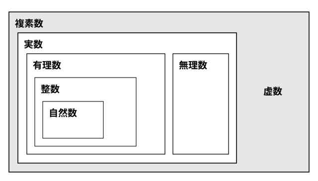

# L09 複素数——2乗して負になる数を認める

- unit_id: hs-math-ii-various-expressions
- 位置づけ: 単元第9レッスン（2時間）。複素数と方程式を扱う後半（L09〜L15）の最初のレッスンで、複素数と二次方程式のまとまり（L09〜L12）の入口である。数学Ⅰ「二次関数」では二次方程式の解を実数の範囲で考え、解の公式の √ の中が負になる場合は、グラフで見れば x 軸との共有点がない場合だ、というところで止めていた。このレッスンでは、2乗すると −1 になる新しい数 i を認め、数の範囲を実数から複素数へ広げる。複素数の相等と四則計算を身につけ、四則計算が複素数の範囲で閉じていることを、新しい数を数として認める根拠として確かめる。一方で、虚数には大小がないことを示し、L07〜L08 の不等式の証明を実数の範囲で行った理由をここで回収する。
- distribution_status: published_draft
- license: CC-BY-4.0
- verify_required: 例題数値・記述は監修者検証必須。
- 主概念: ①「√の中が負になったら？」（数学Ⅰからの問い）→虚数単位 i（i²=−1）・複素数 a＋bi・実数と虚数・純虚数と呼ばれる数・複素数の相等・負の数の平方根 ②四則計算（共役な複素数を掛けて分母を実数にする）・四則が閉じること・虚数には大小がない（境界の宣言）

---

## 0. 本編の前に——数の範囲は、方程式を解くために広がってきた

これまでに学んだ数の範囲は、それまでの数では解けない方程式に出会うたびに広がってきた。中1・中3・数学Ⅰでたどった道を、表で振り返っておこう。

| 方程式 | それまでの範囲では | 広げた数の範囲 | 解 |
|---|---|---|---|
| x＋5=2 | 自然数の解はない | 整数（負の数を含む） | x=−3 |
| 3x=2 | 整数の解はない | 有理数（分数を含む） | x=2/3 |
| x²=2 | 有理数の解はない | 実数（無理数を含む） | x=±√2 |
| x²=−1 | 実数の解はない | ？ | ？ |

数学Ⅰ「数と式」L05 では、有理数と無理数を合わせた実数を1枚の地図にまとめた。そして、実数の範囲で四則計算が閉じていること（実数どうしの和・差・積・商が、0 で割る場合を除いていつも実数になること）と、実数が数直線上の点と1対1に対応することを確かめた。その実数の地図の中にも、最後の行の方程式 x²=−1 の解はない。L07 で確かめたように、実数 a について a²≧0 であり、2乗して −1 になる実数はないからである。

数学Ⅰ「二次関数」では、方程式の解を実数の範囲で考え、数の世界をさらに広げる話は数学Ⅱで学ぶ、と予告していた。解の公式を使って √ の中が負になったとき、それでも解はあるのか。このレッスンは、その問いに答える。

## 1. 虚数単位 i——2乗すると −1 になる数

2乗して −1 になる実数はない。そこで、2乗すると −1 になる新しい数を1つ考え、それを文字 i で表す。

i²=−1

この i を**虚数単位**という。i は、ふつうの文字と同じように足したり掛けたりして計算し、i² が出てきたら −1 に置き換える、と約束する。

たとえば (2i)²=2²×i²=4×(−1)=−4、(−3i)²=9i²=−9、i³=i²×i=−i である。(2i)²=−4 と (−2i)²=(−2)²×i²=−4 から、方程式 x²=−4 は x=±2i という2つの解をもつことになる。実数の範囲では解のなかった方程式に、i を使うと解が書ける。

## 2. 複素数——a＋bi の形の数

i と実数を組み合わせると、3＋2i や −1−√2 i のような数ができる。a, b を実数として、a＋bi の形で表される数を**複素数**という。a はこの複素数の**実部**、b は**虚部**と呼ばれる。以下、a＋bi と書くときの a, b は実数とする。

- b=0 のとき、a＋0i は実数 a である。実数も複素数の仲間に入る。
- b≠0 のとき、a＋bi を**虚数**という。3＋2i、−i、√2 i などは虚数である。
- 虚数のうち、実部が 0 の bi（b≠0）の形の数は、**純虚数**（じゅんきょすう）と呼ばれる。2i や −√3 i は純虚数である。

数の範囲の入れ子は、数学Ⅰ「数と式」L05 の実数の地図の外側に、もう1枠を足した形になる。

:::zatsudan
2乗すると負になる数は、16世紀に、方程式を解く過程で現れた。「虚数」という名前は、そのあとで付けられたものである。数学者たちも、この数を「数」として認めることを長い間ためらった。これまで「解なし」としてきた方程式に解があると言われて戸惑うのは、数学の歴史の上でもごく自然な反応なのである。
:::
<!-- zatsudan話題源: 雑談枠許可リストZ1（「複素数の指導についての一考察——複素数の歴史の教材化——」日本数学教育学会誌74(9)〔1992・著者名未確認〕の授業実践〔平成3年1月〕の指導案が追った歴史の確認範囲。人名は出さない）。出典の確認範囲内の事実のみ使用 -->

## 3. 複素数の相等——実部どうし、虚部どうしを比べる

2つの複素数 a＋bi と c＋di は、実部どうし・虚部どうしがそれぞれ等しいとき、等しいという。

a＋bi=c＋di ⇔ a=c かつ b=d

とくに、a＋bi=0 ⇔ a=0 かつ b=0 である。

この約束は、i が実数でないことと矛盾しないように決めてある。もし b≠d なのに a＋bi=c＋di だとすると、(b−d)i=c−a より i=(c−a)/(b−d) となり、i が実数になってしまう。しかし、2乗して −1 になる実数はない。だから b=d であり、そのとき a=c でもある。

**例題1** 次の等式を満たす実数 x, y を求めよ。
(2x−y)＋(x＋3y)i=5＋6i

x, y は実数なので、2x−y と x＋3y も実数である。実部どうし・虚部どうしを比べて、

2x−y=5、x＋3y=6

第1式から y=2x−5。第2式に代入すると x＋3(2x−5)=6、7x=21 で x=3。よって y=1 である。

検算: 左辺に x=3, y=1 を入れると (6−1)＋(3＋3)i=5＋6i で、右辺と一致する。

:::guide
**x, y が実数であることが、実部と虚部を比べてよい理由になる**

例題1 で実部どうし・虚部どうしを比べられたのは、x, y が実数だからである。もし x や y が虚数でもよいとすると、見かけ上の実部の位置にある 2x−y が、実数とは限らなくなる。たとえば x=i, y=0 とすると、左辺は 2i＋i×i=−1＋2i で、実部は −1、虚部は 2 である。このとき 2x−y=2i は実部ではない。相等を使うときは「〜は実数だから」と一言書いてから比べる、と決めておくと、この取り違えを防げる。
:::

## 4. 負の数の平方根

a>0 のとき、(√a i)²=a×i²=−a、(−√a i)²=−a だから、√a i と −√a i はどちらも負の数 −a の平方根である。逆に、2乗して −a になる複素数を x=p＋qi（p, q は実数）とおくと、x²=(p²−q²)＋2pqi=−a だから、§3 の相等より 2pq=0 かつ p²−q²=−a である。p=0 なら q²=a で q=±√a、q=0 なら p²=−a となる実数 p はない。だから、負の数 −a の平方根は ±√a i の2つだけである。そこで、正の数 a について

√(−a)=√a i

と定める（右辺の √a i は √a と i の積で、i は根号の外にある）。とくに √(−1)=i である。

**例題2** 次の問いに答えよ。
(1) √(−9) を i を用いて表せ。
(2) 方程式 x²=−5 を解け。
(3) √(−2)×√(−8) を計算せよ。

(1) √(−9)=√9 i=3i
(2) x は −5 の平方根だから、x=±√5 i
(3) まず i を使った形に直す。√(−2)=√2 i、√(−8)=√8 i=2√2 i だから、√(−2)×√(−8)=√2 i×2√2 i=2×2×i²=−4

(3) を √(−2)×√(−8)=√((−2)×(−8))=√16=4 と計算するのは誤りである。

:::guide
**√(−2)×√(−8) が 4 にならない理由**

中3と数学Ⅰで使ってきた √a×√b=√(ab) は、a と b が正の数のときに確かめた性質である。その理由は、√a×√b を2乗すると ab になり、√a×√b 自身が正の数なので、ab の正の平方根 √(ab) に等しい、というものだった。この理由は、√a と √b が正の数であることを使っている。√(−2)=√2 i は正の数ではない（そもそも虚数には正・負がない。§6）ので、この理由がそのままは使えない。実際、√(−2)×√(−8) の2乗は 16 だが、16 の平方根には 4 と −4 の2つがあり、どちらになるかは i を使って計算して初めて分かる（答えは −4）。負の数の平方根を含む計算は、まず √(−a)=√a i の形に直し、i をふつうの文字として計算してから i²=−1 を使う。この順番を決めておけば迷わない。
:::

## 5. 四則計算——i を文字として計算し、i² を −1 に置き換える

足し算・引き算は、実部どうし・虚部どうしをまとめる。文字式で同類項をまとめるのと同じである。

(a＋bi)＋(c＋di)=(a＋c)＋(b＋d)i、(a＋bi)−(c＋di)=(a−c)＋(b−d)i

掛け算は、分配法則で展開してから i² を −1 に置き換える。

(a＋bi)(c＋di)=ac＋adi＋bci＋bdi²=(ac−bd)＋(ad＋bc)i

**例題3** 次の計算をせよ。
(1) (3＋2i)＋(1−5i)  (2) (3＋2i)−(1−5i)  (3) (2＋3i)(4−i)  (4) (1＋i)²

(1) (3＋1)＋(2−5)i=4−3i
(2) (3−1)＋(2＋5)i=2＋7i
(3) 8−2i＋12i−3i²=8＋10i＋3=11＋10i
(4) 1＋2i＋i²=1＋2i−1=2i

(4) の (1＋i)² は、実部が 0 の純虚数 2i になった。見た目だけでは分からず、計算してみて初めて分かることもある。

a＋bi と a−bi のように、虚部の符号だけが違う2つの複素数は、互いに**共役な複素数**（きょうやくなふくそすう）と呼ばれる。共役な複素数どうしの積は

(a＋bi)(a−bi)=a²−(bi)²=a²−b²i²=a²＋b²

で、実数になる（和も (a＋bi)＋(a−bi)=2a で、実数である）。

割り算では、この性質を使う。分母と分子に、分母と共役な複素数を掛けて、分母を実数にする。

**例題4** (3＋i)/(1−2i) を a＋bi の形で表せ。

分母 1−2i と共役な複素数 1＋2i を、分母と分子に掛ける。

(3＋i)/(1−2i)=(3＋i)(1＋2i)/((1−2i)(1＋2i))=(3＋6i＋i＋2i²)/(1²＋2²)=(1＋7i)/5=1/5＋(7/5)i

検算: 答えに元の分母を掛けて、元の分子に戻るかを見る。(1−2i)(1/5＋(7/5)i)=1/5＋(7/5)i−(2/5)i−(14/5)i²=1/5＋i＋14/5=3＋i で、分子に戻る。

:::guide
**分母を実数にする——分母の有理化と同じ発想**

数学Ⅰ「数と式」L07 では、1/(√5＋√2) の分母を有理化するのに、符号だけ変えた相方 √5−√2 を分子と分母に掛けた。(√5＋√2)(√5−√2)=5−2 のように、和と差の積で √ が消えるからである。複素数の割り算も同じ形をしている。(1−2i)(1＋2i)=1²−(2i)²=1＋4 で、和と差の積が i を消す。違いは、(2i)²=−4 なので、引き算が足し算に変わり、分母が 1²＋2² という2乗の和になる点だけだ。分母の a＋bi が 0 でなければ、a と b の少なくとも一方は 0 でないので、a²＋b² は正の数になる。だから、0 で割る場合を除いて、複素数の割り算はいつでもできる。検算を「答えに元の分母を掛けて分子に戻す」で行うのも、有理化のときと同じである。
:::

## 6. 四則が閉じていること、大小がないこと

ここまでの計算から、複素数どうしの和・差・積は、いつも a＋bi（a, b は実数）の形の複素数になる。商も、割る数 c＋di が 0 でなければ、

(a＋bi)/(c＋di)=((ac＋bd)＋(bc−ad)i)/(c²＋d²)

で、c²＋d²>0 だから、やはり複素数である。つまり、数学Ⅰ「数と式」L05 の言葉で言えば、複素数の範囲でも四則計算は閉じている。さらに L10 で見るように、複素数の範囲では、二次方程式がいつも解をもつ。

一方で、実数どうしは大小を比べられたが、虚数については大小を考えない。2i>i や 3＋i<5 のような不等式は書かない。虚数には、正・負もない。L07〜L08 の不等式の証明を、すべて実数の範囲で行ったのはこのためである。

:::guide
**数として認めてよいか——3つの条件で考える**

新しい数を「数」として認めるかどうかを、(ア) 四則計算ができる（閉じている）、(イ) 数直線の上に置ける、(ウ) 大小を比べられる、の3つで考えてみよう。負の数を加えた有理数の範囲も、無理数を加えた実数の範囲も、3つとも満たしていた。虚数を加えた複素数の範囲は (ア) を満たすが、(イ) と (ウ) は満たさない（i×i=−1 のように、虚数どうしの計算の結果が実数になることもある。閉じているのは「複素数の範囲」である）。数直線上の点は実数と1対1に対応していて（数学Ⅰ「数と式」L05）、虚数の置き場所は残っていない。(ウ) については、i と 0 の大小を決めようとすると分かる。i>0 だとすると、両辺に正の数 i を掛けて（数学Ⅰ「数と式」L08 の不等式の性質③）i×i>0、つまり −1>0 となって誤りである。i<0 だとすると、両辺に負の数 i を掛けて不等号の向きを変え（性質④）i×i>0 となり、やはり −1>0 となる。i=0 でもない。どれを選んでも、実数で成り立っていた不等式の性質と両立しない。では、大小を比べられない数を、数として使ってよいのか。複素数では大小をあきらめるかわりに、四則計算が閉じ、二次方程式がいつも解をもつ、という大きな見返りが得られる。複素数を数として使うのは、この見返りがあるからである。どの条件が崩れ、どの条件が残ったのかを自分の言葉で言えれば、虚数は「わけの分からない数」ではなくなる。
:::

## 7. 練習

**問1** 次の問いに答えよ。
(1) √(−49) を i を用いて表せ。
(2) √(−5)×√(−20) を計算せよ。
(3) 方程式 x²=−7 を解け。
(4) 方程式 9x²＋4=0 を解け。

**問2** 次の複素数の実部と虚部を答え、実数か虚数かを答えよ。虚数のときは、純虚数かどうかも答えよ。
(1) 3−5i  (2) −4i  (3) √2  (4) (1＋i)²  (5) i²

**問3** 次の等式を満たす実数 x, y を求めよ。
(1) (x＋1)＋(y−2)i=3＋i
(2) (x＋2y)＋(2x−y)i=4−7i

**問4** 次の計算をせよ。
(1) (5−2i)＋(−3＋4i)  (2) (1＋3i)−(4−i)  (3) (2−i)(3＋4i)  (4) (1−2i)²  (5) (3＋2i)(3−2i)

**問5** 次の式を a＋bi の形で表せ。
(1) 5/(1＋2i)  (2) (2＋3i)/(2−i)  (3) i/(1＋i)

**問6** 次の問いに答えよ。
(1) x=1＋2i のとき、x²−2x＋5 の値を求めよ。また、x²−2x＋5=(x−1)²＋4 と変形できるので、方程式 x²−2x＋5=0 は実数の範囲では解をもたない。このことと求めた値を合わせると、この方程式について何が言えるか。1文で述べよ。
(2) ある人は「2i−i=i だから、i が正なら 2i>i と言える」と考えた。この考えの問題点を、§6 の内容を使って2〜3文で説明せよ。

---

:::stretch
**S1** i の累乗を調べる。
(1) i, i², i³, i⁴, i⁵, i⁶, i⁷, i⁸ を計算し、値がどのような規則で並ぶかを答えよ。
(2) i¹⁰⁰ と i¹⁰³ を求めよ。
(3) 1＋i＋i²＋i³＋…＋i¹⁰ の値を求めよ。
:::

対応解答: answer_key_L09-12.md

<!-- gen_nav:nav:start（自動生成・手編集しない） -->

---

[← 前のレッスン](lesson_08.md)｜[単元の目次](README.md)｜[解答](answer_key_L09-12.md)｜[次のレッスン →](lesson_10.md)

<!-- gen_nav:nav:end -->
