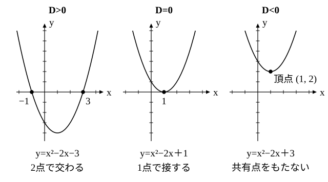

# L10 二次方程式の虚数解と解の種類の判別——数学Ⅰのグラフを振り返る

- unit_id: hs-math-ii-various-expressions
- 位置づけ: 単元第10レッスン（1.5時間）。L09 で数の範囲を複素数まで広げたことを使って、二次方程式の解を複素数の範囲で考え直す回である。解の公式を平方完成から導き直し、√ の中が負のときも虚数の解が求まること、つまり複素数の範囲では二次方程式がいつも解をもつことを確かめる。解が実数か虚数かは、√ の中の式 b²−4ac（判別式と呼ばれる）の符号で判別できる。最後に、数学Ⅰ「二次関数」で調べた放物線と x 軸の共有点の個数（2個・1個・0個）と、解の種類とを並べて1つにまとめる。
- distribution_status: published_draft
- license: CC-BY-4.0
- verify_required: 例題数値・記述は監修者検証必須。
- 主概念: ①解の公式を平方完成から導き直し、複素数の範囲で「二次方程式は常に解をもつ」→虚数解を「解なし」と書かない ②判別式 D=b²−4ac（教科書で呼ばれる名）による解の種類の判別と、数学Ⅰ二次関数のグラフ（x 軸との共有点の個数）との統合

---

## 1. 数学Ⅰの「解なし」をもう一度見る

方程式 x²＋2x＋5=0 を考える。左辺を平方完成すると (x＋1)²＋4 だから、放物線 y=x²＋2x＋5 は頂点が (−1, 4) の下に凸の放物線である。頂点が x 軸より上にあるので、グラフと x 軸の共有点はない（数学Ⅰ「二次関数」L09）。数学Ⅰでは、このことを「この方程式は実数の範囲では解をもたない」と読んだ。

複素数の範囲では、この先へ進める。x²＋2x＋5=0 を (x＋1)²=−4 と変形すると、x＋1 は −4 の平方根だから、L09 により x＋1=±2i。よって

x=−1±2i

検算: x=−1＋2i を代入する。x²=1−4i＋4i²=−3−4i だから、x²＋2x＋5=(−3−4i)＋(−2＋4i)＋5=0 となり、確かに解になっている。

このように、実数の範囲では解をもたなかった二次方程式も、複素数の範囲では解をもつ。二次方程式の解のうち、虚数であるものを**虚数解**という。実数である解は、数学Ⅰと同じく実数解と呼ぶ。x²＋2x＋5=0 は、実数解をもたず、2つの虚数解 −1＋2i と −1−2i をもつ。

## 2. 解の公式を導き直す

同じ手順を、一般の二次方程式 ax²＋bx＋c=0 で行う。この単元では、二次方程式の係数 a, b, c は実数で、a≠0 とする。

両辺を a で割ると x²＋(b/a)x＋c/a=0。x の係数の半分 b/(2a) を使って平方完成すると、

(x＋b/(2a))²−b²/(4a²)＋c/a=0 より (x＋b/(2a))²=b²/(4a²)−c/a=(b²−4ac)/(4a²)

(√(b²−4ac)/(2a))²=(b²−4ac)/(4a²) だから、右辺の平方根は ±√(b²−4ac)/(2a) である（これらのほかに平方根がないことは L09 §4 と同じ考え方で確かめられる。b²−4ac=0 のときは 2 つが重なり、0 の 1 つだけになる）。よって x＋b/(2a)=±√(b²−4ac)/(2a) で、

x=(−b±√(b²−4ac))/(2a)

これが解の公式である。中3と数学Ⅰでは、b²−4ac≧0 のときにだけこの式を使った。複素数の範囲では、b²−4ac<0 のときも、L09 の約束 √(−k)=√k i（k>0）で √(b²−4ac)=√(4ac−b²) i と読めば、同じ式で解が求まる。したがって、**複素数の範囲では、二次方程式はいつも解をもつ**。

**例題1** 次の二次方程式を解け。
(1) x²−3x＋4=0  (2) 2x²＋4x＋3=0

(1) 解の公式から、x=(3±√(9−16))/2=(3±√(−7))/2=(3±√7 i)/2
(2) x=(−4±√(16−24))/4=(−4±√(−8))/4=(−4±2√2 i)/4=(−2±√2 i)/2
（(2) の最後は、分子と分母を 2 で割って約分した。）

検算: (1) の x=(3＋√7 i)/2 を代入する。x²=(9＋6√7 i＋7i²)/4=(1＋3√7 i)/2、3x=(9＋3√7 i)/2 だから、x²−3x＋4=((1＋3√7 i)−(9＋3√7 i))/2＋4=−4＋4=0 となる。

:::guide
**虚数解を「解なし」と書かない——範囲をつけて答える**

数学Ⅰで「解なし」と答えていた二次方程式は、この単元からは「実数解をもたない（2つの虚数解をもつ）」と答える。数学Ⅰの「解なし」は、実数の範囲では解がない、という意味だった。範囲を複素数まで広げた今、同じ方程式に「解なし」と書くと、解が存在しないという誤った主張になってしまう。二次方程式を解くときは、虚数解もすべて書く。解の種類を問われたら「異なる2つの実数解」「重解」「異なる2つの虚数解」のどれかで答える（重解は次の §3 で扱う）。一方で、数学Ⅰの二次不等式の答えの「解なし」は、今でも正しい。不等式は実数の範囲で考えるもので、虚数には大小がない（L09）からである。
:::

## 3. 解の種類の判別——判別式 D=b²−4ac

解の公式の √ の中にある b²−4ac の符号で、解の種類が決まる。b²−4ac は、教科書で二次方程式の**判別式**と呼ばれ、D で表される。

D=b²−4ac

- D>0 のとき、√D は正の実数なので、(−b＋√D)/(2a) と (−b−√D)/(2a) は異なる2つの実数解である。
- D=0 のとき、解は x=−b/(2a) の1つだけになる。この解は、2つの解が重なったものとみて**重解**（じゅうかい）と呼ばれる。重解は実数解である。
- D<0 のとき、√D=√(−D) i は虚数なので、解は異なる2つの虚数解である。

まとめると、係数が実数の二次方程式 ax²＋bx＋c=0 について、次のようになる。

| D の符号 | 解の種類 |
|---|---|
| D>0 | 異なる2つの実数解 |
| D=0 | 重解（実数解） |
| D<0 | 異なる2つの虚数解 |

とくに「実数解をもつ」は D≧0 と言い換えられる。

**例題2** 次の二次方程式の解の種類を判別せよ。
(1) 2x²−5x＋1=0  (2) 4x²−12x＋9=0  (3) 3x²＋2x＋1=0

(1) D=(−5)²−4×2×1=25−8=17>0 だから、異なる2つの実数解をもつ。
(2) D=(−12)²−4×4×9=144−144=0 だから、重解をもつ（4x²−12x＋9=(2x−3)² より、重解は x=3/2）。
(3) D=2²−4×3×1=4−12=−8<0 だから、異なる2つの虚数解をもつ。

判別式を使うと、解を求めなくても解の種類が分かる。

:::guide
**判別式が使えるのは、係数が実数のとき**

§3 の表は、a, b, c が実数であることを前提にしている。係数が実数なら D も実数で、その符号によって √D が実数か虚数かが決まるからである。係数に虚数を含む方程式では、この表は当てはまらない。たとえば x²−ix=0 は x(x−i)=0 と因数分解でき、解は 0 と i で、実数解 0 をもつ。ところが、b=−i として D を計算すると (−i)²−4×1×0=−1 で、負になる。D<0 なのに実数解がある。表が当てはまらないのは、係数 −i が実数でないからである。この単元で判別式を使う二次方程式は、すべて係数が実数である。
:::

## 4. 数学Ⅰのグラフと結びつける

数学Ⅰ「二次関数」L08 で学んだように、二次方程式 ax²＋bx＋c=0 の実数解は、放物線 y=ax²＋bx＋c と x 軸の共有点の x 座標である。同 L09 では、共有点の個数を、凸の向きと頂点の y 座標の符号から判定した。この判定と判別式の関係を確かめる。

ax²＋bx＋c を平方完成すると、

ax²＋bx＋c=a(x＋b/(2a))²−(b²−4ac)/(4a)=a(x＋b/(2a))²−D/(4a)

だから、頂点の y 座標は −D/(4a) である。a>0（下に凸）のとき、頂点の y 座標が負であることは D>0 と、0 であることは D=0 と、正であることは D<0 と同じになる。a<0（上に凸）のときは、−D/(4a) の符号が D の符号と一致するので、頂点の y 座標が正であること（共有点2個）が D>0 と同じになる。どちらの場合も、共有点2個・1個・0個は、それぞれ D>0・D=0・D<0 と同じである。

たとえば x²−2x＋c=0 で、c を −3, 1, 3 と変えてみる。D=4−4c は、それぞれ 16, 0, −8 になる。

| c | D=4−4c | y=x²−2x＋c の頂点 | x 軸との共有点 | x²−2x＋c=0 の解 |
|---|---|---|---|---|
| −3 | 16 | (1, −4) | 2個 | x=−1, 3（異なる2つの実数解） |
| 1 | 0 | (1, 0) | 1個（接する） | x=1（重解） |
| 3 | −8 | (1, 2) | 0個 | x=1±√2 i（異なる2つの虚数解） |

放物線と x 軸の共有点の個数は、異なる実数解の個数と一致する（ここでは重解を1個と数える。重なった数だけ数える数え方は L14 で使う）。共有点が0個のときは、実数解はないが、虚数解が2つある。

| D の符号 | 解の種類 | 放物線 y=ax²＋bx＋c と x 軸 |
|---|---|---|
| D>0 | 異なる2つの実数解 | 異なる2点で交わる（共有点2個） |
| D=0 | 重解 | 1点で接する（共有点1個） |
| D<0 | 異なる2つの虚数解 | 共有点をもたない（共有点0個） |

:::guide
**数学Ⅰの「共有点なし」の先にあったもの**

数学Ⅰでは、放物線が x 軸と共有点をもたないとき、方程式については、実数の範囲では解がない、と言うところで止めた。ここでは、その場合に虚数解が2つある、と言えるようになった。グラフに見えるのは実数解だけで、虚数解はグラフには現れない。虚数は数直線の上に置き場所がない（L09）ので、x 軸の上にも現れないからである。だから、グラフが x 軸から浮いているときに「交わらない」と「解がない」を同じ意味で使ってはいけない。グラフが教えてくれるのは実数解がいくつあるかであり、虚数解まで含めた解の全体は、判別式と解の公式が教えてくれる。数学Ⅰのグラフの見方と、この単元の判別式は、同じ二次方程式を別の側から見ている。
:::

## 5. 練習

**問1** 次の二次方程式を解け。
(1) x²−4x＋13=0  (2) 2x²−2x＋1=0  (3) x²＋x＋1=0  (4) 3x²＋4x＋2=0

**問2** 次の二次方程式の解の種類を判別せよ。
(1) 3x²−5x＋2=0  (2) x²＋2√3 x＋3=0  (3) 2x²−3x＋4=0  (4) −x²＋4x−5=0

**問3** 放物線 y=x²−6x＋c と x 軸の共有点の個数が、2個・1個・0個になるのは、定数 c がそれぞれどのような値のときか。判別式を使って答えよ。また、共有点が0個のとき、方程式 x²−6x＋c=0 の解について言えることを答えよ。

**問4** 係数が実数の二次方程式 ax²＋bx＋c=0 について、次のことを、判別式 D の条件（D>0、D=0、D<0、D≧0 のどれか）で言い換えよ。
(1) 実数解をもつ。
(2) 異なる2つの虚数解をもつ。
(3) 重解をもつ。
(4) 放物線 y=ax²＋bx＋c と x 軸が、異なる2点で交わる。
(5) 放物線 y=ax²＋bx＋c と x 軸が、共有点をもたない。

**問5** ある人は、方程式 x²−2x＋6=0 について「判別式は D=4−24=−20<0 だから、解なし」と答えた。この答え方のどこが不十分かを説明し、正しい答え（解の種類と、すべての解）を書け。

---

:::stretch
**S1** k を実数の定数とする。二次方程式 x²＋2kx＋k＋6=0 について、次の問いに答えよ。
(1) 判別式 D を k の式で表し、因数分解せよ。
(2) 重解をもつような k の値と、そのときの重解を求めよ。
(3) 異なる2つの虚数解をもつような k の値の範囲を求めよ。
:::

対応解答: answer_key_L09-12.md

<!-- gen_nav:nav:start（自動生成・手編集しない） -->

---

[← 前のレッスン](lesson_09.md)｜[単元の目次](README.md)｜[解答](answer_key_L09-12.md)｜[次のレッスン →](lesson_11.md)

<!-- gen_nav:nav:end -->
