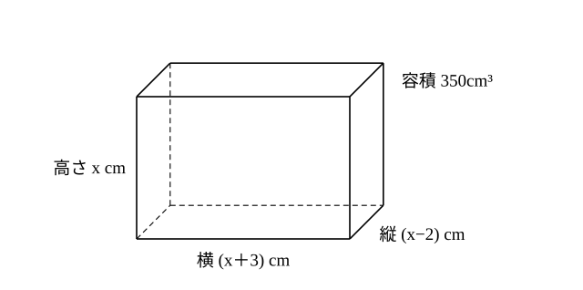

# L15 方程式の活用——直方体の容積から三次方程式へ

- unit_id: hs-math-ii-various-expressions
- 位置づけ: 単元第15レッスン（1時間）。学習指導要領解説が挙げる直方体の箱の例を使って、日常の事象を方程式で表して解き、得られた解が事象に合うかを吟味（ぎんみ）する回である。立式すると三次方程式になり、L13〜L14 の因数定理で解ける。一方で、値を表にして探す方法とも比べ、方程式を立てて解くよさを言葉にする。因数定理と高次方程式のまとまり（L13〜L15）の最後のレッスンである。
- distribution_status: published_draft
- license: CC-BY-4.0
- verify_required: 例題数値・記述は監修者検証必須。
- 主概念: ①日常の事象を三次方程式で表す（学習指導要領解説の直方体の箱の例）→解の吟味 ②「三次方程式を必ず使う」前提にしない対比と、数学Ⅱ「微分・積分の考え」への予告

---

## 1. 箱の寸法を方程式で求める

**例題1** 縦の長さが高さより 2cm 短く、横の長さが高さより 3cm 長い直方体の形の箱を作る。容積を 350cm³ にするには、縦・横・高さをそれぞれ何 cm にすればよいか。
（この設定は、高等学校学習指導要領解説 数学編（平成30年告示）が、方程式を問題解決に活用する例として挙げているものである。）

高さを x cm とすると、縦は (x−2) cm、横は (x＋3) cm である。

長さは正だから、x−2>0、つまり x>2 である（このとき x と x＋3 も正になる）。容積の条件から、

x(x−2)(x＋3)=350

左辺を展開して整理すると、x³＋x²−6x−350=0 となる。

P(x)=x³＋x²−6x−350 とおき、因数定理で解を探す。候補は 350 の約数で、x>2 だから 5, 7, 10, … を試せばよい。x³ が 350 に近くなるのは x が 7 くらいのときなので、P(7)=343＋49−42−350=0 と分かる。よって x−7 が因数で、

x³＋x²−6x−350=(x−7)(x²＋8x＋50)

x²＋8x＋50=0 は、判別式が D=64−200=−136<0 で、実数解をもたない（虚数解 x=−4±√34 i をもつ）。

したがって、方程式の解は x=7, −4＋√34 i, −4−√34 i の3つである。

## 2. 解の吟味——事象に合う解を選ぶ

方程式の解は3つ出たが、箱の高さとして意味をもつのは、x>2 を満たす実数だけである。虚数解は長さを表さないので捨てる。x=7 は x>2 を満たす。

高さは 7cm、縦は 7−2=5cm、横は 7＋3=10cm である。検算: 5×10×7=350 で、容積は 350cm³ になる。

答え 縦 5cm、横 10cm、高さ 7cm

:::guide
**答えの候補が3つ出ても、事象に合うのは1つ——その判断が活用**

方程式を解く作業は、式を満たす値を、事象の条件をいったん忘れて全部集める作業である。三次方程式なら、虚数解まで含めて3つの候補が出てくる。その中から、長さは正の実数でなければならない、縦の x−2 も正でなければならない、といった事象の条件に照らして、意味のある解を選ぶ。この吟味までが、方程式を問題解決に使うということである。吟味では、立式のときに書いた条件（x>2）に戻ればよい。立式の段階で x の範囲を書いておくのは、あとで解を選ぶための物差しを用意しておくためである。
:::

## 3. 表で探す方法と比べる

この問題は、方程式を使わずに、x にいろいろな値を入れて表を作っても探せる。

| 高さ x | 3 | 4 | 5 | 6 | 7 | 8 |
|---|---|---|---|---|---|---|
| 縦 x−2 | 1 | 2 | 3 | 4 | 5 | 6 |
| 横 x＋3 | 6 | 7 | 8 | 9 | 10 | 11 |
| 容積 | 18 | 56 | 120 | 216 | 350 | 528 |

x=7 のとき、容積が 350 になる。しかも、x が大きくなると縦・横・高さがどれも長くなるので、容積も大きくなる。だから、容積がちょうど 350 になる高さは x=7 のほかにない、と方程式を解かなくても言える。

では、方程式を立てて解くことのよさは何か。1つは、表では整数の値しか調べていないのに対し、方程式を解くと、整数でない値も含めて、式を満たす x を全部そろえられることである。この問題では、残りの2つの解が虚数で、実数の答えは x=7 だけだと確かめられた。もう1つは、x が大きいほど容積も大きい、という見方が使えない場面でも使えることである。紙の大きさが決まっている箱のように、高さを大きくすると縦や横が短くなる場合には、答えが2つあり、しかも一方が整数でないこともある（練習の問2、stretch の S1）。表で1つ見つけて安心すると、もう1つを見落としてしまう。

:::guide
**方程式は、必ず使う道具ではなく、選べる道具**

この単元の問題だからといって、どんな問題でも最初から三次方程式を立てるものだと決めつけないようにしよう。例題1 は、表と「x が大きいほど容積も大きい」という見方だけでも答えられた。逆に、立式してみたら、思っていた次数の方程式にならないこともある。大切なのは、表で探す、関係を式にする、式の形から解の個数を見通す、といった方法を並べて、その場面でいちばん確かで速い方法を選ぶことである。方程式のよさは、ほかの方法と比べたときに初めて、はっきり見えてくる。
:::

## 4. この先の単元へ

紙や材料の大きさが決まっているとき、容積が最も大きくなる寸法はどこか、という問いは、数学Ⅱの「微分・積分の考え」で調べられるようになる。

## 5. 練習

**問1** 縦の長さが高さより 1cm 短く、横の長さが高さより 3cm 長い直方体の形の箱の容積が 160cm³ である。高さを x cm として方程式を立て、縦・横・高さを求めよ。解の吟味も書くこと。

**問2** 1辺が 12cm の正方形の厚紙の四すみから、1辺が x cm の正方形を切り取り、残りを折り曲げて、ふたのない箱を作る。
(1) 箱の容積を x の式で表せ。また、x のとりうる値の範囲を答えよ。
(2) 容積が 100cm³ になるような x の値をすべて求めよ。（ヒント: まず x=1 が解であることを確かめよ。）

**問3** 1辺が x cm の立方体がある。縦を 2cm 長く、横を 2cm 短くし、高さはそのままにして直方体を作ったところ、体積がもとの立方体より 20cm³ 小さくなった。x の値を求めよ。また、立式した方程式が何次方程式になったかを答えよ。

**問4** 例題1 を表で解いた人が「表で x=7 が見つかったのだから、方程式を立てる必要はない」と言った。この意見に対して、方程式を立てて解くことで新たに分かったことを、2〜3文で述べよ。

---

:::stretch
**S1** 横 21cm、縦 18cm の長方形の紙を折って、直方体の形の紙パックを作る。底面の2辺を x cm と y cm、高さを z cm とすると、紙の大きさとのりしろの幅から、2x＋2y＋1=21、x＋z＋2=18 が成り立つ。容積を 240cm³ にする寸法を考える。
（この設定は、高等学校学習指導要領解説 数学編（平成30年告示）が課題学習の例として挙げているものである。）
(1) y と z を x の式で表し、紙パックの容積 V を x の式で表せ。
(2) V=240 となる x を求めたい。x=6 が解であることを確かめてから、方程式の解をすべて求めよ。
(3) (2) の解のうち、紙パックの寸法として適するものをすべて答え、それぞれについて、底面の2辺と高さを求めよ。
:::

対応解答: answer_key_L13-15.md

<!-- gen_nav:nav:start（自動生成・手編集しない） -->

---

[← 前のレッスン](lesson_14.md)｜[単元の目次](README.md)｜[解答](answer_key_L13-15.md)｜[次のレッスン →](lesson_16.md)

<!-- gen_nav:nav:end -->
