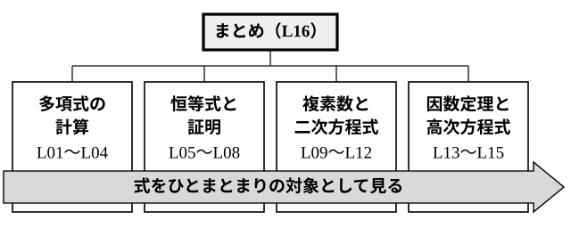

# L16 単元のまとめ——式を「対象」として見る

- unit_id: hs-math-ii-various-expressions
- 位置づけ: 単元第16レッスン（2時間）。単元全体の総括回である。**新しい概念・新しい用語は立てない**。単元の地図で4つのまとまり（多項式の計算／恒等式と証明／複素数と二次方程式／因数定理と高次方程式）を振り返り、単元の背骨だった「式をひとまとまりの対象として見る」見方でつなぎ直す。言葉の条件を式の条件に言い換える型を一覧にし、各まとまりから1問ずつの総合演習と、L01 で扱った (a＋b)³ の誤りの再検査を行う。最後に、この単元の式の見方が、この先どの単元で使われるかを予告する。
- distribution_status: published_draft
- license: CC-BY-4.0
- verify_required: 例題数値・記述は監修者検証必須。
- 主概念: ①単元マップと各まとまり1問の総合演習・(a＋b)³=a³＋b³ としてしまう誤りの再検査 ②後続単元への予告（先取りしない）

---

## 1. 単元の地図——4つのまとまりと1本の背骨

L01 で、この単元は式の計算・等式と不等式の証明・複素数と方程式の3つの部分からなる、と地図を示した。ここまでの15レッスンを、4つのまとまりに分けて見直す。

| まとまり | レッスン | 式をひとまとまりとして見た場面 |
|---|---|---|
| 多項式の計算 | L01〜L04 | x−2 を M とおく置き換え・(a＋b)³ を立方体として見る・割り算の結果を A=BQ＋R の等式で表す |
| 恒等式と証明 | L05〜L08 | 恒等式の両辺を係数の並びとして比べる・左辺−右辺 を1つの式として 0 と比べる・(…)²≧0 を使う |
| 複素数と二次方程式 | L09〜L12 | a＋bi を1つの数として計算する・2つの解を α＋β と αβ の2つの数にまとめる |
| 因数定理と高次方程式 | L13〜L15 | A=BQ＋R に値を代入する・x² を X とおく・事象を1つの方程式にまとめる |

どのまとまりでも、中身の計算を急ぐ前に、式を1つのものとして扱い、名前をつけ、比べ、言い換えてきた。この見方が、4つのまとまりを貫く背骨である。

## 2. 言葉の条件を、式の条件に言い換える

この単元の問題の多くは、言葉で書かれた条件を式の条件に言い換えると、あとは計算するだけになった。主な言い換えを一覧にする（新しい内容はない）。

| 言葉の条件 | 式の条件 | 学んだレッスン |
|---|---|---|
| A を B で割った商が Q、余りが R | A=BQ＋R（R=0、または R の次数<B の次数） | L03 |
| 2次式で割った余り | px＋q とおける | L03・L13 |
| x についての恒等式である | 両辺の同じ次数の項の係数が、それぞれ等しい | L05 |
| 等式 A=B を証明する | A−B=0 を示す | L06 |
| 不等式 A≧B を証明する | A−B≧0 を示し、等号が成り立つときを書く | L07・L08 |
| 二次方程式が実数解をもつ | D≧0 | L10 |
| 二次方程式が異なる2つの虚数解をもつ | D<0 | L10 |
| 二次方程式の2つの解の和と積 | α＋β=−b/a、αβ=c/a | L11 |
| 2つの解がともに正 | D≧0 かつ α＋β>0 かつ αβ>0 | L12 |
| P(x) を x−α で割った余り | P(α) | L13 |
| P(x) は x−α で割り切れる | P(α)=0 | L13 |

**例題1** 3次式 P(x)=x³＋ax²＋bx＋6 が x²−x−2 で割り切れるとき、定数 a, b の値を求めよ。また、方程式 P(x)=0 を解け。

「x²−x−2 で割り切れる」を式にする。x²−x−2=(x＋1)(x−2) だから、商を Q(x) とすると P(x)=(x＋1)(x−2)Q(x) と書ける。これは恒等式なので、x=−1, 2 を代入すると P(−1)=0、P(2)=0 である（L13）。
P(−1)=−1＋a−b＋6=0 より、a−b=−5
P(2)=8＋4a＋2b＋6=0 より、2a＋b=−7
2つの式から a=−4, b=1。

このとき P(x)=x³−4x²＋x＋6 で、P(x) を x²−x−2 で割ると商は x−3 だから、P(x)=(x＋1)(x−2)(x−3)。方程式 P(x)=0 の解は x=−1, 2, 3 である。

検算: 展開して戻す。(x＋1)(x−2)=x²−x−2 で、これに x−3 を掛けると x³−3x²−x²＋3x−2x＋6=x³−4x²＋x＋6 になる。

この例題では、割り切れるという言葉を因数分解の形に言い換え（L03）、恒等式に値を代入し（L05・L13）、最後は高次方程式を解いた（L14）。1つの問題の中で、単元のいくつものまとまりが使われている。

:::guide
**検算の3つの型——展開して戻す・代入する・等号の値を確かめる**

この単元では、答えを出したあとの確かめ方を、場面ごとに使い分けてきた。因数分解や割り算の答えは、展開して戻す（L01・L03）。方程式の解は、もとの方程式に代入する（L10・L14）。不等式の証明や最小値は、等号が成り立つ値を入れて、両辺が本当に等しくなるかを見る（L07・L08）。どれも、答えが正しければこうなるはずだ、という性質を1つ選んで確かめる作業である。ただし、1つの値の代入は、誤りを見つけるのには強いが、等式が恒等式であることや、解をすべて求めたことの証明にはならない（L05）。代入して 0 になれば、その値が解であることは確かめられるが、ほかに解がないことは分からない。証明や計算のあとで、自分の書いたものを疑ってみる習慣として続けよう。
:::

## 3. この先の単元へ

この単元で身につけた式の見方は、この先の単元で道具として使われる。ここでは、どこで使われるかだけを予告し、中身には立ち入らない。

- 数学Ⅱ「図形と方程式」: 絶対値を含む不等式の表す領域を調べる場面で、L08 の絶対値の見方が使われる。また、L05 の問5 のような「k がどんな値でも成り立つ」条件は、図形が k の値によらず通る点を求める場面で出てくる。
- 数学Ⅱ「微分・積分の考え」: 三次関数の増減を調べ、L15 で予告した容積の最大値のような問題を扱う。3次式の因数分解や因数定理が、そこでの計算の土台になる。
- 数学B「数列」: n についての恒等式として係数を決める場面がある（L05）。
- 数学B「統計的な推測」: 二項定理の係数 nCr が、二項分布と呼ばれる確率の並びに現れる（L02）。
- 数学C「平面上の曲線と複素数平面」: 複素数を平面上の点として表し、かけ算を回転として見る見方は、数学Cで学ぶ。

:::guide
**一度直した誤りが、また顔を出したら**

L01 で、(a＋b)³ を a³＋b³ としてしまう誤りを、立方体の図と値の代入で直した。このような、一度は直したはずの誤りは、しばらくたつとまた顔を出すことがある。正しい公式を覚え直すだけでは、同じ誤りが戻ってくることもある。戻ってきたら、理由から直し直すのがよい。(a＋b)³ なら、立方体のすき間を埋める6個の直方体（3a²b と 3ab²）と、a=b=1 などを代入すると崩れることが、その理由である。練習の問5 は、その再検査である。(a＋b)³ に限らず、√a×√b=√(ab) を負の数にも使ってしまう考え方（L09）や、≧ が示せれば等号も必ず成り立つと決めつける考え方（L08）も、同じように戻ってくることがある。
:::

## 4. 練習

**問1**（多項式の計算）
(1) 27x³−8y³ を因数分解し、展開して戻して確かめよ。
(2) 3次式 A を x²−2x＋3 で割ると、商が x＋1 で、余りが定数になる。A の定数項が 5 であるとき、A を求めよ。

**問2**（恒等式と証明）
(1) すべての実数 x, y について、x²＋2y²≧2xy を証明せよ。また、等号が成り立つのはどのようなときか答えよ。
(2) x>0 のとき、(2x＋1)(x＋2)/x の最小値と、そのときの x の値を求めよ。

**問3**（複素数と二次方程式）二次方程式 x²−4x＋k=0（k は実数の定数）について、次の問いに答えよ。
(1) 異なる2つの虚数解をもつような k の値の範囲を求めよ。
(2) k=7 のとき、2つの解を α, β とする。α²＋β² と α³＋β³ の値を、解と係数の関係を使って求めよ。
(3) k=7 のときの解を求め、(2) の値を確かめよ。

**問4**（因数定理と高次方程式）P(x)=x³＋ax²＋bx＋5 を x²−3x＋2 で割った余りが 7x＋1 である。
(1) 定数 a, b の値を求めよ。
(2) 方程式 P(x)=0 を解け。

**問5**（誤りの再検査）ある人は「(x＋2)³=x³＋8 だから、等式 (x＋2)³=x³＋8 は x についての恒等式である」と考えた。
(1) x=1 を代入して、この考えが誤りであることを確かめよ。
(2) (x＋2)³ を正しく展開せよ。
(3) 方程式 (x＋2)³=x³＋8 を解け。

**問6**（言い換え）次のことを、（ ）内の文字についての式の条件に言い換えよ。
(1) x³＋ax＋b は x−2 で割り切れる。（a, b）
(2) 等式 ax²＋bx＋c=2x²−3 が x についての恒等式である。（a, b, c）
(3) 二次方程式 x²＋px＋q=0（p, q は実数）が重解をもつ。（p, q）
(4) 二次方程式 x²＋px＋q=0（p, q は実数）が異符号の2つの解をもつ。（p, q）

---

:::stretch
**S1** 3次式 P(x) を x²＋1 で割ると余りが x＋2、x−1 で割ると余りが 7 である。
(1) P(x) を (x²＋1)(x−1) で割った商を Q(x)、余りを R(x) とする。P(x)=(x²＋1)(x−1)Q(x)＋R(x) の式を使って、R(x) を x²＋1 で割った余りが x＋2 になることを説明せよ。また、R(x) が2次以下の式であることから、R(x)=a(x²＋1)＋x＋2（a は定数）とおけることを説明せよ。
(2) R(x) を求めよ。
(3) P(x) の x³ の係数が 1 であるとき、P(x) を求めよ。
:::

対応解答: answer_key_L16.md

<!-- gen_nav:nav:start（自動生成・手編集しない） -->

---

[← 前のレッスン](lesson_15.md)｜[単元の目次](README.md)｜[解答](answer_key_L16.md)

<!-- gen_nav:nav:end -->
