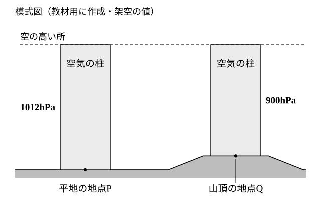
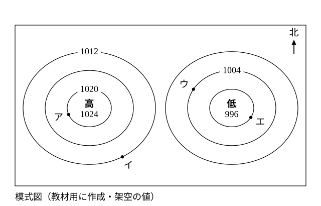

# レッスン1 気圧と天気図——空気の柱と等圧線

- unit_id: jhs-sci-2-atmospheric-movement-japan-weather
- 位置づけ: 子単元 --pressure-wind（気圧配置と風）。親単元の第1レッスン（1時間）。気圧を「空気の柱の重さによる圧力」として捉え直し、模式天気図（等圧線・高気圧・低気圧）の読み方を身につける。次のレッスン2（風の吹き方）の土台。
- distribution_status: published_draft
- license: CC-BY-4.0
- verify_required: V1（天気図・気圧値はすべて教材用の架空値）／V2（「等圧線」は教科書側の語・太字導入の可否は監修判断）／V7（天気図の気圧が海面の高さに直した値である説明は1文に留める）／V9（答え方の指示は毎問明示・気圧は整数hPa）。全記述は監修者（理科担当）検証必須。
- 主概念: ①気圧＝その場所より上にある空気の柱の重さによる圧力（高い所ほど低く、同じ場所でも時間とともに変わる） ②模式天気図の読み方（等圧線は同じ気圧の地点を結んだ線・閉じた等圧線で周囲より高い所が高気圧、低い所が低気圧・北が上）

---

## ここで学ぶこと

天気予報で「高気圧におおわれて」「低気圧が近づいて」という言い方を聞いたことがあるでしょう。この単元では、その**気圧**のちがいが風を起こし、天気を動かしていくしくみを学びます。今日はその出発点として、まず気圧を「自分の上にのっている**空気の柱**の重さ」としてとらえ直します。次に、天気図で気圧のようすをどう読むかを、この教材用に作った模式天気図で練習します。ここで身につける「どこが高くてどこが低いか」の読み方が、次のレッスンで学ぶ**風の吹き方**の根もとになります。

## 前の単元とのつながり

この教材では、気象観測の単元で学ぶ次の3つの定義を使います。まだ習っていなくても、忘れていても、ここに書いてある定義だけで先へ進めます。

- **気圧**とは、空気の重さによる圧力のことです。単位はhPa（ヘクトパスカル）を使います。気圧は高い所ほど低く、同じ場所で測っても時間とともに変わります。
- **風向**とは、風が**吹いてくる方位**のことです。「北の風」は北から南へ向かって吹く風です。
- **風速**とは、空気が1秒あたりに進む距離のことです。

また、湿度の単元で学んだ規則性「**気温が下がると飽和水蒸気量（その気温の空気が含むことのできる水蒸気の上限）が小さくなる**（だから、空気中の水蒸気の量が変わらなければ湿度が上がる）」は、この単元では、雲ができるしくみを考えるところ（レッスン2・4・8）で使います。今日のレッスンでは気圧の話に集中しましょう。教科書によっては、この単元を湿度より先に学びます。その場合は、この規則性が出てくる所を「あとで湿度の単元で学ぶこと」として読み進めてください。

## 空気の柱と気圧

私たちの上には、空の高い所まで空気が積み重なっています。地面に立っている自分の頭の上に、空気がまっすぐ**柱**のように積み重なっていると考えてみましょう。この柱には重さがあり、その重さが下にある物を押します。同じ広さの地面の上にのっている柱どうしでくらべたときの、この押す力の大きさ（面積あたりの力＝圧力）が気圧です。

> 【ことば】**気圧** その場所より上にある空気の柱の重さによる圧力。単位は［hPa］。上にある空気が多いほど大きく、少ないほど小さい。

ここから2つのことが分かります。

1. **高い所ほど気圧は低い**。山の上に立つと、自分の上に残っている空気の柱は平地より短くなります。柱が短い＝上にある空気が少ない＝押す力が小さい、だから気圧は低いのです。
2. **同じ場所でも気圧は時間とともに変わる**。上にある空気の量は、空気が流れこんだり出ていったりして日々変わります。天気図が毎日ちがうのは、このためです。

下の図1は、平地の地点Pと山頂の地点Qの上にある空気の柱を、この教材用に作った架空の値で模式的にくらべたものです。

> **注意**：図1の気圧の値（Pが1012hPa、Qが900hPa）は、この教材の練習用に作った**架空の値**です。実際の場所の観測値ではありません。

:::guide
**柱はあくまでイメージ——何の役に立つか**

空気は柱のように区切られているわけではなく、まわりの空気とつながって自由に動いています。それでも「上にのっている空気の重さ」で気圧を考えるイメージが役に立つのは、気圧の大小の**向き**をまちがえなくなるからです。山の上に立つと、頭の上に残っている空気の柱は平地より短く、だから気圧も低くなります。「山の上は空が近いから空気が多い」と考えてしまうと向きが逆になります。迷ったら、自分の頭の上に残っている空気の量を思い浮かべてください。
:::

ところで、山の上の観測所で測った気圧をそのまま天気図に書きこむと、平地の観測値とくらべられません。そこで**天気図に書かれている気圧は、測った場所の高さのちがいをそろえるため、海面の高さでの値に直したもの**になっています（直し方そのものは、この教材では扱いません）。

:::guide
**冷たいコップに水滴がつくのは気圧の話ではない**

気圧の話を聞くと「冷たい飲み物のコップの外側に水滴がつく」現象を思い出す人がいます。これはよくある結びつけですが、あの水滴は**空気が冷やされて水蒸気が水に変わる**現象で、湿度の単元で学ぶ露点（空気が冷えて水蒸気が水滴になり始める温度）の話です。気圧が高い・低いとは別のしくみです。この単元では「空気の重さ」「空気の流れ」の話をします。「空気が冷えて水蒸気が水になる」話は前の単元の道具として借りるだけ、と区別しておくと混ざりません。
:::

## 模式天気図の読み方

次に、天気図で気圧のようすを読みます。ここからの天気図は、すべてこの教材用に作った模式図です。

> **注意**：下の図2は、この教材の練習用に作った**模式天気図**（架空）です。実際の日付・場所の天気図ではなく、気圧の値もすべて架空です。実際の天気図の表し方は教科書や気象庁の天気図（「気象庁 天気図」などの言葉で探せます）で確認してください。

図2の読み方は次の4点です。

1. **北が上**。天気図や気象情報は、北を上にしてかかれています。図の右が東、左が西、下が南です。
2. **同じ気圧の地点を結んだ線**が引かれています。教科書では、この線を等圧線（とうあつせん）と呼びます。図2では等圧線は**4hPaごと**に引かれていて、数字がかかれている線は1020・1012・1004の3本です。数字のない線の値は、となりの線から4hPaずつ数えて求めます。
3. **閉じた等圧線で、まわりより気圧が高くなっている所が高気圧、低くなっている所が低気圧**です。図2では西（左）に「高」の記号、東（右）に「低」の記号があり、高気圧の中心の値は1024hPa、低気圧の中心の値は996hPaです。
4. 地点ア〜エは、どれもいずれかの等圧線の上にあります。その地点の気圧は、のっている線の値です。

> 【ことば】**高気圧**・**低気圧** 閉じた等圧線で囲まれ、まわりより気圧が高い所を高気圧、低い所を低気圧という。「何hPa以上なら高気圧」という決まった値はなく、**まわりとくらべて**高いか低いかで決まる。

:::guide
**1000hPaより高いから高気圧、ではない**

「高気圧」「低気圧」という名前から、決まった値の線引きがあるように感じるかもしれません。しかし高気圧・低気圧は**まわりとの比較**で決まります。図2の低気圧の中心は996hPaですが、もし別の日にまわりが990hPa台ばかりの中に1000hPaの閉じた等圧線があれば、そこは高気圧です。読むときは値そのものより「中心へ向かって値が上がっているか、下がっているか」を見てください。
:::

## 例題

**例題1**　図2の地点イの気圧は何hPaか。整数で答えること。

**考え方**　①地点イがのっている等圧線を見る。②その線には1012の数字がかかれている。→ **1012hPa**

**例題2**　図1の地点Q（山頂）の気圧が地点P（平地）より低い理由を「空気の柱」という言葉を使って一文で説明しなさい。

**考え方**　①Qは高い所にある。②Qの上にある空気の柱はPより短い。③柱が短いと、その重さによる圧力は小さい。→ **Qの上にある空気の柱がPより短く、その重さによる圧力が小さいから**。

## 読み取りのコツ

- **等圧線を1本またぐごとに4hPa**（図2の場合）。数字のない線の値は、数字のある線から4hPaずつ足すか引くかして求めます。
- **高気圧の中心へ向かうほど値は大きく、低気圧の中心へ向かうほど値は小さく**なります。図2では、どの地点の気圧も低気圧の中心の996hPaと高気圧の中心の1024hPaの**間**に収まります。答えがこの範囲の外に出たら、足す・引くの向きをまちがえています。
- 「高い所ほど気圧は低い」と「高気圧の中心に近いほど気圧は高い」の「高い」は別の意味です。前者は**土地の高さ**、後者は**まわりとくらべた気圧の大小**です。

## 練習問題

以下すべて、上の図1・図2（この教材用の**架空の模式図**）を使うこと。気圧の値は整数hPaで答えること。

1. 図2の地点アの気圧は何hPaか。整数で答えること。
2. 図2の地点エの気圧は何hPaか。数字のない等圧線の上にあるので、となりの線から4hPaずつ数えて、整数で答えること。
3. 図2の地点アと地点ウの気圧の差は何hPaか。整数で答えること。
4. ある生徒が「山の上は空に近くて空気がたくさんあるから、平地より気圧が高い」と言った。どこがまちがっているか「空気の柱」という言葉を使って一文で指摘しなさい。
5. 図2について、次に答えなさい。
   (a) 高気圧の中心と低気圧の中心の気圧の差は何hPaか。整数で答えること。
   (b) 低気圧の中心に近づくほど、気圧はどうなるか。「高くなる」「低くなる」のどちらかで答えなさい。

:::stretch
**S1** 図1の地点P（1012hPa）と地点Q（900hPa）の気圧の差は何hPaか。整数で答えなさい。また、この差が「上にのっている空気の柱の何のちがい」から生まれるのかを一文で書きなさい（「長さ」でも「空気の量」でもよい。値はこの教材用の架空値であることに注意）。
:::

:::zatsudan
気圧は、山に登れば低くなるだけでなく、同じ場所でじっとしていても時間とともに変わっていきます。今日の朝と夕方で値がちがうのも、今週と来週でちがうのも、上にある空気の量が変わるからでした（本文の2）。毎日の天気図を見くらべると、この「時間とともに変わる気圧」を追いかけることができます。次のレッスンでは、この気圧のちがいが**風**を生むことを学びます。
:::
<!-- zatsudan話題源: 雑談枠許可リストZ4（中学校学習指導要領（平成29年告示）解説 理科編 p.94「大気圧は高度によって変わることや同じ観測点であっても時間とともに変化する」・確認範囲内。空気の量が変わるという理由は本文の主概念①の再掲で、出典の確認文の外）。出典で確認した事項と本文からの再掲（確認文の外）を区別して使用・数値なし -->

<!-- gen_nav:nav:start（自動生成・手編集しない） -->

---

[単元の目次](README.md)｜[解答](answer_key_L01-03.md)｜[次のレッスン →](lesson_02.md)

<!-- gen_nav:nav:end -->
