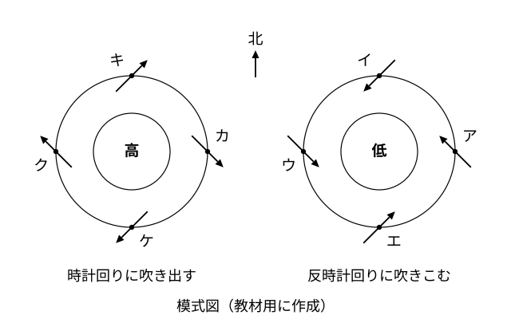
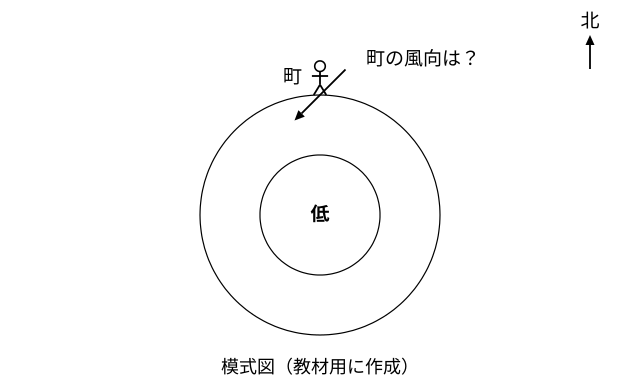

# レッスン2 風はどう吹くか——気圧配置と風向

- unit_id: jhs-sci-2-atmospheric-movement-japan-weather
- 位置づけ: 子単元 --pressure-wind（気圧配置と風）。親単元の第2レッスン（1時間）。「気圧の高い方から低い方へ風が吹く」という機構を土台に、高気圧・低気圧のまわりの風の吹き方（北半球）を学び、上空から見た天気図を「自分の町に立って感じる風向」に言いかえる手順を型にする。子単元「気圧配置と風」の中核。
- distribution_status: published_draft
- license: CC-BY-4.0
- verify_required: V1（模式図・地点配置はすべて教材用の架空）／V4（北半球で低気圧には反時計回りに吹きこみ、高気圧からは時計回りに吹き出す、という風の吹き方は確定値として扱わず監修で確認）／V9（風向は8方位で答える指示を毎問明示。学校慣行が16方位なら読みかえ）。低気圧・高気圧の中心付近の天気の傾向（上昇気流・下降気流）は教科書標準の記述で、監修確認対象。全記述は監修者（理科担当）検証必須。
- 主概念: ①風は気圧の高い方から低い方へ吹き、等圧線の間隔が狭いほど強い ②高気圧・低気圧のまわりの風の吹き方（北半球）と「上空から見た図」を「自分の町の風向」に変換する手順

---

## ここで学ぶこと

レッスン1で、天気図には気圧の高い所と低い所があることを読み取りました。今日はその**気圧のちがい**が風を生むしくみを学びます。大事なことは2つ。第一に、**風は気圧の高い方から低い方へ吹く**こと。第二に、天気図は上から見おろした図なので、**自分の町に立ったときの風向**に言いかえる手順が必要なこと（向きを変える操作ではなく、町の位置と「吹いてくる方位」を取りちがえないための手順です）。この「上から見おろした図→自分の町の風向」の言いかえは、この単元でこの教材がいちばん重点を置いて練習する所です。手順を型にして練習します。次のレッスン3では、日本付近を西から東へ動いていく高気圧や低気圧があることを学びます。

## 風は気圧の高い方から低い方へ

空気は、押す力の強い所から弱い所へ動きます。レッスン1で学んだように、気圧は空気の柱の重さによる圧力でした。となり合う2つの場所で気圧がちがうと、気圧の高い側の空気が低い側へ押し出されます。この空気の動きが**風**です。

> 【ことば】**風向** 風が**吹いてくる方位**。北から南へ向かって吹く風は「北の風」。この教材では、北・北東・東・南東・南・南西・西・北西の**8方位**で答える。

> 【ことば】**風速** 空気が1秒あたりに進む距離。

気圧のちがいが風を生むので、次の2つのことがいえます。

1. **風は気圧の高い方から低い方へ向かって吹く**。
2. **等圧線の間隔が狭い所ほど風は強い**（地面近くの風を、ほかの条件が同じ所どうしでくらべたときの傾向です）。同じ距離の中で気圧の差が大きい（等圧線がつまっている）ほど、空気を押す力の差が大きいからです。逆に、等圧線の間隔が広い所では風は弱くなります。

:::guide
**なぜ「高い方から低い方へ」なのか**

「気圧が高い」とは、その場所の上にある空気の柱が重い（空気が多い）ということでした。空気が多い所と少ない所が同じ高さでとなり合えば、多い側から少ない側へ空気が流れて、同じくらいになろうとします。天気図の気圧は海面の高さにそろえた値なので（レッスン1）そのままくらべられます。つながった容器の水が、多い側から少ない側へ流れて水面がそろうのと似たイメージです（あくまでイメージで、空気が坂を転がるわけではありません）。「高気圧から低気圧へ」と丸暗記するより「空気の多い側から少ない側へ」と理由ごと覚えておくと、季節風（レッスン7以降）でもそのまま使えます。
:::

## 高気圧・低気圧のまわりの風

ここからは、この教材用に作った模式図で考えます。

> **注意**：下の図1は、この教材の練習用に作った**模式図**（架空）です。北が上で、上空から見おろした向きにかかれています。矢印は風の向き（空気が進む向き）を表し、実際の観測に基づく図ではありません。

風は気圧の高い方から低い方へ吹きます。ですから、高気圧のまわりでは中心から外へ吹き出し、低気圧のまわりでは外から中心へ吹きこみます。ただし北半球では、まっすぐ中心へ向かうのではなく、次のように回りながら吹きます。

- **低気圧**の中心へは、**反時計回り**に回りながら吹きこむ。
- **高気圧**の中心からは、**時計回り**に回りながら吹き出す。

なぜ回るのかという理由は、地球全体の動きと関わる内容なので、この教材では踏みこみません。ここでは**事実として使います**。南半球での吹き方も、この教材では扱いません。

この教材の模式図では、風の矢印は「等圧線に沿う向き」と「中心へ向かう（または中心から離れる）向き」の**ちょうど中間の向き**にかいてあります。風向は、矢印の**根もとの側**、つまり風が吹いてくる方位を8方位で読みます。矢印の根もとが方位のちょうど間にあるときは、その間の方位（北東・南東・南西・北西）で答えます。

:::guide
**反時計回りをどう覚えるか**

低気圧は反時計回りに吹きこむ、高気圧は時計回りに吹き出す——この2つを別々に覚えようとすると、テストの直前に入れかわりがちです。おすすめは、**低気圧の「反時計回りに吹きこむ」だけを図で1つ覚え、高気圧はその逆**（回る向きも、出入りも逆）と決めておくことです。図1の低気圧の東側の地点を見てください。風は南東から吹いてきて、地点アから左上（北西）へ向かっています。この1か所の矢印を頭に置いておけば、ほかの地点は「反時計回りに一周させる」だけで復元できます。
:::

## 上空の図から「自分の町の風向」へ

天気図は上空から見おろした図です。しかし風向は、自分の町に立って「どちらから吹いてくるか」で言います。この2つをつなぐ手順を型にします。

1. **自分の町の位置を図の上に置く**（人形を立てるイメージ）。
2. **その地点にかかれている矢印の向きを読む**。矢印の根もとが、風の吹いてくる側。
3. **吹いてくる方位で言う**。「北が上」の約束から、8方位を決める。

> **注意**：下の図2も、この教材の練習用に作った**模式図**（架空）です。低気圧の中心が町の**南**を通っているときの、町の位置と風の矢印をかいてあります。町の風向は図には書かず「？」にしてあります。

:::guide
**低気圧の東側にいることと、東の風とは、まったく別のこと**

このレッスンでとくに気をつけたい読みまちがいが「自分の町が低気圧の東側にあるから東の風」という考え方です。「東側にいる」は**町の位置**の話です。「東の風」は**風が吹いてくる方位**の話で、別の量です。図1の低気圧の東側の地点アでは、風は**南東から**吹いてきています。つまり南東の風です。手順1で町を置いたら、手順2でその地点の矢印の**根もと**を見る——この一手間を省くと、位置の名前をそのまま風向にしてしまいます。声に出して「矢印の根もとはどっち？」と自分に聞く習慣をつけましょう。
:::

## 気圧配置と天気の傾向

教科書では、低気圧の中心付近ではまわりから吹きこんだ空気が上へ向かい（上昇気流）、雲ができやすく天気がくずれやすい、高気圧の中心付近では空気が下へ向かい（下降気流）、雲ができにくく晴れやすい、と説明されます。上へ向かった空気の気温が下がると飽和水蒸気量が小さくなり、含みきれなくなった水蒸気が水滴になって雲ができる——これは湿度の単元で学んだ規則性（気温が下がると飽和水蒸気量が小さくなる・レッスン1で再掲）を使った説明です。この傾向は、レッスン3で「次の日の天気を考える」ときに使います。

## 例題

**例題1**　図1の低気圧のまわりの地点ア（中心の東側）の風向を8方位で答えなさい。

**考え方**　①地点アは低気圧の中心の東側。②低気圧のまわりの風は反時計回りに吹きこむので、東側では風は、北へ向かう向きと中心（西）へ向かう向きのちょうど間、つまり北西へ向かう。図1の矢印は北西へ向かい、根もとは南東側にある。③吹いてくる方位で言う。→ **南東の風**

**例題2**　図2で、低気圧の中心が町の南にあるとき、町の風向を8方位で答えなさい。

**考え方**　①町は低気圧の中心の**北側**にある（中心が町の南＝町は中心の北）。②低気圧の北側では、反時計回りの風は、西へ向かう向きと中心（南）へ向かう向きのちょうど間、つまり南西へ向かう。図2の矢印は南西へ向かい、根もとは北東側。③吹いてくる方位で言う。→ **北東の風**

## 読み取りのコツ

- **答えは吹いてくる方位**。矢印の先ではなく、根もとの側の方位です。
- **低気圧のまわりを一周する**と、東側→南東、北側→北東、西側→北西、南側→南西の順に、風向も反時計回りに回っていきます。答えを4か所ならべて、この並びになっているか確かめると、1か所だけ逆に読んだミスを見つけられます。高気圧のまわりでは、同じ側の地点の風向が低気圧のときとちょうど反対の方位になります（例: 南側なら、南西の反対の北東の風）。並びが時計回りになる、という意味ではありません。
- **町から見た中心の位置と、中心から見た町の位置は反対**です。低気圧の中心が町の南にあるなら、町は中心の北側です。手順1で町を置くときに、この言いかえを1回はさみます。

## 練習問題

以下すべて、上の図1・図2（この教材用の**架空の模式図**）を使うこと。風向は8方位で答えること。

1. 図1の高気圧のまわりの地点カ（中心の東側）の風向を8方位で答えなさい。
2. 図1の低気圧のまわりの地点エ（中心の南側）の風向を8方位で答えなさい。
3. 図2とは反対に、低気圧の中心が町の**北**を通っているときの町の風向を8方位で答えなさい。また、図2の場合（中心が町の南）と風向がどう変わるかを一文で書きなさい。
4. ある生徒が図1を見て「地点アは低気圧の東側にあるから、東の風が吹く」と答えた。どこがまちがっているか「吹いてくる方位」という言葉を使って一文で指摘しなさい。
5. 高気圧の中心付近と低気圧の中心付近で、天気がくずれやすいのはどちらか。理由を「上昇気流」という言葉を使って一文で書きなさい。

:::stretch
**S1** ある日の天気図で、地点Xの近くでは等圧線と等圧線のすき間が、地点Yの近くの半分しかなかった（等圧線はどちらも4hPaごと）。風が強いと考えられるのはXとYのどちらか。理由を「等圧線の間隔」という言葉を使って一文で書きなさい。
:::

:::zatsudan
天気図や気象情報の図は、北を上にしてかかれるのが約束です。地図と同じ向きなので、テレビの天気図を見たら「自分の町はこのあたり」と指で置いてみると、上空から見おろす目と、地面に立って風を受ける目とが切りかわりやすくなります。図の上に人形を立てるつもりで町を置く——今日の手順1は、そのまま日常の天気図の見方としても使えます。
:::
<!-- zatsudan話題源: 雑談枠許可リストZ5（平成30年度 全国学力・学習状況調査 報告書 中学校理科 の学習指導の例「天気図上に人形を置く」「天気図などの気象情報は北を上にしている」・確認範囲内）。出典の確認範囲内の事実のみ使用・数値なし -->

<!-- gen_nav:nav:start（自動生成・手編集しない） -->

---

[← 前のレッスン](lesson_01.md)｜[単元の目次](README.md)｜[解答](answer_key_L01-03.md)｜[次のレッスン →](lesson_03.md)

<!-- gen_nav:nav:end -->
