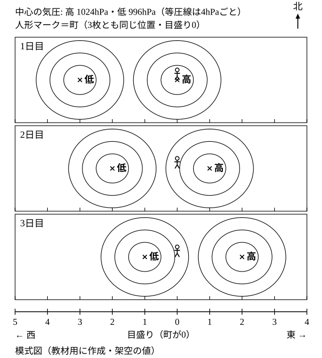
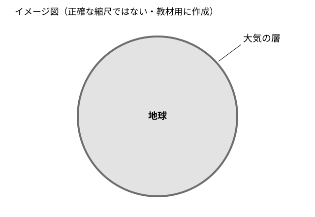

# レッスン3 天気は西から東へ——偏西風と大気の動き

- unit_id: jhs-sci-2-atmospheric-movement-japan-weather
- 位置づけ: 子単元 --pressure-wind（気圧配置と風）。親単元の第3レッスン（1時間）。子単元「気圧配置と風」の最終回。連続する模式天気図から、温帯低気圧と移動性高気圧が西から東へ移動することを読み取り、その背景にある偏西風を知る。地球の大きさに対して大気の層がごく薄いことにも触れる。最後に「次の日の配置を自分で推測する」転移問題を置く。
- distribution_status: published_draft
- license: CC-BY-4.0
- verify_required: V1（連続模式天気図・目盛り・気圧値はすべて教材用の架空）／V4（偏西風は一年中西から東へ、という向きは監修で確認）／V9（風向は8方位・移動量は図の目盛りで答える指示を毎問明示）。「温帯低気圧」「移動性高気圧」の定義文は最小限に留め、構造（前線）はレッスン6に譲る（この2つの定義文は、語は解説にあるが定義文は解説に無い教科書標準の文であり、語の太字導入の可否とは別に、定義文の出典と適用範囲を監修で確認する）。全記述は監修者（理科担当）検証必須。
- 主概念: ①温帯低気圧・移動性高気圧が西から東へ移動すること（連続模式天気図）と、その背景にある偏西風 ②地球の大きさに対して大気の層はごく薄いこと（触れる水準）

---

## ここで学ぶこと

レッスン1・2では、ある1枚の天気図の中で、気圧の高低と風の吹き方を読みました。今日は天気図を**何日分かならべて**見ます。すると、高気圧や低気圧が同じ場所にとどまらず、**西から東へ**動いていくことが分かります。この動きの背景にあるのが、日本の上空に一年中吹いている**偏西風**（へんせいふう）です。天気が「西から変わる」と言われるのはこのためです。レッスンの最後には、3日分の図から**4日目・5日目の自分の町の風向や天気を自分で推測する**問題に取り組みます。天気図を「見る」だけでなく「考える」道具にすることが、この3回（レッスン1〜3）のゴールです。次のレッスン4からは、低気圧にともなう**前線**のしくみへ進みます。

## 連続模式天気図を読む

> **注意**：下の図1は、この教材の練習用に作った**模式天気図**（架空）を3日分ならべたものです。実際の日付・場所の天気図ではなく、気圧の値も動く速さもすべて架空です。町の位置も架空です。

図1の読み方は次のとおりです。

1. 3枚とも**北が上**で、同じ範囲をかいています。町の位置（人形マーク）は3枚とも同じ場所です。高気圧・低気圧の中心は×の印で、そのわきに「高」「低」の字があります。
2. 図の下に、西から東へ向かう**目盛り**が入っています。町の位置を目盛り0とし、東へ1、2、……、西へ1、2、……と数えます。
3. 1日目は、高気圧の中心が町と同じ位置（目盛り0・町の上空）にあり、低気圧の中心は町の西、目盛り3つ分の所（西へ3）にあります。
4. 2日目・3日目と日がたつごとに、高気圧の中心も低気圧の中心も**東へ目盛り1つ分ずつ**動いています。等圧線は4hPaごとで、高気圧の中心の値は1024hPa、低気圧の中心の値は996hPaです（レッスン1の図2と同じ中心の値・同じ間隔の等圧線ですが、高気圧と低気圧の東西は入れかえてあります。それを日ごとに東へずらしたものです）。

日本付近に現れるこのような低気圧・高気圧には名前がついています。

> 【ことば】**温帯低気圧** 日本付近のような温帯でできる低気圧。西から東へ移動していく。前線をともなうことが多く、その構造はレッスン5・6で学ぶ。

> 【ことば】**移動性高気圧** 西から東へ移動していく高気圧。季節との関係はレッスン9で学ぶ。

温帯低気圧も移動性高気圧も西から東へ動くのは、**日本の上空には一年中、西から東へ向かう強い風が吹いている**からです。この風を**偏西風**といいます。

> 【ことば】**偏西風** 日本の上空を一年中、西から東へ向かって吹いている風。低気圧や高気圧はこの流れに運ばれて西から東へ移動する。

:::guide
**動く向きと風向——「西から東へ動く」と「西の風」を区別する**

偏西風は西から東へ吹く風です。風向は「吹いてくる方位」で言う約束（レッスン2）でしたから、偏西風は**西の風**です。「東へ向かう風だから東の風」と言ってしまうと、レッスン2の約束と逆になります。また「低気圧が西から東へ動く」のは低気圧という**しくみ全体の移動**の話で、その低気圧のまわりで自分の町に吹く風の**風向**とは別の量です。低気圧は東へ動いているのに、町には南東の風が吹いている、ということがふつうに起こります。「何が動いているか」「どこから吹いてくるか」を分けて言うくせをつけましょう。偏西風は上空を流れる風です。町で感じる地面近くの風の風向は、この教材の模式図では、そのときの高気圧・低気圧の位置から読みます（レッスン2）。
:::

:::guide
**3コマの図から動きを読むコツ**

3枚の図をながめると、等圧線の形が少しずつ変わって見えて、何が動いたのか分かりにくくなります。コツは、**同じ記号だけを目で追う**ことです。低気圧の中心の印（×と「低」の字）だけを1日目・2日目・3日目と指でたどり、目盛りで位置を数えます。次に「高」だけを同じようにたどります。全体を一度に見ようとせず、1つの記号の位置の変化を1本の線にして読む——これが連続図の基本の読み方です。
:::

## 地球と大気の厚さ

低気圧や高気圧、雲や雨といった気象現象は、地球をとりまく**大気**の中で起こっています。ところが、この大気の層は地球の大きさとくらべると**ごく薄い**層です。私たちが見上げる空の高さは、地球の丸みの大きさに対して、ほんのわずかな厚さにあたります。天気の変化は、この薄い層の中で、西から東への大気の流れとともに起こっているのです。

> **注意**：下の図2は大気の薄さを伝えるための**イメージ図**で、正確な縮尺ではかいてありません。厚さの数値を読み取る図ではありません。

## 例題

**例題1**　図1で、低気圧の中心は1日目から2日目にかけて、どの方向へ動いたか。東・西・南・北のいずれかで答えなさい。

**考え方**　①1日目の「低」の位置は目盛りで西へ3。②2日目の「低」の位置は西へ2。③西へ3から西へ2へ変わった＝**東へ**目盛り1つ分動いた。→ **東**

**例題2**　図1の2日目に、町に吹く風の風向を8方位で答えなさい。

**考え方**　①2日目、町（目盛り0）から見ると、低気圧の中心は西へ2（町は低気圧の**東側**）、高気圧の中心は東へ1（町は高気圧の**西側**）。②レッスン2の吹き方より、低気圧の東側では南東の風。高気圧の西側では、時計回りに吹き出す風の根もとは南東側なので、こちらも南東の風。③どちらの中心から考えても同じ。→ **南東の風**

## 読み取りのコツ

- **動く向きは「西→東」で、目盛りで数える**。動いた量は「目盛り何個分」で答え、距離の単位はつけません（この図の目盛りは架空です）。
- **風向を出すときは、町から見た中心の位置→中心から見た町の位置に言いかえてから**、レッスン2の吹き方（低気圧は反時計回りに吹きこむ・高気圧は時計回りに吹き出す）を当てます。
- **2つの中心の両方から考えて一致するか確かめる**。例題2のように、低気圧側から出した風向と高気圧側から出した風向が一致すれば、読みまちがいに気づく手がかりになります。ただし、一致は確かめの補助で、まちがいがないことの証明ではありません。矢印の根もとでなく矢先を読んでいたり、低気圧と高気圧の回る向きを両方とも逆に覚えていたりすると、2つとも同じようにまちがえて一致してしまいます。町の位置・回る向き・吹いてくる方位（根もとの側）を、それぞれ読み直して確かめます。2つの中心から出した風向が一致しないときは、この教材の模式図では、町を囲む閉じた等圧線をもつ方の中心で考えます（これは教材の中での約束です。実際の天気図では、町のすぐ近くの等圧線の様子から考えます）。

:::guide
**天気図を「見る」から「考える」へ**

テレビや気象情報の天気図は「見る」もの、と思っているかもしれません。しかし今日の図1のように3日分ならべれば「低気圧はこの速さで東へ来る」「明日は中心が町の近くだ」と自分で推測できます。推測は当たらないこともあります。それでも「こう考えたからこう予想した」と根拠を言えることが、理科で天気を学ぶ意味です。練習5では、当たり外れではなく**根拠の言い方**を練習します。
:::

## 練習問題

以下すべて、上の図1・図2（この教材用の**架空の模式図**）を使うこと。風向は8方位で、動いた量は図1の目盛りの個数で答えること。

1. 図1で、低気圧の中心は1日目から3日目にかけて、どの方向へ目盛り何個分動いたか。「東へ〇個分」のように答えなさい。
2. 図1の1日目に、町の天気が晴れやすいと考えられる理由を「高気圧」「雲」という言葉を使って一文で書きなさい。
3. 図1の3日目に、町に吹く風の風向を8方位で答えなさい。低気圧の中心と高気圧の中心のどちらから考えたかも書きなさい。
4. ある生徒が「偏西風は日本の上空を西から東へ向かって吹く風だから、東の風である」と言った。どこがまちがっているか「吹いてくる方位」という言葉を使って一文で指摘しなさい。
5. 図1の1日目から3日目までの動き方が、その後も同じように続くとして、次に答えなさい（転移問題＝学んだことを新しい場面に使う問題。答えだけでなく根拠を書くこと）。
   (a) 4日目には、低気圧の中心は町から見てどの位置に来ると考えられるか。目盛りで答え、そのとき町の天気はどうなりやすいかを、レッスン2で学んだ低気圧の中心付近の傾向を根拠にして一文で書きなさい。
   (b) 5日目には、町に吹く風の風向はどうなると考えられるか。8方位で答えたうえで「町は低気圧の中心のどちら側にあるか」を根拠として一文で書きなさい。

:::stretch
**S1** 気象衛星の雲の画像を何時間分か続けて見ると、雲のまとまりが西から東へ流れていくのが分かることがあります。その理由を「偏西風」という言葉を使って一文で書きなさい。（実際の画像は「気象衛星 雲画像 動画」などの言葉で気象庁のページを探すと見られます。この教材には転載していません。）
:::

:::zatsudan
気象衛星の画像を続けて見ると、雲のまとまりが西から東へ流れていくのが分かることがあります。日本の上空には一年中、西から東へ偏西風が吹いていて、雲のまとまりも低気圧も、その流れに運ばれていることが多いからです。そして、その雲が動いている大気の層は、地球の大きさとくらべればごく薄い層です。薄い層の中の西から東への流れが、明日の天気を運んでくる——レッスン9で、春や秋の天気が数日ごとに変わるしくみとして、もう一度この話に出会います。
:::
<!-- zatsudan話題源: 雑談枠許可リストZ1・Z6（中学校学習指導要領（平成29年告示）解説 理科編 p.96「地球を取り巻く大気の動きにも触れること。また，地球の大きさや大気の厚さにも触れること」「日本の上空には一年中西から東へ偏西風が吹いている」「日本付近の気象衛星画像の動画などの雲の移動の様子から」・確認範囲内。「ことが多い」という頻度の限定は出典の文でなく本文の言い方で、頻度そのものは未確認）。出典で確認した事項と本文の言い方（頻度の限定）を区別して使用・数値なし -->

<!-- gen_nav:nav:start（自動生成・手編集しない） -->

---

[← 前のレッスン](lesson_02.md)｜[単元の目次](README.md)｜[解答](answer_key_L01-03.md)｜[次のレッスン →](lesson_04.md)

<!-- gen_nav:nav:end -->
