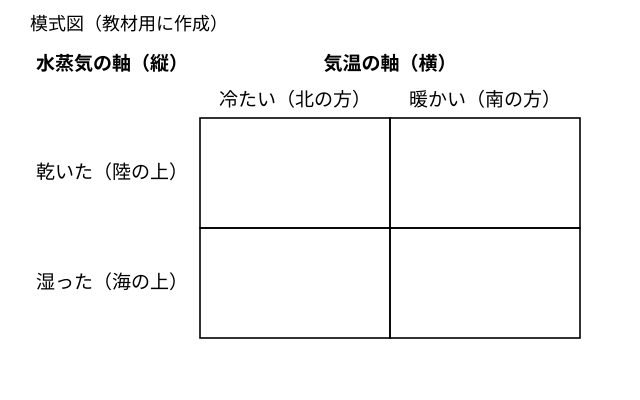
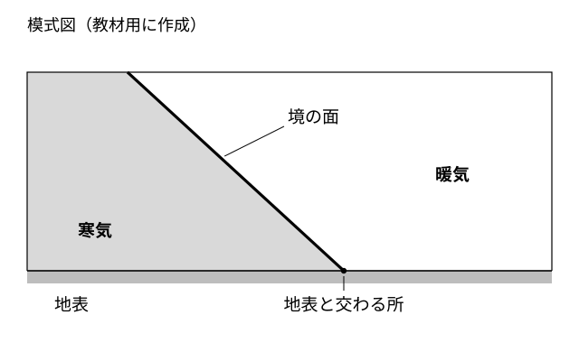

# レッスン4 気団と前線のでき方——暖気と寒気が出会うところ

- unit_id: jhs-sci-2-atmospheric-movement-japan-weather
- 位置づけ: 子単元 --air-masses-fronts（気団・前線と天気の変化）。親単元の第4レッスン（1時間）。子単元「気団・前線と天気の変化」の第1回。性質のそろった大きな空気のかたまり（気団）の性質が「どこでできたか」で決まることを、気温と水蒸気量の2つの軸でとらえる。次に、暖気と寒気が出会っても混ざりにくく、境の面（前線面）と、それが地表と交わる線（前線）ができることを学ぶ。レッスン5（寒冷前線・温暖前線の構造）の土台。
- distribution_status: published_draft
- license: CC-BY-4.0
- verify_required: V1（図の配置・地点はすべて教材用の架空）／V3（気団の性質の言い方「冷たい・暖かい」「乾いた・湿った」は発生場所からの一般原理として扱い、日本周辺の気団の名前と固有の性質はレッスン8〜10に譲る）／V5（気団・前線面・前線の定義文と「冷たい空気は重い」の説明は教科書標準・監修確認対象）／V9（答え方の指示は毎問明示）。全記述は監修者（理科担当）検証必須。
- 主概念: ①気団の性質（気温・水蒸気量）は、その気団が発生した場所の気温と水蒸気量で決まる（2つの軸でセットで言う） ②暖気と寒気は出会っても混ざりにくく、境の面が前線面、前線面が地表と交わる線が前線

---

## ここで学ぶこと

レッスン1〜3では、気圧の高低が風を生み、移動性高気圧や温帯低気圧が西から東へ動いていくことを学びました。今日からは、低気圧にともなって天気を大きく変える**前線**のしくみに入ります。その前に、まず**気団**（きだん）という言葉を学びます。気団とは、広い範囲で気温や湿り（水蒸気の量）がほぼそろった、大きな空気のかたまりのことです。今日いちばん大事なことは2つ。第一に、気団の性質は**その空気がどこでできたか**で決まり、それを言うときは「冷たい／暖かい」と「乾いた／湿った」の**2つの軸**をいつもセットで使うこと。第二に、暖かい空気のかたまり（暖気）と冷たい空気のかたまり（寒気）が出会っても、すぐには混ざらず、境の**面**ができること。この面が地表と交わる線が前線です。次のレッスン5では、この前線を2つの種類に分けて、通過するときの天気の変化を学びます。

## 気団——性質は「どこでできたか」で決まる

空気が同じ場所に長くとどまると、その場所の地面や海面の性質を受け取って、広い範囲で気温や水蒸気の量がほぼそろった空気のかたまりになります。

> 【ことば】**気団** 広い範囲にわたって気温や水蒸気の量（湿り）がほぼそろった、大きな空気のかたまり。その性質は、その空気が発生した（長くとどまった）場所の気温と水蒸気の量で決まる。別の場所へ動いていくと、その場所の影響を受けて性質が変わっていくこともある（発展問題S1・レッスン8）。

「どこでできたか」は、2つの軸で見ます。

1. **北の方か、南の方か**（気温の軸）。日本のまわりで考えると、北の方でできた気団は冷たく、南の方でできた気団は暖かい。
2. **海の上か、陸の上か**（水蒸気の軸）。海の上でできた気団は海から水蒸気を受け取って湿っており、陸の上でできた気団は水蒸気が少なく乾いている。

> **注意**：下の図1は、この教材用に作った**模式図**です。4つの区画は「北か南か」「海か陸か」の組み合わせを表し、実際の地図や特定の場所を表すものではありません（地図ではないので、図の上が北ではありません）。気団の名前は書いてありません。

図1は、横の軸に気温、縦の軸に水蒸気の量をとった4つの区画です。たとえば北の方の陸の上でできた気団は、気温の軸では「冷たい」であり、水蒸気の軸では「乾いた」なので、**冷たく乾いた気団**と言います。このように、気団の性質は「気温の軸の語」と「水蒸気の軸の語」の**2語の組**で言います。

日本のまわりにも、季節ごとに発達する気団があり、名前がついています。その名前と、季節の天気とのつながりは、レッスン8〜10で学びます。今日は名前を覚えるのではなく「発生した場所から性質を言う」という**考え方**を身につけます。学校では、海と陸に見立てたものの上で空気の湿りがどう変わるかを調べるモデル実験を行うことがありますが、この教材では手順は扱わず、図で考えます。

:::guide
**暖かいだけで終わらせない——2つの軸をセットで**

気団の性質を聞かれて「暖かい気団」とだけ答えると、半分しか言っていません。同じ「暖かい」でも、海の上でできた気団は水蒸気を多く含んで湿っており、陸の上でできた気団は乾いています。この湿りのちがいが、その気団がやってくる季節の天気（雨や雪が多いか、乾いた晴れか）を分けます。気団の性質を言うときは、必ず「冷たいか暖かいか」と「乾いているか湿っているか」を**2つとも**言う——この習慣を今日からつけておくと、レッスン8〜10で日本の季節の天気を考えるときにそのまま効きます。
:::

## 暖気と寒気が出会うと——前線面と前線

性質のちがう2つの気団が出会うと、どうなるでしょうか。暖かい空気のかたまりを**暖気**、冷たい空気のかたまりを**寒気**といいます（2つをくらべたときの、暖かい方・冷たい方の呼び方です）。暖気と寒気は、出会ってもすぐには混ざり合いません。教科書では、出会った寒気と暖気を同じ体積でくらべると冷たい空気の方が重いため、寒気が下に、暖気が上になろうとして、2つの間に**斜めの境の面**ができる、と説明されます。

> 【ことば】**前線面** 暖気と寒気が接している境の面。寒気が下、暖気が上になるように、地表から上空へ斜めに広がる。

> 【ことば】**前線** 前線面が地表と交わる線。天気図に線としてかかれるのはこの前線である。

> **注意**：下の図2は、この教材用に作った**模式図**です。前線面の傾きは見やすいように大きくかいてあり、実際の傾きや高さの比率を表すものではありません。

図2は、地面を横から見た断面です。左側に寒気、右側に暖気があり、寒気が暖気の下に、先の細くとがったくさびのような形で入りこんで、境の面が斜めになっています。この面が前線面です。前線面が地表に達している所（図では点に見えますが、手前から奥へ線としてのびています）が前線です。天気図を上から見たときにかかれる前線の線は、この地表との交線にあたります。

:::guide
**面と線——天気図にかかれるのはどちらか**

前線面と前線は名前が似ていて、混ざりやすい言葉です。区別のしかたは「空の中に広がる面か、地表の上の線か」です。空の上には、暖気と寒気の境目が**面**として広がっています。これが前線面です。天気図には、空の中に広がるこの面をそのままかくのではなく、面が地表と交わる**線**をかく約束になっています。それが前線です。天気図の前線の線を見たら「この線から上空へ、斜めの面が広がっているんだな」と立体を思い浮かべてください。次のレッスンで学ぶ「雨の降り方」のちがいには、この面の傾きが大きく関わります。
:::

## 前線面で雲ができるわけ

前線面では、暖気が寒気の上に押し上げられます。押し上げられて上昇した空気は、温度が下がります。湿度の単元で学んだように、**気温が下がると飽和水蒸気量が小さくなる**ので、含みきれなくなった水蒸気が水滴になって雲ができます。だから前線の近くでは雲が多く、雨が降りやすいのです。

:::guide
**上昇気流→雲——レッスン2の低気圧と同じしくみ**

レッスン2で、低気圧の中心付近では吹きこんだ空気が上へ向かい、雲ができやすいことを学びました。前線面で雲ができるのも、同じ「空気が上昇して温度が下がり、水蒸気が水滴になる」しくみです。ちがうのは、空気を上へ向かわせる**きっかけ**です。低気圧の中心では「まわりから吹きこんだ空気が上へ向かう」こと、前線面では「寒気の斜面に沿って暖気が押し上げられる」ことがきっかけになります。「雲ができる理由」を聞かれたら、まず「空気が上昇して温度が下がったから」と答え、次に「何が上昇のきっかけか」を言う——この2段で答えると、低気圧でも前線でも同じ型で説明できます。
:::

## 例題

**例題1**　南の方の海の上で長くとどまってできた気団の性質を「冷たい／暖かい」と「乾いた／湿った」の2つの軸の組で答えなさい。

**考え方**　①南の方でできた→気温の軸は「暖かい」。②海の上でできた→水蒸気の軸は「湿った」。③2つをセットで言う。→ **暖かく湿った気団**

**例題2**　図2で、暖気と寒気の境の「面」と、それが地表と交わる「線」の名前をそれぞれ答えなさい。また、天気図に線としてかかれるのはどちらか答えなさい。

**考え方**　①境の面は前線面。②地表との交線は前線。③天気図にかかれるのは、面が地表と交わる線の方。→ **面は前線面、線は前線。天気図にかかれるのは前線**

## 読み取りのコツ

- **気団の性質は必ず2語で**。「暖かい」だけや「湿った」だけの答えは半分です。「暖かく湿った」のように、気温の軸と水蒸気の軸を1つずつ言います。
- **発生場所と性質は軸ごとに対応**。北か南か→冷たいか暖かいか、海か陸か→湿ったか乾いたか。片方の軸が決まっても、もう片方は決まりません（海の上というだけでは、冷たいか暖かいかは分かりません）。
- **面と線**。「前線面」は空の中に広がる面。「前線」はその面が地表と交わる線。天気図にかかれるのは線の方です。

## 練習問題

以下すべて、上の図1・図2（この教材用の**架空の模式図**）を使うこと。気団の性質は「冷たい／暖かい」「乾いた／湿った」の2つの軸の組で答えること。

1. 北の方の海の上で長くとどまってできた気団の性質を、2つの軸の組で答えなさい。
2. ある気団の性質が「暖かく乾いた気団」であった。この気団は、図1の4つの区画のうち、どこで発生したと考えられるか。「〇の方の〇の上」の形で答えなさい。
3. ある生徒が「海の上でできた気団は、冷たい気団である」と言った。どこがまちがっているか「2つの軸」という言葉を使って一文で指摘しなさい。
4. 図2の断面で、寒気と暖気はどちらが下側にあるか答えなさい。また、そうなる理由を「重い」という言葉を使って一文で書きなさい。
5. 前線面の近くで雲ができやすい理由を「上昇」「飽和水蒸気量」の2つの言葉を使って一文で書きなさい。

:::stretch
**S1** 北の方の陸の上でできた冷たく乾いた気団が、暖かい海の上を長い距離進んでいったとする。この気団の水蒸気の軸の性質は、進む前とくらべてどう変わると考えられるか。「乾いた／湿った」のどちらへ変わるかを答え、理由を「海」「水蒸気」の2つの言葉を使って一文で書きなさい。（この考え方は、レッスン8で冬の日本海側の天気を考えるときに使います。）
:::

:::zatsudan
気団が海の上で水蒸気を多く含むようになるのも、陸や海が温められて空気の温度が決まるのも、もとをたどれば太陽のエネルギーです。海から水が蒸発して水蒸気になり、雲になり、雨や雪として地上にもどる——この水の循環は、太陽のエネルギーによって引き起こされています。大陸も海洋も同じ太陽に温められているのに、温まり方がちがうために、季節によって大陸と海洋に温度の差が生まれます。その差がどのように季節の風を生むかは、レッスン7で学びます。
:::
<!-- zatsudan話題源: 雑談枠許可リストZ10（中学校学習指導要領（平成29年告示）解説 理科編 p.95「水の循環は太陽のエネルギーによって引き起こされる」・確認範囲内。大陸と海洋の温まり方の差はレッスン7の主概念〔教科書標準・解説に明文なし〕への予告で、出典の確認文の外）。出典で確認した事項とレッスン7からの予告（確認文の外）を区別して使用・数値なし -->

<!-- gen_nav:nav:start（自動生成・手編集しない） -->

---

[← 前のレッスン](lesson_03.md)｜[単元の目次](README.md)｜[解答](answer_key_L04-06.md)｜[次のレッスン →](lesson_05.md)

<!-- gen_nav:nav:end -->
