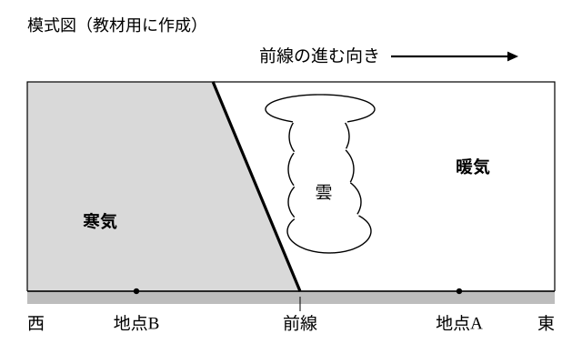
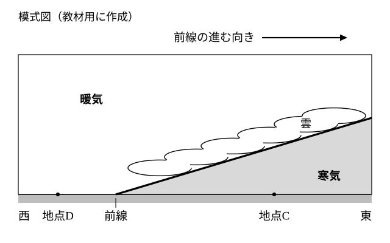

# レッスン5 寒冷前線と温暖前線——構造と通過のときの変化

- unit_id: jhs-sci-2-atmospheric-movement-japan-weather
- 位置づけ: 子単元 --air-masses-fronts（気団・前線と天気の変化）。親単元の第5レッスン（1.5時間）。レッスン4で学んだ前線面を、寒気が押す場合（寒冷前線）と暖気が押す場合（教科書で温暖前線と呼ばれる前線）に分け、それぞれの断面の構造と、前線が通過するときの雨の降り方・気温・風向の変化を対比する。「雨が降ったかどうか」だけで前線の種類を決めない、という見方の1段目。レッスン6（温帯低気圧と時系列の判定）の土台。
- distribution_status: published_draft
- license: CC-BY-4.0
- verify_required: V1（断面図・地点はすべて教材用の架空）／V2（「温暖前線」は教科書側の語。本文は「教科書では〜と呼びます」の水準で太字なし。太字導入の可否は監修判断）／V5（寒冷前線の通過の特徴は学習指導要領解説に明記。温暖前線の特徴と「通過後の風向が北寄り／南寄り」は教科書標準・研究の評価項目に依る。雲の種類名も「教科書では」水準）／V9（答え方の指示は毎問明示）。全記述は監修者（理科担当）検証必須。
- 主概念: ①寒冷前線＝寒気が暖気の下にもぐりこんで暖気を急に押し上げる→背の高い雲・短時間の比較的強い雨・雷→通過後に気温が下がり、風向が北寄りに変わる ②温暖前線（教科書語）＝暖気が寒気の上にゆるやかにはい上がる→広い範囲の雲・長い時間の弱い雨→通過後に気温が上がり、風向が南寄りに変わる

---

## ここで学ぶこと

レッスン4で、暖気と寒気の境に前線面ができ、その面が地表と交わる線が前線だと学びました。今日はその前線を、**どちらの空気が押しているか**で2つに分けます。寒気が暖気を押して進む前線が**寒冷前線**、暖気が寒気を押して進む前線は、教科書では温暖前線と呼ばれます。2つの前線は、前線面の傾き、できる雲の形、雨の降り方、そして前線が町を通過した後の気温・風向の変化が対になっています。今日いちばん大事なことは、前線の種類を「雨が降ったかどうか」で決めないこと。雨はどちらの前線でも降ります。見るべきは**雨の降り方**と、**通過の前後で気温と風向がどう変わったか**です。次のレッスン6では、この2つの前線が1つの低気圧にどうついているかを学び、時刻ごとの記録から前線の通過を判定する手順を型にします。

## 断面図の見方（2つの図に共通）

ここからの断面図は、すべてこの教材用に作った模式図です。

> **注意**：下の図1・図2は、この教材用に作った**模式図**です。どちらも地面を横から見た断面で、左が西、右が東、前線は東（右）へ進むとしてかいてあります。前線面の傾き、雲の高さや広がりは見やすいように強調してあり、実際の比率や実在の地点を表すものではありません。

図の約束は3つです。①左が西、右が東。②前線は東へ進むので、前線の東側は「これから通過する側（通過前）」で、西側は「もう通過した側（通過後）」。③図の中の地点は、前線の東側にある地点は「通過前」の町、西側にある地点は「通過後」の町の様子として読む。

## 寒冷前線——寒気がもぐりこんで押し上げる

寒気が暖気を押して進むとき、重い寒気は暖気の**下にもぐりこみ**、暖気を急に持ち上げます。前線面の傾きは急で、持ち上げられた暖気は狭い範囲で強く上昇するため、**背の高い雲**ができます（教科書では積乱雲（せきらんうん）と呼ばれる雲です）。

> 【ことば】**寒冷前線** 寒気が暖気の下にもぐりこんで進む前線。前線面の傾きは急で、前線付近の狭い範囲に背の高い雲ができる。

寒冷前線が町を通過するとき、町では次のことが起こります。

- 前線が通過するころに、**短時間の、比較的強い雨**が降る。雷をともなうことがある。
- 通過後、町の空気は暖気から寒気に入れかわるので、**気温が下がる**。
- 通過後、**風向が変わる**。教科書では、北寄りの風（北・北西・北東のように、北をふくむ方位の風）に変わると説明されます（風向が変わる理由は、レッスン6で低気圧のまわりの風と合わせて見ます）。

図1の地点A（東側・通過前）は暖気の中にいて、地点B（西側・通過後）は寒気の中にいます。前線が東へ進むと、地点Aもやがて寒気の中に入ります。

:::guide
**通過後の気温は暗記でなく、空気の入れかわりで考える**

寒冷前線が通過すると気温が下がる——これを丸暗記すると、温暖前線と入れかわって覚えてしまいがちです。おすすめは「前線が通過する＝町の空気が入れかわる」と考えることです。寒冷前線は寒気が押している前線ですから、通過した後の町は寒気の中に入ります。だから気温が下がる。逆に、暖気が押している前線が通過すれば、町は暖気の中に入り、気温は上がる。「どちらの空気が押しているか」→「通過後はどちらの空気の中にいるか」→「気温はどうなるか」の3段で考えれば、2つの前線を入れかえて覚えることはなくなります。
:::

## 温暖前線——暖気がはい上がる

暖気が寒気を押して進むとき、軽い暖気は寒気の**上にゆるやかにはい上がり**ます。前線面の傾きはゆるく、暖気は広い範囲でゆっくり上昇するため、**広い範囲に層のように広がる雲**ができます。教科書では、このような前線を温暖前線と呼びます。

温暖前線が町を通過するとき、教科書では次のように説明されます。

- **長い時間、弱い雨**が降り続く。雲は前線の東側（寒気の上空）に広がっているので、前線が近づいてくる間（通過前）から雨が降る。
- 通過後、町の空気は寒気から暖気に入れかわるので、**気温が上がる**。
- 通過後、風向が**南寄り**の風（南・南西・南東のように、南をふくむ方位の風）に変わる。

図2の地点C（東側・通過前）は寒気の中にいて、広がった雲の下で弱い雨が降っています。地点D（西側・通過後）は暖気の中にいます。

## 前線の記号——進む向きの側につける

天気図では、前線を線でかき、その線に記号をつけて種類を表します。教科書では、寒冷前線は線の片側に**三角**を並べ、温暖前線は線の片側に**半円**を並べます。三角も半円も、**前線が進む向きの側**につけます。記号の向きを見れば、その前線がどちらへ進んでいるか——つまり、どちら側の町がこれから通過を経験するか——が分かります。（記号の形は、レッスン6の図1で見られます。）教科書には、このほかに停滞前線（ていたいぜんせん）・閉塞前線（へいそくぜんせん）という前線の名前も出てきますが、この教材では、停滞前線はレッスン9で梅雨の前線として学び（名前は「教科書では〜」の水準です）、閉塞前線はここで名前を挙げるだけにとどめます。

:::guide
**三角と半円の覚え方**

記号は「形から機構を思い出す」ようにすると忘れにくくなります。寒冷前線の三角は、寒気が暖気の下にとがった先で突きこんでいく形。温暖前線の半円は、暖気が寒気の上へ丸くはい上がっていく形——と結びつけておきます（覚え方であって、記号の由来を説明するものではありません）。そして、どちらの記号も**前線が進む向き**の側にかきます。図で三角が線の東側についていれば、その寒冷前線は東へ進んでいて、東側の町はこれから通過を経験します。
:::

:::guide
**雨が降ったから寒冷前線、ではまだ半分——見るのは降り方と前後の変化**

前線の話でとくに気をつけたい考え方が「雨が降った。だから寒冷前線が通過したのだ」と決めてしまうことです。しかし雨は温暖前線でも降りますし、前線と関係なく降ることもあります。雨が降ったという事実だけでは、前線の種類も、通過したかどうかも決まりません。見るべきことは2つ。ひとつは**降り方**（短時間で強いか、長時間で弱いか）。もうひとつは**通過の前後で何が変わったか**（気温は上がったか下がったか、風向はどちら寄りに変わったか）。この2つ目を、時刻ごとの記録から読む手順は次のレッスン6で型にします。今日は「雨だけで決めない」と心に決めておきましょう。
:::

## 例題

**例題1**　ある断面図では、前線面の傾きが急で、前線の近くの狭い範囲に背の高い雲ができていた。この前線は寒冷前線と温暖前線のどちらか。根拠を「もぐりこむ」または「はい上がる」のどちらかの言葉を使って一文で書きなさい。

**考え方**　①傾きが急・背の高い雲が狭い範囲→寒気が暖気の下にもぐりこんで急に押し上げる型。②これは寒冷前線の構造。→ **寒冷前線。寒気が暖気の下にもぐりこんで暖気を急に押し上げるため、前線面が急で背の高い雲ができるから**

**例題2**　図1の地点Aを寒冷前線が通過した後、地点Aの気温は上がるか下がるか。理由を「寒気」という言葉を使って一文で書きなさい。

**考え方**　①地点Aは通過前、暖気の中にいる。②寒冷前線は寒気が押している前線なので、通過後は寒気の中に入る。③寒気の中に入れば気温は下がる。→ **下がる。通過後、地点Aの空気が暖気から寒気に入れかわるから**

## 読み取りのコツ

- **押している空気→通過後の空気→気温の向き**。寒冷前線は寒気が押す→通過後は寒気の中→気温は下がる。温暖前線は暖気が押す→通過後は暖気の中→気温は上がる。この3段が合っていれば、気温の向きをまちがえることはありません。
- **傾きと雨の長さは対**。急な前線面→狭い範囲の背の高い雲→短時間の強い雨。ゆるい前線面→広い範囲の雲→（広い雲が町の上を通りすぎるのに時間がかかる）→長時間の弱い雨。「急」と「短い」が組になります。「ゆるい」と「長い」も組です（教科書で学ぶ典型的な降り方です。実際の雨の強さや長さは、空気の湿り気や前線の進む速さでも変わります）。
- **記号は進む向きの側**。三角・半円のついている側へ前線は進みます。
- **雨だけで決めない**。降り方と、通過前後の気温・風向の変化を合わせて言います。

## 練習問題

以下すべて、上の図1・図2（この教材用の**架空の模式図**）と本文の説明を使うこと。「上がる／下がる」「寒冷前線／温暖前線」のように選ぶ問題は、その語で答えること。

1. ある断面図では、前線面の傾きがゆるく、前線の東側の広い範囲に雲が広がり、弱い雨が長く降っていた。この前線は寒冷前線と温暖前線のどちらか答えなさい。また、その前線が通過した後、町の気温は上がるか下がるか答えなさい。
2. 図2の地点Cは、温暖前線の通過前と通過後のどちらの状態か答えなさい。また、地点Cはいま寒気と暖気のどちらの中にいるか答えなさい。
3. ある生徒が「今日は短い時間に強い雨が降ったから、温暖前線が通過したのだと思う」と言った。どこがまちがっているか「降り方」という言葉を使って一文で指摘しなさい。また、前線の種類を決めるために、雨のほかに確かめるべきことを1つ書きなさい。
4. 天気図の中に、線の東側に半円が並んだ前線がかかれていた。この前線の種類と、進む向き（東・西・南・北のいずれか）を答えなさい。
5. 温暖前線の雨が長い時間降り続き、寒冷前線の雨が短い時間で終わりやすい理由を「前線面の傾き」と「雲」の2つの言葉を使って一文で書きなさい。

:::stretch
**S1** ある町を、まず温暖前線が通過し、しばらくして寒冷前線が通過した。町の気温は、①温暖前線の通過前→②温暖前線の通過後→③寒冷前線の通過後、と進むにつれてどう変わると考えられるか。①→②と②→③のそれぞれについて「上がる／下がる」で答え、町の空気が寒気と暖気のどちらからどちらへ入れかわるかを理由として一文ずつ書きなさい。（この「温暖前線の次に寒冷前線」という順番が、レッスン6の温帯低気圧の話につながります。）
:::

:::zatsudan
「通過後に風向が北寄りに変わる」と言うときの「北寄り」は風が**吹いてくる**方位の話です。風向は観測地点に吹いてくる風の方位、風速は空気が1秒あたりに進む距離——この2つの定義はレッスン2でも確かめました。前線の通過で「風が変わった」と感じるとき、変わっているのは吹いてくる方位（風向）のこともあれば、進む速さ（風速）のこともありますが、この教材の判定に使うのは風向の方です。レッスン6では、風向が南寄りから北寄りへ変わった時刻を、寒冷前線の通過の手がかりの1つとして使います。
:::
<!-- zatsudan話題源: 雑談枠許可リストZ3（中学校学習指導要領（平成29年告示）解説 理科編 p.93「風向については観測地点に吹いてくる風の方位」「風速については空気が1秒あたりに進む距離」・確認範囲内。「通過後は北寄りの強い風」は三崎ほか（2011）の評価項目に依る）。出典の確認範囲内の事実のみ使用・数値なし -->

<!-- gen_nav:nav:start（自動生成・手編集しない） -->

---

[← 前のレッスン](lesson_04.md)｜[単元の目次](README.md)｜[解答](answer_key_L04-06.md)｜[次のレッスン →](lesson_06.md)

<!-- gen_nav:nav:end -->
