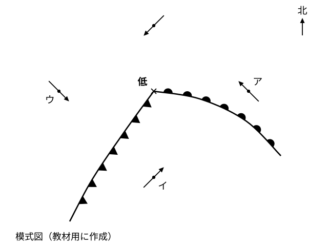
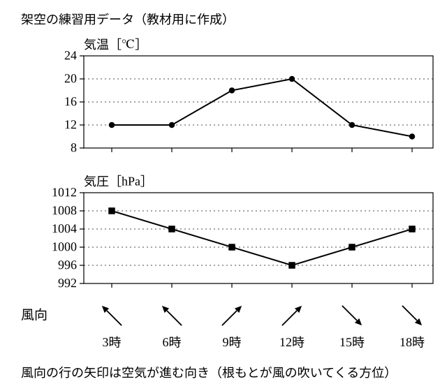

# レッスン6 温帯低気圧と天気の変化——「雨」だけで決めない

- unit_id: jhs-sci-2-atmospheric-movement-japan-weather
- 位置づけ: 子単元 --air-masses-fronts（気団・前線と天気の変化）。親単元の第6レッスン（1.5時間）。子単元「気団・前線と天気の変化」の最終回。レッスン3で名前を学んだ温帯低気圧に、レッスン5の2つの前線がどうついているかを模式図で学び（中心の東側に温暖前線・南西側に寒冷前線・反時計回りに吹きこむ風）、1つの町の時刻ごとの記録（架空）から「どの前線がいつ通過したか」を、雨の有無でなく気温・風向・気圧の変わり方で判定する手順を型にする。子単元の中核。
- distribution_status: published_draft
- license: CC-BY-4.0
- verify_required: V1（模式図・時系列表の値はすべて教材用の架空。実在の日付・地名・観測値ではない）／V4（低気圧に反時計回りに吹きこむ風向はレッスン2の教材内の約束を再訪・確定値としない）／V5（温帯低気圧の前線の配置〔東側に温暖前線・南西側に寒冷前線〕と「低気圧の接近で気圧が下がり、通過後に上がる」は教科書標準・研究の評価項目に依る）／V9（答え方の指示は毎問明示。時刻は表の時刻から選ぶ・風向は8方位）。時刻ごとの記録を読む技能の練習そのものは気象観測の単元の内容であり、本レッスンでは判定の根拠を示す1つの表に限る。全記述は監修者（理科担当）検証必須。
- 主概念: ①温帯低気圧の模式構造（中心から東側へ温暖前線・南西側へ寒冷前線がのび、2つの前線の間に暖気、風は反時計回りに吹きこむ） ②前線の種類と通過した時間帯は「雨が降ったか」でなく「通過の前後で気温・風向・気圧がどう変わったか」で判定する

---

## ここで学ぶこと

レッスン5で、寒冷前線と温暖前線の構造と、通過のときの変化を対にして学びました。今日はまず、この2つの前線が**1つの温帯低気圧**にどうついているかを模式図で見ます。中心から東側へ温暖前線、南西側へ寒冷前線がのび、2つの前線の間に暖気が入りこんでいます。次に、この低気圧が町の近くを通ったときの、時刻ごとの気温・気圧・風向・天気の記録（この教材用の架空の表）を読み、**どの前線が、いつ通過したか**を判定する手順を型にします。ここでいちばん大事なことは、レッスン5で予告したとおり「雨が降ったから寒冷前線が通過した」と決めないこと。判定の根拠は、**通過の前後で気温・風向・気圧がどう変わったか**です。気団と前線の3回（レッスン4〜6）はここで終わり、次のレッスン7からは、大陸と海洋のちがいが生む季節の風へ進みます。

## 温帯低気圧と2つの前線

レッスン3で、日本付近のような温帯でできて西から東へ移動する低気圧を温帯低気圧と呼ぶことを学びました。

> 【ことば】**温帯低気圧** 温帯でできる低気圧。西から東へ移動し、前線をともなうことが多い。北半球では、まわりの風は反時計回りに中心へ吹きこむ（レッスン2）。

> **注意**：下の図1は、この教材用に作った**模式図**（架空）です。北が上で、上空から見おろした向きにかいてあります。低気圧の中心の位置、前線の形、地点ア〜ウの位置はすべて架空で、実際の日付・場所の天気図ではありません。風向の文字と前線の名前は図に入れてありません。

図1の読み方は次のとおりです。

1. 中心から**東側**へのびているのが、半円の記号の前線＝温暖前線です。半円は、線の北側から北東側（前線の外側＝寒気の側）についています。記号は、その前線が相手の空気を押していく側につきます（レッスン5）。低気圧全体が西から東へ動くので、この前線も東へ進みます。
2. 中心から**南西側**へのびているのが、三角の記号の前線＝寒冷前線です。三角は南東側（前線の東側）についているので、この前線も東へ進みます。
3. **2つの前線の間**（中心の南側）は**暖気**です。温暖前線の東側と、寒冷前線の西側、そして中心の北側は**寒気**です。暖気が寒気の中に南からくさびのように入りこんでいる、と見てください。
4. 風は、レッスン2で学んだとおり、中心へ**反時計回り**に吹きこみます。この教材の模式図では、中心の東側の地点では南東の風、南側（2つの前線の間）では南西の風、西側では北西の風、北側では北東の風になるようにかいてあります。

低気圧全体は西から東へ動きます（レッスン3）。だから、低気圧の中心が町の**北**を通るとき、町（中心の南側）では、まず温暖前線が通過して町は暖気に入り、次に寒冷前線が通過して町は寒気にもどります。低気圧が東へ動くので、中心から見た町の位置は東側（図1のアの側）→南側（イ）→西側（ウ）と移り、町から見ると風向は南東→南西→北西と変わっていきます。

:::guide
**中心が北を通るか南を通るかで、町の経験はちがう**

レッスン2で、低気圧の中心が町の南を通るとき、町（中心の北側）では北東の風が吹くことを学びました。図1を見ると、中心の北側は寒気の中で、前線はのびていません。つまり、この模式図の形では、中心が町の南を通るとき、町は前線の通過を経験せず、寒気の中で風向が南東→北東→北西と変わっていくだけです。一方、中心が町の**北**を通るとき、町は中心の南側＝2つの前線の通り道にいます。温暖前線、暖気、寒冷前線の順に経験し、気温は上がってから下がります。天気の変化を考えるときは「低気圧の中心が自分の町のどちら側を通るか」を最初に確かめてください。レッスン2の「町を図に置く」手順が、ここでも最初の一手です。
:::

## 前線の通過を時刻ごとの記録で判定する

低気圧の中心が町の北を通過したとします。町では、時刻ごとに気温・気圧・風向・天気が変わっていきます。下の表1は、この教材用に作った**架空の記録**です。時刻ごとの記録を読む練習そのものは気象観測の単元で行うので、ここでは前線の判定の根拠を1つの表で確かめるだけにします。

> **注意**：表1と図2は、この教材の練習用に作った**架空の記録**です。実在の日付・地名・観測値ではなく、値は判定の手順が見やすいようにきりのよい数にしてあります。この表の形を、実際の天気の変化の速さや大きさの根拠に使わないでください。実際の記録の読み方は教科書で確認してください。

**表1** ある町の1日の記録（架空・低気圧の中心が町の北を通過した日）

| 時刻 | 3時 | 6時 | 9時 | 12時 | 15時 | 18時 |
|---|---|---|---|---|---|---|
| 気温［℃］（架空値） | 12 | 12 | 18 | 20 | 12 | 10 |
| 気圧［hPa］（架空値） | 1008 | 1004 | 1000 | 996 | 1000 | 1004 |
| 風向（8方位） | 南東 | 南東 | 南西 | 南西 | 北西 | 北西 |
| 天気 | 雨（弱い） | 雨（弱い） | くもり | くもり | 雨（強い） | 晴れ |

低気圧が町の近くを通ったことが分かっている記録（表1）で、寒冷前線がいつ通過したかは、次の4段の手順で判定します。

1. **気圧が最も低くなった時刻を見つける**。低気圧が大きく変わらずに動いてくるとき、低気圧が近づくと気圧は下がり続け、中心が最も近づいた頃に最も低くなり、遠ざかると上がり始めます。教科書では、この変化の形をもとに、低気圧が通過したと判定します。
2. **気温が急に下がった時間帯を見つける**。寒冷前線の通過後は町が寒気に入るので、気温が大きく下がります。
3. **風向が南寄りから北寄りへ変わった時間帯を見つける**。寒冷前線の通過後は風向が北寄りに変わります。
4. **2と3が同じ時間帯で起こっていれば、その時間帯が寒冷前線の通過**。1の時刻の直後に来ていれば、低気圧の中心の通過とも合っています（寒冷前線は中心の南西側にのびているので、中心が通ったあとにやって来ます——図1）。

雨の有無はこの手順に入っていないことに注意してください。雨は、判定した後に「寒冷前線の通過なら短時間の強い雨、温暖前線の接近なら長い弱い雨のはず」と**確かめる**ために使います。

:::guide
**手順の順番が大事——「雨」は最後に確かめる材料**

表を見ると「雨」の文字が最初に目に入ります。そこで「雨が降っている時間帯＝寒冷前線の通過」と決めたくなるのですが、これが逆の結論を生みます。たとえば、表の前半の3時と6時に弱い雨が記録されていても、3時と6時の記録をくらべて気温が下がっておらず、風向も南寄りのままなら、この手順ではその時間帯を寒冷前線の通過の候補にしません。レッスン5で学んだ「温暖前線が近づいてくる間の長い弱い雨」の方だと考えられます。逆に、気温が急に下がり、風向が北寄りに変わった時間帯は、その時刻に雨の記録がなくても寒冷前線の通過の候補になります。**雨から判定を始めると逆の結論になりやすい**——だから手順では雨を最後に回して「判定が合っていれば降り方もこうなるはず」と確かめる材料にします。
:::

:::guide
**気圧の「谷」の読み方——下がり続けてから上がり始める所**

表1の気圧の行を左から右へたどると、下がり続けて、ある時刻で最も低くなり、そこから上がり始めています。折れ線にすると谷のような形です。低気圧は「まわりより気圧が低い所」でしたから、低気圧の中心が町に近づくほど町の気圧は下がり、最も近づいた頃に最も低くなり、遠ざかると上がる——この形は、低気圧の強さが大きく変わらずに動いたとき、町の近くを通ったことのしるしです。ただし、谷の底の時刻が「前線の通過した時間帯」そのものではありません。前線の通過は、気温と風向の変化で決めます。気圧の谷は「低気圧が通った」ことを、気温・風向の変化は「どの前線がいつ通ったか」を教える、と役割を分けておきましょう。
:::

## 例題

**例題1**　図1の地点イ（2つの前線の間）は、暖気と寒気のどちらの中にあるか。また、地点イの風向を8方位で答えなさい。

**考え方**　①地点イは温暖前線と寒冷前線の間＝中心の南側。ここは暖気がくさびのように入りこんでいる所。②中心の南側の風は、反時計回りに吹きこむ風の約束（レッスン2）から南西の風。→ **暖気。風向は南西の風**

**例題2**　表1で、寒冷前線が通過したのは何時と何時の間か。本文の4段の手順にしたがい、手順1〜3で見つけた時刻を示して答えなさい。

**考え方**　①気圧が最も低いのは12時（996hPa）。その後は15時に1000hPa、18時に1004hPaと上がっている。②気温が急に下がったのは12時（20℃）→15時（12℃）の間。③風向が南寄り（南西）から北寄り（北西）へ変わったのも12時→15時の間。④②と③が同じ時間帯で、①の直後。→ **12時から15時の間**（雨の確かめ: 15時に強い雨が記録され、18時にはやんで晴れている——次の記録までに終わった強い雨で、寒冷前線の特徴と合っている）

## 読み取りのコツ

- **判定は気温・風向・気圧の3行から、雨の行は最後**。「雨（強い）」「雨（弱い）」の文字から目に入りますが、判定の根拠にするのは変化の向きです。
- **寒冷前線は下がる・北寄り、温暖前線は上がる・南寄り**。気温の向きと風向の寄りが対になります。片方だけ合っていて他方が合わないときは、読みまちがいか、前線以外の原因を疑います。片方の行が記録されていないときは、残りの行だけで時間帯が1つに決まるかを考えます。温暖前線では、通過の前も後も南寄り（南東→南西）のことがあります。このときは風向だけでは決めきれないので、気温の上がり方を先に見ます。
- **前線の通過は時刻と時刻の間で答える**。表は3時間ごとの記録なので「12時から15時の間」のように答えます。「12時に通過した」と1つの時刻に決めることはできません。
- **中心が北を通るか南を通るかを最初に確かめる**。図1の模式図の形では、町が中心の南側にいなければ、前線の通過そのものを経験しません。

## 練習問題

以下すべて、上の図1・表1・図2（この教材用の**架空の模式図・架空の記録**）を使うこと。時刻は表1にある時刻から選び、時間帯は「〇時から〇時の間」の形で答えること。風向は8方位で答えること。

1. 図1で、温暖前線と寒冷前線は、それぞれ低気圧の中心から見てどの側へのびているか。「東側・西側・南西側・北側」の中から選んで答えなさい。また、暖気があるのは「2つの前線の間」と「中心の北側」のどちらか答えなさい。
2. 表1で、気圧が最も低いのは何時か。また、その時刻の前と後で、気圧はそれぞれ「下がっている」「上がっている」のどちらか答えなさい。
3. 図1の低気圧の中心が町の北を通過するとき、町では2つの前線をどの順で経験するか。また、そのとき町の風向は、温暖前線の通過前→2つの前線の間→寒冷前線の通過後の順に、8方位でどう変わるか答えなさい。
4. ある生徒が表1を見て「3時と6時に雨が降っているから、この間に寒冷前線が通過した」と言った。どこがまちがっているか、3時→6時の気温と風向の変化を根拠にして一文で指摘しなさい。また、この雨はレッスン5で学んだどの前線に関係する雨だと考えられるか答えなさい。
5. （転移問題＝学んだことを新しい場面に使う問題。答えだけでなく根拠を書くこと）本文の4段の手順は寒冷前線のためのものだった。手順2を「気温が急に上がった時間帯」と読みかえ、手順3を「風向が変わって、通過後に南寄りの風になった時間帯」と読みかえて（手順4は「2と3が同じ時間帯で起こっていれば、その時間帯が温暖前線の通過。温暖前線は低気圧の中心より先に来るので、1の時刻の前に来ていれば合っている」と読みかえる）、表1で温暖前線が通過したのは何時と何時の間かを判定し、根拠にした気温と風向の変化を一文で書きなさい。

:::stretch
**S1** 表1の風向の行が記録されていなかったとする。気温・気圧・天気の3行だけで、寒冷前線の通過した時間帯を判定できるか。「できる／できない」で答え、できるなら決め手になる行と、その行のどの変化を根拠にするかを一文で書きなさい。
:::

:::zatsudan
小学5年生のとき、台風が近づくと天気がどう変わるかを学びました。あのときは雲の動きと天気を結びつけて考えましたが、今日の表1のように気温・気圧・風向をならべて読むと、天気の変化の「なぜ」がもう一段くわしく見えてきます。台風の進む道すじが夏から秋にかけて変わっていくことは、レッスン10で日本付近の気団の発達と衰退（すいたい）に結びつけて学びます。「何が近づいていて、いま何が通過しているか」で天気の変化を考える目は、低気圧でも台風でも同じです。
:::
<!-- zatsudan話題源: 雑談枠許可リストZ8（中学校学習指導要領（平成29年告示）解説 理科編 p.96「台風の進路が夏から秋にかけて変化していることに気付かせ」および小学校第5学年の既習「台風による天気の変化」・確認範囲内）。出典の確認範囲内の事実のみ使用・数値なし。災害の話題は置いていない -->

<!-- gen_nav:nav:start（自動生成・手編集しない） -->

---

[← 前のレッスン](lesson_05.md)｜[単元の目次](README.md)｜[解答](answer_key_L04-06.md)｜[次のレッスン →](lesson_07.md)

<!-- gen_nav:nav:end -->
