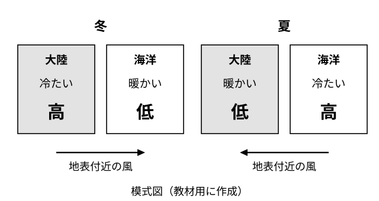

# レッスン7 季節風と海洋の影響——大陸と海はどちらが早く温まるか

- unit_id: jhs-sci-2-atmospheric-movement-japan-weather
- 位置づけ: 子単元 --japan-seasons（日本の季節の天気）。親単元の第7レッスン（1時間）。子単元「日本の季節の天気」の第1回。日本の季節ごとの天気を考える土台として、大陸と海洋の温まり方のちがいが温度差を生み、温度差が気圧差を生み、気圧差が風（季節風）を生む、という3段のしくみを学ぶ。日本がユーラシア大陸の東岸にあり、海洋の影響を大きく受ける場所であることにも触れる。レッスン8（冬）・レッスン10（夏）で、この3段が季節ごとの気圧配置として現れる。
- distribution_status: published_draft
- license: CC-BY-4.0
- verify_required: V1（図の配置・ラベルはすべて教材用の架空・模式）／V2（「海陸風」は教科書側の語。本文は「教科書では〜と呼びます」の水準で太字なし。太字導入の可否は監修判断）／V4（冬の季節風は北西・夏は南東という向きは監修で確認。本教材では「大陸から海へ」「海から大陸へ」を日本から見た8方位に直した言い方で扱う）／V9（風向は8方位で答える指示を毎問明示）。「陸は海より温まりやすく冷めやすい」「冷やされた空気は重くなり地表付近の気圧が高くなる」は学習指導要領解説に明文がなく教科書標準の説明であり、監修確認対象。全記述は監修者（理科担当）検証必須。
- 主概念: ①陸は海より温まりやすく冷めやすい→大陸と海洋の温度差→気圧差→風。冬は大陸から海へ、夏は海から大陸へ吹く季節風 ②日本はユーラシア大陸の東岸にあり、大陸の影響を受けながらも海洋の影響を大きく受ける

---

## ここで学ぶこと

レッスン1〜6では、気圧の高低が風を生むこと、移動性高気圧や温帯低気圧が西から東へ動くこと、暖気と寒気の境に前線ができることを学びました。今日からの4回は、これらを使って**日本の季節ごとの天気**を考えます。その土台として、今日は**季節風**のしくみを学びます。いちばん大事なことは、季節風を「冬は北西、夏は南東」という型名（決まり文句）**だけで覚えない**ことです。季節風には、はっきりした3段のしくみがあります。①大陸と海洋では温まり方・冷え方がちがうので、季節によって温度差ができる。②温度差があると、地表付近の気圧に差ができる。③風は気圧の高い方から低い方へ吹く（レッスン2）。この3段を自分の言葉で言えるようになることが今日のゴールです。あわせて、日本がユーラシア大陸の**東岸**にあるという位置が、日本の天気にどう関わるかを知ります。次のレッスン8では、この3段が冬の天気にどう現れるかを見ます。

## 大陸と海洋——温まりやすさのちがい

同じ太陽の光を受けても、陸（大陸）と海（海洋）では温まり方がちがいます。教科書では、**陸は海より温まりやすく、冷めやすい**、と説明されます。つまり、夏には大陸の方が海洋より暖かくなり、冬には大陸の方が海洋より冷たくなります。海洋は温まりにくく冷めにくいので、季節による温度の変化が大陸よりゆるやかです。

> 【ことば】**季節風** 季節によって決まった向きに吹く風。大陸と海洋の温度差が生む気圧差によって起こり、日本付近では冬は大陸から海へ、夏は海から大陸へ吹く。

## 温度差が気圧差を生む——3段のしくみ

温度差があると、なぜ気圧差ができるのでしょうか。レッスン4で「出会った寒気と暖気を同じ体積でくらべると冷たい空気の方が重い」と学びました。教科書では、次のように説明されます。

- **冷やされた側**では、地表付近の空気が冷えて重くなり、上から空気が降りてくる（下降気流）。上空ではまわりから空気が集まり、出ていく分より入ってくる分が多くなって、その場所の上にある空気の量が増える（レッスン1の柱の考え方）ので、地表付近の気圧は**高く**なる。
- **温められた側**では、地表付近の空気が暖められて軽くなり、上へ向かう（上昇気流）。上空ではまわりへ空気が流れ出て、入ってくる分より出ていく分が多くなって、その場所の上にある空気の量が減るので、地表付近の気圧は**低く**なる。

レッスン2で、高気圧の中心付近では下降気流、低気圧の中心付近では上昇気流になりやすいことを学びましたが、これと同じ組み合わせです。そして風は、気圧の高い方から低い方へ吹きます（レッスン2）。まとめると、季節風のしくみは次の3段です。

1. **温度差**: 陸は海より温まりやすく冷めやすいので、冬は大陸が海洋より冷たく、夏は大陸が海洋より暖かい。
2. **気圧差**: 冷たい側（冬は大陸）の地表付近は気圧が高く、暖かい側（冬は海洋）は気圧が低い。夏はこの逆。
3. **風**: 風は気圧の高い方から低い方へ吹くので、冬は大陸から海へ、夏は海から大陸へ吹く。

> **注意**：下の図1は、この教材用に作った**模式図**です。左の四角を大陸、右の四角を海洋として、温度と気圧の高低と風の向きを表しています。実際の地図ではなく、8方位もかいてありません。温度や気圧の具体的な値は表していません。

図1の読み方は次のとおりです。

1. 左のパネルが**冬**、右のパネルが**夏**です。それぞれ、左の四角が大陸、右の四角が海洋を表します。
2. 各四角の中に、温度のようす（「冷たい」「暖かい」）と、地表付近の気圧の高低（「高」「低」）が書いてあります。「冷たい」「暖かい」は、大陸と海洋を**くらべたとき**の言い方です。
3. 矢印は、地表付近の風の向きです。気圧の「高」から「低」へ向かっていることを確かめてください。冬は大陸→海洋、夏は海洋→大陸です。

:::guide
**型名の「冬は北西・夏は南東」を暗記しない——3段で組み立てる**

季節風を「冬は北西の風、夏は南東の風」と型名だけで覚えると「なぜそうなるのか」を聞かれたときに答えられません。また、暗記だけだと冬と夏を入れかえて覚えてしまうことも起こります。おすすめは、答えを覚えるのではなく、3段を**毎回組み立てる**ことです。「いまは冬。陸は冷めやすいから大陸が冷たい。冷たい側は気圧が高い。風は高い方から低い方へだから、大陸から海へ」——ここまで言えれば、あとは「大陸から海へ」を8方位に直すだけです。組み立ての出発点は、いつも「陸は海より温まりやすく冷めやすい」の1行です。この1行から先が、レッスン2の「気圧の高い方から低い方へ」につながっていることを確かめてください。
:::

## 「大陸から海へ」を日本の風向に直す

日本付近の季節風を8方位で言うには、日本から見て大陸と海洋がどの方位にあるかを使います。日本は**ユーラシア大陸の東岸**にあり、大陸は日本から見て**北西**の方向に、太平洋は**南東**の方向に広がっています。風向は「吹いてくる方位」で言う約束（レッスン2）ですから、

- 冬の季節風は、大陸（北西）から海へ吹く風＝**北西の風**。
- 夏の季節風は、海（南東）から大陸へ吹く風＝**南東の風**。

となります。教科書では、冬の季節風は北西、夏の季節風は南東、と説明されます。この教材でも、季節風の向きはこの言い方で扱います。

:::guide
**風向は「向かう先」ではなく「吹いてくる方位」で言う**

冬の季節風は大陸から海へ、つまり日本付近では北西から南東へ向かって吹きます。これを「南東へ向かうから南東の風」と言ってしまうと、レッスン2・3で確かめた約束と逆になります。風向は**吹いてくる方位**です。大陸は日本から見て北西にあるので、大陸から吹いてくる風は北西の風。夏は海（南東）から吹いてくるので南東の風。「風はどこ**から**来たか」を先に言う——レッスン3の偏西風（西から東へ吹く＝西の風）で使った区別と同じです。
:::

## 日本の位置——大陸の影響と海洋の影響

日本がユーラシア大陸の東岸にあることは、季節風の向きを決めるだけではありません。冬に大陸から吹いてくる冷たい風は、日本に届くまでに**日本海**の上を渡ります。夏に海から吹いてくる風は、太平洋の上で水蒸気を多く含んでいます。つまり日本の天気は、大陸の影響を受けながらも、そのあいだにある**海洋の影響**を大きく受けています。レッスン4の発展問題S1で考えた「海の上を進む気団は海から水蒸気を受け取る」という考え方が、レッスン8で冬の日本海側の雪を考えるときにそのまま使われます。

:::guide
**1日の中でも同じことが起こる——教科書でいう海陸風**

季節風は「1年の中で大陸と海洋の温度差が入れかわる」ことで起こる風でした。教科書では、これと同じしくみが**1日の中**でも海岸付近で起こる、と説明され、その風を海陸風（かいりくふう）と呼びます。「温度差→気圧差→風」の3段は、期間が1年でも1日でも同じです。学校では、海と陸に見立てたものを温めて空気の動きを見るモデル実験で、このしくみを確かめることがありますが、この教材では手順は扱わず、3段の組み立てだけを練習します（発展問題S1で、この1日版を考えます）。
:::

## 例題

**例題1**　図1の冬のパネルで、大陸と海洋のどちらの地表付近の気圧が高いか。また、そうなる理由を「冷めやすい」という言葉を使って一文で書きなさい。

**考え方**　①冬は、陸（大陸）が海より冷めやすいので、大陸の方が海洋より冷たい。②冷たい側の地表付近では空気が重くなって気圧が高くなる。→ **大陸。陸は海より冷めやすいので、冬は大陸の方が冷たくなり、冷たい側の地表付近の気圧が高くなるから**

**例題2**　冬の季節風の風向を8方位で答えなさい。また、その方位になる理由を「大陸」「吹いてくる」の2つの言葉を使って一文で書きなさい。

**考え方**　①冬の季節風は大陸から海へ吹く（例題1の気圧差から、高い大陸→低い海洋）。②日本から見て大陸は北西にある。③風向は吹いてくる方位で言う。→ **北西の風。冬の季節風は日本から見て北西にある大陸から吹いてくる風だから**

## 読み取りのコツ

- **3段の順番を守る**: 温度差→気圧差→風。「風が吹くから気圧が下がる」のように逆向きに言わないこと。出発点はいつも「陸は海より温まりやすく冷めやすい」です。
- **図1の「冷たい」「暖かい」はくらべた言い方**。冬の海洋を「暖かい」と書いてあるのは、同じ冬の大陸とくらべて、という意味です。海が夏のように暖かいという意味ではありません。
- **大陸と海洋をくらべて、冷たい側が高気圧、暖かい側が低気圧**（季節風の3段のモデルの中での言い方です）。レッスン4の「冷たい空気は重い」と、レッスン2の「高気圧の中心付近では下降気流、低気圧の中心付近では上昇気流」を結び付けて覚えます（レッスン2では高気圧・低気圧の側から、ここでは冷えた空気・温められた空気の側から、同じ組み合わせを言っています）。
- **8方位に直すときは日本の位置から**。大陸は北西、太平洋は南東。「大陸から海へ」＝北西の風。「海から大陸へ」＝南東の風。

## 練習問題

以下すべて、上の図1（この教材用の**架空の模式図**）と本文の3段のしくみを使うこと。風向は8方位で答えること。

1. 図1の夏のパネルで、大陸と海洋のどちらの地表付近の気圧が高いか答えなさい。また、風は「大陸から海洋へ」「海洋から大陸へ」のどちらに吹くか答えなさい。
2. 夏の季節風の風向を8方位で答えなさい。また、日本から見て海（太平洋）がどの方位にあるかを根拠として一文で書きなさい。
3. ある生徒が「冬の季節風は、海が冷たいから、海から吹いてくる」と言った。どこがまちがっているか「冷めやすい」「大陸」の2つの言葉を使って一文で指摘しなさい。
4. 冬の季節風が北西から吹く理由を、次の3段の順に、各段一文ずつ、合計三文で書きなさい。①温度差（「温まりやすく冷めやすい」を使う）、②気圧差（「気圧」を使う）、③風（「高い方から低い方へ」を使い、日本から見た大陸の方位も入れる）。
5. もし大陸と海洋の温まりやすさに差がなく、季節が変わっても大陸と海洋の温度差ができないとしたら、季節風はどうなると考えられるか。「気圧差」という言葉を使って一文で書きなさい。

:::stretch
**S1** 海岸に住む人が、よく晴れた日の昼に、海から陸へ向かって風が吹くことに気付いたとする。この風が吹くしくみを、本文の3段（温度差→気圧差→風）にそって「温まりやすい」「気圧」の2つの言葉を使って二文以内で書きなさい。また、同じ日の夜には風の向きがどうなると考えられるかを「陸から海へ」「海から陸へ」のどちらかで答えなさい。（教科書ではこのような風を海陸風と呼びます。季節風と同じしくみが1日の中で起こる例です。）
:::

:::zatsudan
日本はユーラシア大陸の東のはしにあります。地図で見ると、北西には大きな大陸、南東には広い太平洋。この位置のおかげで、日本の天気は大陸の影響と海洋の影響の両方を受けます。冬に大陸から吹いてくる風も、夏に海から吹いてくる風も、日本に届く前に海の上を通る——だから日本の季節の天気を考えるときは、いつも「大陸と海洋のどちらの影響が強く出ているか」を問いにすると見通しがよくなります。レッスン8からの3回は、この問いを季節ごとに立てていきます。
:::
<!-- zatsudan話題源: 雑談枠許可リストZ2（中学校学習指導要領（平成29年告示）解説 理科編 p.97「日本がユーラシア大陸の東岸に位置するために，日本付近の気象は大陸の影響を受けながらも海洋の影響を大きく受けている」・確認範囲内。冬と夏の風が日本に届く前に海の上を通るという文は本文「日本の位置」節の再掲で、出典の確認文の外）。出典で確認した事項と本文からの再掲（確認文の外）を区別して使用・数値なし -->

<!-- gen_nav:nav:start（自動生成・手編集しない） -->

---

[← 前のレッスン](lesson_06.md)｜[単元の目次](README.md)｜[解答](answer_key_L07-10.md)｜[次のレッスン →](lesson_08.md)

<!-- gen_nav:nav:end -->
