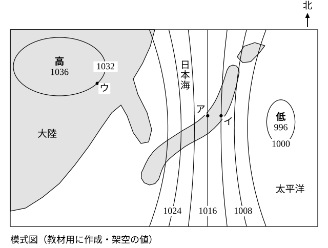
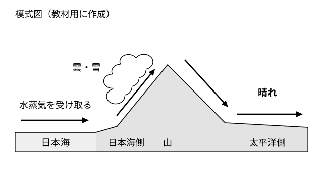

# レッスン8 冬の天気——シベリア気団と日本海側の雪

- unit_id: jhs-sci-2-atmospheric-movement-japan-weather
- 位置づけ: 子単元 --japan-seasons（日本の季節の天気）。親単元の第8レッスン（1時間）。子単元「日本の季節の天気」の第2回。レッスン7の3段（温度差→気圧差→風）が冬にどう現れるかを、シベリア気団の発達→大陸の高気圧と海洋上の低気圧→北西の季節風、という順で学ぶ。次に、乾いた冷たい風が日本海を渡る間に水蒸気を得て日本海側に雪を降らせ、山を越えた太平洋側では乾いた晴れになる、という海洋の影響を断面図で学ぶ。型名「西高東低」は最後に添える。
- distribution_status: published_draft
- license: CC-BY-4.0
- verify_required: V1（模式天気図・気圧値・地点・断面図はすべて教材用の架空。実在の日付・地名・観測値ではない）／V2（「シベリア高気圧」「西高東低」は教科書側の語。本文は「教科書では〜と呼びます」の水準で太字なし。太字導入の可否は監修判断）／V3（シベリア気団＝寒冷で乾燥、は学習指導要領解説の例示に依るが、固有値として確定扱いしない）／V4（低気圧の西側・高気圧の東側で北西の風、という読みはレッスン2の教材内の約束に依る。冬の季節風が北西である向きは監修で確認）／V9（気圧は整数hPa・風向は8方位で答える指示を毎問明示）。「山にぶつかって上昇した空気から雪が降り、山を越えた空気は乾いている」の説明は教科書標準・監修確認対象。全記述は監修者（理科担当）検証必須。
- 主概念: ①シベリア気団（冷たく乾いた気団）の発達→大陸に高気圧・海洋上に低気圧→北西の季節風（型名「西高東低」は機構の後に添える） ②乾いた冷たい風が日本海を渡る間に水蒸気を得て日本海側に雪、山を越えた太平洋側は乾いた晴れ

---

## ここで学ぶこと

レッスン7で、季節風の3段（温度差→気圧差→風）を学びました。今日はこの3段を**冬**に当てて、日本の冬の天気を組み立てます。冬、大陸の内部（シベリア）は強く冷え、そこに**シベリア気団**が発達します（気団が「発達する」とは、勢いを増して広がることです）。すると大陸に高気圧、日本の東の海洋上に低気圧という配置になり、大陸から海へ、日本付近では**北西の季節風**が吹きます。ここまでが前半。後半は、この風が日本海を渡る間に起こることです。もともと乾いていた冷たい風が、日本海の上で水蒸気を受け取り、日本の山にぶつかって**日本海側に雪**を降らせ、山を越えた**太平洋側では乾いた晴れ**になる。冬の日本で、日本海側と太平洋側の天気がまるでちがうのは、この**海洋の影響**のためです。今日のゴールは、模式天気図を見て「これは冬の配置だ」と根拠つきで言えること、そして日本海側と太平洋側の天気のちがいを「水蒸気」の言葉で説明できることです。次のレッスン9では、春・秋と梅雨（つゆ）へ進みます。

## シベリア気団の発達と冬の気圧配置

レッスン4で、気団の性質は「北の方か南の方か」「海の上か陸の上か」の2つの軸で決まることを学びました。冬、日本の北西にあるユーラシア大陸の内部（シベリア）は、北の方にあること（レッスン4の気温の軸）に、陸が冷めやすいこと（レッスン7）が重なって、強く冷えます。ここで発達する気団がシベリア気団です。

> 【ことば】**シベリア気団** 冬に大陸（シベリア）で形成される気団。北の方の陸の上でできるので、**冷たく乾いた**気団である。シベリア気団の発達と冬の天気は密接に関わっている。

シベリア気団が発達すると、レッスン7の3段のとおり、冷えた大陸の地表付近の気圧は高くなり、大陸に大きな高気圧ができます（教科書では、この高気圧をシベリア高気圧と呼びます。気団は性質〔ここでは冷たく乾いた〕がほぼそろった大きな空気のかたまりの名前、高気圧はまわりより気圧の高い所の名前で、同じ場所に重なってできます）。一方、日本の東の海洋上は大陸より暖かいので、大陸とくらべて気圧が低くなります。大陸の高気圧に対して、海洋上は低気圧となります（冬に典型的な配置では、日本の東の海洋上に低気圧があります）。この配置では、風は大陸の高気圧から海洋上の低気圧へ向かって吹き、日本付近では北西の季節風になります。

> **注意**：下の図1は、この教材の練習用に作った**模式天気図**（架空）です。北が上です。等圧線の値、高気圧・低気圧の中心の位置、地点ア〜ウの位置はすべて架空で、日本列島も簡略な形でかいてあります。実際の日付の天気図ではありません。風向の矢印と季節の名前は図に入れてありません。

図1の読み方は次のとおりです。

1. 図の**左上（北西）の大陸**に高気圧の中心があり、中心の値は1036hPaです。図の**右（東）の海洋上**に低気圧の中心があり、中心の値は996hPaです。
2. 等圧線は4hPaごとで、数字は1032・1024・1016・1008・1000の線に書いてあります。数字のない線は、両どなりの線から値を読みます。
3. 等圧線が**たての向きに何本もならんでいる**のが、この配置の特徴です。日本列島はその等圧線のあいだにあります。レッスン2で学んだとおり、等圧線の間隔が狭いほど風は強く吹きます。
4. 地点アは日本海側の町、地点イは太平洋側の町、地点ウは大陸上の地点です。

図1で、日本付近の風向を考えてみましょう。日本は、低気圧の中心から見て**西側**、高気圧の中心から見て**東側**にあります。レッスン2の吹き方では、低気圧の西側の風向は北西、高気圧の東側の風向も北西です。どちらの中心から考えても北西の風になり、レッスン7で組み立てた「大陸から海へ＝北西の風」と一致します。

このように、**大陸（西）に高気圧、海洋上（東）に低気圧**という冬の配置を、教科書では「西高東低」の気圧配置と呼びます。型名は便利ですが、名前の前に「シベリア気団が発達して大陸に高気圧、海洋上に低気圧」というしくみを言えるようにしておいてください。

:::guide
**型名は最後——「西高東低」の前に言うべきこと**

「冬の気圧配置は？」と聞かれて「西高東低」と答えられる人は多いのですが「なぜ西が高くて東が低いのか」を聞かれると止まってしまうことがあります。型名は、しくみを言い終えたあとの**あだ名**のようなものです。答える順番を決めておきましょう。①冬は大陸が冷える（陸は冷めやすい・北の方）。②シベリア気団が発達し、冷えた大陸の地表付近は気圧が高くなって高気圧。海洋上は大陸とくらべて気圧が低く、大陸の高気圧に対して低気圧となる（冬に典型的な配置では、日本の東の海洋上に低気圧がある）。③風は高い方から低い方へ、大陸から海へ、日本付近では北西の季節風。④この配置を教科書では西高東低と呼ぶ。④だけを覚えても、①〜③が抜けていれば、模式天気図の季節判定や「なぜ」の問題に答えられません。
:::

:::guide
**等圧線がたてに何本も——冬の図の見分け方**

図1の見た目の特徴は、等圧線が**たてじま**のように何本もならんでいることです。レッスン1・2の模式天気図では、高気圧と低気圧のまわりに閉じた等圧線が同心円のようにかかれていました。冬の配置では、大陸の大きな高気圧と海洋上の低気圧のあいだに気圧の差が大きくかかるので、そのあいだの等圧線がたてに、せまい間隔でならびます。間隔がせまいということは（レッスン2）、風が強いということです。模式天気図を見て季節を判定するときは、①高気圧と低気圧が「大陸と海洋上のどちらにあるか」と、②等圧線が「たてじまか、閉じた形か、横にのびた前線があるか」の2点を見ます。この見分け方は、レッスン9・10でほかの季節の図を見るときも同じ手順で使います。
:::

## 日本海を渡る風——日本海側の雪と太平洋側の晴れ

シベリア気団は冷たく乾いた気団でした。ところが、冬の日本海側にはたくさんの雪が降ります。乾いた気団からなぜ雪が降るのでしょうか。

かぎは**日本海**です。レッスン4の発展問題で「北の方の陸の上でできた冷たく乾いた気団が、暖かい海の上を長い距離進むと、海から水蒸気を受け取って湿った方へ変わる」と考えました。冬の北西の季節風は、まさにこの道すじをたどります。

1. 大陸を出たときの風は**冷たく乾いた**空気である。
2. 日本海の上を渡る間に、大陸の空気より暖かい海面から**水蒸気を受け取り**、湿った空気になる。
3. 湿った空気が日本の山にぶつかって**上昇**すると、温度が下がって飽和水蒸気量が小さくなり（湿度の単元）、含みきれない水蒸気が雲になり、冬は雪として日本海側に降る。
4. 山を越えた空気は、雪として水蒸気を落としてきたので**乾いており**、山を下る側（太平洋側）では雲ができにくく、乾いた晴れの天気になる。

> **注意**：下の図2は、この教材用に作った**模式図**（断面）です。左が日本海、中央が日本の山、右が太平洋側で、山の高さや雲の大きさは見やすいように誇張してあり、実際の地形や高さの比率を表すものではありません。

図2では、左から右へ進む風の矢印が、日本海の上で「水蒸気を受け取る」→山の日本海側で「雲・雪」→山を越えて太平洋側で「晴れ」と変わっていくようすを表しています。同じ1つの風が、海洋の影響を受けて日本海側と太平洋側でまったくちがう天気をもたらすのです。

:::guide
**乾いた気団なのに雪、というなぞは2つの軸の「変化」で解く**

「シベリア気団は乾いている」と「日本海側は雪が多い」は、どちらも正しい知識です。この2つが頭の中でぶつかると「乾いているなら雪は降らないはず」と、どちらかを疑いたくなります。解決のかぎは、気団の性質は**出発したときの性質**であり、気団から吹き出した風（空気）が進む間に水蒸気の軸が**変わる**ことです。気温の軸は「冷たい」のまま、水蒸気の軸が「乾いた」から「湿った」へ動く——日本海という「海の上」を通ったからです。レッスン4で「気団の性質は2つの軸で言う」と決めたのは、こういう場面で「どちらの軸が変わったか」を言えるようにするためでした。そして山を越えると、水蒸気の軸はまた「乾いた」へもどります。1つの風の水蒸気の軸が、乾いた→湿った→乾いた、と2回変わる。これが冬の日本の天気の骨組みです。
:::

## 例題

**例題1**　図1で、地点ア（日本海側の町）の風向を8方位で答えなさい。低気圧の中心と高気圧の中心のどちらから考えたかも書きなさい。

**考え方**　①地点アは、低気圧の中心（図の右）から見て西側にある。レッスン2の吹き方より、低気圧の西側の風向は北西。②高気圧の中心（図の左上）から見ると、地点アは東側にある。高気圧の東側の風向も北西。③どちらから考えても一致。→ **北西の風**（低気圧の中心から考えた。高気圧の中心から考えても同じ）

**例題2**　冬に日本海側で雪が多く降る理由を「日本海」「水蒸気」の2つの言葉を使って一文で書きなさい。

**考え方**　①大陸を出たときの風は冷たく乾いている。②日本海の上を渡る間に水蒸気を受け取って湿る。③山にぶつかって上昇し、雲・雪になる。→ **大陸から吹く冷たく乾いた風が日本海の上を渡る間に水蒸気を受け取って湿り、日本の山にぶつかって上昇するときに雲ができて雪が降るから**

## 読み取りのコツ

- **季節判定は「どこに高・低があるか」から**。大陸に高気圧、海洋上に低気圧、等圧線がたてじま——この3点がそろえば冬の配置です。型名（西高東低）はその後に。
- **風向は2つの中心の両方から確かめる**（レッスン3のコツ）。低気圧の西側＝北西、高気圧の東側＝北西。一致すれば読みまちがいに気づく手がかりになりますが、一致は確かめの補助です（回る向きを両方とも逆に覚えていたり、矢先を読んでいたりすると、同じまちがいで一致します。町の位置・回る向き・吹いてくる方位〔根もとの側〕を、それぞれ確かめます）。
- **日本海側と太平洋側は1つの風の前半と後半**。同じ風が、水蒸気を受け取る前（乾いた）→受け取った後（湿った・雪）→落とした後（乾いた・晴れ）と変わります。2つの地域を別々の天気として覚えるのではなく、風の道すじの順で言います。
- **気圧は等圧線の値を整数hPaで読む**。数字のない線は両どなりの線から4hPaきざみで求めます。

## 練習問題

以下すべて、上の図1・図2（この教材用の**架空の模式天気図・模式図**）と本文のしくみを使うこと。気圧は整数hPaで、風向は8方位で答えること。

1. 図1で、高気圧の中心と低気圧の中心は、それぞれ「大陸上」「海洋上」のどちらにあるか答えなさい。また、この配置のときに日本付近に吹く季節風の風向を8方位で答えなさい。
2. 図1の配置が冬のものと考えられる理由を「大陸」「高気圧」の2つの言葉を使って一文で書きなさい。
3. 図2で、日本海側で雪が降る理由と、太平洋側で晴れる理由を、それぞれ「水蒸気」という言葉を使って一文ずつ、合計二文で書きなさい。
4. ある生徒が「シベリア気団は乾いた気団だから、シベリア気団の風が吹く日本海側に雪は降らないはずだ」と言った。どこがまちがっているか「日本海」「水蒸気」の2つの言葉を使って一文で指摘しなさい。
5. 図1で、地点ウ（大陸上）と地点ア（日本海側の町）と地点イ（太平洋側の町）の気圧を、それぞれ整数hPaで読み取りなさい。また、地点ウと地点アの気圧の差を整数hPaで求めなさい。

:::stretch
**S1** もし日本と大陸のあいだに日本海がなく、大陸と日本が陸続きだったとしたら、冬の日本海側の雪はどうなると考えられるか。「多くなる／少なくなる」のどちらかで答え、理由を「水蒸気」という言葉を使って一文で書きなさい。（実際の冬の風向は「アメダス 風向 天気図」などの言葉で気象庁のページを探し、全国の風向と天気図を見くらべると確かめられます。この教材には実際のデータを転載していません。）
:::

:::zatsudan
気象庁には、全国の地域の気象の情報を集めるしくみがあり、アメダス（地域気象観測システム）と呼ばれています。冬の日に全国の風向をながめると、日本海側の多くの地点で北西寄りの風がならんでいる日があり、同じ日の天気図を横に置くと、大陸の高気圧と海洋上の低気圧の配置が見えてきます。自分の町の空だけを見ていては分からない「広い範囲の風のそろい方」が、こういう地域の観測データを加えると見えてくる——これが、天気図と観測データをならべて考える面白さです。
:::
<!-- zatsudan話題源: 雑談枠許可リストZ7（中学校学習指導要領（平成29年告示）解説 理科編 p.94「アメダス（地域気象観測システム）」の地域の気象情報を自分の観測に加えて考えること、および p.97「全国のアメダスのデータと天気図や気象衛星画像などを用いて，冬に北西の季節風が顕著なのは…」・確認範囲内）。出典の確認範囲内の事実のみ使用・数値なし・実データの転載なし -->

<!-- gen_nav:nav:start（自動生成・手編集しない） -->

---

[← 前のレッスン](lesson_07.md)｜[単元の目次](README.md)｜[解答](answer_key_L07-10.md)｜[次のレッスン →](lesson_09.md)

<!-- gen_nav:nav:end -->
