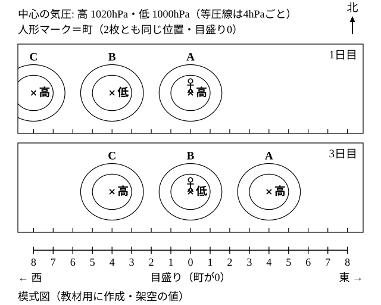
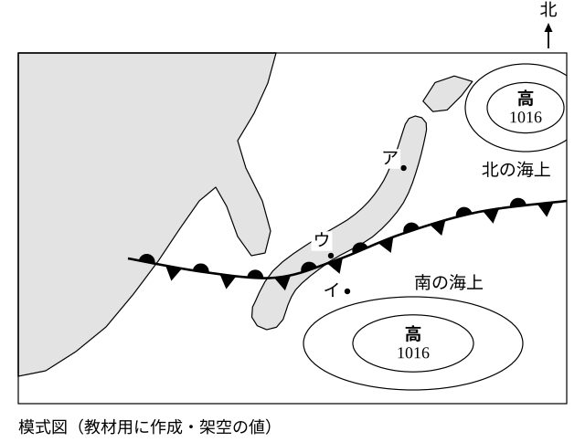

# レッスン9 春と秋・梅雨の天気——動く高気圧と動かない前線

- unit_id: jhs-sci-2-atmospheric-movement-japan-weather
- 位置づけ: 子単元 --japan-seasons（日本の季節の天気）。親単元の第9レッスン（1.5時間）。子単元「日本の季節の天気」の第3回。前半は、春・秋に移動性高気圧と温帯低気圧が交互に西から東へ通過し、天気が数日の周期で変わることを、連続模式天気図から読む（レッスン3の再訪）。後半は、性質のちがう2つの気団の勢力がつり合い、境の前線が動かずにとどまる時期（教科書では梅雨）を、模式天気図と気団の2つの軸で学ぶ。「動く高気圧」と「動かない前線」の対比が軸。
- distribution_status: published_draft
- license: CC-BY-4.0
- verify_required: V1（連続模式天気図・目盛り・気圧値・前線の位置・地点はすべて教材用の架空）／V2（「梅雨」「停滞前線」「オホーツク海気団」は学習指導要領解説に無い教科書側の語。本文は「教科書では〜と呼びます」の水準で太字なし。太字導入の可否と、梅雨・停滞前線を本レッスンに置く採否は監修判断）／V3（北の海上の気団＝冷たく湿った、は教科書標準・確定値としない。南の海上の気団の名前はレッスン10で導入）／V4（低気圧・高気圧が西から東へ動く向きは監修で確認）／V9（動いた量は目盛りの個数・気団の性質は2つの軸の組で答える指示を毎問明示）。高気圧の中心付近は晴れやすく低気圧の中心付近は天気がくずれやすい、という傾向はレッスン2の教科書標準の記述に依る。移動性高気圧が春・秋に日本付近をよく通過する、という季節の限定（【ことば】移動性高気圧）も教科書標準の記述で、監修確認対象。全記述は監修者（理科担当）検証必須。
- 主概念: ①春・秋は移動性高気圧と温帯低気圧が交互に西から東へ通過し、天気が数日の周期で変わる ②性質のちがう2つの気団の勢力がつり合うと、境の前線が動かずにとどまり、前線付近で雨の日が続く（教科書では梅雨・停滞前線）

---

## ここで学ぶこと

レッスン8では、冬に大陸の高気圧が居すわり、北西の季節風が吹き続ける天気を学びました。今日は、それとは対照的な2つの時期を学びます。前半は**春と秋**。この時期は、レッスン3で学んだ**移動性高気圧**と**温帯低気圧**が交互に西から東へ通過し、晴れの日と雨の日が数日ごとに入れかわります。天気が「周期的に」変わる、と言います。後半は、春と夏のあいだの時期です。北の海上の冷たく湿った気団と、南の海上の暖かく湿った気団の勢力が**つり合って**、2つの気団の境の前線が**動かずにとどまり**、雨の日が続きます。教科書では、この時期を梅雨（つゆ）と呼びます。今日のゴールは2つ。連続模式天気図から「数日で天気が入れかわる理由」を西から東への移動で言えること、そして「動く前線（レッスン5・6）」と「動かない前線」のちがいを、気団の勢力の言葉で言えることです。次のレッスン10では、夏の天気と台風の進路、そして四季のまとめへ進みます。

## 春と秋——移動性高気圧と温帯低気圧が交互に通る

レッスン3で学んだ2つの言葉を確かめておきます。

> 【ことば】**移動性高気圧** 西から東へ移動していく高気圧。春・秋に日本付近をよく通過し、中心付近では晴れやすい。

> 【ことば】**温帯低気圧** 日本付近のような温帯でできる低気圧。西から東へ移動し、前線をともなうことが多い（構造はレッスン6）。中心付近では天気がくずれやすい。

春と秋には、この2つが**交互に**、日本の上空の偏西風（レッスン3）に運ばれて西から東へ通過します。高気圧が町の上に来れば晴れやすく、次に低気圧が来れば雨やくもりになりやすく、また高気圧が来れば晴れやすい——この入れかわりが数日ごとにくり返されるので、天気は**周期的**に変わります。

> **注意**：下の図1は、この教材の練習用に作った**模式天気図**（架空）を2日分ならべたものです。実際の日付・場所の天気図ではなく、気圧の値も動く速さも目盛りもすべて架空です。町の位置も架空です。図には天気の記号を入れていません。

図1の読み方は次のとおりです。

1. 2枚とも**北が上**で、同じ範囲をかいています。町の位置（人形マーク）は2枚とも同じ場所で、図の下の目盛りの0にあります。目盛りは町から東へ1、2、……、西へ1、2、……と数えます。この図で「町の真上」と言うときは、地図の上（北）ではなく、町と同じ位置（町の上空）のことです。
2. **1日目**: 町の真上（目盛り0）に高気圧A（中心1020hPa）があります。その西、目盛り4つ分の所（西へ4）に低気圧B（中心1000hPa）、さらに西へ4つ分の所（西へ8）に次の高気圧C（中心1020hPa）があります。高・低・高が**交互**にならんでいます。
3. **3日目**: 高気圧Aは東へ4、低気圧Bは0（町の真上）、高気圧Cは西へ4にあります。つまり、どの中心も**2日で東へ目盛り4つ分**、1日あたり目盛り2つ分ずつ動いています。
4. 等圧線は4hPaごとです。この図では、高気圧と低気圧の中心の値だけを書いてあります。

1日目と3日目に町の真上にあるものを図で確かめてください。その後も同じ速さで動くとして、次に町の真上に来るものは練習問題で考えます。高気圧と低気圧が交互に町の上を通るたびに天気が入れかわる——これが「周期的に変わる」ということです（この図の周期はもちろん架空の値です）。

:::guide
**周期を目盛りで読む——同じ記号だけを追う**

レッスン3のコツ「同じ記号だけを目で追う」を、ここでも使います。まず低気圧Bの「低」だけを1日目・3日目と追い、目盛りで「西へ4→0」＝東へ4つ分と数えます。次に「1日あたり」に直します（4÷2＝2つ分）。周期を考えるときは、さらに「高から次の高まで」の間隔を見ます。図1では高気圧Aと高気圧Cは目盛り8つ分はなれています。1日に2つ分動くので、高気圧Aの次の高気圧が町の上に来るのは8÷2＝4日後——つまりこの図では「晴れやすい日が4日ごとにくり返す」と読めます。「何日で天気が一巡するか」は「高と高の間隔」÷「1日に動く量」で見積もれます。実際の高気圧・低気圧の間隔や速さは日によってちがうので、この数はこの図の中だけの値です。
:::

## 梅雨——動かない前線

春から夏へ移る時期、日本付近では、北の海上に**冷たく湿った**気団、南の海上に**暖かく湿った**気団が向かい合います。レッスン4の2つの軸で言うと、北の気団は「北の方・海の上」でできるので冷たく湿っており、南の気団は「南の方・海の上」でできるので暖かく湿っています。教科書では、北の海上の気団をオホーツク海気団（オホーツクかいきだん）と呼びます。南の海上の気団の名前は、レッスン10で学びます。

2つの気団は性質がちがうので、境に**前線**ができます（レッスン4）。レッスン5・6で学んだ前線は温帯低気圧とともに西から東へ動いていきましたが、この時期の前線はちがいます。北の気団と南の気団の**勢力（相手を押す強さ）がほぼつり合っている**ので、どちらも相手を押し切れず、境の前線は東西にのびたまま、**ほとんど動かずにとどまります**。教科書では、この動かない前線を停滞前線、この時期を梅雨と呼びます。前線付近では、湿った空気がぶつかって押し上げられ、雲ができて雨が降ります（レッスン4「前線面で雲ができるわけ」）。前線が動かないので、前線の近くの地域では**雨やくもりの日が何日も続く**ことになります。

> **注意**：下の図2は、この教材の練習用に作った**模式天気図**（架空）です。北が上です。北と南の高気圧の位置・値、前線の位置、地点ア〜ウの位置はすべて架空で、日本列島も簡略な形でかいてあります。気団の名前と季節の名前は図に入れてありません。

図2の読み方は次のとおりです。

1. 日本列島にそって、**東西に**前線がのびています。線の北側と南側に、半円と三角の記号が**交互**についています。教科書では、この記号のつけ方で停滞前線を表します（記号を覚える問題は、この教材では出しません）。
2. 前線の**北の海上**に高気圧（中心1016hPa）があり、その中の空気が北の冷たく湿った気団です。前線の**南の海上**にも高気圧（中心1016hPa）があり、その中の空気が南の暖かく湿った気団です。この図では、2つの気団の勢力がつり合っているという前提を、2つの高気圧の中心の値を同じにすることで表しています（中心の値が同じだから前線が動かない、と判定するのではありません）。勢力の強まり・弱まりは、レッスン10では高気圧の張り出し（広がり）の大きさで表します。
3. 地点アは前線の北側（北の気団の中）、地点イは前線の南側（南の気団の中）、地点ウは前線のすぐ近くです。

:::guide
**動く前線と動かない前線——ちがいは押し合いの結果**

レッスン5・6の前線は、温帯低気圧とともに西から東へ動いていきました。寒冷前線では寒気が暖気を押し、温暖前線では暖気が寒気を押していた——つまり、どちらかが**押し勝っている**前線でした。梅雨の前線は、北の気団と南の気団が押し合って**引き分けている**前線です。引き分けなので境の線はほとんど動かず、雨の降る場所も同じ地域にとどまりやすい。だから同じ地域で雨の日が続きます。「前線」という同じ言葉でも「どちらが押し勝っているか」を見ると、動く・動かないのちがいが説明できます。そして、この引き分けがくずれて南の気団が押し勝つと、前線は北へ押し上げられ、日本は南の気団におおわれて夏になります（発展問題S1・レッスン10）。
:::

:::guide
**北の気団は「冷たいから乾いている」ではない**

気団の性質を「冷たい＝乾いた、暖かい＝湿った」と1本の軸で覚えてしまうと、梅雨の北の気団を「冷たいから乾いている」と答えてしまいます。レッスン4の2つの軸を思い出してください。冷たいか暖かいかは「北か南か」で、乾いているか湿っているかは「陸か海か」で決まります。梅雨の北の気団は**北の海上**でできるので、冷たく、そして**湿って**います。南の気団も**南の海上**なので、暖かく湿っています。2つの気団はどちらも「湿った」——だから境の前線付近では雲ができやすく、その前線がほとんど動かないので（本文）、同じ地域で雨が長く続きます。「冷たい」と「乾いた」は別の軸の言葉である、という約束が、ここでも効いています。
:::

## 例題

**例題1**　図1で、低気圧Bは1日目から3日目にかけて、どの方向へ目盛り何個分動いたか。「東へ〇個分」の形で答え、1日あたり何個分かも答えなさい。

**考え方**　①1日目の低気圧Bの位置は西へ4。②3日目の位置は0（町の真上）。③西へ4から0へ変わった＝東へ目盛り4個分。④2日間で4個分なので、1日あたり4÷2＝2個分。→ **東へ4個分。1日あたり2個分**

**例題2**　図2の北の海上の気団と南の海上の気団の性質を、それぞれ「冷たい／暖かい」と「乾いた／湿った」の2つの軸の組で答えなさい。

**考え方**　①北の気団は北の方の海の上でできる→気温の軸は「冷たい」で、水蒸気の軸は「湿った」。②南の気団は南の方の海の上でできる→「暖かい」「湿った」。→ **北の気団は冷たく湿った気団。南の気団は暖かく湿った気団**

## 読み取りのコツ

- **動いた量は目盛りの個数で「1日あたり」に直す**。距離の単位はつけません（この図の目盛りは架空です）。
- **天気の見通しは「町の真上に何が来るか」で言う**。高気圧の中心が来れば晴れやすい、低気圧の中心が来れば天気がくずれやすい（レッスン2の傾向）。
- **前線が動くか動かないかは、2つの気団の押し合いで言う**。どちらかが押し勝てば動く（レッスン5・6）、つり合えばほとんど動かない（梅雨）。
- **気団の性質は必ず2つの軸で**。梅雨の2つの気団は、気温の軸はちがうが、水蒸気の軸は「湿った」で共通です。

## 練習問題

以下すべて、上の図1・図2（この教材用の**架空の模式天気図**）と本文のしくみを使うこと。動いた量は目盛りの個数で、気団の性質は「冷たい／暖かい」「乾いた／湿った」の2つの軸の組で答えること。

1. 図1で、高気圧Cは1日目から3日目にかけて、どの方向へ目盛り何個分動いたか。「東へ〇個分」の形で答えなさい。
2. 図1の1日目と3日目で、町の天気はそれぞれ「晴れやすい」「くずれやすい」のどちらと考えられるか答えなさい。また、そう考えた理由を「高気圧」「低気圧」の2つの言葉を使って一文で書きなさい。
3. 図1の動き方がその後も同じように続くとして、5日目に町の真上に来るのは高気圧A・低気圧B・高気圧Cのどれか。目盛りで位置を数えた根拠をつけて答えなさい。
4. 春や秋に天気が数日の周期で変わる理由を「移動性高気圧」「温帯低気圧」「西から東へ」の3つの言葉を使って一文で書きなさい。
5. ある生徒が「梅雨の前線も、レッスン6の前線と同じように、西から東へ速く動いていく」と言った。どこがまちがっているか「勢力」「つり合」の2つの言葉を使って一文で指摘しなさい。

:::stretch
**S1** 図2の南の海上の気団の勢力が北の気団より強くなり、前線が北へ押し上げられたとする。日本の多くの地域は、北の気団と南の気団のどちらにおおわれるか答えなさい。また、そのときの日本の天気は、梅雨の時期とくらべてどう変わると考えられるか、南の気団の性質（2つの軸）と、日本が南の海上の高気圧におおわれること（レッスン2の高気圧の中心付近の傾向）を根拠にして一文で書きなさい。（この変化の先にある夏の天気を、次のレッスン10で学びます。）
:::

:::zatsudan
教科書によって「気圧と風」を学ぶ順番がちがいます。湿度や雲の前に「気圧と風」を置く教科書もあれば、湿度の後に置く教科書もあります。どちらの順番でも、この単元で使った道具は同じです。気圧の高い方から低い方へ風が吹くこと、移動性高気圧や温帯低気圧が西から東へ動くこと、気団の性質は2つの軸で決まること。今日の「動く高気圧」と「動かない前線」も、この3つの道具の組み合わせでできています。順番がちがっても道具は同じ——だから、別の教科書を使っている友だちとも同じ言葉で天気の話ができます。
:::
<!-- zatsudan話題源: 雑談枠許可リストZ9（啓林館 令和7年度用 各章の目標と評価規準＝湿度の後に「風がふくしくみ」／東京書籍 令和7年度版 年間指導計画＝「気圧と風」を気象観測の章の中（湿度の前）に置く・確認範囲内）。出典の確認範囲内の事実のみ使用・数値なし・教科書会社名は本文に出していない -->

<!-- gen_nav:nav:start（自動生成・手編集しない） -->

---

[← 前のレッスン](lesson_08.md)｜[単元の目次](README.md)｜[解答](answer_key_L07-10.md)｜[次のレッスン →](lesson_10.md)

<!-- gen_nav:nav:end -->
