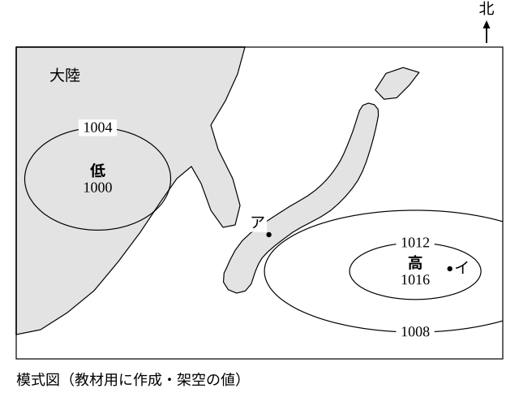
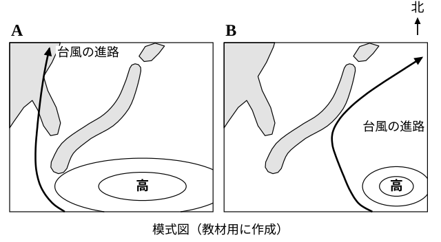
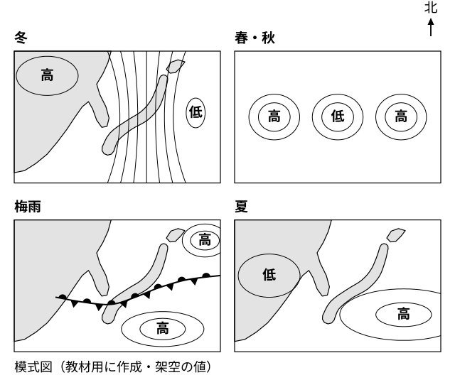

# レッスン10 夏の天気と台風の進路・四季のまとめ

- unit_id: jhs-sci-2-atmospheric-movement-japan-weather
- 位置づけ: 子単元 --japan-seasons（日本の季節の天気）。親単元の第10レッスン（1.5時間）。子単元「日本の季節の天気」の最終回であり、親単元の最終回。前半は、小笠原気団（暖かく湿った気団）の発達→南の海上に高気圧・大陸側に低気圧→南東の季節風・蒸し暑い晴れ、を組み立てる。中盤は、台風の進路が夏から秋にかけて変わることを、小笠原気団の張り出しの発達・衰退と結び付けて学ぶ。最後に、四季の気圧配置を1枚の地図にまとめて「気団の発達・衰退→季節の気圧配置→天気」の1行で親単元を閉じる。転移問題（見たことのない配置から季節風の向きを推測する）を置く。
- distribution_status: published_draft
- license: CC-BY-4.0
- verify_required: V1（模式天気図・気圧値・地点・台風の進路の模式はすべて教材用の架空。実在の年・台風・観測値ではない）／V2（「太平洋高気圧」「南高北低」は教科書側の語。本文は「教科書では〜と呼びます」の水準で太字なし。太字導入の可否は監修判断）／V3（小笠原気団＝高温で湿潤、は学習指導要領解説の例示と学力調査の表記に依るが、固有値として確定扱いしない）／V4（低気圧の東側・高気圧の西側で南東の風、という読みはレッスン2の教材内の約束に依る。夏の季節風が南東である向きは監修で確認）／V9（風向は8方位・気団の性質は2つの軸の組で答える指示を毎問明示）。「台風は高気圧の縁を回るように進み、秋には偏西風に流されて北東へ向かう」の説明は、解説の「台風の進路が小笠原気団の発達や衰退と密接に関わっている」を教科書標準の言い方で補ったもので、監修確認対象。台風の説明文「日本のはるか南の熱帯の海上で発生する低気圧のうち、風がとくに強く発達したもので、多くは日本の方へ北上してくる」も教科書標準の言い方で（風速の基準の数値と対象の海域は書かない）、監修確認対象。台風の発生のしくみ・災害は扱わない。全記述は監修者（理科担当）検証必須。
- 主概念: ①小笠原気団（暖かく湿った気団）の発達→南の海上に高気圧・大陸側に低気圧→南東の季節風・蒸し暑い晴れ（型名「南高北低」は機構の後に添える） ②台風の進路は夏から秋にかけて変わり、小笠原気団の張り出しの発達・衰退と密接に関わる／四季の気圧配置は「どの気団が発達しているか」で1枚にまとまる

---

## ここで学ぶこと

レッスン7〜9で、季節風の3段のしくみ、冬の天気、春・秋と梅雨の天気を学びました。今日は**夏**です。レッスン9の発展問題で考えたとおり、南の海上の気団の勢力が強まって前線が北へ押し上げられると、日本は南の気団におおわれます。この気団が**小笠原気団**（おがさわらきだん）です。今日いちばん大事なことは、小笠原気団を「暑い気団」とだけ覚えないこと。小笠原気団は南の**海の上**でできるので、**暖かく、そして湿った**気団です。日本の夏が「蒸し暑い」のは、この「湿った」があるからです。次に、**台風**の進路が夏から秋にかけて変わることを、小笠原気団の高気圧の張り出しが発達したり衰退したりすることと結び付けて学びます。最後に、この4回で学んだ四季の気圧配置を1枚の地図にまとめて、この単元を閉じます。まとめの合言葉は「どの気団が発達しているか→どんな気圧配置か→どんな天気か」です。

## 小笠原気団の発達と夏の気圧配置

夏、日本の南の海上（小笠原諸島の方面）では、南の方の海の上で気団が発達します。

> 【ことば】**小笠原気団** 夏に日本の南の海上で発達する気団。南の方の海の上でできるので、**暖かく湿った**気団である。小笠原気団の発達・衰退は、夏の天気と台風の進路に密接に関わっている。

小笠原気団が発達すると、南の海上に大きな高気圧ができ、日本の南から南東の海上に広く張り出します（教科書では、この高気圧を太平洋高気圧と呼びます。この教材で「小笠原気団の高気圧」と言うのは、この高気圧のことです）。一方、レッスン7の3段のとおり、夏は陸（大陸）の方が海洋より暖かいので、大陸側の地表付近は海洋とくらべて気圧が低くなります（夏に典型的な配置では、南の海上の高気圧に対して大陸側に低気圧があります）。風は南の海上の高気圧から大陸側の低気圧へ向かって吹き、日本付近では**南東の季節風**になります。この風は暖かく湿った気団の中を通ってくるので蒸し暑く、日本の広い範囲が高気圧におおわれる（高気圧の中心付近は下降気流で晴れやすい——レッスン2）ので、晴れの日が多くなります。

> **注意**：下の図1は、この教材の練習用に作った**模式天気図**（架空）です。北が上です。等圧線の値、高気圧・低気圧の中心の位置、地点ア・イの位置はすべて架空で、日本列島も簡略な形でかいてあります。実際の日付の天気図ではありません。風向の矢印と季節の名前は図に入れてありません。

図1の読み方は次のとおりです。

1. 日本の**南から南東の海上**に、東西に長くのびた高気圧があります。中心の値は1016hPaで、中心は地点ア（日本の町）から見てほぼ東（やや南）にあります。等圧線が日本の南の海上を広くおおっているのが「張り出し」です。
2. **大陸側**に低気圧があります。中心の値は1000hPaで、中心は地点アから見てほぼ西（やや北）にあります。
3. 等圧線は4hPaごとです。冬の図（レッスン8）とちがって、等圧線の間隔は広めで、たてじまにはなっていません。
4. 地点アは日本の町、地点イは高気圧の中心付近の海上です。

図1で、地点アの風向を考えます。地点アは、低気圧の中心から見て**東側**、高気圧の中心から見て**西側**にあります。レッスン2の吹き方では、低気圧の東側の風向は南東、高気圧の西側の風向も南東です。どちらから考えても南東の風になり、レッスン7の「海（南東）から大陸へ＝南東の風」と一致します。

このように、**南の海上に高気圧、北の大陸側に低気圧**という夏の配置を、教科書では「南高北低」の気圧配置と呼びます。冬の「西高東低」と同じく、名前の前に「小笠原気団が発達して南の海上に高気圧、大陸側に低気圧」というしくみを言えるようにしておいてください。

:::guide
**暑いだけでは半分——小笠原気団の「湿った」を落とさない**

小笠原気団の性質を聞かれて「暑い（暖かい）気団」とだけ答える人が多いのですが、それは2つの軸のうちの1つしか言っていません（レッスン4）。小笠原気団は南の**海の上**でできます。海の上でできた気団は水蒸気を多く受け取っているので、**湿って**います。この「湿った」が、日本の夏の天気の説明には欠かせません。夏の暑さが「蒸し暑い」のは、暖かいだけでなく水蒸気が多いから。湿った空気が上昇すると雲ができやすいこと（湿度の単元・レッスン4）も、この「湿った」から説明できます。「暑くて湿った」「暖かく湿った」——気温の軸と水蒸気の軸を2つとも言う約束は、シベリア気団（冷たく乾いた）・梅雨の北の気団（冷たく湿った）・小笠原気団（暖かく湿った）の3つを区別するために作った約束でもあります。
:::

## 台風の進路——小笠原気団の張り出しが決める

**台風**は、日本のはるか南の熱帯の海上で発生する低気圧のうち、風がとくに強く発達したもので、多くは日本の方へ北上してきます。小学5年生で、台風が近づくと天気がどう変わるかを学びました。低気圧なので、まわりの風は反時計回りに中心へ吹きこみます（レッスン2）。この教材では、台風の発生のしくみは扱わず、**進路**が季節でどう変わるかだけを学びます。

台風の進路は、夏から秋にかけて変わります。台風の進路は、小笠原気団の発達や衰退と密接に関わっています。教科書では、次のように説明されます。

- 台風は、小笠原気団の高気圧の中には入りこみにくく、高気圧の**縁（ふち）を回るように**進むことが多い。
- **夏**（小笠原気団の張り出しが発達しているとき）は、高気圧が日本の南の海上を広くおおっているので、台風は高気圧の西の縁に沿って西寄りに進み、日本の西側を通って北上することが多い。
- **秋**（張り出しが衰退して東へ退くとき）は、高気圧の西の縁が東へ移るので、台風は日本の近く（すぐそば・東側）まで北上でき、上空の偏西風（レッスン3）に流されて北東へ向きを変えて進むことが多い。

> **注意**：下の図2は、この教材用に作った**模式図**です。高気圧の大きさと台風の進路の曲線は、しくみが見やすいように単純化してあり、実在の年の台風の進路や実際の位置を表すものではありません。パネルAとBのどちらが夏でどちらが秋かは、図に書いてありません。

図2の読み方は次のとおりです。

1. 2つのパネルとも北が上です。「高」は小笠原気団の高気圧で、曲線の矢印は台風の進路の模式です。
2. パネル**A**では高気圧が大きく西へ張り出し、台風は高気圧の西の縁を回るように、日本の西側を北上しています。
3. パネル**B**では高気圧が小さく東へ退き、台風は日本の近く（すぐそば・東側）まで北上して、北東へ向きを変えています。
4. どちらのパネルでも、台風は高気圧の**中には入らず、縁に沿って**進んでいます。ちがいは、高気圧の張り出し（大きさと位置）です。

:::guide
**偏西風が運ぶのは後半——先に「高気圧の縁を回る」を言う**

台風の進路を決めるものを聞かれて「偏西風」と答えるのは、半分だけ正しい答えです。秋の台風が日本付近で北東へ向きを変えるのは、たしかに偏西風に流されるからです。しかし、台風が日本の近くまで**北上できるかどうか**に大きく関わっているのが、小笠原気団の高気圧の張り出しです。夏のように張り出しが大きければ、台風は高気圧の縁を回って西寄りに進みやすく、日本の近く（すぐそば・東側）までは来にくくなります。張り出しが衰退して東へ退くと、台風は日本の近くまで北上して偏西風の流れに入り、北東へ向きを変えます。順番を決めておきましょう。①小笠原気団の高気圧の張り出しが、台風の進める道を決める。②北上できた台風が、偏西風に流されて北東へ向く。「偏西風」から答え始めると、①が抜けます。図2のAとBで変えてあるのは高気圧の張り出し（大きさと位置）だけで、偏西風は同じという前提でかいてあります。
:::

## まとめ——四季の気圧配置を1枚に

レッスン8〜10で見てきた季節ごとの模式天気図を、1枚にならべます。

> **注意**：下の図3は、レッスン8・9・10の模式天気図（いずれも教材用の架空）を縮めてならべた**まとめの図**です。実際の天気図ではありません。

| 時期 | 発達している気団（2つの軸） | 気圧配置 | 日本付近の風・天気 |
|---|---|---|---|
| 冬（レッスン8） | シベリア気団（冷たく乾いた） | 大陸に高気圧・海洋上に低気圧（教科書では西高東低）・等圧線はたてじま | 北西の季節風。日本海側は雪、太平洋側は乾いた晴れ |
| 春・秋（レッスン9） | 特定の気団が居すわらない | 移動性高気圧と温帯低気圧が交互に西から東へ通過 | 天気が数日の周期で変わる |
| 梅雨（レッスン9） | 北の海上の気団（冷たく湿った）と小笠原気団（暖かく湿った）の勢力がつり合う | 北と南の高気圧のあいだに、東西にのびる動かない前線（教科書では停滞前線） | 前線付近で雨やくもりの日が続く |
| 夏（レッスン10） | 小笠原気団（暖かく湿った） | 南の海上に高気圧・大陸側に低気圧（教科書では南高北低） | 南東の季節風。蒸し暑い晴れ。台風は高気圧の縁を回る |

4つの時期に共通する骨組みは、次の1行です。

> **気団が発達したり衰退したりする→季節に特徴的な気圧配置ができる→その配置が風と天気を決める**。

模式天気図を見て季節を判定するときは、この1行を逆にたどります。①高気圧と低気圧はどこにあるか、等圧線はどんな形か（配置）→②その配置を作っているのはどの気団か→③配置から風向を、気団の性質と風の通り道（海の上を通るか・山を越えるか・前線付近か）から天気を読む。レッスン8の見分け方の手順（高・低の位置と等圧線の形を見る）を、四季の判定の入り口として使います。

:::guide
**四季を「4つの絵」でなく「1つの問い」で覚える**

四季の天気図を4枚の絵として丸ごと覚えようとすると、テストの直前に絵どうしが混ざります。おすすめは、4枚を1つの問い——「いま、どの気団が発達しているか」——の答えとして見ることです。シベリア気団が発達していれば大陸に高気圧、小笠原気団が発達していれば南の海上に高気圧、2つの気団がつり合っていれば東西にのびる前線、どの気団も居すわらなければ高気圧と低気圧が交互に通る。気団の性質（2つの軸）に、配置から読んだ風向と、風が海の上を通るか山を越えるか（レッスン8）を合わせれば、雪か、乾いた晴れか、蒸し暑いかまで説明できます。配置と天気を別々に覚えるのではなく「気団→配置→天気」の1本の線でつなぐ——この線が、この単元10回分の背骨です。
:::

## 例題

**例題1**　小笠原気団の性質を「冷たい／暖かい」と「乾いた／湿った」の2つの軸の組で答えなさい。また、そうなる理由を「南」「海」の2つの言葉を使って一文で書きなさい。

**考え方**　①南の方でできた→気温の軸は「暖かい」。②海の上でできた→水蒸気の軸は「湿った」。③2つをセットで言う。→ **暖かく湿った気団。南の方の海の上でできるので、暖かく、海から水蒸気を多く受け取って湿っているから**

**例題2**　図2のパネルAとパネルBのうち、秋のようすを表しているのはどちらか。理由を「張り出し」という言葉を使って一文で書きなさい。

**考え方**　①秋は小笠原気団が衰退し、高気圧の張り出しが東へ退く。②高気圧が小さく東へ退いているのはパネルB。③そのとき台風は日本の近くまで北上して北東へ向きを変えている（Bの進路の形と合う）。→ **パネルB。秋は小笠原気団の高気圧の張り出しが衰退して東へ退くので、高気圧が小さくかかれているBが秋だと考えられるから**

## 読み取りのコツ

- **気団の性質は必ず2つの軸で**。小笠原気団は「暖かく湿った」。「暑い」だけの答えは半分です。
- **夏の風向も、2つの中心の両方から確かめる**（レッスン3・8のコツ）。低気圧の東側＝南東、高気圧の西側＝南東。
- **台風の進路は「高気圧の縁」から言う**。①張り出しの大きさが進める道を決める→②北上できれば偏西風で北東へ。偏西風だけの説明は後半しか言っていません。
- **季節判定は配置→気団→天気の順**。この教材の4つの模式図では「大陸に高・海洋上に低」なら冬。「南の海上に高・大陸側に低」なら夏。「東西にのびる動かない前線」なら梅雨。「高と低が交互」なら春・秋。

## 練習問題

以下すべて、上の図1〜図3（この教材用の**架空の模式天気図・模式図**）と本文のしくみを使うこと。風向は8方位で、気団の性質は「冷たい／暖かい」「乾いた／湿った」の2つの軸の組で答えること。

1. 図1で、高気圧の中心と低気圧の中心は、それぞれ「南の海上」「大陸側」のどちらにあるか答えなさい。また、この高気圧を作っている気団の名前と、その性質を2つの軸の組で答えなさい。
2. 図1で、地点ア（日本の町）の風向を8方位で答えなさい。低気圧の中心と高気圧の中心のどちらから考えたかも書きなさい。
3. ある生徒が「小笠原気団は南でできるから、暑くて乾いた気団だ」と言った。どこがまちがっているか「海」「2つの軸」の2つの言葉を使って一文で指摘しなさい。
4. 図2で、夏のようすを表しているのはパネルA・Bのどちらか答えなさい。また、夏から秋にかけて台風の進路がどう変わるかを「張り出し」「縁」の2つの言葉を使って一文で書きなさい。
5. （転移問題＝学んだことを新しい場面に使う問題。答えだけでなく根拠を書くこと）架空の国Xは、大きな大陸の北東のはしにあり、大陸はこの国から見て**南西**に、海はこの国から見て**北東**に広がっているとする。この国の冬に吹く季節風の風向を、レッスン7の3段のとおり風が大陸から海へまっすぐ向かうものとして、8方位で答えなさい。また、その根拠を、レッスン7の3段（①温度差→②気圧差→③風）の順に、各段一文ずつ、合計三文で書きなさい（①では「冷めやすい」を、②では「気圧」を、③では「高い方から低い方へ」を使うこと）。

:::stretch
**S1** ある生徒が「秋の台風が日本付近で北東へ進むのは、偏西風に流されるからだ」と説明した。この説明は正しいが、台風の進路を決めるものとしては足りない部分がある。何が足りないかを「小笠原気団」「張り出し」の2つの言葉を使って一文で書きなさい。また、図2のパネルAで台風が日本の近く（日本のすぐそば・日本の東側）まで来られない理由を「縁」という言葉を使って一文で書きなさい。
:::

:::zatsudan
小学5年生のとき、台風が近づくにつれて天気がどう変わるかを学びました。あのときは「台風が来ると天気が変わる」という結びつきを学んだのですが、今日は「台風がどの道を進むか」が季節によってちがうこと、そしてその道に小笠原気団の高気圧の張り出しが密接に関わっていることを学びました。夏の台風と秋の台風で進路の形がちがうと気付けるのは、この単元で「気団の発達・衰退→気圧配置」という見方を手に入れたからです。同じ「台風」という言葉でも、学年が上がると見える層が1つ深くなる——理科の学びは、こういう積み重ねでできています。
:::
<!-- zatsudan話題源: 雑談枠許可リストZ8（中学校学習指導要領（平成29年告示）解説 理科編 p.96「台風の進路が夏から秋にかけて変化していることに気付かせ，台風の進路が小笠原気団の発達や衰退と密接に関わっている」および小学校第5学年の既習「台風による天気の変化」・確認範囲内。レッスン6の雑談〔小5既習の視点〕とは角度を変え、進路の季節変化を主題にした）。出典の確認範囲内の事実のみ使用・数値なし。災害の話題は置いていない -->

<!-- gen_nav:nav:start（自動生成・手編集しない） -->

---

[← 前のレッスン](lesson_09.md)｜[単元の目次](README.md)｜[解答](answer_key_L07-10.md)

<!-- gen_nav:nav:end -->
